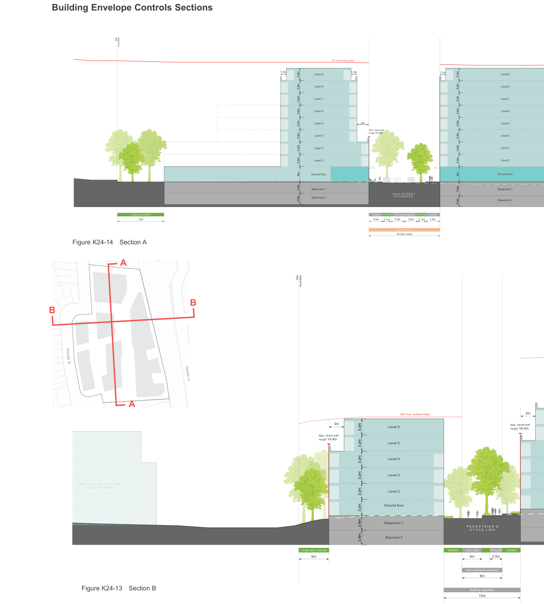
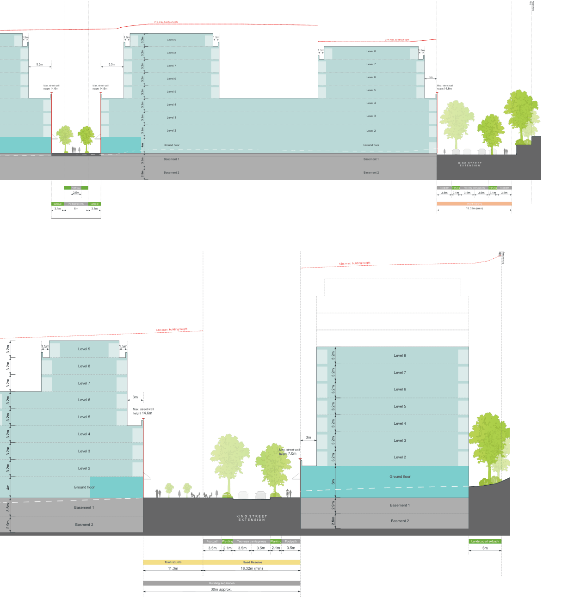
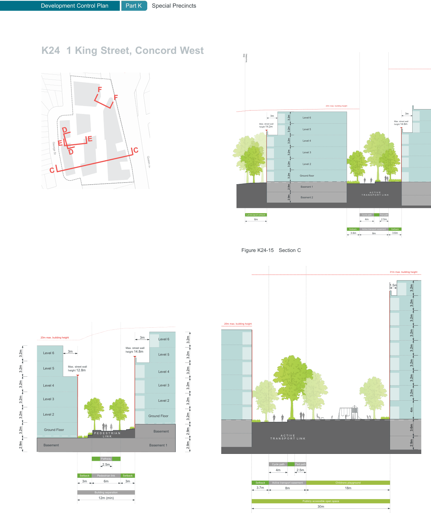

### K24  1 King Street, Concord West

> [Picture on page 465: a map, saved as a picture (images/part-k-special-precincts-page-465-2.gif, 150 dpi); the street names and other small labels are on the picture.]
> Labels printed on the map (copied from the PDF, in no particular order):
> Site · boundary · Landscaped setback · 12m · Figure K24-14 Section A · A · B · B · George St · Queen St · A · I N D I C A T I V E F U T U R E · B U I L T F O R M · Figure K24-13 Section B · 31m max. building height · 1.5m · 1.5m · 1.5m · Level 9 · Level 9 · Level 8 · Level 8 · Level 7 · Level 7 · Level 6 · Level 6 · 3m · Level 5 · Level 5 · Max. street wall · height 11.4m · Level 4 · Level 4 · Level 3 · Level 3 · Level 2 · Level 2 · Ground floor · Ground floor · Basement 1 · Basement 1 · K I N G S T R E E T · E X T E N S I O N · Basement 2 · 3.2m · 3.2m · 3.2m · 3.2m · 3.2m · 3.2m · 3.2m · 3.2m · 4m · 2.9m · 2.9m · Basement 2 · 3.2m · 3.2m · 3.2m · 3.2m · 3.2m · 3.2m · 3.2m · 3.2m · 4m · 3.6m · 2.9m · Footpath · Footpath · Parking · Parking Two-way carriageway · 3.5m · 2.1m · 3.5m 3.5m · 2.1m · 3.5m · Road Reserve · 18.32m (min) · Site · boundary · 3m · 20m max. building height · 3m · Level 6 · Max. street wall · height 16.0m · Max. street wall · height 14.4m · Level 5 · Level 4 · Level 3 · Level 2 · Ground floor · Basement 1 · P E D E S T R I A N & · C Y C L E L I N K · Basment 2 · 3.2m · 3.2m · 3.2m · 3.2m · 3.2m · 3.2m · 2.9m · 2.9m · Landscaped setback · Cycle path Setback · Setback Ped path · 2.5m · 4m · 6m · Active transport easement · 8m · Building separation · 15m

#### Building Envelope Controls Sections

Development Control Plan

Part K

Special Precincts

> [Picture on page 466: a map, saved as a picture (images/part-k-special-precincts-page-466-4.gif, 150 dpi); the street names and other small labels are on the picture.]
> Labels printed on the map (copied from the PDF, in no particular order):
> 1.5m · 5.5m · Max. street wall · height 14.6m · Setback · 3.1m · 31m max. building height · 1.5m Level 9 · Level 8 · 5.5m · Level 7 · Level 6 · Max. street wall · height 14.6m · Level 5 · Level 4 · Level 3 · Level 2 · Ground floor · Basement 1 · Basement 2 · 3.2m · 3.2m · 3.2m · 3.2m · 3.2m · 3.2m · 3.2m · 3.2m · 4m · 3.6m · 2.9m · Pathway · 2.5m · Pedestrian link Setback · 3.1m · 6m · 1.5m · 1.5m · 27m max. building height · Level 8 · Level 7 · Level 6 · Level 5 · Level 4 · Level 3 · Level 2 · Ground floor · Basement 1 · Basement 2 · Site · boundary · 1.5m · 3m · Max. street wall · height 14.6m · K I N G S T R E E T · E X T E N S I O N · Footpath · Footpath · Parking · Parking Two-way carriageway · 3.5m · 2.1m · 3.5m 3.5m · 2.1m · 3.5m · Road Reserve · 18.32m (min)

> Labels printed on the map (copied from the PDF, in no particular order):
> 1.5m · 3.2m · 3.2m · 3.2m · 3.2m · 3.2m · 3.2m · 3.2m · 4m · 3.6m · 2.9m · 3.2m · 31m max. building height · 1.5m · Level 9 · Level 8 · Level 7 · 3m · Level 6 · Max. street wall · height 14.6m · Level 5 · Level 4 · Level 3 · Level 2 · Ground floor · Basement 1 · Basment 2 · Town square · 11.3m · 3m · Max. street wall · height 7.0m · K I N G S T R E E T · E X T E N S I O N · Footpath · Footpath · Planting · Planting Two-way carriageway · 3.5m · 2.1m · 3.5m 3.5m · 2.1m · 3.5m · Road Reserve · 18.32m (min) · Building separation · 30m approx. · 42m max. building height · Level 8 · Level 7 · Level 6 · Level 5 · Level 4 · Level 3 · Level 2 · Ground floor · Basement 1 · Basment 2 · 3.2m · 3.2m · 3.2m · 3.2m · 3.2m · 3.2m · 3.2m · 6m · 2.9m · 2.9m · Site · boundary · Landscaped setback · 6m

> [Picture on page 467: a map, saved as a picture (images/part-k-special-precincts-page-467-1.gif, 150 dpi); the street names and other small labels are on the picture.]
> Labels printed on the map (copied from the PDF, in no particular order):
> F · F · D · E · E · George St · C · D · Queen St · C · 20m max. building height · 3m Level 6 · 3m · Max. street wall · height 14.8m · Level 6 · Level 5 · Level 5 · Max. street wall · height 12.8m · Level 4 · Level 3 · Level 4 · Level 3 · Level 2 · Level 2 · Ground Floor · Ground Floor · Basement · 3.2m · 3.2m · 3.2m · 3.2m · 3.2m · 3.2m · P E D E S T R I A N · L I N K · Basement · Basement 1 · 2.9m · 3.2m · 3.2m · 3.2m · 3.2m · 3.2m · 3.2m · 2.9m · 2.9m · Pathway · 2.5m · Pedestrian link · Setback · Setback · 3m · 3m · 6m · Building separation · 12m (min) · Site · boundary · 20m max. building height · 3m · 3m Level 6 · Max. street wall · height 14.6m · Max. street wall · height 14.2m · Level 5 · Level 4 · Level 3 · Level 2 · Ground floor · Basement 1 · Basment 1 · 2.9m · A C T I V E · T R A N S P O R T L I N K · Basment 2 · 3.2m · 3.2m · 3.2m · 3.2m · 3.2m · 3.2m · 2.9m · 2.9m · Cycle path Ped path · Landscaped setback · 2.5m · 4m · 6m · Setback Active transport easement Setback · 3.6m · 3.6m 8m · Figure K24-15 Section C · 31m max. building height · 1.5m · 20m max. building height · A C T I V E · T R A N S P O R T L I N K · 3.6m · 2.9m · 3.2m · 3.2m · 3.2m · 3.2m · 3.2m · 3.2m · 3.2m · 3.2m · 4m · Cycle path Ped path · 2.5m · 4m · Childrens playground · Setback Active transport easement · 3.7m · 18m · 8m · Publicly accessible open space · 30m
