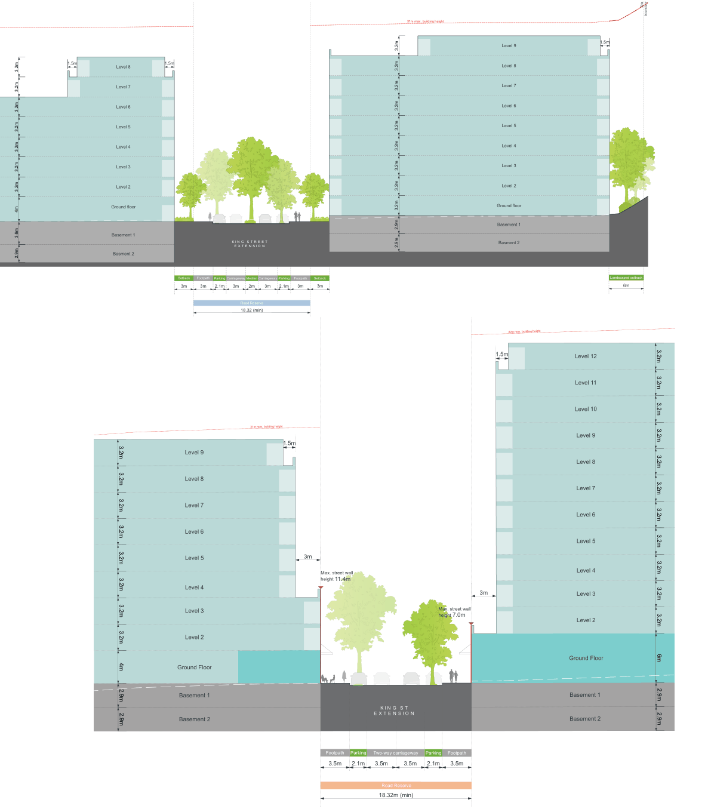

### K24  1 King Street, Concord West

Figure K24-16 Section D

Figure K24-17 Section E

3.6m

2.9m

3.2m

3.2m

3.2m

3.2m

3.2m

3.2m

3.2m

4m

> [Picture on page 468: a map, saved as a picture (images/part-k-special-precincts-page-468-11.gif, 150 dpi); the street names and other small labels are on the picture.]
> Labels printed on the map (copied from the PDF, in no particular order):
> 31m max. building height · Level 9 · 1.5m · 1.5m · Level 8 · Level 8 · Level 7 · Level 7 · Level 6 · Level 6 · Level 5 · Level 5 · Level 4 · Level 4 · Level 3 · Level 3 · Level 2 · Level 2 · Ground floor · Ground floor · 3.2m · Basement 1 · Basement 1 · K I N G S T R E E T · Basment 2 · 2.9m · 2.9m · 3.2m · 3.2m · 3.2m · 3.2m · 3.2m · 3.2m · 3.2m · 3.2m · E X T E N S I O N · Basment 2 · Carriageway · Setback · Setback · Footpath · Footpath · Parking Median Carriageway Parking · 3m · 2m 2.1m · 3m 3m · 2.1m · 3m · 3m · 3m · Road Reserve · 18.32 (min) · 42m max. building height · 1.5m · 31m max. building height · 1.5m · Level 9 · Level 8 · Level 7 · Level 6 · 3m · Level 5 · Max. street wall · height 11.4m · Level 4 · 3m · Level 3 · Max. street wall · height 7.0m · Level 2 · Ground Floor · 3.2m · 3.2m · 3.2m · 3.2m · 3.2m · 3.2m · 3.2m · 3.2m · 4m · Basement · Basement 1 · K I N G S T · E X T E N S I O N · Basement 2 · 2.9m · 2.9m · Parking Two-way carriageway Parking · Footpath · Footpath · 3.5m · 3.5m · 2.1m · 3.5m 3.5m · 2.1m · Road Reserve · 18.32m (min) · Site · boundary · 1.5m · Landscaped setback · 6m · Level 12 · Level 11 · Level 10 · Level 9 · Level 8 · Level 7 · Level 6 · Level 5 · Level 4 · Level 3 · Level 2 · Ground Floor · 3.2m · 3.2m · 3.2m · 3.2m · 3.2m · 3.2m · 3.2m · 3.2m · 6m · 3.2m · 3.2m · 3.2m · Basement 1 · Basement 2 · 2.9m · 2.9m

Figure K24-18 Section F
