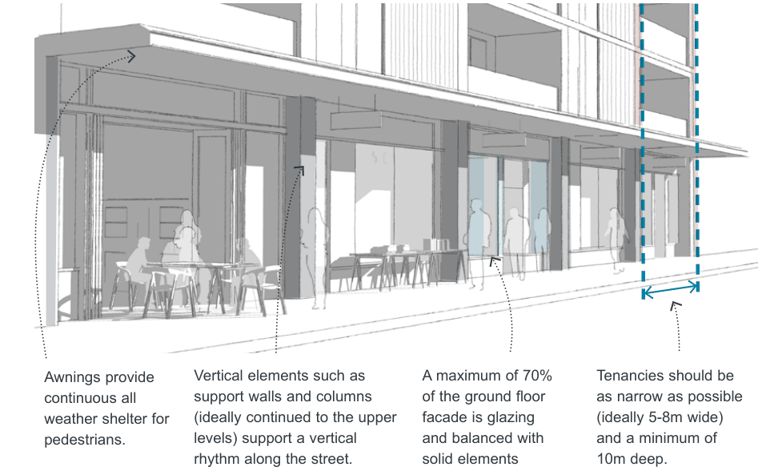

### K24  1 King Street, Concord West

#### K24.5 Appearance

#### Objectives

O20 To ensure building exteriors positively contribute to the streetscape and the desired future character of the area.

O21 To add visual quality and interest to new buildings, with a focus on breaking up massing of higher density forms when viewed from the public domain, publicly accessible places and neighbouring properties.

| Controls |  |
|---|---|
| C28. | To achieve diversity and interest, architectural expression, details and materials of each building should be varied and present overall as a group of buildings rather than one building designed by a single designer or company. |
| C29. | New development is to place particular focus on creating a 'human scale' at the lower levels through the use of detailed design, insets and projections that create interest and, where relevant, the appearance of finer grain along the street. |
| C30. | External walls are constructed of high quality and durable materials and finishes with low maintenance attributes (‘self-cleaning’) such as face brickwork, rendered brickwork, stone, concrete and glass. |
| C31. | The composition of facades is to balance solid and void elements and not use large areas of a single material, including glass. |
| C32. | Roof plant, lift overruns, utilities, vents and other service related elements are to be integrated into the built form design and complementary to the architecture of the building. |
| C33. | Buildings on corners are to address both streets and architectural elements are to be composed so that they 'turn the corner'. |

#### K24.6 Ground Floor Residential Interfaces

#### Objectives

O22 To ensure residential dwellings on the ground level have a high level of amenity and create a positive interface with the street.

O23 To maximise opportunities for passive surveillance of the public domain and enhance public safety and security.

#### Controls

| C34. | Ground floor dwelling units facing the street and public domain are to have individual entries from the street. |
|---|---|
| C35. | Except for accessible units, residential uses on the ground floor should be raised between 0.4m-1.0m above ground level to improve internal privacy of residents and passive surveillance. |
| C36. | Underground parking areas are to protrude no more than 1m above the level of the footpath or adjacent public domain and are to: • be integrated into the landscape and building design; |

• not have car ventilation grills on the street frontage unless screened by landscaping in a garden bed with a minimum plan depth of 1m; and

• have any ground floor car parking areas sleeved with uses fronting the street.

#### K24.7 Active Frontages

#### Objectives

O24 To create engaging and vibrant active non-residential frontages and provide interest and variety along the street.

O25 To focus active frontages around the central town square and close to the station.

> [Picture on page 470: a picture, saved as a picture (images/part-k-special-precincts-page-470-8.gif, 150 dpi).]

Awnings provide continuous all weather shelter for pedestrians.

Vertical elements such as support walls and columns (ideally continued to the upper levels) support a vertical rhythm along the street.

| Controls |  |
|---|---|
| C37. | Ground level active uses must be provided along 'Active frontages' as identified in Figure K24-10. |
| C38. | Along active frontages: • continuous awnings must be provided to shelter pedestrians from weather; • tenancies must be a minimum of 10m deep; • shop entries are to be level with the footpath. Where this is not possible entries are to be a maximum of 0.35m above the footpath level. Shop entries cannot be below the street level; and • The design guidance shown in Figure K24-19 must be applied. |
| C39. | Ground floor tenancies along active frontages should be no more than 8m wide to provide variety and interest along the street. |

A maximum of 70% of the ground floor facade is glazing and balanced with solid elements

Tenancies should be as narrow as possible (ideally 5-8m wide) and a minimum of 10m deep.

Figure K24-19 Design guidance for active frontages
