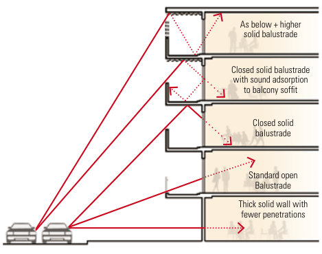
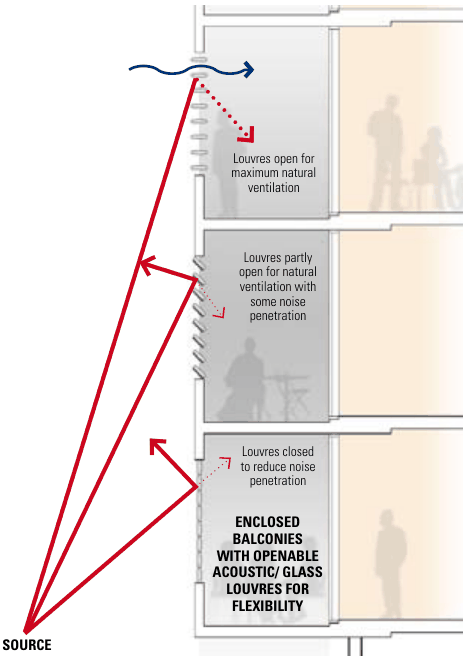

### K24  1 King Street, Concord West

#### K24.8 Amenity

#### Objectives

O26 To minimise the impact of new development on the outlook, privacy and sun access of adjoining properties.

O27 To minimise overshadowing of streets, links and public open spaces.

O28 To protect building users from negative impacts (noise, air quality, vibration) from the rail line.

#### Controls

C40. Siting and built form configuration optimises solar access within the development and minimises overshadowing of adjoining properties.

C41. Development near the rail line is to consider the provisions of the State Environmental Planning Policy (Transport and Infrastructure) 2021 and Development Near Rail Corridors and Busy Roads Interim Guidelines and the design approaches illustrated in Figure K24-20.

Where balconies are required, solid balustrades with sound absorption material added to the underside of balconies above is a good means of reducing noise entering the building.

Providing enclosed balconies (or winter gardens) is another means of reducing the noise entering a building. Where enclosed balconies are used ventilation may need to be considered. By installing acoustic louvres ventilation requirements and reduced noise can be addressed. These approaches are shown in figure 3.16.

> [Picture on page 471: a map, saved as a picture (images/part-k-special-precincts-page-471-34.gif, 150 dpi); the street names and other small labels are on the picture.]
> Labels printed on the map (copied from the PDF, in no particular order):
> As below + higher · figure 3.15: Balcony treatments · which reduce traffic noise · intrusion · solid balustrade · Closed solid balustrade · with sound adsorption · to balcony soffit · Closed solid · balustrade · Standard open · Balustrade · Thick solid wall with · fewer penetrations

Figure K24-20 Noise mitigating facade treatments

#### Controls

| C42. | For residential components of new development, noise sensitive areas (living rooms, bedrooms) are located away from the rail line. |
|---|---|
| C43. | Windows located near the rail line are to be appropriately acoustically treated (eg. double-glazed, laminated glazing, acoustic seals). |
| C44. | Habitable rooms of dwellings (excluding balconies) are to be designed to achieve the following internal noise levels: |

1\) bedrooms: a maximum of 35 dB(A) at any time between 10:00pm and 7:00am

2\) elsewhere in the apartment (other than a garage, kitchen, bathroom or hallway): a maximum of 40dB(A) at any time.

> [Picture on page 471: a map, saved as a picture (images/part-k-special-precincts-page-471-43.gif, 150 dpi); the street names and other small labels are on the picture.]
> Labels printed on the map (copied from the PDF, in no particular order):
> figure 3.16: Enclosable · balconies facing the · Louvres open for · maximum natural · ventilation · Louvres partly · open for natural · ventilation with · some noise · penetration · Louvres closed · to reduce noise · penetration · ENCLOSED · BALCONIES · WITH OPENABLE · ACOUSTIC/ GLASS · LOUVRES FOR · FLEXIBILITY

road

#### SOURCE

(Source: Development Near Rail Corridors And Busy Roads Interim Guideline, NSW)

#### K24.9 Diversity of Uses

#### Objectives

O29 To provide a mix of apartment types and sizes that encourage and facilitate a diverse community from different social backgrounds.

O30 To increase jobs and skills (employment generation) on the site through the provision of adaptable retail and commercial spaces.

O31 To include uses that serve the population related needs of the Canada Bay community.

#### Housing Mix and Affordable Housing

| Controls |  |
|---|---|
| C45. | Dwelling mix is to be provided in accordance with the Canada Bay Local Environmental Plan 2013. |
| C46. | Dwellings dedicated to Affordable Housing are to be of equivalent design quality, diversity and mix as all other dwellings. |
| C47. | Affordable housing is to be providing in accordance with the Canada Bay Local Environmental Plan 2013 and the requirements of the Canada Bay Affordable Housing Contribution Scheme. |
| C48. | Ground floor apartments and terrace style typologies on the lower floors of apartment buildings facing streets and open spaces are encouraged. |
| C49. | Residential typologies should feature inclusive designs that cater for young families with children, the elderly and people with disabilities. |

#### Commercial and Retail Uses

| Controls |  |
|---|---|
| C50. | The minimum amunt of non-residential uses across the site is 3,500m2, and the maximum is 5,000m2 Gross Floor Area in general accordance with Figure K24-10. |
| C51. | Social and community uses, such as a childcare centre or community meeting space and/or gyms are encouraged within the non-residential floor areas. |
