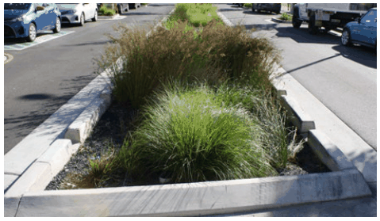

### K24  1 King Street, Concord West

#### K24.10 Sustainability & Performance

#### Objectives

O32 To achieve world leading practice in design, construction and operation to deliver on sustainability outcomes, targeting a net positive environmental impact.

O33 To mitigate the impacts of climate change on key infrastructure and assets.

> [Picture on page 473: a picture, saved as a picture (images/part-k-special-precincts-page-473-10.gif, 150 dpi).]

All new streets and pedestrian/ cycle links should implement water sensitive urban design treatments (WSUD).

| Controls |  |
|---|---|
| C52. | All new development is to achieve the 'Performance Objectives' identified in Figure K24-38. |
| C53. | The development is to achieve beyond the baseline compliance requirements set by BASIX through the following key interventions: • efficient appliances and improved thermal design; • avoid natural gas in all residential development and provide appliances that can be powered by renewable energy sources such as; – electric heat pumps for hot water, – induction cooktops, – electric heating and cooling e.g. efficient air-conditioners with low GWP (Global Warming Potential); • solar photovoltaic and battery ready facilities; • recycled water infrastructure; • green facade treatment for cooler dwellings; and • access to car share facilities best practice parking measures including provision of EV charging and smart metering systems for all parking spaces (see also part B3.8 Electric Vehicles of CCB DCP). |
| C54. | All new streets should accommodate stormwater flows and implement Water Sensitive Urban Design (WSUD) treatments to the satisfaction of Council. |

| Basis | Response |
|---|---|
| Sustainable Buildings SEPP | • Average 7 star NatHERS \| minimum 6 star NatHERS • BASIX Energy 62 (BASIX Higher Standards) • BASIX Materials Index |
| PRCUTS Sustainability Implementation Plan | • BASIX Water 50 • 5.5 star NABERS Energy for Apartment Buildings • 5.5 star NABERS Water for Apartment Buildings • Energy infrastructure |
| Green Star Buildings | • Credible reductions in upfront carbon and energy use • Fossil fuel-free • 100% renewable energy • High impact refrigerants are eliminated, where possible • 80-90% diversion of construction and demolition waste from landfi ll |
| Nature-based Solutions | • 30% urban tree canopy • Increase biodiversity with a high proportion of indigenous planting (+60%) and a signifi cant nesting tree per 500m2 of landscaped area |

Figure K24-21 Performance Objectives (Mott MacDonald, March 2024)
