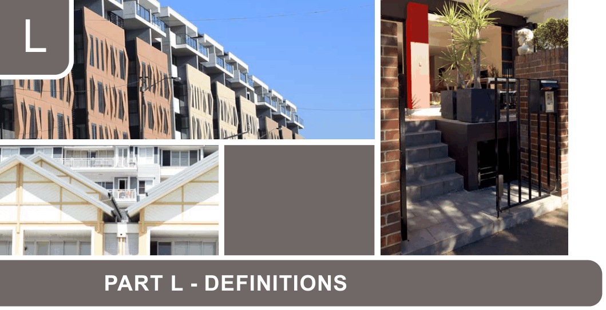

# Canada Bay Development Control Plan - Part L Definitions

Source PDF: [ECM_7719486_v3_CCB-DCP-13_Part-L-Definitions_v2022-05-16.pdf](ECM_7719486_v3_CCB-DCP-13_Part-L-Definitions_v2022-05-16.pdf)

> [Picture on page 1: a picture, saved as a picture (images/part-l-definitions-page-1-1.gif, 150 dpi).]

### L

### PART L - DEFINITIONS

### Definitions

Note: For additional definitions please refer to the Canada Bay Local Environmental Plan.

#### Acid sulfate soils

Note: Refer to the Canada Bay Local Environmental Plan for definition.

#### Advanced tree

An advanced tree is one with a root ball of 90 litres (or larger), which is at least 2 metres in height and 2 years of age.  Trees with a 25 litre root ball will be accepted in lieu of trees with a root ball of 90 litres, when local native trees are selected.

#### Ancillary development/structures

Ancillary development or ancillary structures are group terms used to encapsulate a variety of minor subordinate development such as:

a) access ramp,

b) awning, blind or canopy,

c) balcony, deck, patio, pergola, terrace or verandah that is attached to a dwelling house,

d) basement,

e) carport that is attached to a dwelling house,

f) detached studio,

g) driveway, hard stand space, pathway or paving,

h) fence or screen,

i) garage that is attached to a dwelling house,

j) outbuilding,

k) rainwater tank that is attached to a dwelling house,

l) retaining wall,

m) swimming pool or spa pool and child-resistant barrier.

#### Annual exceedance probability (AEP)

The chance of a flood of a given or larger size occurring in any one year, usually expressed as a percentage.

#### Arborist report

A report (including photographic evidence) prepared by a suitably qualified arborist to ascertain the Safe Useful Life Expectancy (SULE) of the tree and/or whether the tree presents an unacceptable level of risk that pruning will not resolve.

#### Articulation zone

Articulation zone means an area of a lot forward of the building line within which building elements are permitted to be located, being an area measured from:

a) one side boundary of the lot to the opposite side boundary of the lot, or

b) if the lot is a corner lot—the secondary road boundary of the lot to the boundary opposite the secondary road boundary.

#### Attic

Note: Refer to the Canada Bay Local Environmental Plan for definition.

#### Basement

Note: Refer to the Canada Bay Local Environmental Plan for definition.

#### Bicycle Parking Facility

Bicycle parking facility - is an area reserved or designed for short term parking of one or more bicycles. It includes a device to which the bicycle frame and wheels can be locked. It is mostly used by visitors to the development at which it is provided.

#### Bicycle Storage Facility

Bicycle storage facility - is an area reserved or designed for long term parking of one or more bicycles. It is usually enclosed to provide security. It is mostly used by employees or residents of the development at which it is provided.

#### Biodiversity corridor

Defined in Figure B6.8 to Figure B6.14, encompassing all land contained within the green markings in the figures.

#### Building Envelope

Building envelope - means the three-dimensional space within which a building is to be confined.

#### Building Footprint

Building footprint - means the area of land measured at finished ground level which is enclosed by the external walls of a building

#### Building Height (or height of building)

Note: Refer to the Canada Bay Local Environmental Plan for definition.

#### Building height plane

Building height plane - means a plane projected at an angle of 45o over the actual land to be built upon from a vertical distance of 5.0 metres above ground level at the side boundaries of the site.

#### Building identification signs

Note: Refer to the Canada Bay Local Environmental Plan for definition.

#### Building line or setback

Note: Refer to the Canada Bay Local Environmental Plan for definition.

#### Business identification sign

Note: Refer to the Canada Bay Local Environmental Plan for definition.

#### Canopy

The uppermost branches of a tree, forming a more or less continuous layer of foliage.

#### Canopy cover

The proportion of land area occupied by the tree's canopy when visualised from directly above.

#### Canopy Spread

The diameter of a tree’s canopy.

#### Canopy tree

A tree that is capable of forming a canopy that contributes to the urban forest and total canopy cover of an area. A canopy tree is categorised as possessing the following characteristics at maturity:

a) Small: Minimum 6-8 metres height and minimum canopy diameter of 2 metres

b) Medium: Minimum 8-12 metres height and minimum canopy diameter of 4 metres

c) Large: Minimum 12+ metres height and minimum canopy diameter of 6 metres

#### Ceiling Height

Ceiling height - in relation to buildings means the greatest distance measured vertically from the ceiling of the upper most habitable room, or in the case of raked or cathedral ceilings a line projected from associated ceilings, to the existing ground level, or the lowest habitable floor immediately below that point, whether or not at natural ground level, excluding chimneys, attic rooms, and non-habitable rooms which are entirely below natural ground level and have no visible external elevation whatsoever.

#### Child Care Centre

Note: Refer to the Canada Bay Local Environmental Plan for definition.

#### Co-located facilities

Co-located facilities – means one or more facilities on or within an original facility or a public utility structure.

#### Co-Siting

Co-siting – means the siting of a number of telecommunication facilities, often owned by different carriers, in one location.

#### Collection Area

Collection area - is the location where garbage or recyclable material is transferred from a building’s storage containers to a collection vehicle for removal from the site.

#### Communal Open Space

Communal open space - means useable shared open space for the recreation and relaxation of residents of a housing development and which is under the control of a body corporate or equivalent.

#### Conservation Plan

Conservation plan - means a document establishing the significance of a heritage item and recommending an appropriate policy to enable that significance to be retained.

#### Cumulative impact

Cumulative impact – in relation to Telecommunications and Radiocommunications infrastructure - means the impact of radiation from various sources or over time.

#### Council

Council - means the City of Canada Bay Council or any officer or delegated authority authorised to act on behalf of Council.

#### Crown modification

Crown modification pruning refers to changing the form and habit of trees.  It may include pruning in the form of reduction, lifting, pollarding and remedial (restorative) pruning i.e.: damaged, declining or diseased limbs or reducing limbs from touching a roof of a house.

#### Deep soil zones

Deep soil zones are areas of soil that are unencumbered by buildings or structures such as basement car parks, services, swimming pools, tennis courts, rainwater tanks, on site detention tanks, and impervious surfaces including car parks, driveways and roof areas.

Note: Deep soil zones only apply where specified in Part G and K of this DCP.

#### Development Control Plan (DCP)

A plan made to provide more detailed provisions than those included in a local environmental plan.

#### Domestic driveway

A vehicular path within a property comprising three or less domestic units where a single or shared driveway is provided.

#### Dormer Window

Dormer window - means a construction containing a vertical window framed into and projecting through a steeply sloping roof. It can be a window or a group of windows forming a bay or recess in a room projecting outward from the general line of the wall.

#### Dual Occupancy

Note: Refer to the Canada Bay Local Environmental Plan for definition.

#### Dwelling House

Note: Refer to the Canada Bay Local Environmental Plan for definition.

#### Ecologically sustainable development

Note: Refer to the Canada Bay Local Environmental Plan for definition.

#### Electromagnetic radiation (EMR)

Electromagnetic radiation (EMR) – means the radiation in the microwave and radiofrequency band of the electromagnetic spectrum.

#### EV-Capable

Circuitry is installed (including a dedicated branch circuit and continuous raceway from the panel to the future EV parking bay) in preparation for a powerpoint/charging point/station to be added in future.

#### EV-Installed

Charging station is connected to pre-installed circuitry to enable immediate Level 2 or 3 charging.  This is the next step (upgrade) from EV-Ready.

#### EV-Ready

Standard powerpoint is connected to pre-installed circuitry to enable immediate Level 1 charging.  This is the next step from EV-Capable.

#### Flood planning area (FPA)

The area of land below the flood planning level (FPL) and thus subject to flood related development controls.

(Source: Department of Infrastructure, Planning and Natural Resources (2005) Floodplain Development Manual: the management of flood liable land).

#### Flood planning levels (FPL)

The combinations of flood levels (derived from significant historical flood events or floods of specific annual exceedance probability (AEP) and freeboards selected for floodplain risk management purposes, as determined in management studies and incorporated in management plans

(Source: Department of Infrastructure, Planning and Natural Resources (2005) Floodplain Development Manual: the management of flood liable land).

#### Flood prone land

Land susceptible to flooding by the PMF event.

#### Floor Space Ratio

Note: Refer to the Canada Bay Local Environmental Plan for definition.

#### Food Organics (FO)

Food waste including fruit and vegetable scraps, processed food and leftovers from meals such as meat, fish, chicken, bread, egg, egg shells, dairy products, coffee grounds and tea bags.

#### Food Organics Garden Organics (FOGO)

Food Organics and Garden Organics (FOGO) is a collection service that allows food waste or Food Organics (FO) to be added with Garden Organics (GO) waste so it can be recycled into top quality compost.

#### Foreshore area

Note: Refer to the Canada Bay Local Environmental Plan (Clause 6.4) for definition.

#### Freeboard

Freeboard represents a nominated additional height above a flood level to provide a safety factor against inundation. It is used to set minimum floor levels.

#### Frontage

Frontage - means the alignment at the public road reserve at the front of a lot and in the case of a lot that abuts two or more streets, the boundary of which, when chosen, would enable the lot to comply with the DCP provisions.

#### Garage

A structure that is, or is capable of being fully enclosed, that is constructed above or below ground level and for which the primary purpose is for the parking of vehicles.

#### Garbage and Recycling Room

Garbage and Recycling Room - means a room where garbage and recycling receptacles are stored, awaiting reuse or removal from the premises.

#### General crown maintenance

General crown maintenance refers to pruning according to the growth habit of the tree. It does not involve reducing the volume of the crown and retains the structure and size of the tree i.e.: removal of deadwood material.

#### Green roof

Green roof is a roof surface, flat or pitched, that has a growing medium over a waterproof membrane planted partially or completely with vegetation.  Vegetation for green roofs in Canada Bay is to include species suitable for the temperate climate.

#### Green wall

Green wall is an external vertical building element that supports a cover of vegetation, rooted either in stacked pots or growing mats.

#### Gross Floor Area

Note: Refer to the Canada Bay Local Environmental Plan for definition.

#### Gross Leaseable Floor Area

Gross Leaseable Floor Area – the sum of the areas of each floor of a building that is taken to be the area within the internal faces of the walls, excluding stairs, amenities, lifts, corridors and other public areas but including stock storage area.

#### Ground Level (existing)

Note: Refer to the Canada Bay Local Environmental Plan for definition.

#### Habitable Room

Habitable room means a room used for normal domestic activities, and—

a) includes a bedroom, living room, lounge room, music room, television room, kitchen, dining room, sewing room, study, playroom, family room, home theatre and sunroom; but

b) excludes a bathroom, laundry, water closet, pantry, walk-in wardrobe, corridor, hallway, lobby, photographic darkroom, clothes-drying room, and other spaces of a specialised nature occupied neither frequently nor for extended periods. (Source: National Construction Code 2019 A1)

#### Habitat feature

Defined as features forming part of the site comprising habitat for locally native fauna, including but not limited to; trees, shrubs, sedges, groundcovers, rockeries, insect hotels, natural and artificial waterbodies, raingardens, green roofs and green walls.

#### High Flood Risk Precinct

An area of land that under 1%AEP conditions is either subject to a high hydraulic hazard or presents significant evacuation difficulties.

#### Injuring

Injuring - includes the administration to any part of a tree of any chemical or compound or substance which has the potential to harm the tree, irrespective of whether it actually harms the tree; “injuring” also includes altering the ground level in the near vicinity of the tree; “injuring” also includes changing the level of the water table so as to adversely affect the tree.

#### Internal lot

Note: Refer to the Canada Bay Local Environmental Plan for definition.

#### Landscaped Area

Note 1: Refer to the Canada Bay Local Environmental Plan for definition.

Note 2: A landscaped area is an area of soil that does not contain buildings or structures (anything constructed) above or below ground, and which has sufficient dimensions to allow for the growth of canopy trees. Landscaped areas must not contain or sit above; basements, services, swimming pools, tennis courts, rainwater tanks, on site detention tanks, synthetic turf, permeable paving, gravel, impervious surfaces such as car parks, driveways and roof areas, and any area which is not readily available to grow plants into deep soil.

Note 3: Landscaping on structures such as green roofs, walls and balcony gardens is encouraged but is not included in landscaped area calculations.

#### Lane

A public road, with a width greater than 3m but less than 7m, that is used primarily for access to the rear of premises, and includes a nightsoil lane.

#### Level 1 (Electric Vehicle Charging Facility)

• Standard powerpoint

• 2.5–7kW (10-15A, single phase)

• 10-20km of range per hour

• 8-12 hours full charge

#### Level 2 (Electric Vehicle Charging Facility)

• Dedicated EV charger

• 7–25kW (32A, single or three phase)

• Up to 40km of range per hour

• 1.5-5 hours full charge

#### Level 3 (Electric Vehicle Charging Facility)

• Dedicated EV charger

• 25-350kW (40-500A, three phase)

• Up to 150km of range per hour

• 10-45 minutes full charge

#### Local Environmental Plan (LEP)

An LEP is a legal document and generally provides the land use zones, Council Objectives and development standards for different types of development.

#### Low Flood Risk Precinct

An area above the 1% AEP flood and includes all area up to and including the 'Probable Maximum Flood (PMF)'.

#### Low Impact Facility (LIF)

Low impact facility (LIF) - a facility that is exempted from state and council local planning under the Telecommunications (Low-impact Facilities) Determination 1997.

#### Manor House

Note: Refer to SEPP (Exempt and Complying Development Codes) 2008 for definition.

#### Medium Flood Risk Precinct

An area of land that under 1%AEP conditions is not subject to a high hydraulic hazard and presents less than significant evacuation difficulties.

#### Multi Dwelling Housing

Note: Refer to the Canada Bay Local Environmental Plan for definition.

#### Multi Dwelling Housing (Terraces)

Note: Refer to SEPP (Exempt and Complying Development Codes) 2008 for definition.

#### NatHERS or equivalent

NatHERS or equivalent - NatHERS (Nationwide House Energy Rating System) is a computer simulation tool developed by the CSIRO for rating the thermal performance of houses across Australia. The Energy Management Task Force is responsible for delivering a NatHERS compliance protocol. Any software or paper checklist which passes under this protocol is deemed “NatHERS or equivalent” (SEDA 1997).

#### North Facing

North facing - means the orientation within 20 degrees east and 30 degrees west of true north.

#### Outbuilding

Outbuilding - means a detached building or structure used for purposes ancillary to the main dwelling on an allotment and includes cabanas, gazebos, garden sheds, greenhouses, garages, carports and the like.

#### Parent lot

In relation to subdivision, means the lot that is being subdivided.

#### Private Open Space

Note: Refer to the Canada Bay Local Environmental Plan for definition.

#### Protected tree

A protected tree is any tree (living or dead) that:

a) has a height equal to or greater than 5 metres above ground level (existing); or

b) is under 5 metres in height that has a trunk diameter of more than 300mm at ground level (existing); or

c) has a canopy spread of over 4m; or

d) is a native palm, cycad or mangrove, irrespective of its dimensions; or

e) is identified individually or contained within a property identified in the Canada Bay Local Environmental Plan in Schedule 5 or shown on a Heritage Map.

#### Pruning/Prune

Pruning is a type of tree works and is referred to as General Crown Maintenance or Crown Modification as prescribed in the Australian Standard ‘Pruning of Amenity Trees’ (AS 4373-2007).

#### Radiocommunications facility

Radiocommunications facility – means a base station or radio communications link, satellite-based facility or radio communications transmitter.

#### Recycable

Recyclable - means capable of being reprocessed into useable material or re-used.

#### Removal and Cutting down

Removal and cutting down - means the cutting down of a tree so that the tree, including its branches, foliage, trunk, stump and root system will not regrow. This includes the poisoning of the stump and/or roots and/ or removal or grinding out of its remains to prevent regrowth. “Transplanting” is “Removal” when a tree is relocated from one property to another.

#### Residential Flat Builidng

Note: Refer to the Canada Bay Local Environmental Plan for definition.

#### Semi-Detached Dwelling

Note: Refer to the Canada Bay Local Environmental Plan for definition.

#### Significant tree

A tree within a defined precinct which has been assessed by an arboriculturist as being of significance. This listing must be included within a Significant Tree Assessment, Urban Canopy Assessment or similar report relating to the precinct.

Note: This definition only applies to Part K – Special Precincts.

#### Site Coverage

Note: Refer to the Canada Bay Local Environmental Plan for definition.

#### Solar Access

Solar access - means the amount of direct access to sunlight enjoyed by a building, room or open space.

#### Statement of Heritage Impact (SOHI)

Statement of Heritage Impact (SOHI) - means a statement prepared in accordance with the requirements of the Heritage Manual that addresses the significance of the place or item; adequately describes the existing features of the item or place; describes the proposed works and its contribution to the significance of the item; and justifies any proposed works.

#### Streetscape

Refers to the view from the public domain, including but not limited to a street, road,  laneway, public reserve, or the like.

#### Structural engineers report (tree removal)

A report (including photographic evidence) prepared by a suitably qualified structural engineer that demonstrates that the subject tree is causing damage to buildings, structures or underground services.

#### Studio apartment

A dwelling/apartment consisting of one habitable room that combines kitchen, living and sleeping space.

#### Studio (outbuilding)

An outbuilding used for purposes ancillary to the dwelling that is not capable of being used as a separate dwelling.

#### Special Waste

Special waste - means a waste that posed or is likely to pose an immediate or long-term risk to human health or the environment. This includes hazardous waste, clinical waste and contaminated waste. Special arrangements need to be made for the management of these wastes.

#### Storey

Note: Refer to the Canada Bay Local Environmental Plan for definition.

#### Telecommunications facility

Note: Refer to the Canada Bay Local Environmental Plan for definition.

#### Telecommunications Network

Note: Refer to the Canada Bay Local Environmental Plan for definition.

#### Tree

A perennial plant with at least one self-supporting woody or fibrous stem.

#### Urban forest

All trees and vegetation growing within urban areas on public and privately owned lands and includes the organisms for which they provide habitat.

#### Visual catchment

A visual catchment is the area within which a project can be seen at eye level above ground.  Its extent will usually be defined by a combination of landform, vegetation and built elements.

#### Wall Height

Wall height - means the greatest distance measured vertically from the topmost point on an external wall of a building, other than a gable wall or the wall of a dormer window, to existing ground level immediately below that point.

#### Waste

Waste – means any substance that is no longer able to be used for the purpose for which it was originally intended, and defined under the Waste Minimisation and Management Act, 1995, as:

a) Any substance (whether solid, liquid or gaseous) that is discharged, emitted or deposited in the environment in such volume or manner as to cause an alteration in the environment; or

b) any discarded, rejected, unwanted, surplus or abandoned substance; or

c) any otherwise discarded, rejected, unwanted, surplus or abandoned substance intended for sale or recycling, reprocessing, recovery or purification by a separate operation from that which produced the substance; or

d) any substance prescribed by the regulation to be waste under the Waste Minimisation and Management Regulation.

For the purpose of the DCP, a substance is not precluded from being waste merely because it can be re-processed, re-used or recycled.

#### Waste Management Plan

Waste Management Plan – means a checklist showing the volume and type of waste to be generated, stored and treated on site, and how the residual is to be disposed, re-processed, re-used or recycled.

#### Waste Storage and Recycling Area

Waste storage and recycling area – means a designated area or a combination of designated areas on the site of a building for the housing of approved containers to store all waste material (including recyclable material) likely to be generated by the occupants of the building.

Development Control Plan

Part L Definitions

#### This page was intentionally left blank
