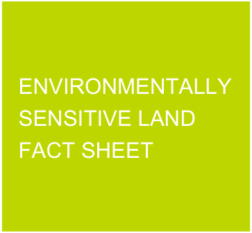

# Canada Bay Development Control Plan - Fact Sheet Environmentally Sensitive Land

Source PDF: [ECM_3736745_v4_Supporting Document Biodiversity Maps - Sheets 001-007 - Fact sheet.pdf](ECM_3736745_v4_Supporting%20Document%20Biodiversity%20Maps%20-%20Sheets%20001-007%20-%20Fact%20sheet.pdf)

### FACT SHEET

> [Picture on page 1: a picture, saved as a picture (images/fact-sheet-environmentally-sensitive-land-page-1-2.gif, 150 dpi).]

### ENVIRONMENTALLY SENSITIVE LAND FACT SHEET

#### Supporting documentation for the Canada Bay Local Environmental Plan 2013

The Supporting Document Biodiversity maps cover the entire local government area.

Both private and public land is affected, however affectations are generally along foreshore areas and areas that contain Ecologically Endangered Communities (EECs). The maps are designed as supporting documents to Council’s mew LEP 2013, which requires consideration against the objectives of clause 6.3 Environmentally Sensitive Land, and applies to land in Zone E2 Environmental Conservation and land identified as “Environmentally Sensitive Land” on the Environmentally Sensitive Land Map.

The information on Council’s supporting biodiversity maps is informed by the Canada Bay Council Biodiversity Framework and Action Plan (August 2019) and the Biodiversity Values Map (2019), which are prepared by the Department of Planning, Industry and Environment under Part 7 of the Biodiversity Conservation Act 2016.

The biodiversity maps also include land identified as Coastal Wetlands and as Proximity Areas for Coastal Wetlands in State Environmental Planning Policy (Coastal management) 2018.

The Biodiversity maps include:

• Endangered ecological communities;

• Vulnerable species; and

• Areas of high biodiversity significance

The provisions in the LEP in this regard require applicants to consider any implications and address any adverse impacts that their development may have on native flora and fauna within land that is zoned E2 Environmental Conservation and shown on the Environmentally Sensitive Land Map, to protect them, to protect the ecological processes necessary for their continued existence, and to encourage their conservation and the recovery of their habitats.

1a Marlborough Street, Drummoyne NSW 2047 Tel 9911 6555  Fax 9911 6550  www.canadabay.nsw.gov.au

Version: 4, Version Date: 18/08/2021

Document Set ID: 3736745
