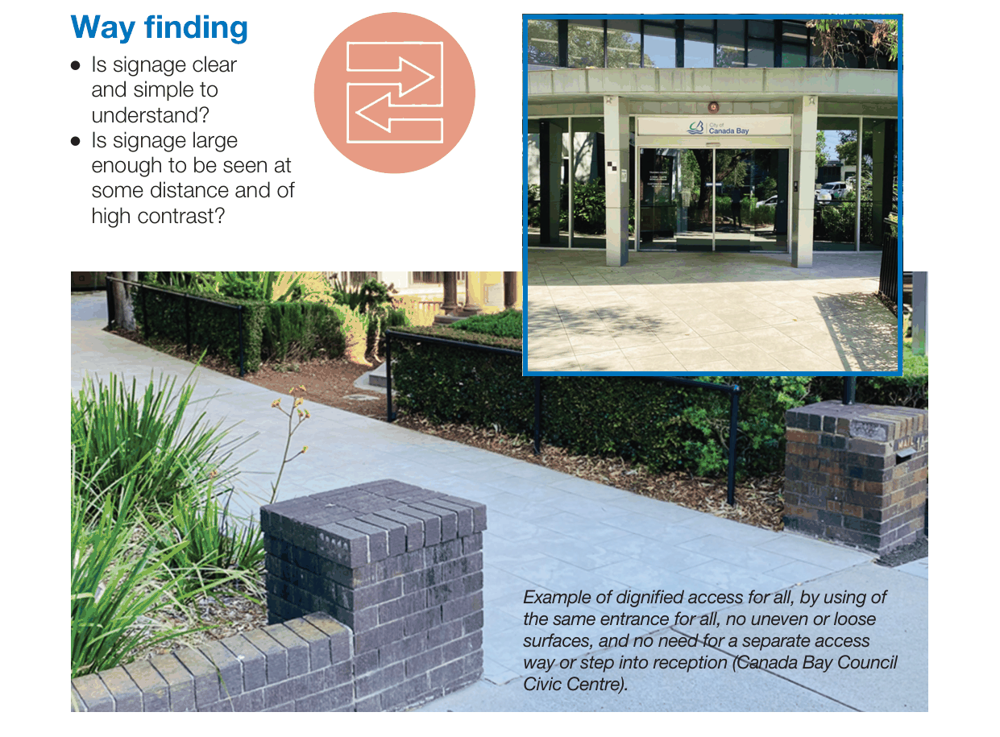

# Canada Bay Development Control Plan - Good design

Source PDF: [Good Design Fact Sheet.pdf](Good%20Design%20Fact%20Sheet.pdf)

### Good design

### factsheet

### To improve access for all to public development.

Thinking upfront about inclusive design can make a world of difference. This short guide will assist you in designing better buildings and spaces by highlighting key questions and solutions to some common access issues in the Canada Bay area.

#### It does not replace the requirement to comply with relevant laws and codes

including the Disability Discrimination Act 1992 (DDA), the Building Code of

#### Australia (BCA), and the Australian Standards (AS).

### Accessible

### paths of travel

### for all

l   Is the path wide enough for a wheelchair or walking frame? l   Is there a clear and continuous accessible path of travel with no uneven or loose surfaces, no steps or other barriers? l   Is there good overhead clearance with nothing hanging down that might be a hazard for people who are blind or vision impaired?

### Dignified

### access for all

Same entrance for all

without reliance on

separate access or stair

lifts.

### Circulation

### space

l   Is there enough space

for a wheelchair and a

person using a walking

frame to pass another person, or regular passing spaces along the path or in circulation areas?

l   Is there seating, bins, street furniture provided at regular intervals?

### Stairs

l   Are there continuous

handrails and colour

contrast strips on the

leading edge or nosing?

l   Are there warning

tactile ground surface

indicators (TGSIs) at

the top and bottom?

### Lifts

l   Are there handrails

installed?

l   Is the lift large enough

to allow someone

using a wheelchair

or walking frame to

ensure they can turn around and access the lift control panel?

l   Do lift buttons have raised tactile and Braille information next to them? l   Can buttons be reached by all? l   Are there audible and visual signals to detail lift levels?

### Way finding

enough to be seen at

### Facilities

l   Is at least part of any

reception desk area

at a height that can

be used by a person

using a wheelchair?

l   Is there good lighting

to assist people with a vision impairment to follow the safest pathway and to assist with communication? l   Does seating have suitable back and arm rests to support people who have difficulty being seated or getting up from a seated position?

> [Picture on page 2: a picture, saved as a picture (images/good-design-page-2-31.gif, 150 dpi).]
> Words printed on the picture (copied from the PDF):
> l   Is signage clear
> and simple to
> understand?
> l   Is signage large
> some distance and of
> high contrast?
> Example of dignified access for all, by using of
> the same entrance for all, no uneven or loose
> surfaces, and no need for a separate access
> way or step into reception (Canada Bay Council
> Civic Centre).

#### 1a Marlborough Street, Drummoyne NSW 2047

#### T: 9911 6555

#### E: council@canadabay.nsw.gov.au

#### W: canadabay.nsw.gov.au
