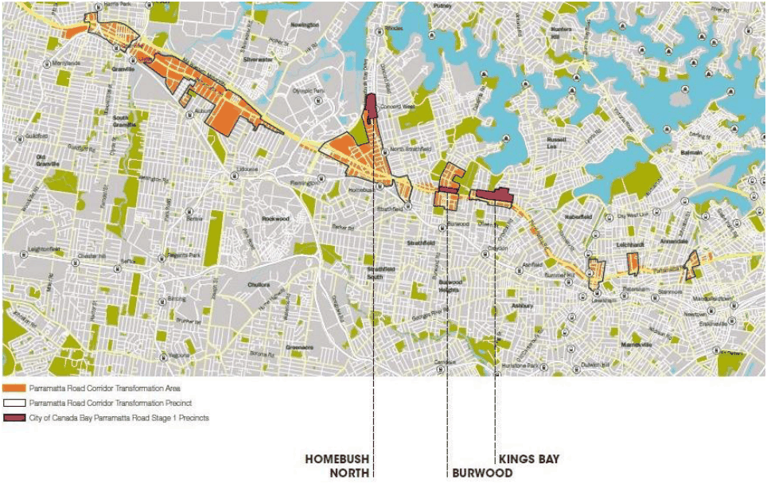

### 2.0 Background

The Parramatta Road Corridor Urban Transformation Strategy 2016 (PRCUTS) was adopted in 2016 by the NSW Government to facilitate the transformation of the Parramatta Road Corridor over the next 30 years, seeking to improve the amenity of Parramatta Road and adjacent communities. PRCUTS provides a long-term framework for the future growth and development of the corridor, and is supported by a suite of documents including the corresponding Parramatta Road Corridor Implementation Plan, Infrastructure Schedule and Planning and Design Guidelines to support the delivery of a renewed and revitalised corridor.

Notably, the PRCUTS identifies three precincts (Homebush, Burwood and Kings Bay) within the Canada Bay local government area which are to be the focus of growth and renewal within the Corridor because of their access to transport and infrastructure, and their capacity to accommodate more housing and jobs.

As part of the PRCUTS, an Implementation Plan was developed to outline the short-term rezoning strategy for precincts within the corridor. This identified the first release of land suitable for rezoning between 2016-2023 (Stage 1 areas). In accordance with the implementation plan, Canada Bay Council has amended the LEP and DCP to commence the implementation of the PRCUTS. The revisions pertain to the Stage 1 areas of PRCUTS, including:

Homebush North Precinct Burwood Precinct Kings Bay Precinct. The planning framework for the PRCUTS precincts (including this Infrastructure Strategy) aims to establish a viable framework that will support the transition of these areas into a high amenity urban environment, which capitalises on its access to services, jobs and public transport. As such, certain infrastructure components such as public open space, footpaths and new streets located within the boundaries of individual sites but are intended to serve the broader community. This requires infrastructure to be planned, designed and constructed in an integrated and coordinated way of which should be funded in an equitable manner, reflecting the overall benefit resulting from future development within each precinct.

Amendments to the LEP and DCP to implement Stage 1 of PRCUTS are supported by masterplans and a public domain plan, which guide the future design of the public realm for each of the Stage 1 areas.

> [Picture on page 5: a picture, saved as a picture (images/prcuts-stage-1-infrastructure-strategy-page-5-25.gif, 150 dpi).]

Figure 1 Locational Context of Homebush North, Burwood and Kings Bay Precincts Source: PRCUTS, 2016
