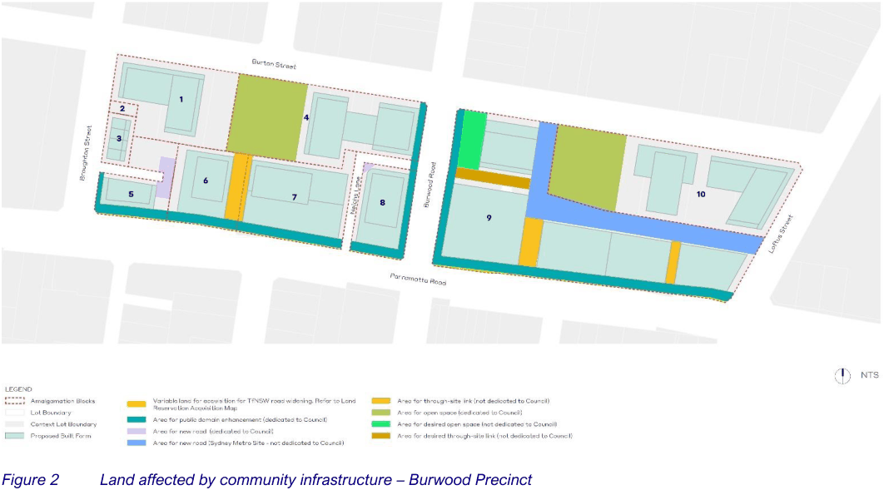
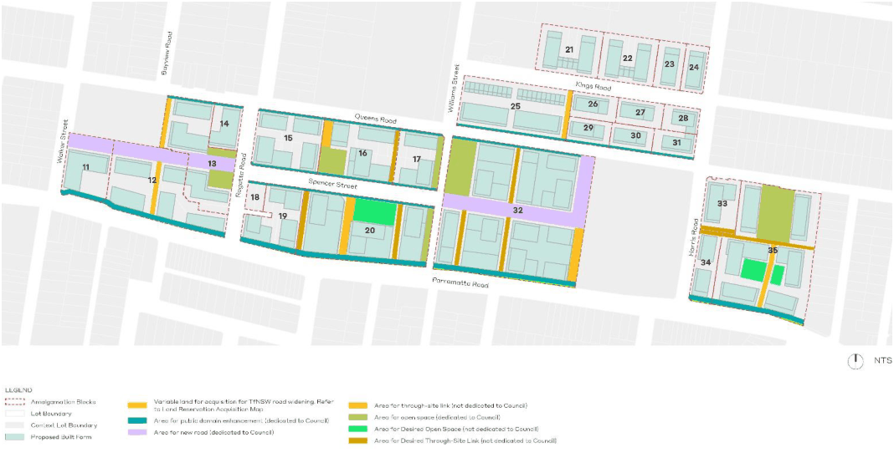

### 4.3 Land Affected by community infrastructure

Certain land occupied by the public domain infrastructure identified by the Burwood and Kings Bay Public Domain Plans and by this Infrastructure Strategy is to be dedicated to the Council, allowing its ongoing maintenance and management for the general community. Additionally, some land along Parramatta Road will be acquired and maintained by Transport for NSW (TfNSW).

The timing of the dedication may be staged, reflecting the gradual redevelopment of the Precincts, or the more specific factors involved in the redevelopment program for the land. However, in order to physically manage and maintain the infrastructure, the Council must have adequate control of the relevant land.

The scheme has been developed on the assumption that the land will be dedicated for a nominal payment to Council and embellishment of the land is required to be delivered at no cost to Council. The following factors are relevant:

1\. The scale and type of development anticipated for the Burwood Precinct or Kings Bay Precinct must be sustained by appropriate infrastructure. If land is not made available, then the needs of the scale and type of development are not met.

2\. The development potential of the land the subject of the Burwood and Kings Bay Public Domain Plans and identified as community infrastructure in the LEP is “taken up” and absorbed in the scheme.

The benefit of this approach is to lessen the actual cost of the scheme as a whole and to preserve the overall equity of contributions. This approach will also ensure the maximum benefits to the community. Notwithstanding the above, there are specific lands identified for community infrastructure but intended to remain under private ownership (i.e. pedestrian through-site links, publicly accessible open space) (refer to Figures 2 and 3). For these instances, the community infrastructure is to be managed and maintained by the private owner of the land and a recreation easement would be placed on title to secure the relevant public access. There are further specific items of infrastructure that are desirable, but not a requirement and not required to be dedicated to Council or TfNSW.

> [Picture on page 8: a picture, saved as a picture (images/prcuts-stage-1-infrastructure-strategy-page-8-21.gif, 150 dpi).]

Figure 2 Land affected by community infrastructure – Burwood Precinct

> [Picture on page 9: a picture, saved as a picture (images/prcuts-stage-1-infrastructure-strategy-page-9-1.gif, 150 dpi).]

Figure 3 Land affected by community infrastructure – Kings Bay Precinct
