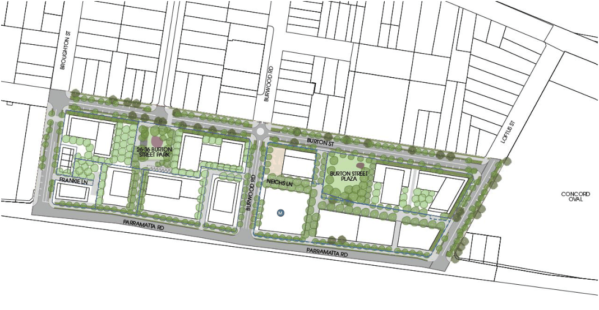

### 5.1 Burwood precinct infrastructure

Burton Street Park

The Burton Street Park will provide much needed open space amenity to the area with opportunities for play, leisure, recreation and exercise. The park also provides a green outlook for surrounding residents while stitching together the streetscape for greater permeability. The park will include a breakout turf area, trees and understorey planting, a playground and ground floor activation and dining space.

Burton Street Plaza

The Burton Street Plaza will provide a new civic heart to Burwood Precinct, providing the area with the place activation it requires. The park will function as an extension to the entrance to the future Burwood North Metro Station that integrates the entrance with an activated public open space. The Plaza will include ground floor activation and dining space, a formal breakout lawn and a formal grove of trees in paving, interspersed with public seating to provide an essential casual gathering area.

Through Links

Three Through Links are specified and an additional Through Link is desired to facilitate north-south and east-west mobility across the Burwood Precinct. Two of the links are 6m in width, and the remaining two links are 12m in width. These links will improve precinct permeability and accessibility for pedestrians and cyclists.

Shared Zone Street

A new shared zone street is specified to provide important connections through the Burwood Precinct, focusing on access to the rear of Burton Street Plaza. The shared zones will incorporate pedestrianized roads with paving treatments and flush kerb environment that clearly communicates the shared environment to all street users.

Public domain enhancements

Many of the blocks along Burwood Road and Parramatta Road will undergo public domain enhancements to facilitate the significant transformation of the corridors to create a vibrant and productive place. This will be done through an introduction of 3m, 5m or 6m wider public domain (footpaths etc). Enhancements will mainly feature continuous kerbside trees, maximizing pedestrian footpath widths streets of continuous area of accessible public domain along the edge of the pedestrian corridors and flush pedestrian crossovers at laneway entries.

Road amendments

The creation of a shared slow zone in Frankie Lane and the western side of Neichs Lane will provide a shared slow zone for pedestrian throughfare in addition to service access to future development sites. These sites will feature opportunities for green walls, permeable paving where possible, footpath crossovers at laneway entries and flush carriageway areas. Frankie lane will also be extended at its easterly dead-end and the north-east corner of Neichs Lane will be transformed into space contributing to the public domain.

> [Picture on page 12: a picture, saved as a picture (images/prcuts-stage-1-infrastructure-strategy-page-12-1.gif, 150 dpi).]

Figure 4 Burwood Precinct public domain plan Source: Public Domain Plan (Group GSA, 2022)
