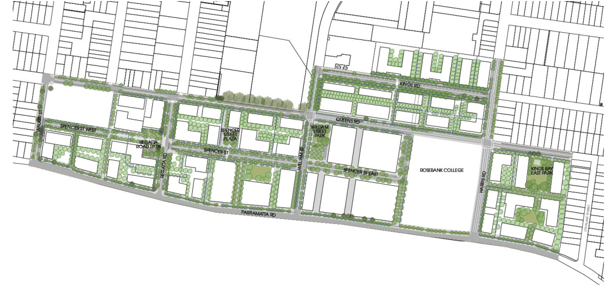

### 5.2 Kings Bay precinct infrastructure

Spencer Street Plaza

Spencer Street Plaza will provide the future town centre with an intimate civic heart and will provide essential support to the activation of the area to create a “place for the people”. The Plaza will feature interactive water and public art elements, ground floor dining spaces along the town centre, a formal breakout lawn and large tree planting.

Regatta Road Park

The Regatta Road Park will provide for the everyday neighbourhood need, whether that be for relaxing, socialising or other forms of passive recreation. The park will feature a neighbourhood-scale playground, a dedicated seating area and large shade tree planting. Other features include ground floor activation around the playground and a turfed and planted area with seating.

William Street Park

This appropriately scaled park will provide a neighbourhood civic space which supports flexible uses opportunities for community orientated programs and events. The park will feature dining space along the courtyard, a breakout lawn, interactive art elements and a formal paved plaza.

Kings Bay East Park

This large neighbourhood park will provide an essential space for the daily social practices and gatherings of the community. The park will largely consist of a nature-orientated playground, community gardens, seating areas, shaded tree planting and an off-leash dog area.

Through Links

Seven Through Links are specified and a further seven Through Links are desired to facilitate north-south and east west mobility across the Kings Bay Precinct. These links range in size from 6m to 12m in width. The through site links will be an essential addition to the green grid and provide much needed connections to neighbouring streets and spaces.

Spencer Street

Spencer Street will go through a process of activation to form the basis of a new and compact local centre for local shops, services and residential dwellings. Spencer Street will also be extended in both an easterly and westerly direction. These extensions will provide additional ground floor activation and dining to support the social life of the village centre. These spaces will be decorated with kerbside trees, generous landscaped beds and kerb extensions at intersections.

Public domain enhancements

Public domain enhancements are specified throughout the Precinct and will be facilitated through a wider public domain (footpaths etc) of 3m, 6m or 8m. This will be used to facilitate shared paths, street planting and a continuous area of accessible public domain along the edge of the corridor abutting adjacent buildings.

> [Picture on page 13: a picture, saved as a picture (images/prcuts-stage-1-infrastructure-strategy-page-13-10.gif, 150 dpi).]

Figure 5 Kings Bay Precinct public domain plan Source: Public Domain Plan (Group GSA, 2022)
