### 7.0 Development sites and lands required for embellishment

### and dedication to Council

Key Site 1

Key Site 1 is located at 46-54 Burton Street Concord with an approximate total area of 3,590m2. The following provisions of the Canada Bay LEP 2013 apply to the site:

Base maximum building height – 8.5 metres Incentive maximum building height – 54 metres Base floor space ratio – 0.5:1, subject to Clause 4.4 (2A) provisions of the Canada Bay LEP 2013 Community infrastructure floor space ratio – 3.0:1

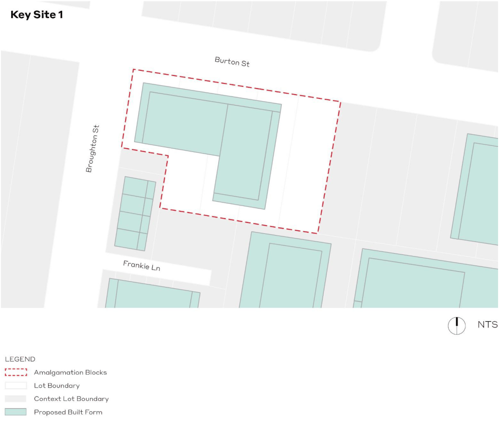

> [Picture on page 16: a picture, saved as a picture (images/prcuts-stage-1-infrastructure-strategy-page-16-10.gif, 150 dpi).]

Figure 6 Key Site 1 – Lands required for embellishment and dedication to Council

Key Site 2 is located at 1E Burton Street Concord with an approximate total area of 136m2. The following provisions of the Canada Bay LEP 2013 apply to the site:

Base maximum building height – 8.5 metres Base floor space ratio – 0.5:1, subject to Clause 4.4 (2A) provisions of the Canada Bay LEP 2013

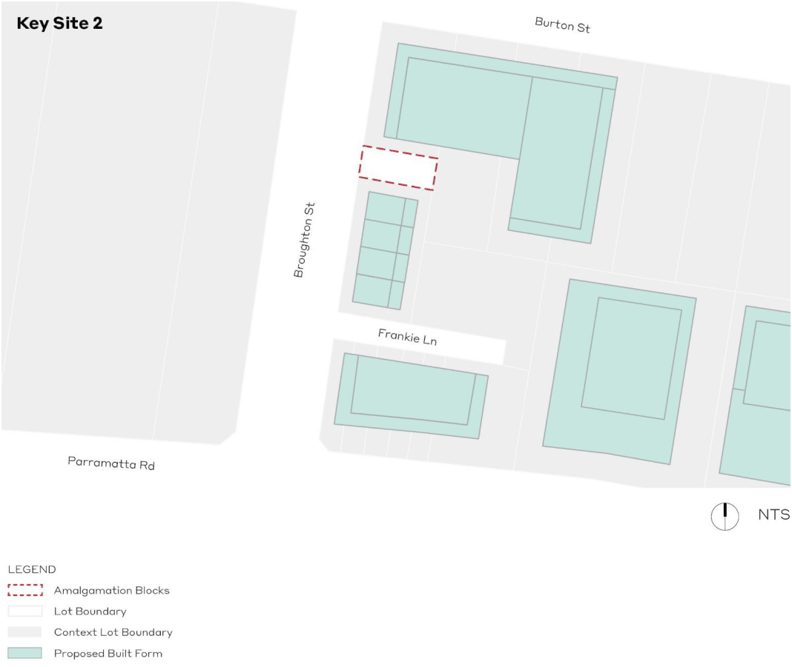

> [Picture on page 17: a picture, saved as a picture (images/prcuts-stage-1-infrastructure-strategy-page-17-5.gif, 150 dpi).]

Figure 7 Key Site 2 – Lands required for embellishment and dedication to Council

Key Site 3 is located at 1 Broughton Street, Concord. It has an approximate total area of 570m2. The following provisions of the Canada Bay LEP 2013 apply to the site:

Base maximum building height – 8.5 metres Incentive maximum building height – 10.5 metres Base floor space ratio – 0.5:1, subject to Clause 4.4 (2A) provisions of the Canada Bay LEP 2013 Community infrastructure floor space ratio – 0.9:1

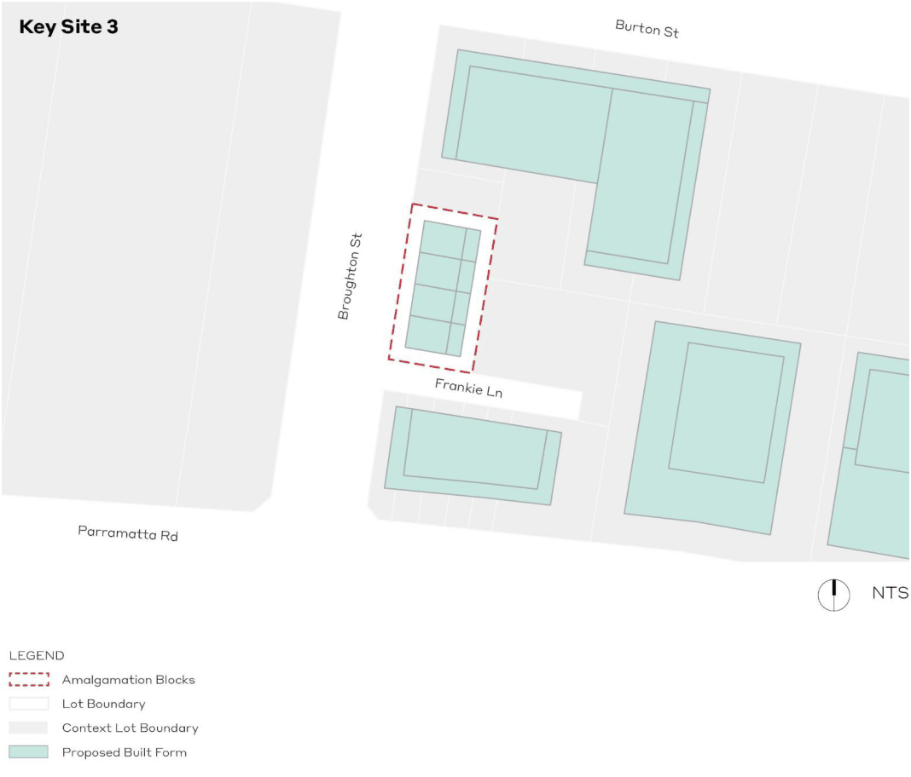

> [Picture on page 18: a picture, saved as a picture (images/prcuts-stage-1-infrastructure-strategy-page-18-7.gif, 150 dpi).]

Figure 8 Key Site 3 – Lands required for embellishment and dedication to Council

Key Site 4 is located at 28-44 Burton Street, Concord with an approximate total area of 5,600m2. The following provisions of the Canada Bay LEP 2013 apply to the site:

Base maximum building height – 8.5 metres Incentive maximum building height – part 37.5 metres part 65 metres Base floor space ratio – 0.5:1, subject to Clause 4.4 (2A) provisions of the Canada Bay LEP 2013 Community infrastructure floor space ratio – 3.0:1 Community infrastructure will include:

A neighbourhood park (a minimum 2,280m2) fronting Burton Street will create a new recreational space for the daily social practices and gatherings of the community. The neighbourhood park will include: − Ground floor activation and outdoor dining spaces along activated edges of the space − An unprogrammed breakout turf area suitable for individual relaxation or group gatherings − Tree and understory planting with stepping stones for through-access − A neighbourhood-scale local playground.

• Public domain enhancement (minimum width of 4.5 metres) along Burwood Road for the purpose of a pedestrian footpath. This will allow for greater ground floor activation and spill out, and will be complimented by continuous avenue of kerbside street trees.

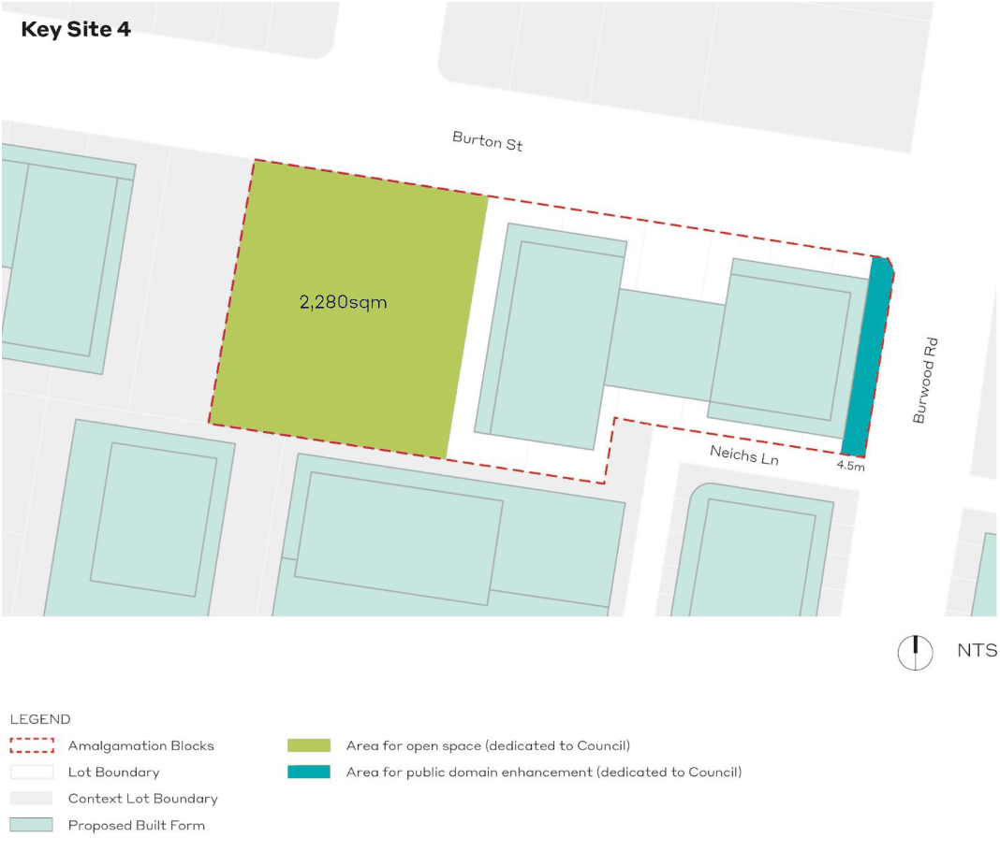

> [Picture on page 20: a picture, saved as a picture (images/prcuts-stage-1-infrastructure-strategy-page-20-1.gif, 150 dpi).]

Land for community infrastructure for Key Site 4 apply to the following lots, sections, deposited plans and strata plans descriptions: Lot 1 DP 986651 Lot 21 DP 1133637 Lot 1 DP 1088710.

Lot 4 DP 10928

Figure 9 Key Site 4 – Lands required for embellishment and dedication to Council

Key Site 5

Key Site 5 is located at 55-59 Parramatta Road and 1A Broughton Street with an approximate total area of 1,840m2. The following provisions of the Canada Bay LEP 2013 apply to the site:

Base maximum building height – 12 metres Community infrastructure maximum building height – 52 metres Base floor space ratio – 1.0:1 Community infrastructure floor space ratio – 2.6:1 Community infrastructure will include:

Public domain enhancements (minimum width of 6m) and additional public domain enhancements in accordance with Transport for New South Wales requirements (variable widthup to 0.6m) on Parramatta Road inclusive of landscaping, a shared path setback from the kerb and bordered by understorey planting to provide a sense of separation between the adjacent roadway and footpath areas, and street tree planting set back from the road edge to avoid conflicts within clear zone requirements.

Public domain enhancements (minimum width of 3m) on Broughton Street to allow for generous pedestrian footpaths providing continuous access integrating with areas of ground floor retail activation A road enlargement for vehicle turning will occur at the dead end of Frankie Lane (minimum width of 7m) and will include a paved ground cover, flush to the verge and to clearly communicate the shared intention of the road.

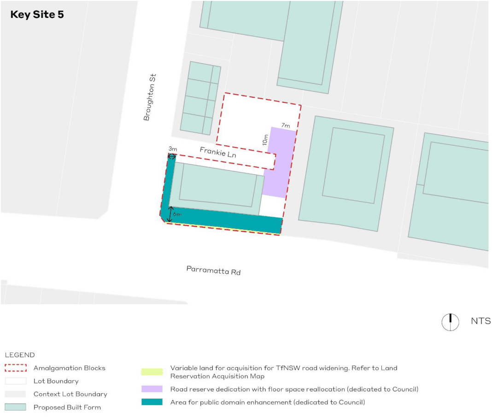

> [Picture on page 21: a picture, saved as a picture (images/prcuts-stage-1-infrastructure-strategy-page-21-5.gif, 150 dpi).]

Land for community infrastructure for Key Site 5 apply to the following lots, sections, deposited plans and strata plans descriptions:

Lot 12 DP 1221579

Lot 13 DP 1221579

Lot 14 DP 1221579

Lot 15 DP 1221579

Lot 16 DP 1221579

Lot 17 DP 1221579

Lot 1 DP 602149

Figure 10 Key Site 5 – Lands required for embellishment and/or dedication to Council

Key Site 6

Key Site 6 is located at 49-55 Parramatta Road, Concord with an approximate total area of 2,260m2. The following provisions of the Canada Bay LEP 2013 apply to the site:

Base maximum building height – 12 metres Community infrastructure maximum building height – 47m metres Base floor space ratio – 1.0:1 Community infrastructure floor space ratio – 3.0:1

Community infrastructure will include:

Public domain enhancements (minimum width of 6m) and additional public domain enhancements in accordance with Transport for New South Wales requirements (variable width up to 0.6m) on Parramatta Road  inclusive of landscaping, a shared path setback from the kerb and bordered by understorey planting to provide a sense of separation between the adjacent roadway and footpath areas, and street tree planting set back from the road edge to avoid conflicts within clear zone requirements. A pedestrian through-site link (minimum width of 9m) to provide pedestrian and bicycle access between Parramatta Road and future public open space to the north. Finishes and treatment are to be contiguous with the pedestrian through-site link adjoining on the eastern boundary (Key Site 7).

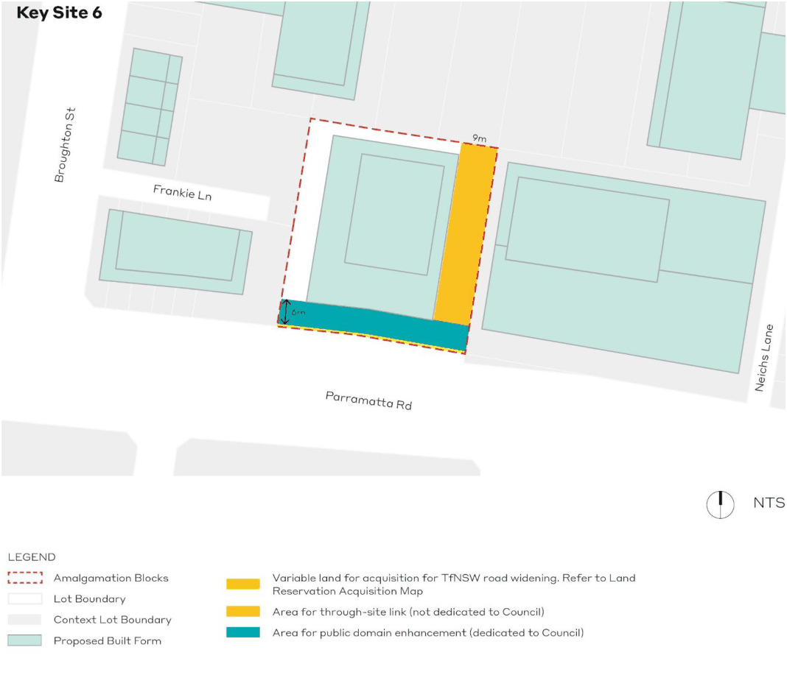

> [Picture on page 22: a picture, saved as a picture (images/prcuts-stage-1-infrastructure-strategy-page-22-10.gif, 150 dpi).]

Land for community infrastructure for Key Site 6 apply to the following lots, sections, deposited plans and strata plans descriptions:

Lot 20 DP 1219785 Figure 11 Key Site 6 – Lands required for embellishment and dedication to Council

Key Site 7 is located at 29-45 Parramatta Road, Concord with an approximate total area of 3,560m2. The following provisions of the Canada Bay LEP 2013 apply to the site:

Base maximum building height – 12 metres Community infrastructure maximum building height – 35m metres Base floor space ratio – 1.6:1 Community infrastructure floor space ratio – 2.5:1

Community infrastructure will include:

Public domain enhancements (minimum width of 6m) and additional public domain enhancements in accordance with Transport for New South Wales requirements (variable width up to 0.59m) on Parramatta Road inclusive of landscaping, a shared path setback from the kerb and bordered by understorey planting to provide a sense of separation between the adjacent roadway and footpath areas, and street tree planting set back from the road edge to avoid conflicts within clear zone requirements. A pedestrian through-site link (minimum width of 3m) to provide pedestrian and bicycle access between Parramatta Road and future public open space to the north. Finishes and treatment are to be contiguous with the pedestrian through-site link adjoining on the western boundary (Key Site 6).

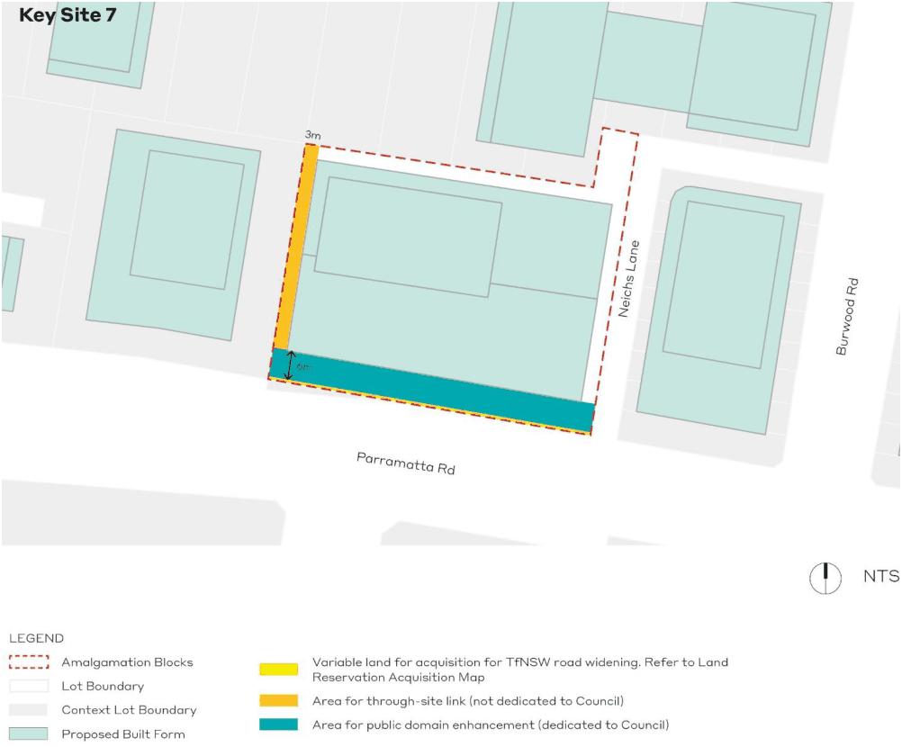

> [Picture on page 23: a picture, saved as a picture (images/prcuts-stage-1-infrastructure-strategy-page-23-16.gif, 150 dpi).]

Land for community infrastructure for Key Site 7 apply to the following lots, sections, deposited plans and strata plans descriptions: SP72357

Figure 12 Key Site 7 – Lands required for embellishment and dedication to Council

Key Site 8 is located at 2A-18 Burwood Road, Concord with an approximate total area of 2,000m2. The following provisions of the Canada Bay LEP 2013 apply to the site:

Base maximum building height – 12 metres Community infrastructure maximum building height – 37.5 metres Base floor space ratio – 2.0:1 Community infrastructure floor space ratio – 3.0:1

Community infrastructure will include:

Public domain enhancements (minimum width of 6m) and additional public domain enhancements in accordance with Transport for New South Wales requirements (variable width up to 0.58m) on Parramatta Road inclusive of landscaping a shared path setback from the kerb and bordered by understorey planting to provide a sense of separation between the adjacent roadway and footpath areas, and street tree planting set back from the road edge to avoid conflicts within clear zone requirements. Public domain enhancement (minimum width of 4.5 metres) along Burwood Road for the purpose of a pedestrian footpath. This will allow for greater ground floor activation and spill out, and will be complimented by continuous avenue of kerbside street trees. Widening of Neichs Lane to improve pedestrian and vehicle visibility along the shared zone.

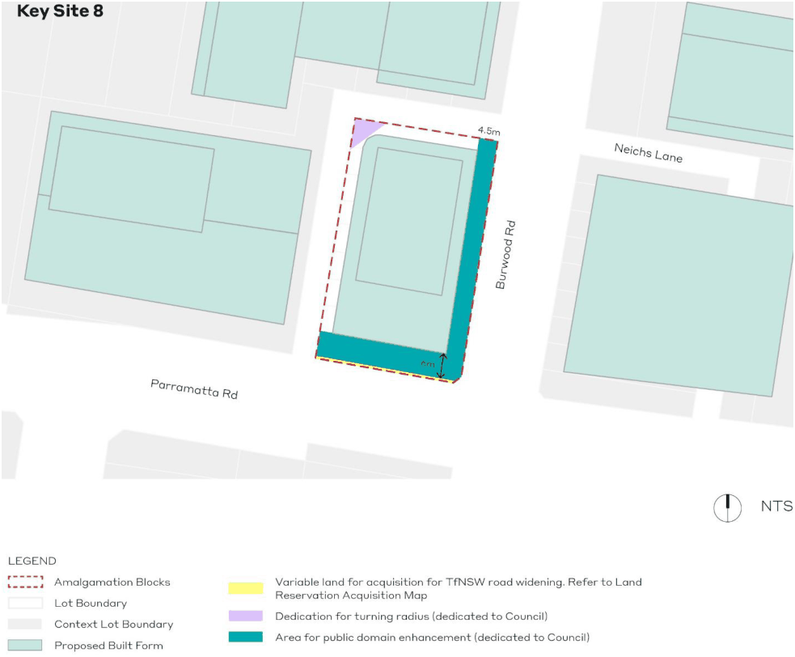

> [Picture on page 24: a picture, saved as a picture (images/prcuts-stage-1-infrastructure-strategy-page-24-17.gif, 150 dpi).]

Land for community infrastructure for Key Site 8 apply to the following lots, sections, deposited plans and strata plans descriptions: Lot 13 DP 10928 Lot 1 DP 423701 Lot A DP 373059 Lot B 373059 Figure 13 Key Site 8 – Lands required for embellishment and dedication to Council

Key Site 9 is located at 20-26 Burton Street, Concord, Part 16 Burton Street, Concord, Part 12 Burton Street, Concord, 1-13 Burwood Road, 1-21 Parramatta Road, Concord and part 1 Loftus Street, Concord with an approximate total area of 13,000m2. The following provisions of the Canada Bay LEP 2013 apply to the site:

Base maximum building height – 8.5 metres and 12 metres Community infrastructure maximum building height – part 24 metres and part 56 metres Base floor space ratio – 2.0:1 and 0.5:1, subject to Clause 4.4 (2A) provisions of the Canada Bay LEP 2013 Community infrastructure floor space ratio – 2.5:1 Community infrastructure will include:

Public domain enhancements (minimum width of 6m) and additional public domain enhancements in accordance with Transport for New South Wales requirements (variable width up to 0.79m) on Parramatta Road inclusive of landscaping, a shared path setback from the kerb and bordered by understorey planting to provide a sense of separation between the adjacent roadway and footpath areas, and street tree planting set back from the road edge to avoid conflicts within clear zone requirements. Public domain enhancement (minimum width of 5m metres) along part of Burwood Road for kerbside tree planting and wide pedestrian footpaths for ground floor activation and spill out. A shared zone road (minimum width of 12m) connection Loftus Street with Burton Street incorporating a pedestrianised road surface, with paving treatments and flush kerb environments that clearly communicate the shared environment to all street users. Two pedestrian through-site links (minimum width of 6m and 12m respectively) to provide pedestrian and bicycle access between Parramatta Road and the new shared zone. Additionally a third 6m wide through-site link is desired, from Burwood Road to the new shared zone, which may be internal to the building but only if it is publicly accessible during normal work hours. Open space at the corner of Burton Street and Burwood Road is desired for the purpose of a plaza and breakout space (a minimum 730m2). The space may include landscaped intervention to provide a comfortable and attractive atmosphere at street level.

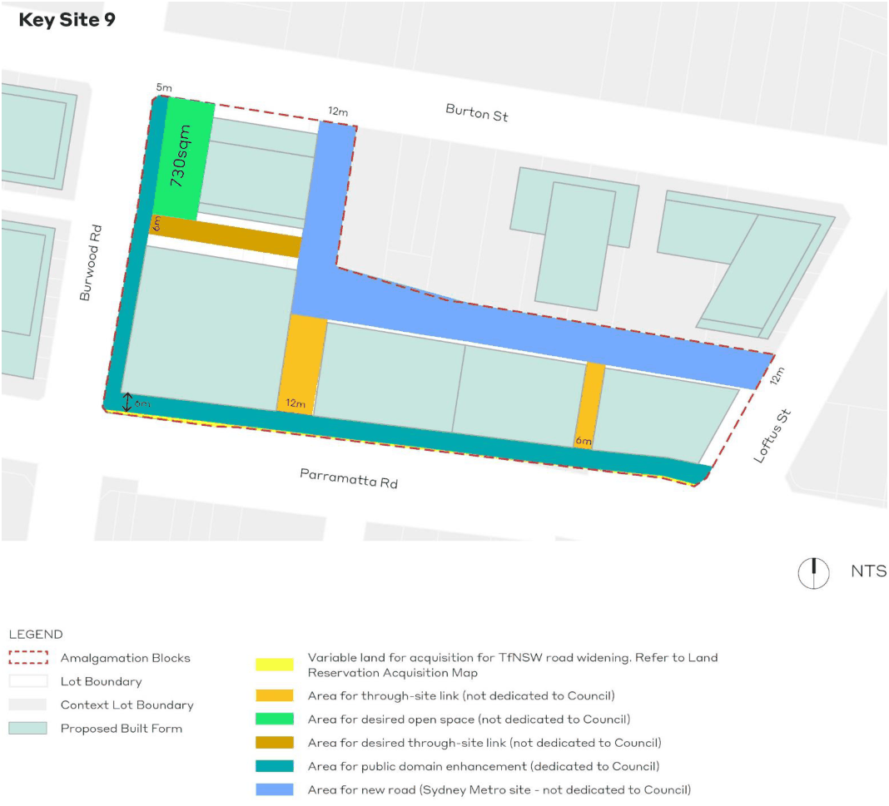

> [Picture on page 26: a picture, saved as a picture (images/prcuts-stage-1-infrastructure-strategy-page-26-1.gif, 150 dpi).]

Land for community infrastructure for Key Site 9 apply to the following lots, sections, deposited plans and strata plans descriptions:

| Lot 4 DP 333924 | Lot 100 DP 1154740 | Lot 1 DP 1027871 | Lot 1 DP 839095 | Lot C DP 340812 |
|---|---|---|---|---|
| Lot B DP 340812 | Lot A DP 340812 | Lot 15 DP 10928 | Lot 19 DP 10928 | Lot 20 DP 10928 |
| Lot 21 DP 10928 | Lot 22 DP 10928 | Lot 23 DP 10928 | Lot 24 DP 10928 | Lot 25 DP 10928 |
| Lot 26 DP 10928 | Lot 27 DP 10928 | Lot 28 DP 10928 | SP 73535 | SP 12487 |
| Lot B DP 344400 | Lot 2 DP 857558 |  |  |  |

Figure 14 Key Site 9 – Lands required for embellishment and dedication to Council

Key Site 10 is located at 2-14A Burton Street, Concord, Part 16 Burton Street, Part 19 Parramatta Road, Concord, 1A-3A Loftus Street, Concord and Part 1 Loftus Street Concord with an approximate total area of 7,550m2. The following provisions of the Canada Bay LEP 2013 apply to the site:

Base maximum building height – 8.5 metres and 12 metres Community infrastructure maximum building height – part 42 metres and part 78 metres Base floor space ratio – 2.0:1 and 0.5:1, subject to Clause 4.4 (2A) provisions of the Canada Bay LEP 2013 Community infrastructure floor space ratio – 3.0:1

Community infrastructure will include:

A new plaza fronting Burton Street (a minimum 2,276m2) will support: − a formal breakout lawn space with shade tree planting and occupiable seating edges for incidental seating or group gatherings. − a local meeting place fronting the street, providing a focal point of the plaza for wayfinding and gathering, potentially incorporating interactive public art elements that can be programmed to provide for different use patterns of the plaza. − a formal grove of trees in paving, interspersed with public seating to provide for informal gathering.

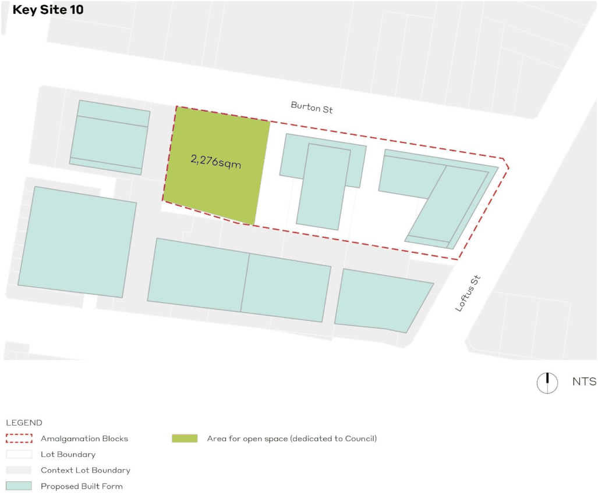

> [Picture on page 27: a picture, saved as a picture (images/prcuts-stage-1-infrastructure-strategy-page-27-15.gif, 150 dpi).]

Land for community infrastructure for Key Site 10 apply to the following lots, sections, deposited plans and strata plans descriptions: SP 12487

Lot 1 DP 549357 Lot 2 DP 549357

Lot B 344400

Lot 21 DP 63018

Figure 15 Key Site 10 – Lands required for embellishment and dedication to Council

Key Site 11 is located at 235 Parramatta Road with an approximate size of 4,660m2. The following provisions of the Canada Bay LEP 2013 apply to the site:

Base maximum building height – 12 metres Community infrastructure maximum building height – 19 metres Base floor space ratio – 1.0:1 Community infrastructure floor space ratio – 1.3:1

Community infrastructure will include:

Public domain enhancements (minimum width of 6m) and additional public domain enhancements in accordance with Transport for New South Wales requirements (variable width up to 0.3m) on Parramatta Road inclusive of landscaping, a shared path setback from the kerb and bordered by understorey planting to provide a sense of separation between the adjacent roadway and footpath areas, and street tree planting set back from the road edge to avoid conflicts within clear zone requirements. A new road corridor (minimum width 18m). This will involve road pavement, footpaths, kerb and guttering, stormwater, kerbside trees, and landscaping beds.

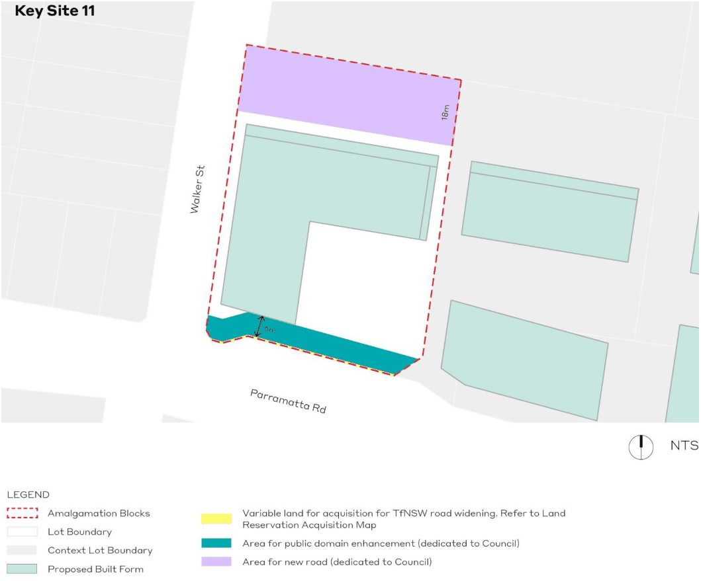

> [Picture on page 28: a picture, saved as a picture (images/prcuts-stage-1-infrastructure-strategy-page-28-15.gif, 150 dpi).]

Land for community infrastructure for Key Site 11 apply to the following lots, sections, deposited plans and strata plans descriptions: Lot 4 DP 826686 Figure 16 Key Site 11 – Lands required for embellishment and dedication to Council

Key Site 12 is located at 215-225 Parramatta Road, Five Dock and 1-3 Regatta Road, Five Dock with an approximate size of 10,690m2. The following provisions of the Canada Bay LEP 2013 apply to the site:

Base maximum building height – 12 metres Community infrastructure maximum building height – 19 metres Base floor space ratio – 1.0:1 Community infrastructure floor space ratio – 1.30:1 Community infrastructure will include:

Public domain enhancements (minimum width of 6m) and additional public domain enhancements in accordance with Transport for New South Wales requirements (variable width up to 0.5m) on Parramatta Road inclusive of landscaping, a shared path setback from the kerb and bordered by understorey planting to provide a sense of separation between the adjacent roadway and footpath areas, and street tree planting set back from the road edge to avoid conflicts within clear zone requirements. A new road corridor (minimum width 18m). This will involve road pavement, footpaths, kerb and guttering, stormwater, kerbside trees, and landscaping beds. A pedestrian through-site link 6m in width to provide pedestrian and bicycle access between Parramatta Road and the new shared zone.

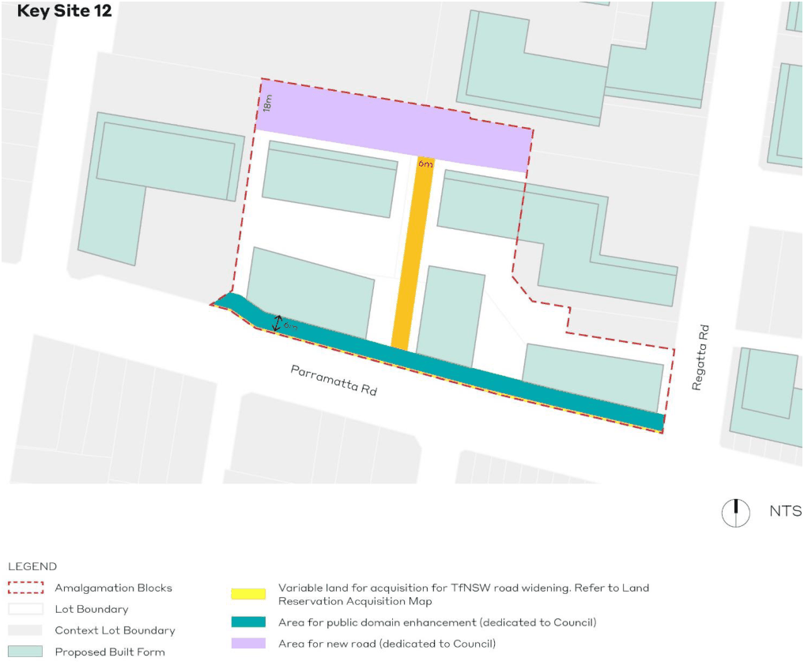

> [Picture on page 29: a picture, saved as a picture (images/prcuts-stage-1-infrastructure-strategy-page-29-17.gif, 150 dpi).]

Land for community infrastructure for Key Site 12 apply to the following lots, sections, deposited plans and strata plans descriptions: Lot 1 DP 826686 Lot 2 DP 826686 Lot 3 DP 826686 Lot 1 DP 172273 Figure 17 Key Site 12 – Lands required for embellishment and dedication to Council

Key Site 13 is located at 15-17 Regatta Road, Five Dock and 7 Regatta Road, Five Dock with an approximate size of 8,680m2. The following provisions of the Canada Bay LEP 2013 apply to the site:

Base maximum building height – 12 metres Community infrastructure maximum building height – part 17 metres and part 19 metres Base floor space ratio – 1.0:1 Community infrastructure floor space ratio – 1.4:1 Community infrastructure will include:

Public open space on both sides of the new shared zone extending from Spencer Street (minimum 1,170m2 in size) that will support: − Large informal turf areas for relaxing, socialising and other forms of passive recreation. − A neighbourhood-scaled local playground. − Seating areas located to support and supplement other park uses. − Large shade tree planting to maximise park amenity and provided filtered screening to adjacent properties. − Turf and planted area with seating adjacent to Spencer Street shared zone. A shared zone road (minimum width of 18m) incorporating a pedestrianised road surface, with paving treatments and flush kerb environments that clearly communicate the shared environment to all street users. Public domain enhancements 3m in width along Queens Road for a paved and landscaped setback to provide comfortable and amenable pedestrian thoroughfare along the street, and activation supported by adjacent ground floor building uses. A pedestrian through-site link (6m in width) to provide pedestrian and bicycle access between Queens Road and the new shared zone.

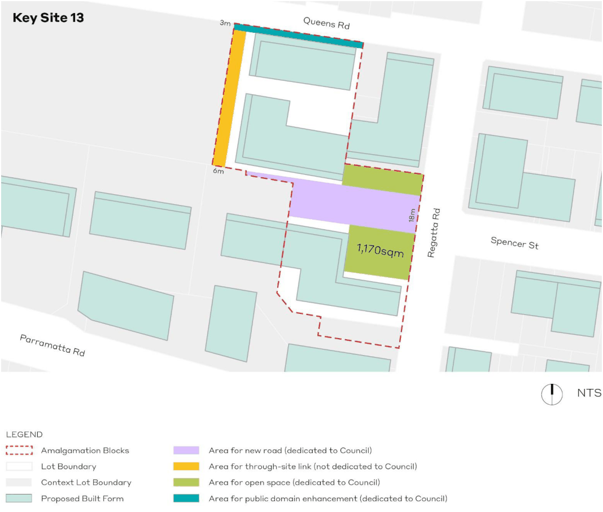

> [Picture on page 31: a picture, saved as a picture (images/prcuts-stage-1-infrastructure-strategy-page-31-1.gif, 150 dpi).]

Land for community infrastructure for Key Site 13 apply to the following lots, sections, deposited plans and strata plans descriptions: Lot 12 DP 826063 Lot 13 DP 826063 Figure 18 Key Site 13 – Lands required for embellishment and dedication to Council

Key Site 14 is located at 19-27 Regatta Road, Five Dock with an approximate size of 2,135m2. The following provisions of the Canada Bay LEP 2013 apply to the site:

Base maximum building height – 12 metres Community infrastructure maximum building height – 17 metres Base floor space ratio – 1.0:1 Community infrastructure floor space ratio – 2.2:1 Community infrastructure will include

Public domain enhancements 3m in width along Queens Road for a paved and landscaped setback to provide comfortable and amenable pedestrian thoroughfare along the street, and activation where supported by adjacent ground floor building uses.

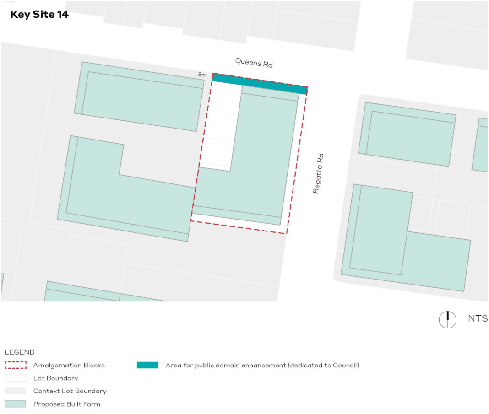

> [Picture on page 32: a picture, saved as a picture (images/prcuts-stage-1-infrastructure-strategy-page-32-11.gif, 150 dpi).]

Land for community infrastructure for Key Site 14 apply to the following lots, sections, deposited plans and strata plans descriptions: Lot 1 DP 1034085 Figure 19 Key Site 14 – Lands required for embellishment and dedication to Council

Key Site 15 is located at 28-38 Spencer Street, Five Dock, 2-12 Regatta Road, Five Dock, and 97 Queens Road, Five Dock with an approximate size of 6,265m2. The following provisions of the Canada Bay LEP 2013 apply to the site:

Base maximum building height – 12 metres Community infrastructure maximum building height – 42 metres Base floor space ratio – 1.0:1 Community infrastructure floor space ratio – 3.0:1 Community infrastructure will include

Public domain enhancements 3m in width along Queens Road for a paved and landscaped setback to provide comfortable and amenable pedestrian thoroughfare along the street, and activation supported by adjacent ground floor building uses. Public domain enhancements 3m in width along Spencer Street for a paved and landscaped setback to provide  generous public domain areas that maximise pedestrian comfort within, and occupation of, the street and public domain. The public domain enhancements will include landscaping integrated with hard surfaces to maximise stormwater infiltration treatment.

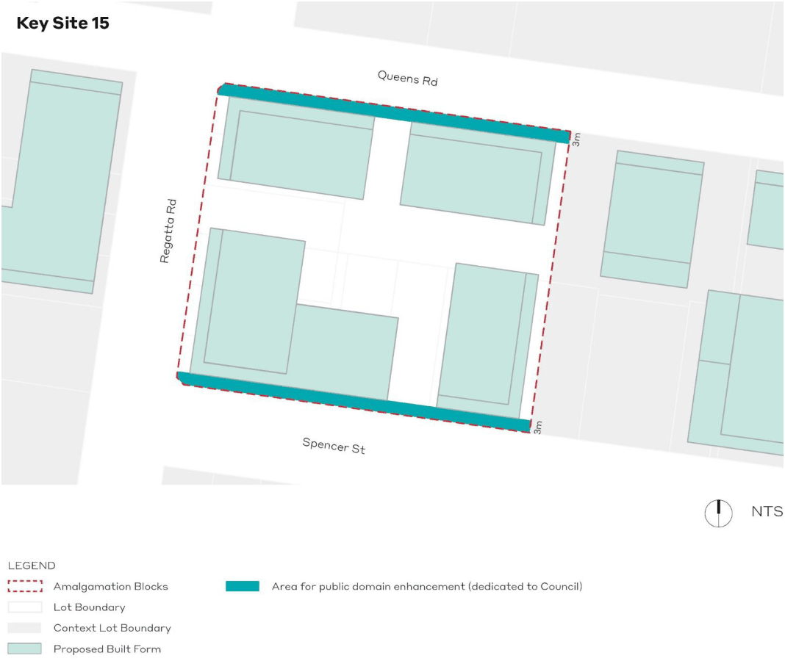

> [Picture on page 33: a picture, saved as a picture (images/prcuts-stage-1-infrastructure-strategy-page-33-13.gif, 150 dpi).]

Land for community infrastructure for Key Site 15 apply to the following lots, sections, deposited plans and strata plans descriptions:

| Lot 6 DP 14016 | Lot 11 DP 1135519 | Lot 7 DP 663408 | Lot 1 DP 114841 |
|---|---|---|---|
| Lot 1 DP 302203 | Lot 4 DP 1117 | Lot 5 DP 1117 | Lot 3 DP 455682 |
| Lot 1 DP 14016 |  |  |  |

Figure 20 Key Site 15 – Lands required for embellishment and dedication to Council

Key Site 16

Key Site 16 is located at 83-95 Queens Road, Five Dock and 14-28 Spencer Street, Five Dock Five Dock with an approximate size of 7,150m2. The following provisions of the Canada Bay LEP 2013 apply to the site:

Base maximum building height – 12 metres Community infrastructure maximum building height – part 32 metres and part 67 metres Base floor space ratio – 1.0:1 Community infrastructure floor space ratio – 3.0:1

Community infrastructure will include:

A new public plaza (minimum area of 1,115 m2) that will feature a formal breakout lawn space with shade tree planting and occupiable seating edges for incidental seating or group gatherings, interactive water / public art elements that can be programmed to provide for different use patterns of the plaza and alternate plaza uses. One required pedestrian link (minimum width of 12m in width) connecting Queens Road to open space that will contribute to essential pedestrian and cyclist movements. Public domain enhancements 3m in width along Queens Road for a paved and landscaped setback to provide comfortable and amenable pedestrian thoroughfare along the street, and activation supported by adjacent ground floor building uses. Public domain enhancements 3m in width along Spencer Street for a paved and landscaped setback to provide  t generous public domain areas that maximise pedestrian comfort within, and occupation of, the street and public domain. The public domain enhancements will also include landscaping integrated with hard surfaces to maximise stormwater infiltration. A desired 6m wide through-site link is suggested from Queens Road to Spencer Street on the eastern boundary.

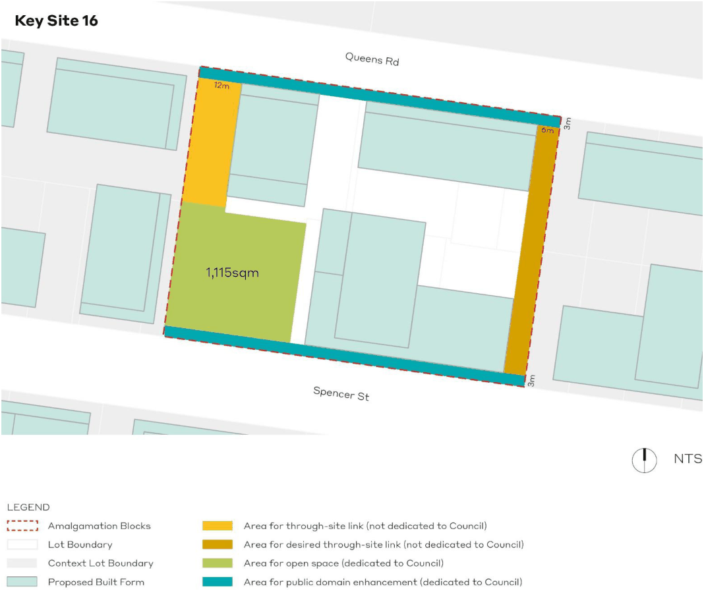

> [Picture on page 35: a picture, saved as a picture (images/prcuts-stage-1-infrastructure-strategy-page-35-1.gif, 150 dpi).]

Land for community infrastructure for Key Site 16 apply to the following lots, sections, deposited plans and strata plans descriptions: Lot 92 DP 1047100 Lot 37 DP 1117 Lot 8 DP 1117

Lot 3 DP 828420 Lot 4 DP 828420

SP 46295

SP 56265

Lot 2 DP 224234 SP 69274

Lot 100 DP 832740

Figure 21 Key Site 16 – Lands required for embellishment and dedication to Council

Key Site 17 is located at 2-12 Spencer Street, Five Dock, 79-81 Queens Road, Five Dock with an approximate total size of 4,180m2. The following provisions of the Canada Bay LEP 2013 apply to the site:

Base maximum building height – 12 metres Community infrastructure maximum building height – 67 metres Base floor space ratio – 1.0:1 Community infrastructure floor space ratio – 3.0:1

Community infrastructure will include:

A landscaped public domain (minimum 8m in width) on the western side of William Street that will include a shared path, landscaping and tree planting. Public domain enhancements 3m in width along Queens Road for a paved and landscaped setback to provide comfortable and amenable pedestrian thoroughfare along the street, and activation supported by adjacent ground floor building uses. Public domain enhancements 3m in width along Spencer Street for a paved and landscaped setback to provide  generous public domain areas that maximise pedestrian comfort within, and occupation of, the street and public domain. The public domain enhancements will include landscaping integrated with hard surfaces to maximise stormwater infiltration.

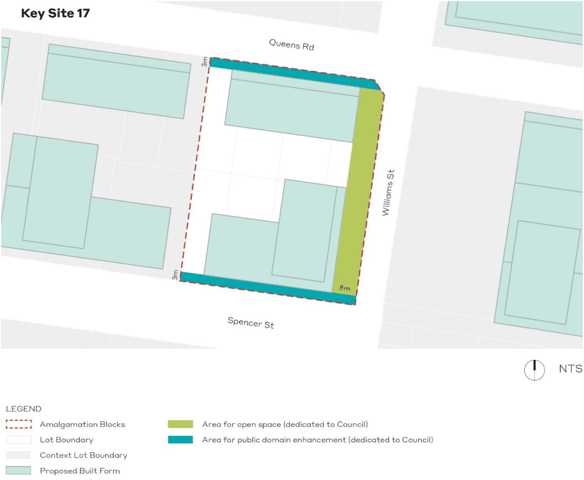

> [Picture on page 36: a picture, saved as a picture (images/prcuts-stage-1-infrastructure-strategy-page-36-15.gif, 150 dpi).]

Land for community infrastructure for Key Site 17 apply to the following lots, sections, deposited plans and strata plans descriptions:

| Lot 15 DP 1117 | Lot 16 DP 1117 | Lot 17 DP 1117 | Lot 20 DP 1117 |
|---|---|---|---|
| Lot 21 DP 1117 | Lot 22 DP 1117 | Lot 1 DP 540151 | Lot 18 DP 651570 |

Figure 22 Key Site 17 – Lands required for embellishment and dedication to Council

Key Site 18 is located at 25-27 Spencer Street, Five Dock with an approximate total size of 870m2. The following provisions of the Canada Bay LEP 2013 apply to the site:

Base maximum building height – 12 metres Community infrastructure maximum building height – 23 metres Base floor space ratio – 1.0:1 Community infrastructure floor space ratio – 3.0:1

Community infrastructure will include:

Public domain enhancements 3m in width along Spencer Street for a paved and landscaped setback to provide  generous public domain areas that maximise pedestrian comfort within, and occupation of, the street and public domain. The public domain enhancements will also include landscaping integrated with hard surfaces to maximise stormwater infiltration.

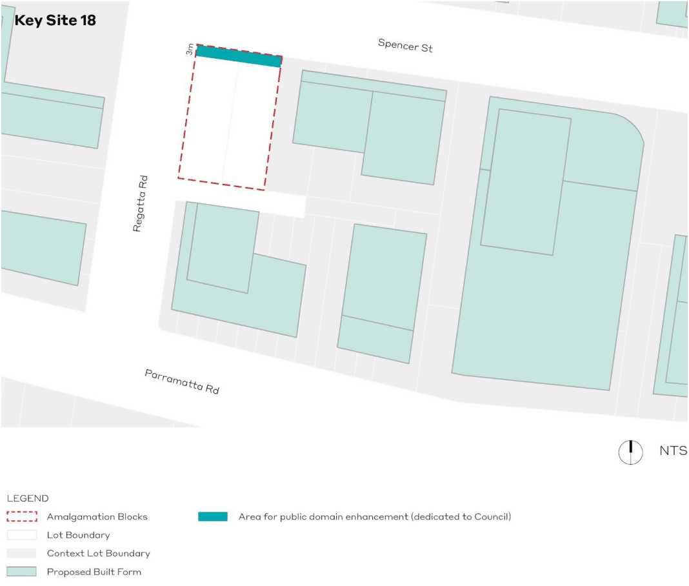

> [Picture on page 37: a picture, saved as a picture (images/prcuts-stage-1-infrastructure-strategy-page-37-11.gif, 150 dpi).]

Land for community infrastructure for Key Site 18 apply to the following lots, sections, deposited plans and strata plans descriptions: Lot 12 DP 11967

Lot 13 DP 11967

Figure 23 Key Site 18 – Lands required for embellishment and dedication to Council

Key Site 19 is located at 181-203 Parramatta Road and Five Dock, 17-19 Spencer Street, Five Dock with an approximate size of 4,860m2. The following provisions of the Canada Bay LEP 2013 apply to the site:

Base maximum building height – 12 metres Community infrastructure maximum building height – 35 metres Base floor space ratio – 1.0:1 Community infrastructure floor space ratio – 3.0:1

Community infrastructure will include:

Public domain enhancements (minimum width of 6m) and additional public domain enhancements in accordance with Transport for New South Wales requirements (variable width up to 0.9m) on Parramatta Road inclusive of landscaping, a shared path setback from the kerb and bordered by understorey planting to provide a sense of separation between the adjacent roadway and footpath areas, and street tree planting set back from the road edge to avoid conflicts within clear zone requirements. Public domain enhancements 3m in width along Spencer Street for a paved and landscaped setback to provide  generous public domain areas that maximise pedestrian comfort within, and occupation of, the street and public domain. The public domain enhancements will also include generous landscaping integrated with hard surfaces to maximise stormwater infiltration.

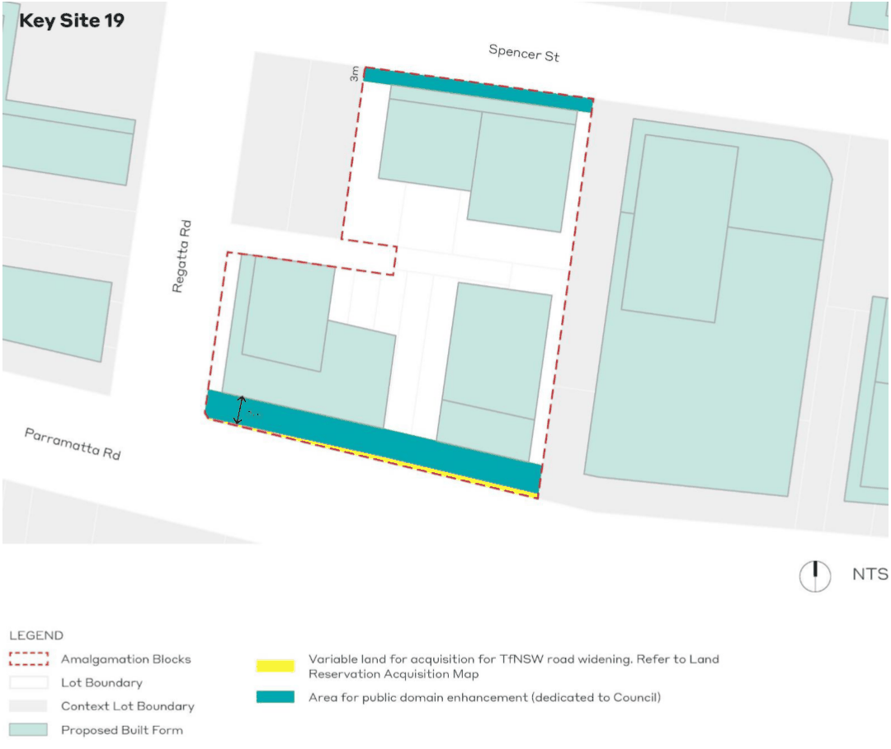

> [Picture on page 39: a picture, saved as a picture (images/prcuts-stage-1-infrastructure-strategy-page-39-1.gif, 150 dpi).]

Land for community infrastructure for Key Site 19 apply to the following lots, sections, deposited plans and strata plans descriptions:

| Lot 5 Section 2 DP 1117 | Lot 9 DP 11967 | Lot 10 DP 11967 | Lot 11 DP 11967 |
|---|---|---|---|
| Lot 101 DP 212763 | Lot 102 DP 212763 | Lot A DP 418798 | Lot B DP 418798 |
| Lot C DP 418798 | Lot 6 DP 456446 | Lot 7 DP 456446 | Lot 8 DP 11967 |

Figure 24 Key Site 19 – Lands required for embellishment and dedication to Council

Key Site 20 is located at 7 Spencer Street, Five Dock with an approximate size of 13,940m2. The following provisions of the Canada Bay LEP 2013 apply to the site:

Base maximum building height – 12 metres Community infrastructure maximum building height – part 73 metres, part 67 metres and part 45 metres Base floor space ratio – 1.0:1 Community infrastructure floor space ratio – 3.0:1

Community infrastructure will include:

Public domain enhancements (minimum width of 6m) and additional public domain enhancements in accordance with Transport for New South Wales requirements (variable width up to 0.90m) on Parramatta Road inclusive of landscaping, a shared path setback from the kerb and bordered by understorey planting to provide a sense of separation between the adjacent roadway and footpath areas, and street tree planting set back from the road edge to avoid conflicts within clear zone requirements. Public domain enhancements 3m in width along Spencer Street for a paved and landscaped setback to provide  generous public domain areas that maximise pedestrian comfort within, and occupation of, the street and public domain. The public domain enhancements will include landscaping integrated with hard surfaces to maximise stormwater infiltration. Desired open space fronting and integrated with Spencer Street should be enhanced to activate the street, as the heart of the precinct. One required pedestrian link (minimum width of 12m in width) connecting Parramatta Road to Spencer Street to provide essential pedestrian and cyclist movement. Additionally, it is desirable that two additional pedestrian links are provided (both 6m in width) from Parramatta Road to Spencer Street, on the western boundary and between the required laneway and the William Street public domain. A landscaped public domain (minimum 8m in width) on the western side of William Street that will include landscaping, a shared path, and tree planting.

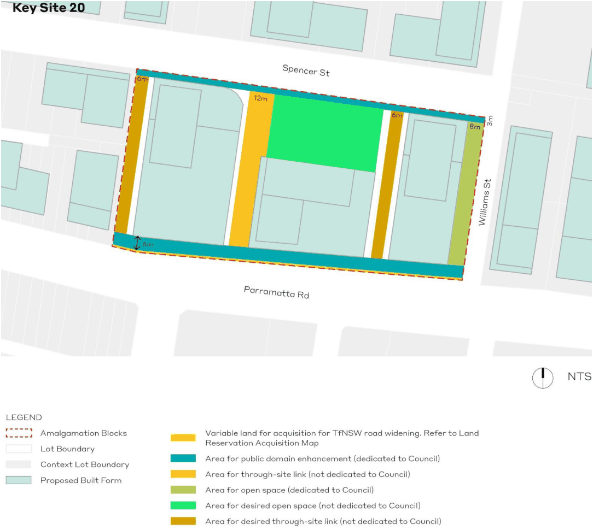

> [Picture on page 41: a picture, saved as a picture (images/prcuts-stage-1-infrastructure-strategy-page-41-1.gif, 150 dpi).]

Land for community infrastructure for Key Site 20 apply to the following lots, sections, deposited plans and strata plans descriptions:

| Lot 1 DP 911313 | Lot A DP 339025 | Lot B DP 339025 | Lot C DP 339025 | Lot 4 DP 981133 |
|---|---|---|---|---|
| Lot 1 DP 540387 | Lot 14 DP 663406 | Lot 15 DP 663407 | Lot 15 DP 455570 | Lot 16 DP 455570 |
| Lot 2 DP 455571 | Lot 17 DP 1117 | Lot 18 DP 1117 | Lot 19 DP 1117 | Lot 23 DP 1117 |
| Lot 2 DP 772186 | Lot 3 DP 772186 | Lot 1 DP 779966 | Lot 1 DP 1048712 | Lot 2 DP 1048712 |
| Lot 1 DP 935576 | Lot 102 DP 839777 |  |  |  |

Figure 25 Key Site 20 – Lands required for embellishment and dedication to Council

Key Site 21 is located at 112-124 Kings Road, Five Dock with an approximate size of 4,830m2. The following provisions of the Canada Bay LEP 2013 apply to the site:

Base maximum building height – 8.5 metres Community infrastructure maximum building height – 17 metres Base floor space ratio – 0.5:1 Community infrastructure floor space ratio – 1.4:1

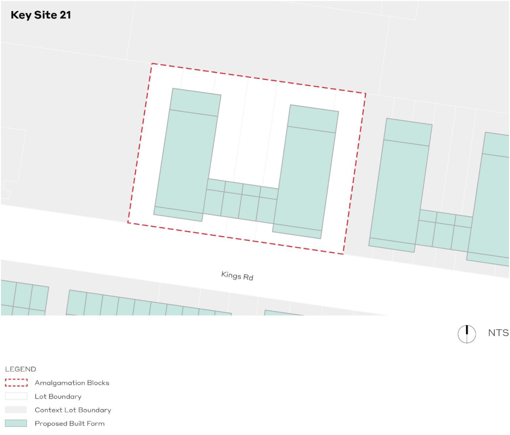

> [Picture on page 42: a picture, saved as a picture (images/prcuts-stage-1-infrastructure-strategy-page-42-7.gif, 150 dpi).]

Figure 26 Key Site 21– Lands required for embellishment and dedication to Council

Key Site 22 is located at 110-98 Kings Road, Five Dock with an approximate size of 4,315m2. The following provisions of the Canada Bay LEP 2013 apply to the site:

Base maximum building height – 8.5 metres Community infrastructure maximum building height – 17 metres Base floor space ratio – 0.5:1 Community infrastructure floor space ratio – 1.4:1

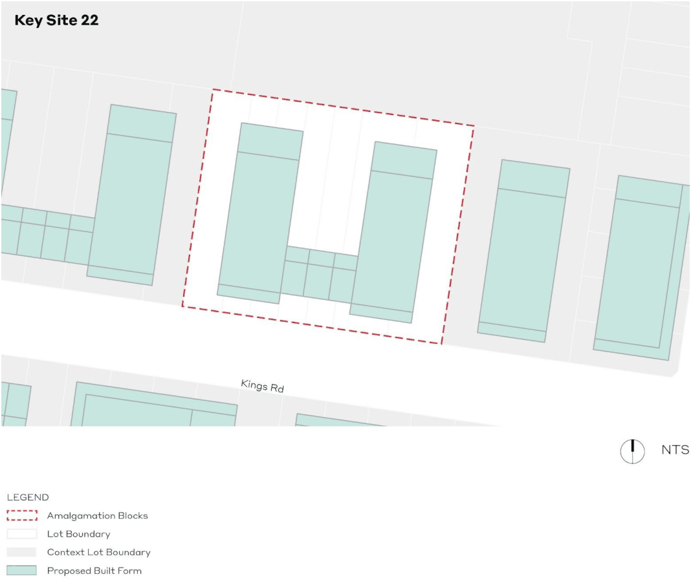

> [Picture on page 43: a picture, saved as a picture (images/prcuts-stage-1-infrastructure-strategy-page-43-7.gif, 150 dpi).]

Figure 27 Key Site 22 – Lands required for embellishment and dedication to Council

Key Site 23 is located at 92-96 Kings Road, Five Dock with an approximate size of 2,130m2. The following provisions of the Canada Bay LEP 2013 apply to the site:

Base maximum building height – 8.5 metres Community infrastructure maximum building height – 17 metres Base floor space ratio – 0.5:1 Community infrastructure floor space ratio – 1.4:1

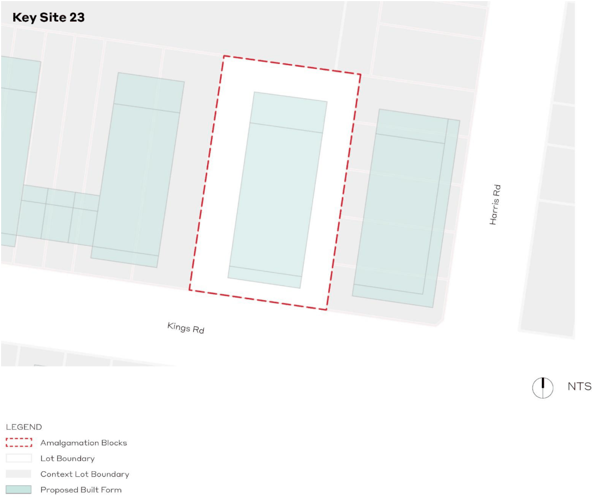

> [Picture on page 44: a picture, saved as a picture (images/prcuts-stage-1-infrastructure-strategy-page-44-7.gif, 150 dpi).]

Figure 28 Key Site 23 – Lands required for embellishment and dedication to Council

Key Site 24 is located at 1A-9 Harris Road, Five Dock with an approximate size of 1,800m2. The following provisions of the Canada Bay LEP 2013 apply to the site:

Base maximum building height – 8.5 metres Community infrastructure maximum building height – 13 metres Base floor space ratio – 0.5:1 Community infrastructure floor space ratio – 1.4:1

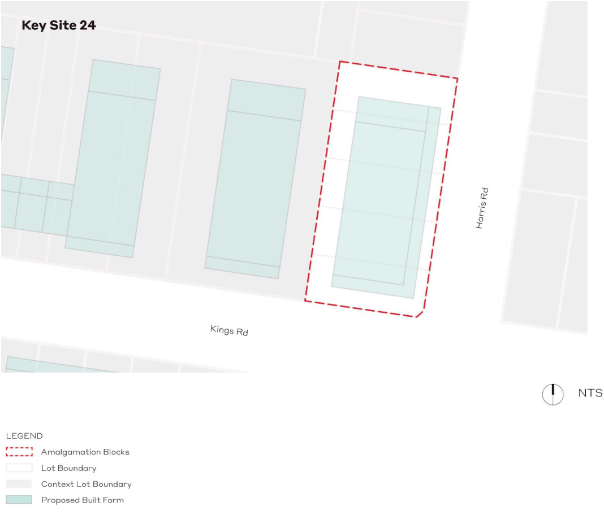

> [Picture on page 45: a picture, saved as a picture (images/prcuts-stage-1-infrastructure-strategy-page-45-7.gif, 150 dpi).]

Figure 29 Key Site 24– Lands required for embellishment and dedication to Council

Key Site 25 is located at 129-133 Kings Road, Five Dock and 118-130 Queens Road, Five Dock with an approximate size of 9200m2. The following provisions of the Canada Bay LEP 2013 apply to the site:

Base maximum building height – 12 metres Community infrastructure maximum building height – part 10 metres and part 17 metres Base floor space ratio – 1.0:1 Community infrastructure floor space ratio – 1.4:1

Community infrastructure will include:

A pedestrian link (minimum 6m in width) connecting Queens Road and Kings Road that will support pedestrian and cyclist movements. Public domain enhancements 3m in width along Queens Road for a paved and landscaped setback to provide comfortable and amenable pedestrian thoroughfare along the street, and activation where supported by adjacent ground floor building uses.

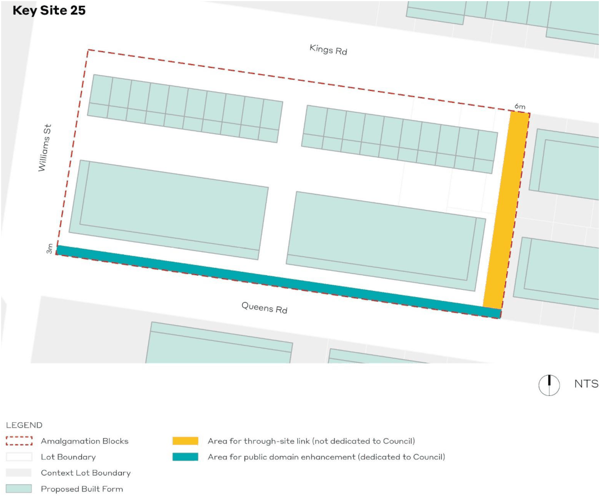

> [Picture on page 46: a picture, saved as a picture (images/prcuts-stage-1-infrastructure-strategy-page-46-13.gif, 150 dpi).]

Land for community infrastructure for Key Site 25 apply to the following lots, sections, deposited plans and strata plans descriptions: SP 30687

Lot 15 DP 15564

Figure 30 Key Site 25– Lands required for embellishment and dedication to Council

Key Site 26 is located at 119-127 Kings Road, Five Dock with an approximate size of 1,950m2. The following provisions of the Canada Bay LEP 2013 apply to the site:

Base maximum building height – part 8.5m and part 12 metres Community infrastructure maximum building height – 17 metres Base floor space ratio – part 0.5:1 and part 1.0:1 Community infrastructure floor space ratio – 1.4:1

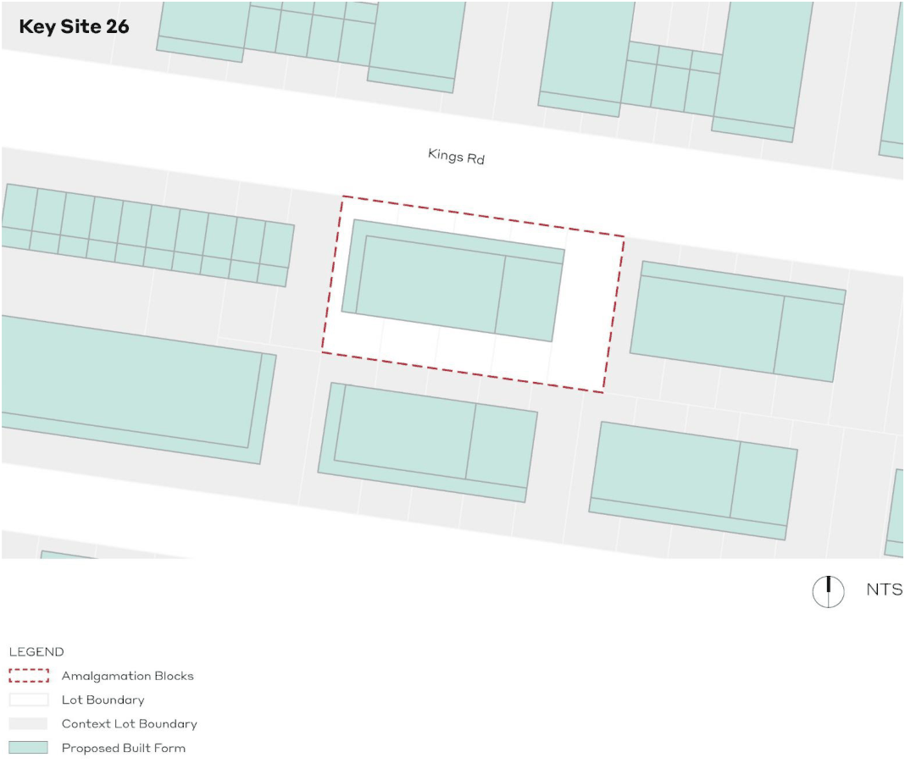

> [Picture on page 47: a picture, saved as a picture (images/prcuts-stage-1-infrastructure-strategy-page-47-7.gif, 150 dpi).]

Figure 31 Key Site 26– Lands required for embellishment and dedication to Council

Key Site 27 is located at 109-117 Kings Road, Five Dock with an approximate size of 1,950m2. The following provisions of the Canada Bay LEP 2013 apply to the site:

Base maximum building height – 8.5 metres Community infrastructure maximum building height – 17 metres Base floor space ratio – 0.5:1 Community infrastructure floor space ratio – 1.4:1

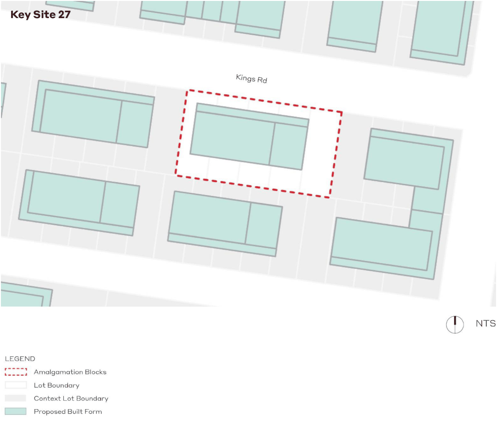

> [Picture on page 48: a picture, saved as a picture (images/prcuts-stage-1-infrastructure-strategy-page-48-7.gif, 150 dpi).]

Figure 32 Key Site 27 – Lands required for embellishment and dedication to Council

Key Site 28 is located at 101-107 Kings Road, Five Dock with an approximate size of 1,525m2. The following provisions of the Canada Bay LEP 2013 apply to the site:

Base maximum building height – 8.5 metres Community infrastructure maximum building height – 17 metres Base floor space ratio – 0.5:1 Community infrastructure floor space ratio – 1.4:1

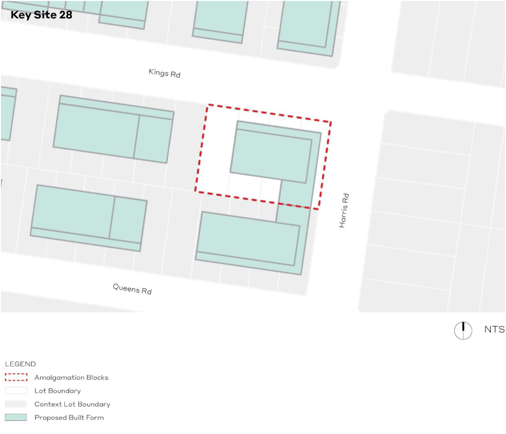

> [Picture on page 49: a picture, saved as a picture (images/prcuts-stage-1-infrastructure-strategy-page-49-7.gif, 150 dpi).]

Figure 33 Key Site 28– Lands required for embellishment and dedication to Council

Key Site 29 is located at 110-116 Queens Road, Five Dock with an approximate size of 1,800m2. The following provisions of the Canada Bay LEP 2013 apply to the site:

Base maximum building height – 12 metres Community infrastructure maximum building height – 17 metres Base floor space ratio – 1.0:1 Community infrastructure floor space ratio – 1.4:1

Community infrastructure will include:

Public domain enhancements 3m in width along Queens Road for a paved and landscaped setback to provide comfortable and amenable pedestrian thoroughfare along the street, and activation where supported by adjacent ground floor building uses.

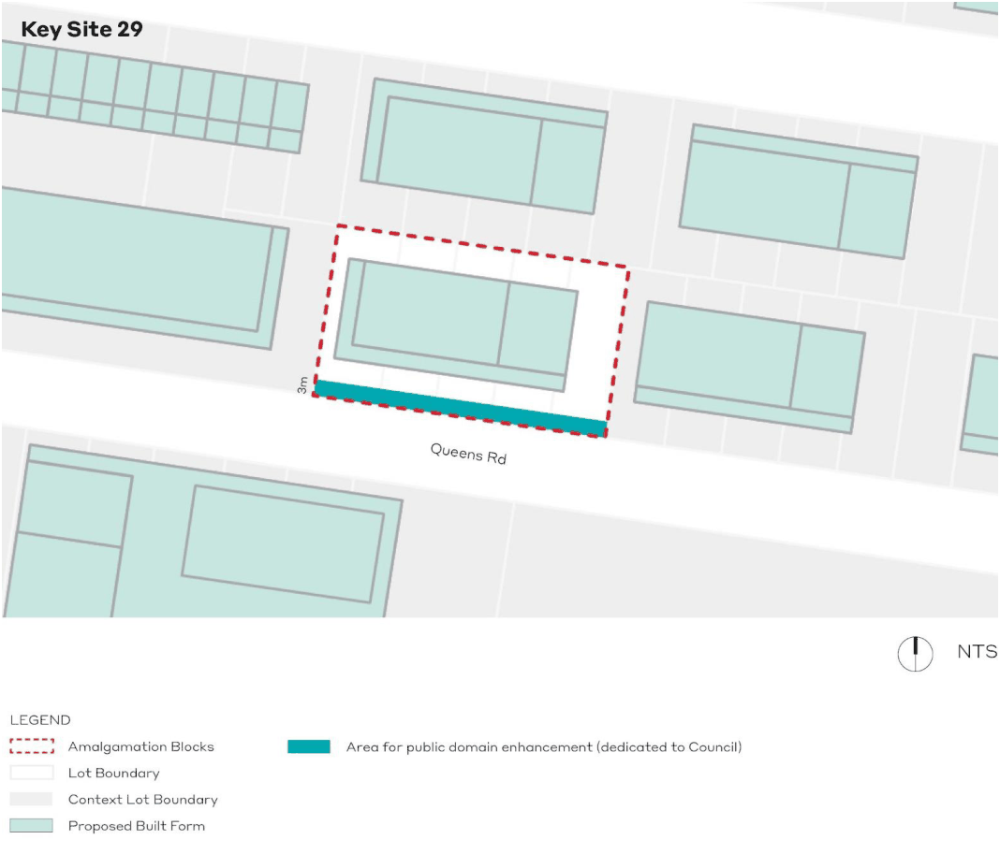

> [Picture on page 50: a picture, saved as a picture (images/prcuts-stage-1-infrastructure-strategy-page-50-11.gif, 150 dpi).]

Land for community infrastructure for Key Site 29 apply to the following lots, sections, deposited plans and strata plans descriptions: Lot 11 DP 15516 Lot 12 DP 15516 Lot 13 DP 15516 Lot 14 DP 15516 Lot 15 DP 15516 Figure 34 Key Site 29 – Lands required for embellishment and dedication to Council

Key Site 30 is located at 100-108 Queens Road, Five Dock with an approximate size of 1,780m2. The following provisions of the Canada Bay LEP 2013 apply to the site:

Base maximum building height – 12 metres Community infrastructure maximum building height – 17 metres Base floor space ratio – 1.0:1 Community infrastructure floor space ratio – 1.4:1

Community infrastructure will include:

Public domain enhancements 3m in width along Queens Road for a paved and landscaped setback to provide comfortable and amenable pedestrian thoroughfare along the street, and activation where supported by adjacent ground floor building uses.

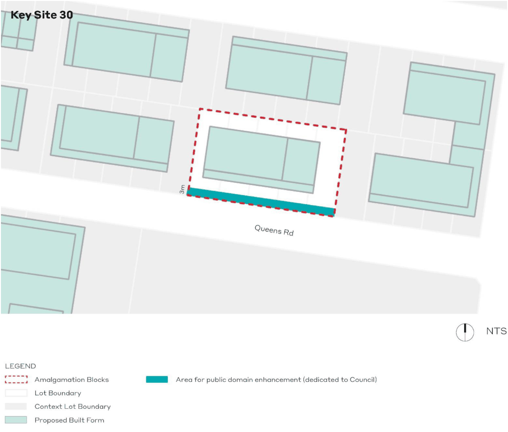

> [Picture on page 51: a picture, saved as a picture (images/prcuts-stage-1-infrastructure-strategy-page-51-11.gif, 150 dpi).]

Land for community infrastructure for Key Site 30 apply to the following lots, sections, deposited plans and strata plans descriptions: Lot 6 DP 15516 Lot 7 DP 15516 Lot 8 DP 15516 Lot 9 DP 15516 Lot 10 DP 15516 Figure 35 Key Site 30 – Lands required for embellishment and dedication to Council

Key Site 31 is located at 90-98 Queens Road, Five Dock with an approximate total size of 1,785m2. The following provisions of the Canada Bay LEP 2013 apply to the site:

Base maximum building height – 12 metres Community infrastructure maximum building height – 17 metres Base floor space ratio – 1.0:1 Community infrastructure floor space ratio – 1.4:1 Community infrastructure will include:

Public domain enhancements 3m in width along Queens Road for a paved and landscaped setback to provide comfortable and amenable pedestrian thoroughfare along the street, and activation where supported by adjacent ground floor building uses.

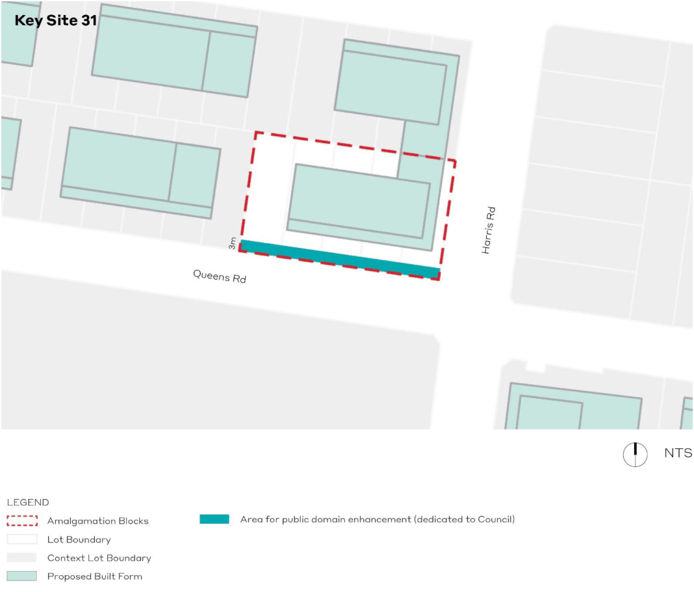

> [Picture on page 52: a picture, saved as a picture (images/prcuts-stage-1-infrastructure-strategy-page-52-11.gif, 150 dpi).]

Land for community infrastructure for Key Site 31 apply to the following lots, sections, deposited plans and strata plans descriptions: Lot 1 DP 15516 Lot 2 DP 15516 Lot 3 DP 15516 Lot 4 DP 15516 Lot 5 DP 15516 Figure 36 Key Site 31– Lands required for embellishment and dedication to Council

Key Site 32 is located at 129-147 Parramatta Road, Five Dock, and 57 Queens Road, Five Dock with an approximate size of 31,410m2. The following provisions of the Canada Bay LEP 2013 apply to the site:

Base maximum building height – 12 metres Community infrastructure maximum building height – part 19 metres, part 35 metres, part 61 metres, part 67 metres and part 79 metres Base floor space ratio – 1.0:1 Community infrastructure floor space ratio – 3.0:1

Community infrastructure will include:

Public domain enhancements (minimum width of 6m) and additional public domain enhancements in accordance with Transport for New South Wales requirements (variable width up to 2.07m) on Parramatta Road. The public domain enhancements will also involve kerbside trees, shared paths, footpaths and landscaping beds. Public open space on the corner of Queens Road and William Street (minimum of 2,290m2) to support outdoor dining spaces, a formal breakout lawn space with tree planting, interactive public art elements and a formal paved plaza space for activation with community events. Public domain enhancements 3m in width along Queens Road for a paved and landscaped setback to provide comfortable and amenable pedestrian thoroughfare along the street, and activation supported by adjacent ground floor building uses. A new road corridor (minimum width 18m). This will involve road pavement, footpaths, kerb and guttering, stormwater, kerbside trees, and landscaping. A pedestrian link 12m in width will be provided at the eastern boundary to connect Parramatta Road and the new road, to provide valuable pedestrian and bicycle access between the road networks. Three desired pedestrian links 6m wide, two linking Queens Road through to Parramatta Road and one linking Parramatta Road to the new public open space.

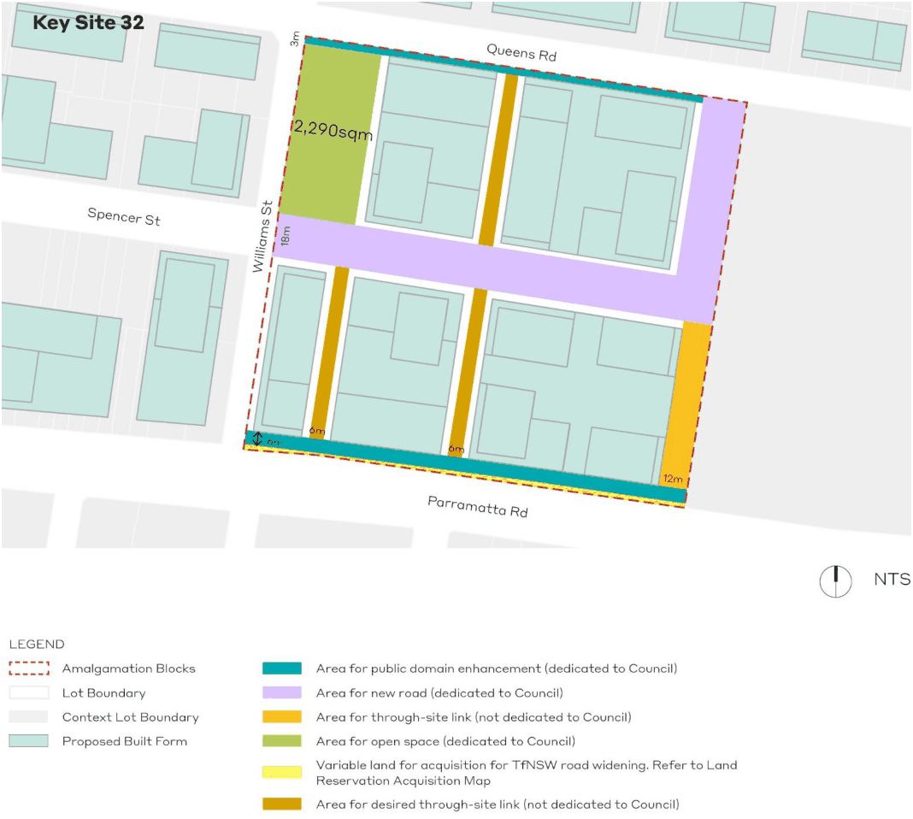

> [Picture on page 54: a picture, saved as a picture (images/prcuts-stage-1-infrastructure-strategy-page-54-1.gif, 150 dpi).]

Land for community infrastructure for Key Site 32 apply to the following lots, sections, deposited plans and strata plans descriptions: Lot 1 DP 180829 Lot 1 DP 82068 Lot 1 DP 2591225 Lot A DP 332646 Lot B DP 332646 Lot A DP 401689 Lot 1 DP 872782 Lot 40 DP 1097688 Lot 41 DP 1097688 Lot X DP 386093 Lot Y DP 386093

Figure 37 Key Site 32 – Lands required for embellishment and dedication to Council

Key Site 33 is located at 49-51 Queens Road, Five Dock with an approximate size of 3,075m2. The following provisions of the Canada Bay LEP 2013 apply to the site:

Base maximum building height – 12 metres Community infrastructure maximum building height – 28 metres Base floor space ratio – 1.0:1 Community infrastructure floor space ratio – 1.8:1

Community infrastructure will include:

A desired  pedestrian through-site link (minimum width of 3m) to provide pedestrian and bicycle access between Harris Street and Courland Street. Finishes and treatment are to be contiguous with the pedestrian through-site link adjoining on the southern boundary (Key Site 34 and Key Site 35).

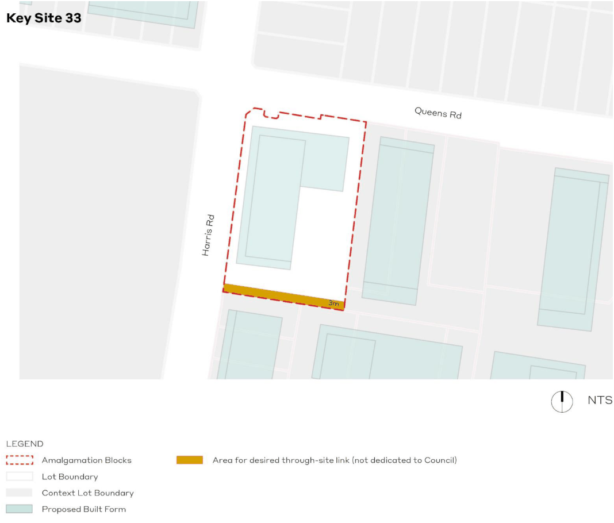

> [Picture on page 55: a picture, saved as a picture (images/prcuts-stage-1-infrastructure-strategy-page-55-11.gif, 150 dpi).]

Land for community infrastructure for Key Site 33 apply to the following lots, sections, deposited plans and strata plans descriptions:

SP 83068 Figure 38 Key Site 33 – Lands required for embellishment and dedication to Council

Key Site 34 is located at 75-77 Parramatta Road, Five Dock and 2A-10 Harris Road, Five Dock with an approximate size of 2,685m2. The following provisions of the Canada Bay LEP 2013 apply to the site:

Base maximum building height – 12 metres Community infrastructure maximum building height – 22 metres Base floor space ratio – 1.0:1 Community infrastructure floor space ratio – 1.8:1

Community infrastructure will include:

Public domain enhancements (minimum width of 6m) and additional public domain enhancements in accordance with Transport for New South Wales requirements (variable width up to 1.58m)  including landscaping, a shared path setback from the kerb and bordered by understorey planting to provide a sense of separation between the adjacent roadway and footpath areas, and street tree planting set back from the road edge to avoid conflicts within clear zone requirements. A desired through-site link  connecting Harris Road to Key Site 33 and Key Site 35 (minimum width of 6m). Finishes and treatment are to be contiguous with the pedestrian through-site link adjoining on the southern boundary (Key Site 34 and Key Site 35).

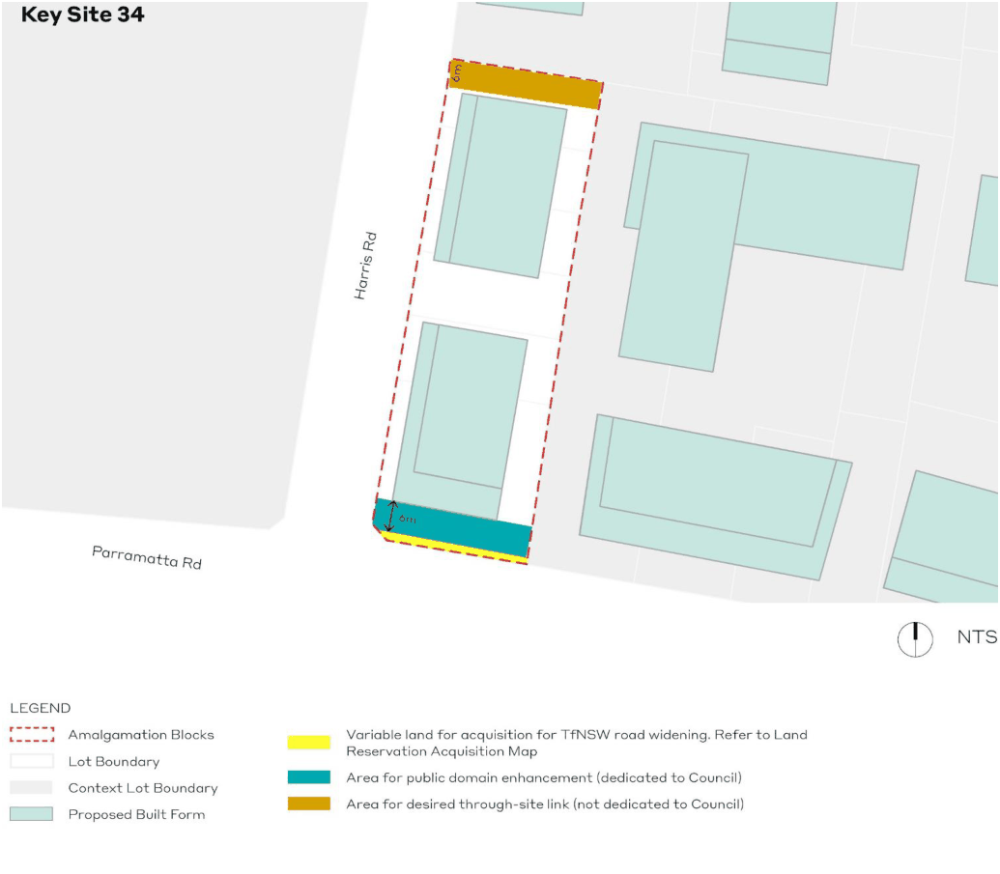

> [Picture on page 56: a picture, saved as a picture (images/prcuts-stage-1-infrastructure-strategy-page-56-15.gif, 150 dpi).]

Land for community infrastructure for Key Site 34 apply to the following lots, sections, deposited plans and strata plans descriptions: Lot 11 DP 718237

Lot 12 DP 718237

Lot 1 DP 320484

Figure 39 Key Site 34 – Lands required for embellishment and dedication to Council

Key Site 35

Key Site 35 is located at 51-65 Parramatta Road, Five Dock and 33-43 Queens Street, Five Dock with an approximate size of 18,625m2. The following provisions of the Canada Bay LEP 2013 apply to Key Site 32:

Base maximum building height – 12 metres Community infrastructure maximum building height – part 20 metres, part 22m, part 28 metres and part 35 metres Base floor space ratio – 1.0:1 Community infrastructure floor space ratio – 1.8:1 Community infrastructure will include:

Public domain enhancements (minimum width of 6m) and additional public domain enhancements in accordance with Transport for New South Wales requirements (variable width up to 1.9m)  including street tree planting and a shared path setback from the kerb and bordered by understorey planting to provide a sense of separation between the adjacent roadway and footpath areas. A neighbourhood park (minimum 2,910m2) fronting Queens Road that will create a new recreational space for the daily social activities and gatherings of the community. A desired neighbourhood park (minimum 900m2) located centrally within Key Site 32 and to support the immediate recreational needs of the local residents and community. A pedestrian through-site link connecting the neighbourhood park and Parramatta Road (minimum width of 6m). A desired pedestrian through-site link south connecting to Key Site 33 and Key Site 34 (minimum width of 6m).. Finishes and treatment are to be contiguous with the pedestrian through-site link adjoining on the western boundary (Key Site 33 and Key Site 34).

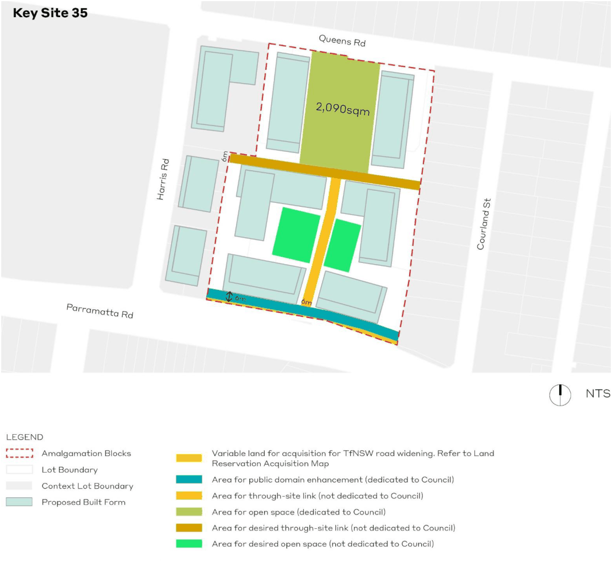

> [Picture on page 58: a picture, saved as a picture (images/prcuts-stage-1-infrastructure-strategy-page-58-1.gif, 150 dpi).]

Land for community infrastructure for Key Site 35 apply to the following lots, sections, deposited plans and strata plans descriptions:

| Lot 13 DP 718237 | Lot 14 DP 718237 | Lot 15 DP 718237 | Lot 16 DP 718237 | Lot 17 DP 718237 |
|---|---|---|---|---|
| Lot B DP 366113 | Lot 4 DP 421391 | Lot 1 DP 788226 | Lot A DP 360990 | Lot B 360990 |

Figure 40 Key Site 35 – Lands required for embellishment and dedication to Council
