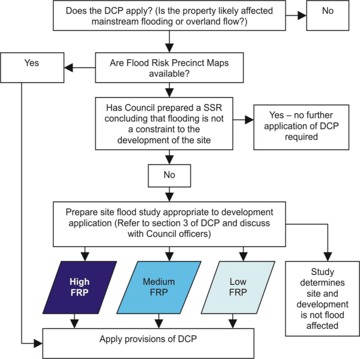
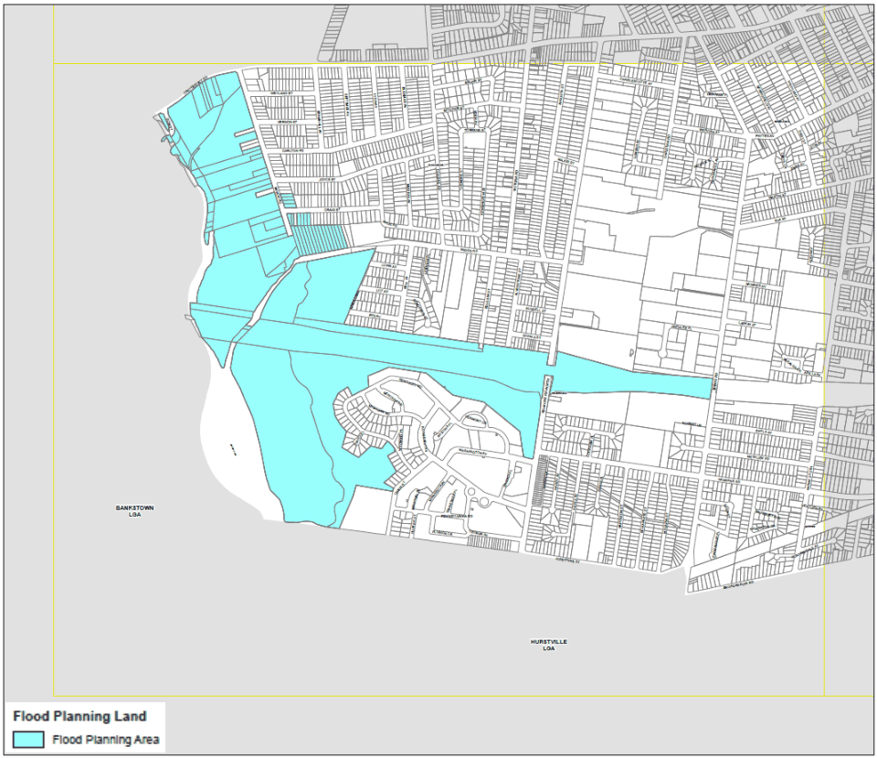
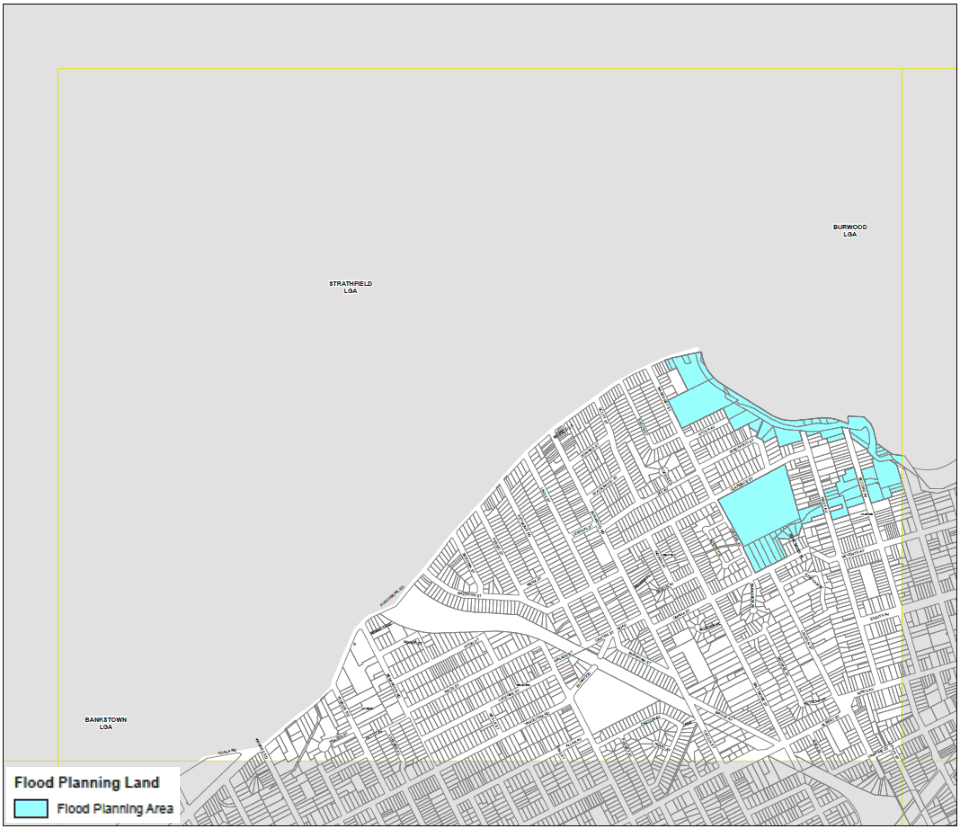
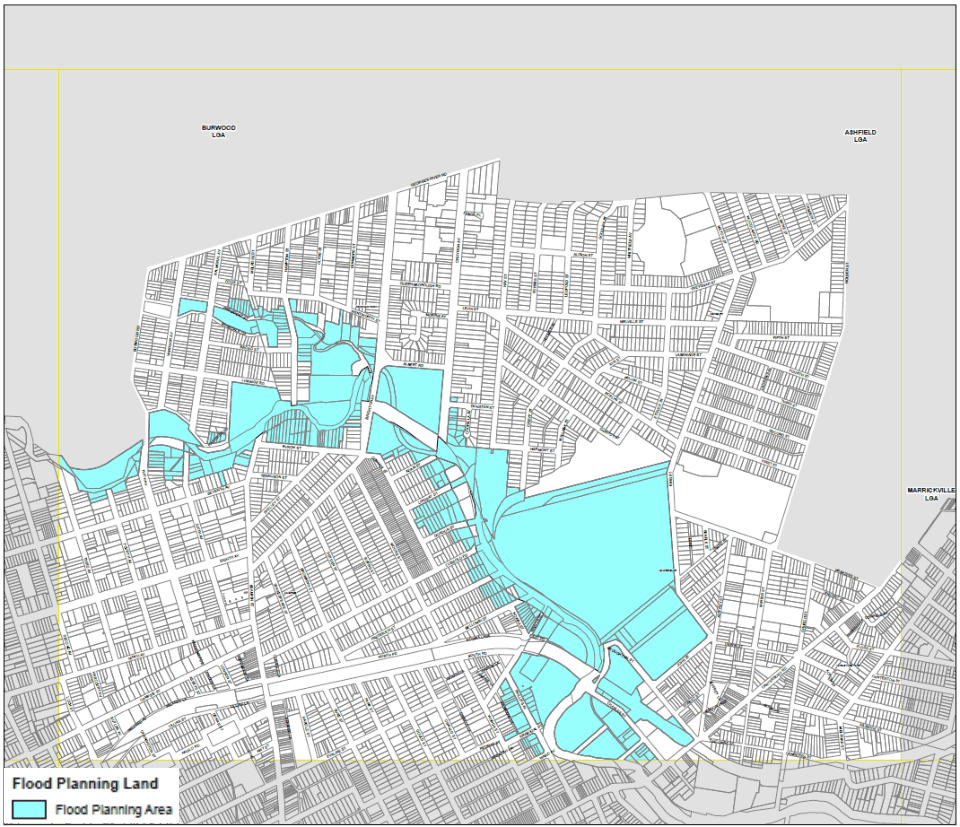
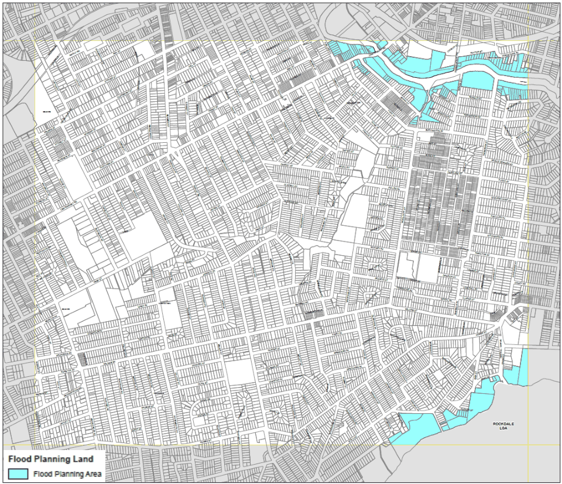
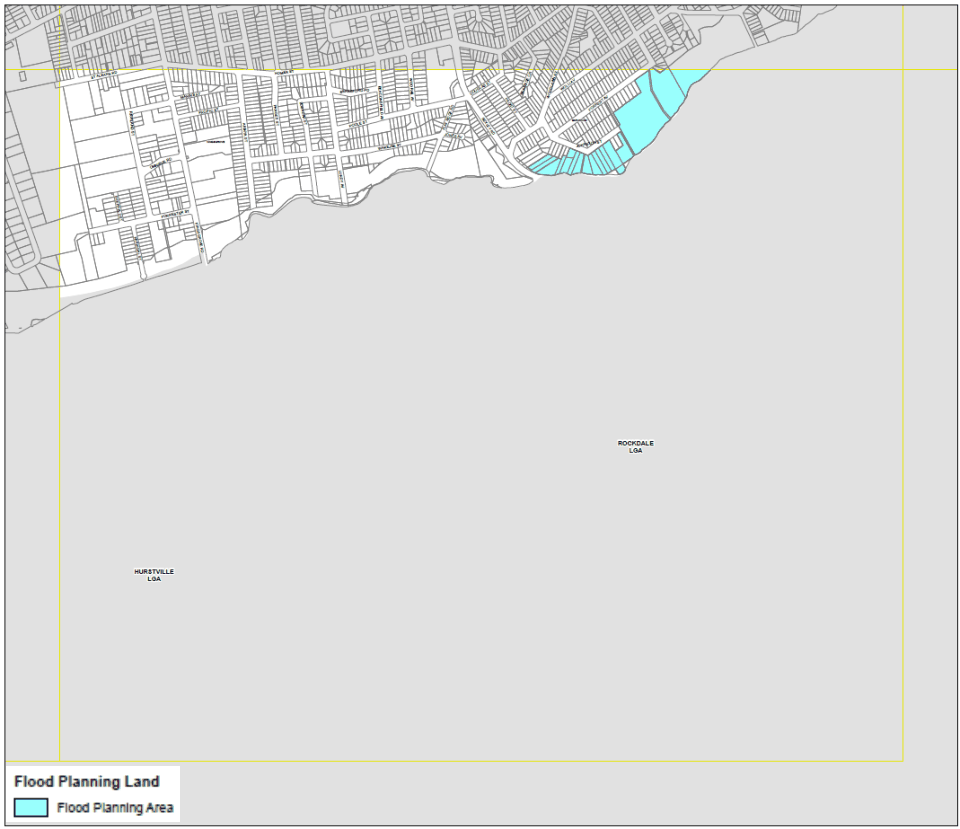
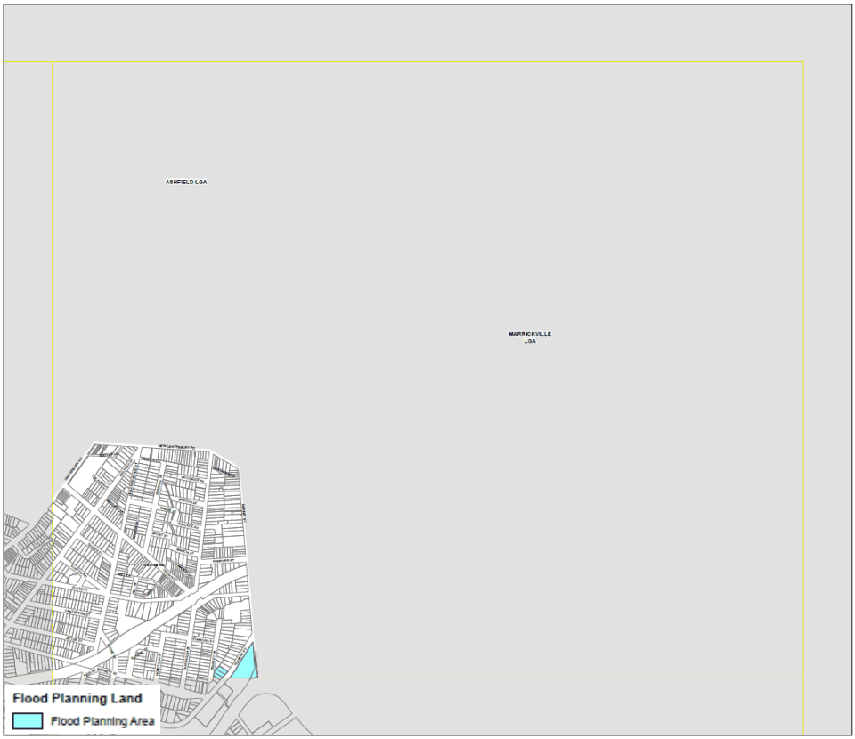
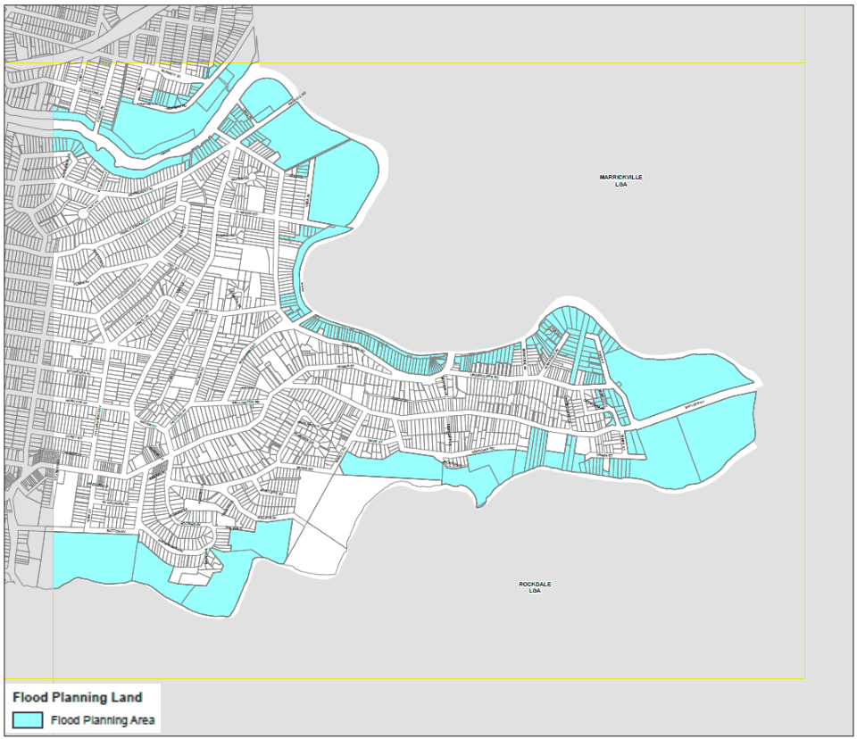

### 7.1 Follow these major steps to lodge the application:

(a) Check the proposal is permissible in the zoning of the land by reference to any applicable environmental planning instruments.

(b) Consider any other relevant planning controls of Council (e.g. controls in any other relevant part of this DCP).

(c) Determine the applicable floodplain or component thereof (e.g. Georges River, Carinya Road Area) and flood risk precinct (low, medium or high) within which your site is situated. Enquire with Council regarding existing flood risk mapping or whether a site-specific assessment may be warranted (for example, if local overland flooding is a potential problem). A site may be located in more than one precinct and the assessment must consider the controls for each precinct relative to where the site is located. The flow diagram below summarises this consideration process.

> [Picture on page 59: a picture, saved as a picture (images/ch-02-02-flood-risk-management-page-59-15.gif, 150 dpi).]

(d) Determine the land use category relevant to the development proposal, by firstly confirming how it is defined by the relevant environmental planning instrument and secondly by ascertaining the land use category from Schedule 2.

(e) Assess and document how the proposal will achieve the performance criteria for development and associated fencing provided by Chapter 2.2 of this DCP.

(f) Check if the proposal will satisfy the prescriptive controls for different land use categories in different flood risk precincts, as specified in the Schedule 3 or 4 depending on which floodplain the site is located.

(g) If the proposal does not comply with the prescriptive controls, determine whether the performance criteria are nonetheless achieved.

(h) Illustrations provided in this plan to demonstrate the intent of development controls are diagrammatic only. Proposals must satisfy all relevant controls contained in this plan and associated legislation.

(i) The assistance of Council staff or an experienced floodplain consultant may be required at various steps in the process to ensure that the requirements of this Plan are fully and satisfactorily addressed.

Note: Compliance with all the requirements of this DCP does not guarantee that an application will be approved.

7.2 Information required with an application to address this plan is as follows:

(a) Applications must include information which addresses all relevant controls listed above, and the following matters as applicable.

(b) Applications for Concessional Development (see Schedule 2) to an existing dwelling on Flood Prone Land shall be accompanied by documentation from a registered surveyor confirming existing floor levels.

(c) Applications affected by this plan shall be accompanied by a survey plan showing:

(i) The position of the existing building(s) or proposed building(s);

(ii) The existing ground levels to Australian Height Datum around the perimeter of the building and contours of the site; and

(iii) The existing or proposed floor levels to Australian Height Datum.

(d) Applications for earthworks, filling of land and subdivision shall be accompanied by a survey plan (with a contour interval of 0.25m) showing relative levels to Australian Height Datum.

(e) For large scale developments, or developments in critical situations, particularly where an existing catchment based flood study is not available, a flood study using a fully dynamic one or two dimensional computer model may be required. For smaller developments the existing flood study may be used if available and suitable (e.g. it contains sufficient local detail), or otherwise a flood study

prepared in a manner consistent with the ‘Australian Rainfall and Runoff’ publication, Council’s Development Engineering Standards Guide and the Floodplain Development Manual, will be required. From this study, the following information shall be submitted in plan form:

(i) water surface contours;

(ii) velocity vectors;

(iii) velocity and depth product contours;

(iv) delineation of flood risk precincts relevant to individual floodplains; and

(v) show both existing and proposed flood profiles for the full range of events for total development including all structures and works (such as revegetation/enhancements).

This information is required for the pre-developed and post-developed scenarios.

(f) Where the controls for a particular development proposal require an assessment of structural soundness during potential floods, the following impacts must be addressed:

(i) hydrostatic pressure;

(ii) hydrodynamic pressure;

(iii) impact of debris; and

(iv) buoyancy forces.

Foundations need to be included in the structural analysis.

## SECTION 8–DEFINITIONS

adequate warning systems, signage and exits means where the following is provided:

(a) an audible and visual alarm system which alerts occupants to the need to evacuate, sufficiently prior to likely inundation to allow for the safe evacuation of pedestrians and vehicles;

(b) signage to identify the appropriate procedure and route to evacuate; and

(c) exits which are located such that pedestrians evacuating any location during any flood do not have to travel through deeper water to reach a place of refuge above the 100-year flood away from the enclosed car parking.

average exceedence probability (AEP) means the magnitude of a storm.

Average Recurrence Interval (ARI) means the long term average number of years between the occurrence of a flood as big as, or larger than, the selected event. For example, floods with a discharge as great as, or greater than, the 20-year ARI flood event will occur on average once every 20 years. ARI is another way of expressing the likelihood of occurrence of a flood event.

catch drain means a diversion channel constructed above a road or batter to intercept surface water.

channel means a natural stream that conveys water, a ditch or drain excavated for the flow of water.

culvert means one or more adjacent pipes or enclosed conduits for carrying a watercourse beneath a road or other earthworks.

designated flood means the 1 in 100-year flood for the Georges River.

designated flood level means the level reached by a 1 in 100-year flood as advised by the Department of Public Works and Services in 1986.

effective warning time means the time available after receiving advice of an impending flood and before the floodwaters prevent appropriate flood response actions being undertaken. The effective warning time is typically used to move farm equipment, move stock, raise furniture, evacuate people and transport their possessions.

enclosed car parking means car parking which is potentially subject to rapid inundation, which consequently increases risk to human life and property (such as basement of bunded car parking areas).  The following criteria apply for the purposes of determining what is enclosed car parking:

(a) flooding of surrounding areas may raise water levels above the perimeter which encloses the car park (normally the entrance), resulting in rapid inundation of the car park to depths greater than 0.8m; and

(b) drainage of accumulated water in the car park has an outflow discharge capacity significantly less than the potential inflow capacity.

extreme flood means an estimate of the probable maximum flood, which is the largest flood likely to ever occur.

fail safe access for pedestrians means a reliable and permanent system which will allow safe evacuation for pedestrians up to and including the 100-year flood and may include a walkway and stairs designed in accordance with the Building Code of Australia, or where necessitated by topography, fixed ladders designed in accordance with the Australian Standard AS 1657, located at or above the 100-year flood level.

fail safe access for motor vehicles means a reliable and permanent system which will allow the safe movement of vehicles during all floods up to and including the 100-year flood.

flood means a relatively high stream flow which overtops the natural or artificial banks in any part of a stream, river, estuary, lake or dam, and/or local overland flooding associated with major drainage as defined by the FDM before entering a watercourse.

Note: Consistent with the FDM, this DCP does not apply in the circumstances of local drainage inundation as defined in the FDM and determined by Council.  Local drainage problems can generally be minimised by the adoption of urban building controls requiring a minimum difference between finished floor and ground levels.

flood awareness means an appreciation of the likely effects of flooding and a knowledge of the relevant flood warning and evacuation procedures.

flood compatible building components means a combination of measures incorporated in the design and/or construction and alteration of individual buildings or structures subject to flooding, and the use of flood compatible materials for the reduction or elimination of flood damage.

flood compatible materials mean the materials used in building which are resistant to damage when inundated.

flood evacuation strategy means the proposed strategy for the evacuation of areas within effective warning time during periods of flood as specified within any policy of Council, the FRMP, the relevant SES Flood Plan, by advices received from the State Emergency Services (SES) or as determined in the assessment of individual proposals.

flood plan means a management plan prepared in consultation with the State Emergency Services (SES) which demonstrates the means to minimise the likelihood of flood damage, including demonstrated ability to move goods above the flood level within the likely available flood warning time and a strategy to safely evacuate persons on the site.

Floodplain Risk Management Plan (FRMP) means a plan prepared for one or more floodplains in accordance with the requirements of the FDM or its predecessor of which this DCP forms part.

Floodplain Risk Management Study (FRMS) means a study prepared for one or more floodplains in accordance with the requirements of the FDM or its predecessor.

flood prone land (being synonymous with flood liable and floodplain) is the area of land which is subject to inundation by the probable maximum flood (PMF).

flood proofing means a combination of measures incorporated in the design and/or construction and alteration of individual buildings or structures subject to flooding, for the reduction or elimination of flood damage as indicated in the Floodplain Development Manual.

freeboard means a factor of safety expressed as the height above the design flood level. Freeboard provides a factor of safety to compensate for uncertainties in the estimation of flood levels across the floodplain, such and wave action, localised hydraulic behaviour and impacts that are specific event related, such as levee and embankment settlement, and other effects such as “greenhouse” and climate change.

habitable room means a room used for normal domestic activities that includes a bedroom, living room, lounge room, music room, television room, kitchen, dining room, sewing room, study, playroom and sunroom; but excludes a bathroom, laundry, water closet, food storage pantry, walk-in wardrobe, corridor, hallway, lobby, photographic darkroom, clothes drying room, and other spaces of specialised nature occupied neither frequently nor for extended periods.

habitable floor area means:

(a) in a residential situation: a living or working area, such as a lounge room, dining room, rumpus room, kitchen, bedroom or workroom; and

(b) in an industrial or commercial situation: an area used for offices or to store valuable possessions susceptible to flood damage in the event of a flood.

hazard means a source of potential harm or a situation with a potential to cause loss. In relation to this plan, the hazard is flooding which has the potential to cause harm or loss to the community.

high hazard flood fringe areas mean the areas subject to inundation in a designated flood of 1m or more, but not including floodway areas, interim floodways, or the special development areas referred to in this DCP.

high hazard flood fringe areas mean the areas subject to inundation in a designated flood of 1m or more.

hydraulic hazard is the hazard as determined by the provisional criteria outlined in the FDM in a 100-year flood event.

interim floodways mean the areas subject to current investigations to determine the extent and severity of the flood hazard. In the case of severe hazard, the investigation should determine whether or not flood mitigation measures can and should be introduced to reduce the hazard to that normally associated with high hazard flood fringe areas. This would allow Council to approve new buildings and additions. Only one interim floodway currently exists and this is located in the vicinity of MacLaurin Avenue and Henry Lawson Drive, East Hills.

local overland flooding means inundation by local runoff rather than overbank discharge from a stream, river, estuary, lake or dam.

low hazard flood fringe areas mean those areas subject to inundation in a designated flood to a depth of less than 1m.

merit approach is an approach, the principles of which are embodied in the FDM which weighs social, economic, ecological and cultural impacts of land use options for different flood prone areas together with flood damage, hazard and behaviour implications, and environmental protection and well-being of the State’s rivers and floodplains.

100-year flood means the flood that has a 1% chance of occurring or being exceeded in any year.

probable maximum flood (PMF) means the largest flood that could conceivably occur at a particular location, usually estimated from probable maximum precipitation.

probable maximum precipitation (PMP) means the greatest depth of precipitation for a given duration meteorologically possible over a given size storm area at a particular location at a particular time of the year, with no allowance made for long-term climatic trends (World Meteorological Organisation, 1986). It is the primary input to the estimation of the probable maximum flood.

probability means a statistical measure of the expected chance of flooding (see ARI).

reliable access during a flood means the ability for people to safely evacuate an area subject to flooding, having regard to the depth and velocity of flood waters, the suitability of the evacuation route, and without a need to travel through areas where water depths increase.

risk means the chance of something happening that will have an impact. It is measured in terms of consequences and probability (likelihood). In the context of this plan, it is the likelihood of consequences arising from the interaction of floods, communities and the environment.

Site Emergency Response Flood Plan (not being an SES Flood Plan) is a management plan that demonstrates the ability to safely evacuate persons and include a strategy to move goods above the flood level within the available warning time. This Plan must be consistent with any flood evacuation strategy, flood plan or similar plan adopted by Council.

watercourse means a natural or constructed channel for the flow of water.

## SECTION 9–FLOOD RISK MANAGEMENT IN THE FORMER CANTERBURY LOCAL GOVERNMENT AREA

#### Explanation

Council must ensure that all stormwater and flood infrastructure provided with development meets appropriate design and environmental standards and be complementary to its public infrastructure.

Sections 9–10 provides objectives and controls for stormwater and flood management and applies to all development. The objectives and controls are intended to prevent or reduce the impact of development through:

• requiring integrated stormwater design between development and Council’s assets and the use of on-site detention of stormwater; and

• managing the potential impact of flood to development on flood liable land.

#### Land to which sections 9–10 apply

Sections 9–10 of Chapter 2.2 apply to land in the former Canterbury Local Government Area.

#### Objectives

O1 To ensure infrastructure design and construction is appropriate to each site.

O2 To ensure drainage systems are designed to collect and convey stormwater runoff from the site and into receiving systems with minimal nuisance, danger or damage to the site, adjoining properties or Council’s property.

O3 To produce quality engineering works for all developments.

O4 To encourage the consideration of possible engineering constraints to the development at the first stage of the design of the development.

O5 To ensure public infrastructure managed by Council is not compromised by development.

#### Development controls

#### Overland flow path

Surface overland flow paths are an integral part of the drainage system and must be considered at the design stage of the stormwater system. They are to be preserved and maintained unobstructed throughout the developed site and adjoining properties.

9.1 Do not obstruct any overland flow path. Council will enforce the removal of any obstruction to overland flow within private properties and recover from the owners the cost of carrying out such work.

9.2 Do not obstruct existing runoff, entering the site from upstream properties or sub-catchments, from flowing into the subject site, or redirect it to increase the quantity or concentration of surface runoff entering adjoining properties.

Note: During periods of heavy rainfall, it is anticipated that there will be potential runoff, across boundaries of some properties, which will enter downstream sites from upstream properties due to the local contours of the area.

9.3 Consider potential runoff at the design stage and design so it will not have any adverse impact on adjoining properties. Overland flow should not be obstructed from flowing naturally and is not to pond or concentrate along boundaries of adjoining properties. Suitable channels, open dish drains, walls or any other measures may be necessary to accommodate the existing and potential overland flow paths throughout the subject site.

9.4 Care must be exercised to ensure that provision of any of the above remedial measures will not result in diverting runoff into the OSD system, if this is unattainable, then the OSD system must be designed to cater for the additional stormwater runoff anticipated from upstream catchment area(s).

9.5 Council may require that the design specify the extent of the overland flow path through the site, and that the development be located/modified clear of the overland flow path or set at an appropriate freeboard.

#### Areas subject to possible flooding

9.6 OSD is not required on sites affected by 1 in 100-year flooding (mainstream flooding not overland flow).

Note: Council has a record of the flood levels for properties adjacent to the Cooks River and the Salt Pan Creek. Council will issue flood levels on written request, subject to a fee. Flood levels will be issued to Australian Height Datum to the nearest 100mm. Levels for the 1 in 20-year flood, 1 in 50-year flood and 1 in 100-year flood can also be provided. Approximate ground levels can also be given, however; it is the applicant’s responsibility to engage a surveyor to determine the actual ground and floor levels.

9.7 Council may require a flood study be undertaken and submitted with an application, where flood studies have not previously been undertaken for areas adjacent to water courses.

9.8 Habitable floor levels of all residential and institutional buildings are to be a minimum of 0.5m above the 1 in 100-year flood level.

9.9 All garages or parking areas are to be at least 150mm above the 1 in 100-year flood level.

## SECTION 10–FLOOD RISK MANAGEMENT

#### Explanation

This section applies to development on land potentially affected by a one in 100-year Flood Standard for Salt Pan Creek and the Cooks River, as well as sites within proximity to this flood plain within the former Canterbury Local Government Area.

Council will issue flood levels on written request. Flood levels will be issued to Australian Height Datum to the nearest 100mm. Levels can be provided for the 1 in 20-year flood, 1 in 50-year flood and 1 in 100-year flood. Approximate ground levels can also be given but it is the applicant’s responsibility to engage a surveyor to establish the actual ground and floor levels. This section should be read in conjunction with the Floodplain Development Manual.

#### Objectives

O1 To ensure development in flood liable areas is designed and constructed to withstand the stresses of the highest probable flood.

O2 To ensure development will not increase the flood hazard or flood damage to other properties or adversely affect them in any way during times of flooding.

#### Development controls

10.1 Submit a survey plan to Council showing the relative levels to AHD, prepared by a registered practicing surveyor.

10.2 Flood levels of all habitable rooms should be 0.5m or more above the standard flood level. A certificate by a registered practicing surveyor certifying the level of the completed building will be required.

10.3 Where Council considers flooding could damage a proposed development, no work should be commenced until a qualified structural/civil engineer has submitted a certificate of structural adequacy with regard to stability as a result of flooding.

10.4 Where the development relates to an existing building, a certificate is to be provided from a qualified practicing structural or civil engineer stating that the existing building is capable of withstanding the likely floodwaters and impact from debris in those waters without sustaining structural damage.

10.5 Developments such as sporting grounds and open-air car parks will be considered on flood liable land. Any consent for such development will require certificates from surveyors and engineers as referred to above.

10.6 Habitable rooms include bedrooms, bathrooms, living rooms, study, lounge rooms, dining rooms, games rooms, kitchens, halls, garages, offices, laundries, utility rooms, manufacturing rooms/areas, classrooms, storage areas.

10.7 Non-habitable floor space includes decking, sports grounds and car parks.

Note: The above habitable room and non-habitable floor space lists are not exhaustive and may include other forms of accommodation, storage and space use.

> [Picture on page 69: a picture, saved as a picture (images/ch-02-02-flood-risk-management-page-69-4.gif, 150 dpi).]

Figure 10a: Flood Planning Map–Former Canterbury Local Government Area

> [Picture on page 70: a picture, saved as a picture (images/ch-02-02-flood-risk-management-page-70-1.gif, 150 dpi).]

Figure 10b: Flood Planning Map–Former Canterbury Local Government Area

> [Picture on page 71: a picture, saved as a picture (images/ch-02-02-flood-risk-management-page-71-1.gif, 150 dpi).]

Figure 10c: Flood Planning Map–Former Canterbury Local Government Area

> [Picture on page 72: a picture, saved as a picture (images/ch-02-02-flood-risk-management-page-72-1.gif, 150 dpi).]

Figure 10d: Flood Planning Map–Former Canterbury Local Government Area

> [Picture on page 73: a picture, saved as a picture (images/ch-02-02-flood-risk-management-page-73-1.gif, 150 dpi).]

Figure 10e: Flood Planning Map–Former Canterbury Local Government Area

> [Picture on page 74: a picture, saved as a picture (images/ch-02-02-flood-risk-management-page-74-1.gif, 150 dpi).]

Figure 10f: Flood Planning Map–Former Canterbury Local Government Area

> [Picture on page 75: a picture, saved as a picture (images/ch-02-02-flood-risk-management-page-75-1.gif, 150 dpi).]

Figure 10g: Flood Planning Map–Former Canterbury Local Government Area
