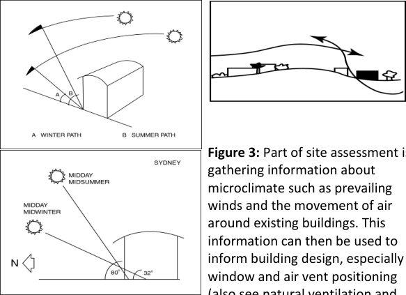

### 1.3 Building orientation and design

#### Objective

The objective is to have the building’s orientation and siting optimised for passive design strategies that will reduce the need for artificial lighting, mechanical heating, cooling and ventilations systems, and thus contribute to energy conservation.

#### Consideration

Consider how the building’s orientation and its position on the site will take best advantage of solar access and microclimatic conditions (such as prevailing summer breezes).

#### Concept

A building should be placed on its site so as to maximise solar access between 8.00am and 4.00pm at the mid-winter solstice. The north wall and roof should not be shaded by other buildings or by vegetation in mid-winter (this is called ‘north wall access’).

If a building is orientated so that the major areas of glazing are facing solar north (Figure 1) this maximises winter sun penetration (because the sun is at a lower angle in winter) and assists in shading in summer when the sun is at a higher angle (Figure 2).

For workplaces, sun penetration needs to be kept away from task areas, but may be able to be utilised for winter heat gain in non-critical areas (e.g. staff canteens, reception areas) – this needs to be designed in relation to thermal mass (refer to Item 3). East and west facing glazing should be avoided because it can be difficult to shade and cause heat gain in summer.

Building orientation and siting also needs to take account of local microclimate. For example, knowing about the direction and intensity of prevailing winds means that the building can be sited to exclude cold winter winds or to take advantage of summer breezes. The effect of adjacent buildings on airflow needs to be considered also (Figure 3).

Glazing on the north facade of a building takes advantage of the sun’s higher angle in summer, requiring less shading. The lower sun angle in winter can be utilised to allow sunlight to penetrate into non-crucial work areas, and thus contribute to the building heat

> [Picture on page 16: a picture, saved as a picture (images/ch-03-04-sustainable-development-page-16-8.gif, 150 dpi).]
> Words printed on the picture (title and legend, copied from the PDF):
> gathering information about
> microclimate such as prevailing
> winds and the movement of air
> around existing buildings. This
> information can then be used to
> inform building design, especially
> window and air vent positioning

Figure 3: Part of site assessment is

gain.

Figure 1: A building should be oriented so that the longest axis is facing true north.

(also see natural ventilation and cooling and Figures 5 and 6).

Figure 2: The sun’s path is higher in the sky in summer and lower in winter. In summer, the east and west sides of a building are exposed to sun for long periods – which is a good reason to minimise windows there.
