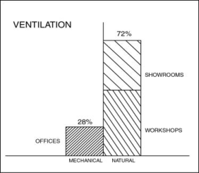
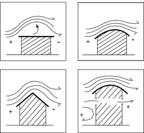
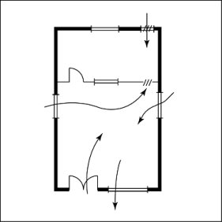
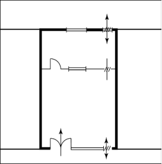
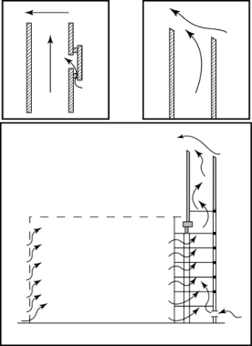
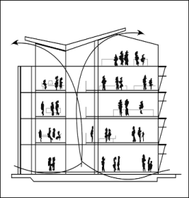

### 1.8 Natural ventilation and cooling

#### Objective

The objective is to have a comfortable, healthy indoor environment by using forms of ventilation not dependent upon fossil fuel derived energy (and thereby reduce greenhouse emissions).

#### Consideration

Consider which basic natural ventilation strategies will be used and why they are appropriate for the proposed building, particularly in terms of energy savings. Also, demonstrate that advanced natural ventilation strategies have been adequately evaluated and implemented where feasible. Indicate the percentage of floor space to be naturally ventilated (Figure 4).

#### Concept

Ventilation is essential for the health of building occupants: fresh air needs to be inducted; stale air and CO2 need to be expelled. By carefully managing airflow through a building, comfort conditions can be improved, and in summer, a cooler indoor environment can be created. This requires understanding and designing in relation to several factors:

#### Designing to assist airflow

Managing airflow for ventilation requires:

(a) knowing about how air moves across the site: the influence of prevailing winds, topography, nearby buildings and vegetation. These factors as well as solar access and local rainfall make up the ‘micro-climate’;

(b) taking into account how building form directs air movements. In general:

(i) airflow over a building creates positive and negative pressures, which can affect how air moves through a building;

(ii) sharp edges cause eddies and suction effects; and

(iii) roof form is critical (with flat roofs having the highest wind shadow).

This means taking external air movement and air pressure (such as prevailing winds) into account when determining the size and locations of the building’s ventilation openings (Figure 5).

Qualification 1: In all cases the ventilation scheme has to be designed in conjunction with, and in compliance with fire regulations.

Qualification 2: The induction of external air into a building during the day and night has to be based on the quality of this air being good. If doubts exist it should be tested.

Qualification 3: Close proximity to external noise can limit opportunities for natural ventilation.

> [Picture on page 22: a picture, saved as a picture (images/ch-03-04-sustainable-development-page-22-1.gif, 150 dpi).]

Figure 4: Applicants must indicate the percentages of their building to be naturally and mechanically ventilated (i.e. air conditioned). The aim is to minimise air-conditioned spaces.

> [Picture on page 22: a picture, saved as a picture (images/ch-03-04-sustainable-development-page-22-8.gif, 150 dpi).]

Figure 5: Roof shape affects how air flows over and around a building. Positive pressures are created on the windward side and negative pressures on the leeward side. Flat roofs have large wind shadows and can be subject to suction. When making decisions about roof form, building site conditions need to be taken into account so as to avoid creating unwanted situations like wind tunnels, eddies and suction effects, and to benefit from cooling summer breezes (see also natural ventilation and cooling and Figure 9).

#### Designing to assist cooling

Managing airflow for ventilation and cooling requires all of the above, plus:

(a) understanding the nature and the disposition of the building’s thermal mass; and

(b) having information about differences in temperature: externally and internally; between day and night; between different parts of the building.

With this information, passive ventilation systems can be designed to move ambient cooler air to where it can be most effective. For example, air can be pre-cooled before entering a building by directing it across shaded thermal mass that is at a lower temperature than outdoors. Another example is night cooling. Here, the colder night air is drawn in through low level intakes (such as grills) and exhausted through high level vents to flush the building of warm air that has accumulated during the day, to make the building more comfortable at the start of the day.

This is particularly appropriate for offices with large numbers of computers and other equipment that give off a lot of heat during the day. More sophisticated night cooling techniques involve utilisation of a building’s thermal mass, such as directing air through the centre of a custom designed slab or through plenums.

#### Basic natural ventilation

#### Cross-ventilation

This is the simplest of measures and just requires an appropriate sized and positioned building openings (windows, vents) and an internal layout that allows for free air movement for prevailing or managed air currents (Figure 6).

In many commercial buildings (e.g. shops with storerooms at rear) openable windows may not be desirable for security reasons. Instead, grills and vents should be employed – appropriately sized and positioned to facilitate cross ventilation (Figure 7).

> [Picture on page 23: a picture, saved as a picture (images/ch-03-04-sustainable-development-page-23-1.gif, 150 dpi).]

Figure 6: Cross ventilation can be supplied by appropriately positioned openable windows and/or vents. This is easier to achieve for freestanding buildings with access to good quality air and where external noise is not a problem. Where conditions are not optimal, care needs to be exercised in positioning air intakes, so as to minimise the building occupants’ exposure to externally generated air or noise pollution. Effectively designed cross ventilation can reduce the need for air conditioning and fans, and thus save on energy costs.

> [Picture on page 23: a picture, saved as a picture (images/ch-03-04-sustainable-development-page-23-13.gif, 150 dpi).]

Figure 7: Where premises are bounded on either sides, such as shops, cross ventilation presents a challenge. Shops usually have a wall or partition between display and storage/office space. This can obstruct airflow, creating stuffy spaces requiring air conditioning. In such situations cross ventilation can be achieved (and security maintained) by creating an airflow from the entrance to interior vents or highlight windows at the rear of the shop, through to secure vents or barred windows at the rear of the building.

#### The stack effect

The ‘stack effect’ refers to the draught that is created by warm buoyant air as it rises in a tall confined space. This could be a chimney, stairwell, atrium or lift shaft. The stack effect can be taken advantage of to improve internal comfort conditions in various ways.

#### High-level (window) ventilation

High-level windows (such as clerestory windows) are effective for removing hot stale air. Combined with lower level air intake (windows or vents) on the opposite side of a space, they can be used for night cooling (see cooling above).

Used in the same way during the day, high-level windows can increase comfort in hot weather, while not actually lowering the indoor temperature.

#### Cowlings

These are roof-mounted vents designed to catch wind. They need to be appropriately sized and positioned in relation to roof profile and air movement.

#### Rotary ridge ventilators

These are usually mounted on roof ridges and rotate according to wind direction to draw air out of internal spaces.

#### Ridge vents

These can be of several types. For example linear ridge vents run along the length of the roof ridge and are generally used just to ventilate the roof space, so as to avoid moisture build up.  Ridge vents that are operable (able to be opened and closed) are also available.

These can be used more ambitiously as part of a passive strategy to ventilate room space in a building with pitched roof and raked ceilings. Depending on the configuration of the space, the stack effect (see below) could be utilised to assist airflow.

#### Solar fans

Fans driven with a small electric motor powered, during good daylight, by a small photovoltaic cell (instead of mains electricity). Ridge or chimney mounted solar fans can assist hot air extraction in roof spaces in premises.

#### Advanced natural ventilation

#### For buildings over $2 million

Increasingly stack-assisted ventilation is being favoured by environmentally aware engineers as a way of moving air through a building instead of using powered fans. The ‘stack effect’ refers to the draught that is created by warm buoyant air as it rises in a tall confined space.

This could be a chimney, stairwell, atrium or lift shaft. The stack effect can be taken advantage of to improve internal comfort conditions in various ways.

#### Atriums

An atrium is a tall internal courtyard with a glazed roof. It can assist air movement in a similar way to a chimney, as well as provide capacity for other internal spaces to induct and exhaust air. Atriums also deliver natural light and can improve the aesthetic appeal of

> [Picture on page 24: a picture, saved as a picture (images/ch-03-04-sustainable-development-page-24-20.gif, 150 dpi).]

internal spaces (Figure 8).

> [Picture on page 24: a picture, saved as a picture (images/ch-03-04-sustainable-development-page-24-22.gif, 150 dpi).]

Figure 8: The main use of atriums is to bring daylight into the core of buildings, but they can also be designed to enhance natural ventilation, and thus reduce or eliminate the need for air conditioning.

Figure 9: The stack effect, where warm air rises and is displaced by cool air at lower levels, can be used for natural ventilation and cooling. A chimney (or other tall narrow spaces such as a stairwell) enhances this by accelerating the airflow. The diagram shows a sophisticated stack ventilation system for multi-storey buildings, with different kinds of chimney openings to modify the action of wind pressures. The use of chimneys and similar spaces as a means of natural ventilation and cooling needs to be incorporated at the early stages of building design and should take local wind conditions into account (see also building orientation and siting and Figures 4 and 5).

#### Chimneys

To create an efficient stack effect in a chimney the critical factors are its height, dimensions, the position and size of openings, air pressures and desired rates of air change.

Additionally, the introduction of a material at a higher elevation to heat or to expose to solar radiation can increase the efficiency of the draw, particularly important if low-level air is being inducted for cooling. The design of such structures requires computer modelling, and while this and their construction are a considerable project expense this has to be offset against the cost of air handling plant and operational costs. For large scale projects this method and those below should be reviewed (Figure 9).

#### Shafts, service conduits, stairwells

These building elements can be designed to manage airflow, providing air induction and expulsion is appropriately managed and that large openings (i.e. doorways) and other apertures are kept in the open or closed position that the system requires to function.

#### Double facades

A double facade effectively acts as an airway in the same way as an atrium, but with a very shallow depth. It can also be designed to shade external walls and be used to group services instead of having separate service shafts (Figure 10).

Figure 10: A double facade acts as an airway in the same way as an atrium, but with a very shallow depth. It also shades the external wall and can be used to group building services externally.

Figure 11: The stable temperature of a concrete slab can be utilised as part of a heating or cooling strategy. The space between the slab and a suspended ceiling or between the slab and a platform floor can function as a plenum by directing air across the slab, allowing it to circulate and come in contact with the slab’s stable temperature. Pipework is sometimes introduced into the slab. It may be used to carry either pre-cooled or pre-heated water or air. The concrete’s thermal mass stores heat or cold, according to the design parameters.

#### Plenum utilisation and other means to facilitate airflow

A plenum is normally introduced as a designed feature of the building fabric. It allows hot or cool air to pass below the thermal mass of a slab to heat or cool it. It is an appropriate device in both a naturally ventilated building as well as an alternative to ducting in a mechanically serviced (air-conditioned) building.

There are propriety products can be used to effectively retrofit an existing slab so that it performs as if had been fabricated with a plenum. For example, a rigid sheet with a profile that forms air channels and can be installed between a false ceiling and slab or a pedestal

floor and slab to draw in air. Additionally there are design solutions and products that provide alternatives to the obstruction of thermal mass by false ceilings, such as permeable ceilings that allow air to pass through them.

Ceilings in commercial buildings are generally suspended grids into which acoustic backed ceiling tiles fit. This prevents air from coming into contact with the thermal mass of the concrete slab above.  In retrofitting a building, it would be advantageous to substitute this with an open grid ceiling or permeable tiles (without acoustic backing). This would allow rising warm air created by people and equipment to pass through the ceiling to the cooler underside of the slab, which would act as a ‘heat sink’ (Figure 11).
