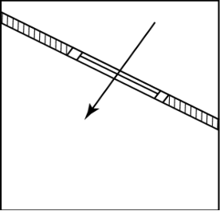
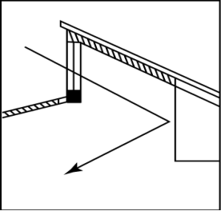
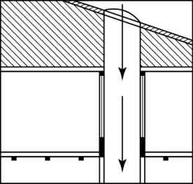
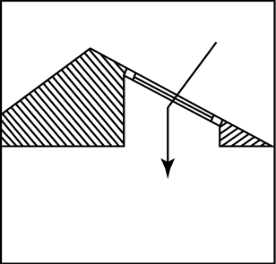
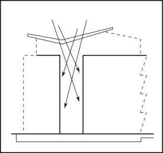

### 1.9 Daylighting

#### Objective

The objective is to have an increased ratio of daylight to artificial light without unduly increasing the building’s heat load, and therefore to reduce energy uptake and greenhouse emissions.

#### Consideration

Consider methods for maximising daylight penetration into the building (Figure 24).

#### Concept

Daylight consists of direct and reflected sunlight and skylight. Daylighting should be an integral part of the overall design of a building. Well-designed daylight can deliver a direct reduction of energy use because it reduces the need or artificial lighting. On the other hand poorly designed daylighting can increase the heat load in summer, leading to more energy being used for cooling.

Compared to other building materials, glass, when exposed to sunlight, lets in much more radiant heat into a building. Also, heat generated inside a building is lost much more rapidly through glass than through other materials when the outside temperature is lower. Therefore it is very important that daylighting, heating and cooling should be designed in relation to each other to achieve the most energy efficient outcomes. This is why on large projects computer modelling of different design options is often done.

When designing and managing daylighting systems it is important to eliminate glare. Window orientation and geometry, the type of glazing used and the reflectance of walls and other surfaces and shade structures can eliminate unwanted glare. The type of glazing, types of windows, window angle, the use of reflective materials and paints, plus a range of design strategies and off the shelf products can all affect the quality and management of daylight entering a building.

#### Related concept

A rectangular building with a narrow floor plate, oriented east-west will optimise daylighting opportunities. The type of structural grid is also a factor (see building orientation and building form).

#### Daylighting methods

#### Side lighting (conventional windows)

These provide adequate daylight in a building’s perimeter zones, but illumination levels fall off rapidly with distance from the window wall. A typical limit is 4m to 6m depending on the height of the window.

#### Clerestory windows

High-level windows often arranged in strips. Used in conjunction with reflective surfaces they enable deep penetration of indirect light, thus avoiding glare. If openable, they can also double as high-level air vents (see natural ventilation and cooling). South facing clerestories admit the most even light (Figure 12).

#### Skylights

These admit more daylight per square metre of glazed area than vertical windows, but they also collect more heat, which needs to be controlled. Off the shelf products with double glazing and heat reflective coating on one side (low emission or low e glass) are available. Skylights can be fixed or openable, the latter providing good high-level venting (see natural ventilation and cooling – Figure 13).

#### Interior treatments

Reflective materials, mirrors, reflective colours and surface treatment are all important to consider for achieving the best daylighting performance.

> [Picture on page 27: a picture, saved as a picture (images/ch-03-04-sustainable-development-page-27-20.gif, 150 dpi).]

Figures 12–15: Different approaches to daylighting.

> [Picture on page 27: a picture, saved as a picture (images/ch-03-04-sustainable-development-page-27-22.gif, 150 dpi).]

A clerestory window and reflective surface to bounce light deeper into a room.

> [Picture on page 27: a picture, saved as a picture (images/ch-03-04-sustainable-development-page-27-25.gif, 150 dpi).]

A skylight set into a roof with no ceiling cavity (the roof should be insulated).

> [Picture on page 27: a picture, saved as a picture (images/ch-03-04-sustainable-development-page-27-28.gif, 150 dpi).]

A light tube brings light through the ceiling cavity.

A light well cutting through roof and floor plates to bring light deep into a building.

#### Special glazing

There are types of glass and off the shelf insulating glass units that are designed to allow light transmission while reducing heat transmission. Some, such as tinted or mirror glass, also reduce light transmission, compared to clear glass. Most effective for daylighting and heat insulation is double glazing (which has the added bonus of significantly reducing external noise penetration). It is also more expensive. To prevent glare, frosted or sandblasted glass panels could be used instead of clear glass (e.g. upper panels) in situations where visual comfort is critical (such as premises with large numbers of computers).

#### Related concept

Glazing options needs to be assessed at the same time as overall insulation needs (see building envelope and insulation).

#### Light wells

These perform a similar function to atriums but rather than being a void space around which functional spaces are disposed, a light well is a dissection through the floor plates (Figure 14).

#### Light tubes

Light tubes are used to bring light from a roof or wall through an intermediate space (like a roof cavity) into a room. Sometimes they have a highly reflective inner surface to intensify light penetration, usually combined with a translucent ceiling fixture to evenly diffuse the light delivered to the interior (Figure 15).

#### Atriums

An atrium is a void intersecting all building levels that brings light into the building core. Atriums need to be carefully designed so as to manage light penetration without creating areas of glare. Atriums can also be designed to facilitate natural ventilation (see natural ventilation and cooling – Figure 16).

> [Picture on page 28: a picture, saved as a picture (images/ch-03-04-sustainable-development-page-28-27.gif, 150 dpi).]

Figure 16: Atriums bring light into a building and can also be used as part of the natural ventilation strategy (natural ventilation and Figure 8).

Figure 17: Light shelves are horizontal solid structures with a highly reflective surface used to bounce daylight off the ceiling making it penetrate deeper into the interior space than by a

Figure 18: A light shelf can be positioned inside the window, half inside/half outside or outside

only. The position chosen affects the shadow area created underneath the shelf as well as

the depth of light penetration. Light shelves need to be carefully designed in terms of height and positioning, as well as in relation to the dimensions of the space they will serve.

window alone. Their performance varies according to ceiling height and the height of the light shelf from the floor.  Light shelves can increase uniformity of illumination between work areas near and far from windows.

#### Prismatic panels

These use refraction or reflection to redistribute daylight and sunlight away from a window and further into a room (for example they are often used in conjunction with a skylight to create more even, usable light). They eliminate glare and solar gain, increase depth of light penetration but require careful setting.

#### Light shelves

Light shelves provide indirect light deep into an interior space, while reducing solar gain and glare. Their effectiveness depends upon window height, room height and depth; the dimensions, surface finish and positioning of the light shelf, as well as the interior colour scheme, lighter colours have higher reflectance (Figures 17 and 18).

Other optical devices, especially light control panels that use non-imaging optics and reflective materials are under development and used in specialist contexts.
