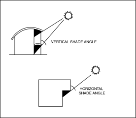
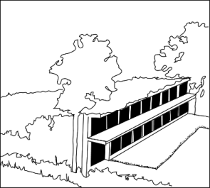
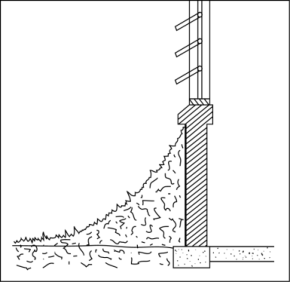

### 1.10 Shade and sun control

#### Objective

The objective is to have the protection of buildings from unwanted seasonal heat gain, to reduce glare to internal spaces and to minimise external ‘heat islanding’, and thus to reduce energy uptake and greenhouse emissions.

#### Consideration

Consider the shade strategy to be used for the building. If glazing is used on east or west facades, it must be shaded (preferably by external shading devices) from penetration by summer sun.

#### Concept

Provision of shade in the right places and at the right time of the year, appropriate to the building, its site and the kind of activities to be carried out in it, is an important part of passive design. Reasons for providing shade are:

(a) to control solar radiation entering a building (especially through glass) when it is not wanted (e.g. in summer);

(b) to manage glare (especially to stop sunlight falling directly on task areas);

(c) to manage the heat gain of external thermal mass and to reduce heating islanding caused by reflected heat; and

(d) to provide protection from ultra-violet light radiation in external areas used by a building’s occupants (such as recreation areas, around canteens).

External shade structures such as overhangs and awnings assist in preventing heat transmission through glass as well as cutting out glare. Therefore where the aim is to control heat gain, external treatment is always preferable to internal devices such as blinds that affect light transmission only. External shade structures are also preferable to blinds because they allow visual connection with the outside, which is more pleasant for building occupants.

For facade design and in determining the shading requirements of windows, both the vertical and the horizontal shadow angles need to be considered. Qualified building designers such as architects or engineers use shadow protractors with regional Sun Charts or computer programs for this purpose (Figure 19).

> [Picture on page 30: a picture, saved as a picture (images/ch-03-04-sustainable-development-page-30-11.gif, 150 dpi).]

Figure 19: In determining the shading requirements of windows, both the vertical and horizontal shadow angles need to be considered. Qualified building designers such as architects or engineers use shadow protractors with regional Sun Charts or computer programs for this purpose. The vertical shadow angle is used to determine the cut-off line for shade structures roughly parallel to the ground (like awnings). The horizontal shadow angle is used when considering the shading effect of an irregular facade or of vertical shade elements (like fixed vertical louvres).

#### Facade design

Shade provision of shade should not be a last minute ‘add-on’, but an integral part of facade design. Given that sunlight and daylight penetrate buildings differently according to building orientation and season, it is very unlikely that an energy efficient building would have identical fenestration and shading treatment on all facades.

#### Building shade structures

The addition of eaves, overhangs, awnings, verandas or colonnades should be considered at an early stage of building design. Shade needs will be determined by factors such as orientation, location of thermal mass, of windows and the building’s likely patterns of use.

#### Louvres

These can be exterior or interior; vertical or horizontal; fixed or operable. Operable louvres can be manual or mechanical; user activated or operated by a sun tracking system. Options should be selected according to building orientation, window size and design, room use and occupancy levels.

#### Blinds and shutters

These can be interior or exterior and should be selected according to building orientation, window size and design, room use and occupancy. External shade devices such as louvres are available with either horizontal or vertical slats. If they are to be fixed, sun angle calculations need to be done carefully. Otherwise adjustable louvers can be used, angling them as needed to cut out early morning and late afternoon sun. On east and west

> [Picture on page 31: a picture, saved as a picture (images/ch-03-04-sustainable-development-page-31-7.gif, 150 dpi).]

windows this will also block the view (Figure 20).

> [Picture on page 31: a picture, saved as a picture (images/ch-03-04-sustainable-development-page-31-9.gif, 150 dpi).]

Figure 20: External shade devices such as louvres are available with either horizontal or vertical slats. If they are to be fixed, sun angle calculations need to be done carefully. Otherwise adjustable louvers can be used.

Figure 21: Earth berms are mounds of earth in direct contact with an external wall.  They are used to stabilise internal temperatures by reducing the exposure of the thermal mass to variations in air temperature. They also reduce noise transmission.

Figure 22: Building grassing works on the same principle as a berm, but protects a larger area of the building envelope against external heat gain and internal heat loss. It also insulates against sound, as well as advantaging surrounding areas by reducing ‘heat islanding’ i.e. heat given off from large structures, that collectively contributes to increasing temperatures of built-up areas compared to less developed surrounding areas.
