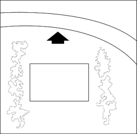
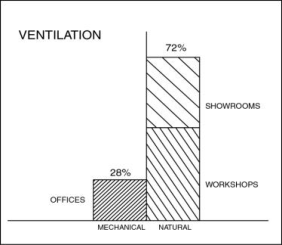
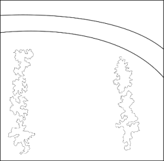

### 1.11 Landscape design

#### Objective

The objective is to have landscape elements that provide shading and cooling to enhance the building’s thermal performance and thereby reduce energy uptake and greenhouse emissions.

#### Consideration

Consider how the landscaping strategy will contribute to building energy performance.

#### Concept

Landscape design is not just about making an industrial or commercial development look

good. It can also be a passive means of contributing to thermal performance and daylighting.

#### Trees

Trees can provide seasonally appropriate shading to thermal mass, windows and external areas. Some pre-cooling effects can be achieved by allowing air to pass through trees or shrubs before entering a building. There are also psychological benefits for people working in a building where there are visual and tangible connections to trees.

Trees need to be selected and planted extremely carefully in relation to building function and siting. Their growth pattern and growth rate, mature size, canopy density and whether they are deciduous or evergreen should all be appropriate to the nature of the site. Species native to Canterbury Bankstown (derived where possible from locally sourced seed stock) should be used wherever possible as their water requirements are most likely to less than imported species and they will contribute to maintaining local biodiversity.

#### Berms

These are mounds of earth in direct contact with an external wall, used to alter the ratio of heat gain and loss by reducing exposure of thermal mass to solar radiation (Figure 21).

#### Building grassing

This is an established way to add external insulation, reduce solar heat gain and loss. It also reduces ‘heat islanding’ and thus urban thermal mass temperature increase (Figure 22).

#### Roof gardens and planters

These are also established ways to add external insulation, reduce solar heat gain and loss. It also reduces ‘heat islanding’ (and thus urban thermal mass temperature increase).

#### Evaporative cooling

This is an old method that can be used when designing landscape or building envelope. It is based on the principal of pre-cooling air by passing it through or across water. It does this in three ways.

Still/running water/fountains as part of landscaping can reduce external air temperature as latent heat is removed during evaporation.

Spray mist systems increase the rate of evaporation and seek to spatially manage the water vapour and air movement.

Note: the water used in evaporative cooling system should be collected roof water. If stored in underground tanks its cooling capability will be enhanced and pumping should whenever possible be from a solar pump.

> [Picture on page 33: a picture, saved as a picture (images/ch-03-04-sustainable-development-page-33-1.gif, 150 dpi).]

Figure 24: As part of the Design Report that all applicants must submit with the application, a site diagram indicating the footprint and orientation of the proposed building must be included.

> [Picture on page 33: a picture, saved as a picture (images/ch-03-04-sustainable-development-page-33-8.gif, 150 dpi).]

Figure 25: As part of the Design Report all applicants must indicate the percentages of their building to be naturally and mechanically ventilated (i.e. air conditioned). The aim is to minimise air-conditioned spaces.

> [Picture on page 33: a picture, saved as a picture (images/ch-03-04-sustainable-development-page-33-16.gif, 150 dpi).]

Figure 23: As part of the Design Report that all applicants must submit with the application, a site analysis must be included. This must indicate existing structures, adjacent buildings or features; slope, drainage, prevailing seasonal winds; vegetation and site features; environmental constraints and opportunities (e.g. proximity to a water way or a sensitive area of vegetation).
