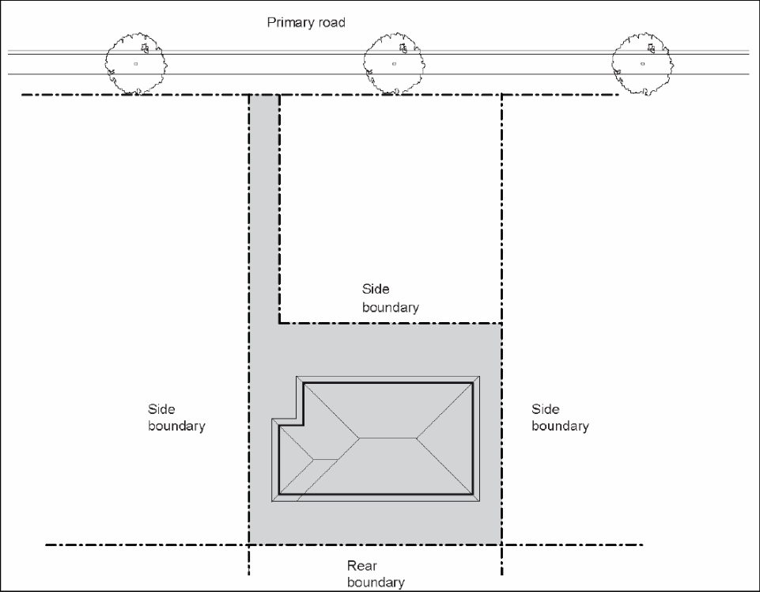

## Chapter 3 General Requirements

### 3.5 Subdivision

June 2023 (Amended August 2024)

Welcome to the

### City of Canterbury-Bankstown

#### Great Cities

We believe in creating vibrant, dynamic, and diverse communities that offer opportunities for people to connect, pursue their passions, and contribute to the world around them.

#### Naturally Green

We protect and prioritise nature in and around our city to enhance environmental sustainability and improve the quality of life for our residents.

#### Design Excellence

We encourage buildings, spaces, and objects that are both beautiful and practical, enhancing the beauty, accessibility, and safety of our built environment.

#### People First

We prioritise the needs, preferences, and aspirations of our community in all aspects of urban planning and design, creating supportive and enriching places people love.

#### Community

We engage with our community to ensure their needs and aspirations are reflected in the outcome, creating sustainable, resilient, vibrant, diverse, and inclusive places.

#### Sustainability

We seek designs that reduce negative impacts on the environment while also promoting social and economic well-being.

#### Net-Zero

We encourage our community to design buildings and places that produce as much renewable energy as they consume, reducing greenhouse gas emissions, lowering energy bills, and increasing resilience to environmental shocks and stresses.

#### Join us in creating a City that's liveable, loveable, and sustainable for all!

#### CONTENTS

Section 1 – Introduction ....................................................................................................... 4

Section 2 – Battle-axe lots .................................................................................................... 5

Section 3 – Housing estates ................................................................................................. 7

## SECTION 1–INTRODUCTION

#### Explanation

The Canterbury-Bankstown Local Environmental Plan 2023 and Canterbury-Bankstown Development Control Plan 2023 combine to regulate effective and orderly development, consistent with Connective City 2036.

The Canterbury-Bankstown Local Environmental Plan 2023 is Council's principal planning document. It provides objectives, zones and development standards such as lot sizes, floor space ratios and building heights.

The Canterbury-Bankstown Development Control Plan 2023 supports the LEP by providing additional objectives and development controls for subdivision development.

#### Objectives

O1 To ensure lots provide adequate space for buildings, setbacks, landscape, open space, driveways, vehicle manoeuvring areas and the like.

## SECTION 2–BATTLE-AXE LOTS

#### Explanation

A battle-axe lot means a lot that has access to a road by an access handle. It is created behind another lot and has three side boundaries and a rear boundary.

> [Picture on page 5: a picture, saved as a picture (images/ch-03-05-subdivision-page-5-5.gif, 150 dpi).]

Figure 2a: Example of a battle-axe lot

#### Objectives

O1 To ensure lots provide adequate space for buildings, setbacks, landscape, open space, driveways, vehicle manoeuvring areas and the like.

O2 To ensure the access handle provides safe and convenient vehicle and pedestrian access to the dwelling at all times.

#### Development controls

#### Lot dimensions and access handles

2.1 Council may allow the subdivision of land to create not more than four battle-axe lots provided that:

(a) the area of each lot, exclusive of any access corridor, is not less than 450m2; and

(b) each lot contains a rectangle with sides of 10m and 15m behind the setbacks of the proposed building.
