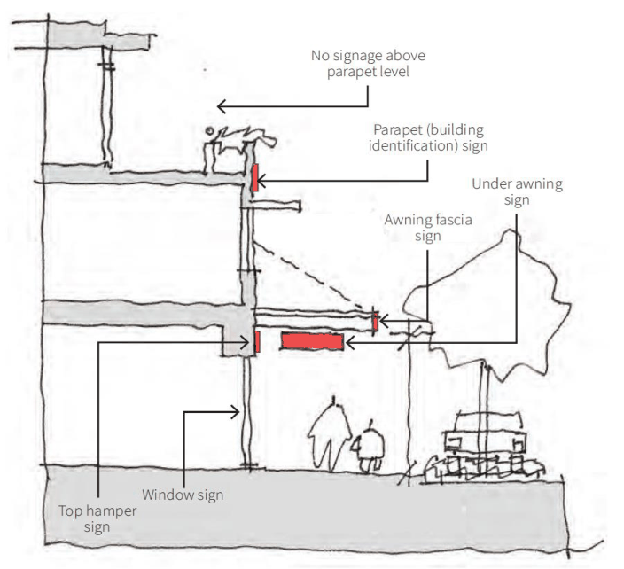

## Chapter 3 General Requirements

### 3.6 Signs

June 2023 (Amended April 2025)

Welcome to the

### City of Canterbury-Bankstown

#### Great Cities

We believe in creating vibrant, dynamic, and diverse communities that offer opportunities for people to connect, pursue their passions, and contribute to the world around them.

#### Naturally Green

We protect and prioritise nature in and around our city to enhance environmental sustainability and improve the quality of life for our residents.

#### Design Excellence

We encourage buildings, spaces, and objects that are both beautiful and practical, enhancing the beauty, accessibility, and safety of our built environment.

#### People First

We prioritise the needs, preferences, and aspirations of our community in all aspects of urban planning and design, creating supportive and enriching places people love.

#### Community

We engage with our community to ensure their needs and aspirations are reflected in the outcome, creating sustainable, resilient, vibrant, diverse, and inclusive places.

#### Sustainability

We seek designs that reduce negative impacts on the environment while also promoting social and economic well-being.

#### Net-Zero

We encourage our community to design buildings and places that produce as much renewable energy as they consume, reducing greenhouse gas emissions, lowering energy bills, and increasing resilience to environmental shocks and stresses.

#### Join us in creating a City that's liveable, loveable, and sustainable for all!

#### CONTENTS

Section 1 – Introduction ......................................................................................................... 4

Section 2 – Location and design ............................................................................................. 5

Section 3 – Illumination and reflectance ............................................................................... 8

Section 4 – Definitions ......................................................................................................... 10

## SECTION 1–INTRODUCTION

#### Explanation

The Canterbury-Bankstown Local Environmental Plan 2023 and Canterbury-Bankstown Development Control Plan 2023 combine to regulate effective and orderly development, consistent with Connective City 2036.

The Canterbury-Bankstown Local Environmental Plan 2023 is Council's principal planning document. It provides objectives, zones and development standards such as lot sizes, floor space ratios and building heights.

The Canterbury-Bankstown Development Control Plan 2023 supports the LEP by providing additional objectives and development controls to enhance the design and operation of signs.

#### Objectives

O1 To ensure signs are compatible with the desired amenity and visual character of the locality.

O2 To ensure signs are compatible with the development on which it is displayed.

O3 To ensure development does not lead to visual clutter through the proliferation of signs and displays.

O4 To ensure signs contribute to the safety, legibility and amenity of Canterbury- Bankstown.

## SECTION 2–LOCATION AND DESIGN

#### Explanation

Good design integrates signs with the built form through consistency with the building proportions and detailing, while minimising visual clutter. Well-designed signs create visual interest and assist in way finding.

#### Objectives

O1 To ensure signs provide effective communication in suitable locations.

O2 To ensure signs are of high quality design and finish.

#### Development controls

#### Signs in Zones R2, R3 and R4

2.1 Business identification signs must comply with the following controls:

(a) Council permits only one sign per site;

(b) the total sign area must not exceed 1.2m x 0.6m;

(c) the sign is to be located on or behind the building line;

(d) the sign is to be located at or below the awning level. Where there is no awning to the building, the sign is solely permitted below the window sill of the second storey windows;

(e) if the sign is painted or attached to a building, the sign must not screen windows and other significant architectural features of the building;

(f) the sign is to be non-illuminated.

#### Signs in Zones E1, E2 and MU1

2.2 Business and building identification signs must integrate with the building form and architectural features of the building to which the signs are attached as follows:

(a) The total sign area must not exceed 0.5m² for each metre of the primary street frontage.

(b) Awning fascia signs, top hamper signs, under awning signs and window signs are permissible at or below the awning level. Where there is no awning to the building, signs are solely permitted below the window sill of the second storey windows.

(c) A maximum of one under awning sign is permitted for each ground floor tenancy.

(d) Window signs must not obscure more than 25% of the window area.

(e) Parapet signs and individual laser cut lettering applied to the facade are permissible above the awning level.

2.3 Council does not permit signs above the parapet of the podium level.

2.4 Pylon signs will only be considered on sites with large street frontages occupied by uses such as services stations, large take away food and drink premises and retail complexes.

> [Picture on page 6: a picture, saved as a picture (images/ch-03-06-signs-page-6-4.gif, 150 dpi).]

Figure 2a: Signs in Zones E1, E2 and MU1

#### Signs in Zones E3 and E4
