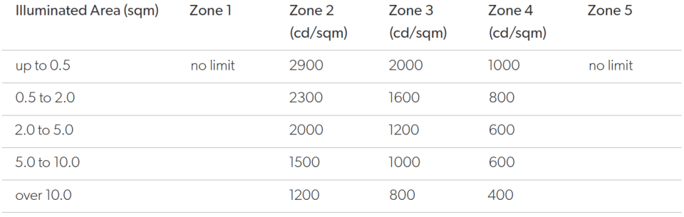
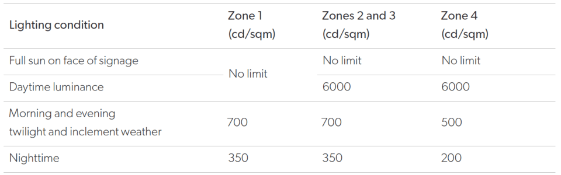

### 2.8 Council prohibits the following signs:

(a) flashing signs, flashing lights, signs which incorporate devices which change colour, a sign where movement can be recognised by a passing motorist;

(b) signs that extend over street boundaries, other than those permitted in conjunction with shops, or the like, where such buildings are erected on the street alignment;

(c) signs which would adversely affect existing traffic lights;

(d) signs which are not permanently fixed to the site;

(e) signs made of canvas, calico or the like.

#### Design

2.9 Corporate colours, logos and other graphics must achieve a high degree of compatibility with the architecture, materials, finishes and colours of the building and streetscape.

2.10 Building identification signs and business identification signs that are painted or attached to a building must not screen windows and other significant architectural features of the building.

2.11 Signs are not to dominate in terms of scale, number, proportion and form or any other attributes.

2.12 The amount of signs may be limited due to the cumulative impact on a locality or a building.

2.13 The design and place of signs are not to adversely impact on the amenity of residential sites.

2.14 Signs are to be designed for easy maintenance.

2.15 Development must remove signs that are no longer necessary or unsightly to avoid clutter.

2.16 Signs are not to include offensive or objectionable material in the content of an advertisement (such as discriminatory messages, promotion of unlawful or anti-social behaviour, encouraging excessive consumption of alcohol, pornography, or offensive language).

#### Signs on parked vehicles

2.17 Signs on parked vehicles such as cars, trucks and trailers, are prohibited where:

(a) The vehicle is unregistered.

(b) The primary purpose of the vehicle is for advertising purposes.

## SECTION 3–ILLUMINATION AND REFLECTANCE

#### Explanation

An illuminated sign refers to any sign illuminated by an artificial source. Signs that are brighter than the luminance criteria may have the potential to dazzle or distract drivers. This issue can be exacerbated in areas where a high level of motorist concentration is required e.g. busy intersections and pedestrian crossings.

#### Objectives

O1 To minimise unacceptable glare.

O2 To ensure illuminated signs are compatible with the amenity of neighbouring residential environments.

#### Development controls

#### Illumination and reflectance criteria for non-digital signs

3.1 The following criteria apply to non-digital illuminated signs illuminated by fluorescent and/or incandescent bulbs whether internally illuminated or lit from the exterior:

(a) Signs must comply with the luminance requirements in Table 3a.

(b) For night time use, signs (whether internally illuminated or lit from its exterior) must not cast a shadow on areas that were previously lit and that have a special lighting requirement, e.g. pedestrian crossings.

(c) The light sources for illuminated signs must focus solely on the sign and:

(i) be shielded so that glare does not extend beyond the sign

(ii) with the exception of back lit neon signs, have no light source visible to passing motorists with a light output greater than that of a 15W fluorescent/ LED bulb.

(d) The level of reflectance of a sign, and its content, is not to exceed the ‘minimum coefficients of Luminous intensity per unit area for Class 2A material’, as set out in the Australian Standard AS/NZS 1906.1, Retroreflective materials and devices

for road traffic control purposes will not be approved.

Table 3a: Maximum allowable daytime luminance of illuminated non-digital signs

> [Picture on page 8: a picture, saved as a picture (images/ch-03-06-signs-page-8-29.gif, 150 dpi).]

Source: Transport Corridor Outdoor Advertising and Signage Guidelines, DPHI

#### Illumination and reflectance criteria for digital signs

3.2 The following criteria apply to digital illuminated signs illuminated by fluorescent and/ or incandescent bulbs whether internally illuminated or lit from the exterior:

(a) Signs must comply with the luminance requirements in Table 3b.

(b) The images displayed on the sign must not otherwise unreasonably dazzle or distract drivers without limitation to their colouring or contain flickering or flashing content.

Table 3b: Maximum allowable daytime luminance of illuminated digital signs

> [Picture on page 9: a picture, saved as a picture (images/ch-03-06-signs-page-9-9.gif, 150 dpi).]

Source: Transport Corridor Outdoor Advertising and Signage Guidelines, DPHI

## SECTION 4–DEFINITIONS

awning fascia sign means a sign affixed to the street-facing edge of an awning.

digital signs means devices that use digital technology to display bright, high quality electronic images. A central feature of these devices is the use of Light Emitting Diode (LED) technology allowing luminance to be controlled and adjusted automatically. They can utilise:

• Static electronic displays – these display static images only, which are presented successively at set intervals. They do not contain or imply motion such as vertical or horizontal scrolling, fade, dissolve or animation within the message itself; and do not have any movement of any part of the advertising structure or surrounds. These signs are also known as Electronic Static Displays (ESDs).

Display dwell times, transition times and luminance can all be controlled and changed electronically. Digital signs can be installed on a range of permanent and portable structures similar to those for printed formats.

Variable message signs (VMS) that are used for advertising purposes and which display static text messages or static graphics are included in this definition. VMS can be used in permanent or portable structures. VMS that are erected by TfNSW or a local council for road safety or traffic management purposes are excluded.

VMS are increasingly being utilised for advertising purposes in a broader range of environments including commercial, community and schools. Reference to digital signs in the remainder of the Guidelines includes ESDs, VMSs or both, as the context permits or requires.

• Non-static (dynamic) electronic displays – these display animations, videos, flashing, and have active display changes. These signs can be either permanent or portable, including any signs which contain any portion of video and/or animated content. Those that face the road reserve and are visible to road users are prohibited.

luminance means the objective brightness of a surface as measured by a photometer, expressed in candelas per square meter.

parapet sign means a sign located above the awning, affixed to the parapet of a building.

pylon sign means a sign displayed on or forming an integral part of a freestanding pylon or similar structure but does not include an advertising hoarding sign.

top hamper sign means a sign affixed above the ground floor street-facing window, below the awning.

under awning sign means a sign affixed under an awning.

window sign means a painted or printed sign affixed to a ground floor street-facing window. The spaces between lettering are generally transparent.

Zone 1 covers areas with generally very high off-street ambient lighting. This includes land zoned SP5 Metropolitan Centre.

Zone 2 covers areas with generally high off-street ambient lighting e.g. some major shopping/commercial centres with a significant number of off-street illuminated devices and lights. This includes land zoned E2 Commercial Centre and MU1 Mixed Use.

Zone 3 covers areas with generally medium off-street ambient lighting e.g. small to medium shopping/commercial centres. This includes land in employment and special use zones not including Zones E2 Commercial Centre, MU1 Mixed Use and SP5 Metropolitan Centre.

Zone 4 covers areas with generally low levels of off-street ambient lighting. This includes land in rural, residential, recreation and waterway zones.

Zone 5 covers areas within underground railway stations and areas fully contained within station buildings which are visible only from within the rail corridor.
