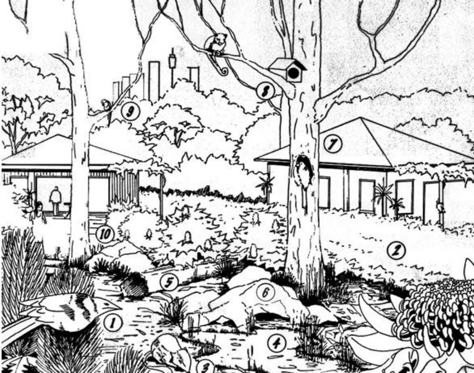

### 2.5 The landscape of setbacks and deep soil zones must:

(a) provide sufficient depth of soil to enable the growth of mature trees;

(b) use a combination of groundcovers, shrubs and trees;

(c) use shrubs that do not obstruct sightlines between the site and the public domain; and

(d) where buffer or screen planting is required, use continuous evergreen planting consisting of shrubs and trees to screen the structure, maintain privacy and function as an environmental buffer.

#### Trees

2.6 Development must consider the retention of existing trees, including street trees, in the building design.

2.7 Development must plant at least one canopy tree for every 12m of front and rear boundary width and:

(a) Canopy trees are to be of a minimum 75 litre pot size.

(b) Use deciduous trees in small open spaces, such as courtyards, to improve solar access and control of microclimate.

(c) Place evergreen trees well away from the building to allow the winter sun access.

(d) Select trees that do not inhibit airflow.

(e) Provide shade to large hard paved areas using tree species that are tolerant of compacted/deoxygenated soils.

2.8 Development must provide street trees that will contribute to the canopy where possible.

## SECTION 3–BIODIVERSITY

#### Explanation

Good landscape design enhances the development’s environmental performance by retaining positive natural features which contribute to habitat values and preserving green networks.

#### Objectives

O1 To protect biodiversity and ecological processes.

#### Development controls

#### Biodiversity

3.1 Development must retain, protect and enhance indigenous/native vegetation and natural site features and incorporate it into the landscape design.

3.2 Development must create a buffer zone to adjoining bushland and use indigenous planting in the buffer zone.

3.3 Development must manage habitat values by reinforcing biodiversity links.

3.4 The landscape design may consider using the following features to encourage native wildlife: 1 Trees and shrubs native to the area can provide nectar and seeds – an important food for native birds.

2 Prickly shrubs and dense hedges protect bird nests from predators such as cats. 3 Leaf litter and bark provide feeding areas for small animals such as frogs and lizards.

4 Small ponds provide water and habitat. 5 Hollow logs provide shelter for small marsupials and lizards. 6 Small caves and crevices serve as burrows and nesting sites for small animals. 7 Where structurally sound, tree hollows provide nesting holes essential for birds and possums.

8 Strong, healthy tree limbs provide habitat for tree dwellers and allow safe movement through the canopy.

9 Tree branches provide safe perching places for birds. 10 Rocks provide shelter, shade and sun bathing opportunities for small animals.

> [Picture on page 8: a picture, saved as a picture (images/ch-03-07-landscape-page-8-1.gif, 150 dpi).]

Figure 3a: Features to encourage native wildlife
