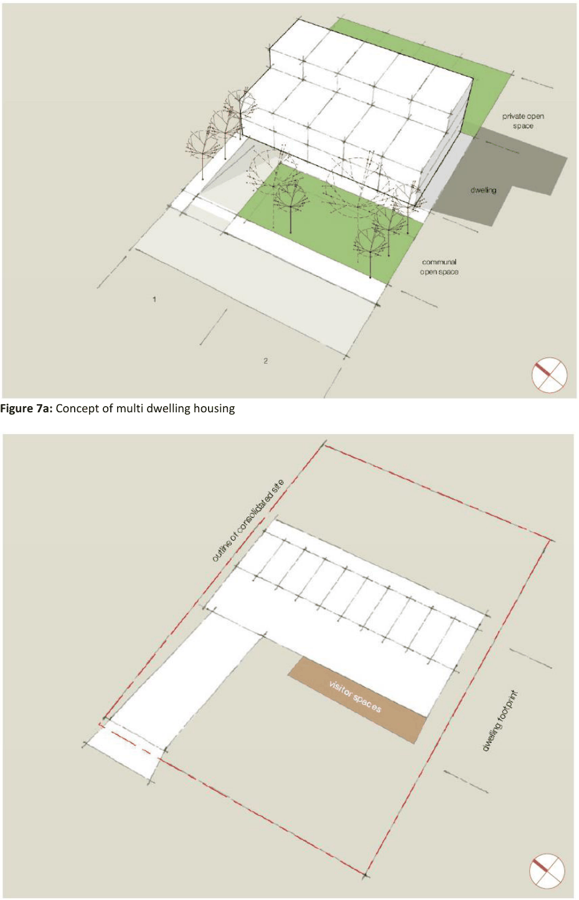

### 7.17 Where development proposes a basement, Council must ensure:

(a) the basement architecturally integrates with the development; and

(b) the basement does not extend beyond the perimeter of the floor level immediately above. For this clause, the perimeter includes the front porch; and

(c) there will be no adverse impacts on the streetscape, public domain, landscaped areas and amenity; and

(d) the driveway and associated retaining walls integrate into the overall design of the dwellings and landscaped areas. Large areas of blank, minimally or poorly articulated retaining walls are not acceptable.

> [Picture on page 34: a picture, saved as a picture (images/ch-05-01-former-bankstown-lga-page-34-1.gif, 150 dpi).]

Figure 7a: Concept of multi dwelling housing

Figure 7b: Concept of basement car parking layout

## SECTION 8–RESIDENTIAL FLAT BUILDINGS AND SHOP TOP HOUSING IN RESIDENTIAL ZONES

#### Objectives

O1 To ensure the building form, building design, setbacks and landscape of residential flat buildings and shop top housing are compatible with the suburban character of the high density residential areas.

O2 To ensure the building form, building design, room sizes and internal layout of residential flat buildings and shop top housing provide appropriate amenity to residents in terms of access to sunlight, privacy and useability.

O3 To ensure the building form and building design of residential flat buildings and shop top housing do not adversely impact on the amenity of neighbouring sites in terms of visual bulk, access to sunlight and privacy.

O4 To ensure the size, location and design of private open spaces provide appropriate amenity to residents in terms of useability, access to sunlight, privacy and landscape.

O5 To ensure the landscape design contributes to a high quality streetscape and amenity.

O6 To provide deep soil zones to allow for and support healthy plant and tree growth.

O7 To minimise the visual impact of off-street parking on the streetscape.

O8 To ensure basements are well-designed and integrate into the overall design of the development.

O9 To minimise the effect of blank walls.

O10 To ensure the building design and materials reduce the opportunities for vandalism and graffiti.

O11 To ensure that land adjoining a development site is not left sterilised or isolated so that it is incapable of being developed for the purpose of multi dwelling housing under the applicable controls.

O12 To minimise the reflection of sunlight from buildings to surrounding areas and buildings.

O13 To ensure building materials do not lead to hazardous, undesirable or uncomfortable glare to pedestrians, motorists or occupants of surrounding buildings.

#### Development controls

#### Isolation of sites

8.1 Development on land within Zone R4 High Density Residential is not to result in a site adjoining such land having an area of less than 1,000m2 or a width of less than 20m at the front building line for the purpose of multi dwelling housing.

#### Storey limit (not including basements)

8.2 Development must comply with the storey limit that corresponds with the maximum building height shown for the site on the Height of Building Map as follows:

| Maximum building height as shown on the Height of Buildings Map (Canterbury-Bankstown LEP 2023) | Storey limit (not including basements) |
|---|---|
| 13m | 4 storeys (no attic) |
| 16m | 5 storeys (no attic) |
| 19m | 6 storeys (no attic) |
| 25m | 8 storeys (no attic) |

8.3 The siting of the development and landscape works must be compatible with the existing slope and contours of the site and any adjoining sites.  Council does not allow any development that involves elevated platforms on columns; or excessive or unnecessary terracing, rock excavation, retaining walls or reclamation.

#### Fill

8.4 Any reconstituted ground level on the site within the ground floor perimeter of the proposed building must not exceed a height of 1m above the ground level (existing). For this clause, the ground floor perimeter includes the front porch.

8.5 Any reconstituted ground level on the site outside of the ground floor perimeter of the proposed building must not exceed a height of 600mm above the ground level (existing) of an adjoining site. For this clause, the ground floor perimeter includes the front porch.

#### Street setbacks

8.6 The minimum setback for a building wall to the primary street frontage is:

(a) 3m for the sites at 1–9 Leonard Street and 74–80 Restwell Street in Bankstown; and

(b) 6m for all other sites.

8.7 The minimum setback for a building wall to the secondary street frontage is 6m.

#### Side and rear setbacks

8.8 For a single or two storey building, the minimum setback to the side and rear boundaries of the site is 0.6 multiplied by the wall height.

8.9 For a building with three or more storeys, the minimum setback to the side and rear boundaries of the site is 4.5m provided the average setback is 0.6 multiplied by the wall height.

8.10 Residential flat buildings and shop top housing (including basements) must provide a minimum 5m setback to Ruse Park for the purposes of deep soil landscaping.

8.11 The minimum setback for a basement level to the side and rear boundaries of the site is 2m.

8.12 The minimum setback for a driveway to the side and rear boundaries of the site is 1m.

#### Private open space

8.13 Development must locate the private open space behind the front building line. This clause does not apply to any balconies where it is used to provide articulation to the street facade.

#### Building design

8.14 Council applies the State Environment Planning Policy (Housing) 2021 (Chapter 4) and the Apartment Design Guide to residential flat buildings and shop top housing. This includes buildings that are up to two storeys or contain less than four dwellings.

8.15 Development for the purpose of residential flat buildings and shop top housing must demolish all existing dwellings (not including any heritage items) on the site.

8.16 The maximum roof pitch for residential flat buildings and shop top housing is 35 degrees.

8.17 Council may allow residential flat buildings (up to three storeys) and shop top housing (up to three storeys) to have an attic provided the attic design:

(a) accommodates no more than two small rooms (for the purposes of a bedroom and/or study) and a bathroom plus an internal link to the storey below; and

(b) ensures the attic does not give the external appearance of a storey.
