### 15.8 Where the basement is not providing parking:

(a) the combined area of storage, plant rooms and any areas used for mechanical services or ducting must not be more than 20m²; and

(b) any area in the basement beyond the limit specified in subclause (a) must be included in the calculation of gross floor area; and

(c) pedestrian access must only be provided internally or from the side or rear of the dwellings. Pedestrian access from the side or rear of the dwellings must not result in stairs or access encroaching into the minimum setback areas.

#### Setbacks

#### Objectives

O4 To ensure the basement does not adversely impact the streetscape, public domain, landscaped areas and amenity.

#### Development controls

15.9 The basement must not extend beyond the perimeter of the floor level immediately above. For this clause, the perimeter includes the front porch.

#### Landscaped areas and driveways

#### Objectives

O5 To ensure the site has landscaped areas of sufficient size to enhance the streetscape and provide a high level of amenity.

O6 To provide deep soil zones to allow for and support healthy plant and tree growth.

O7 To protect existing street trees and on-street parking.

#### Development controls

15.10 This clause applies to dwelling houses on sites that are less than 15m wide at the front building line. The width of the driveway must not be more than 3.5m or 40% of the site width at the front building line, whichever is the lesser.

15.11 This clause applies to dwelling houses on sites that are at least 15m wide at the front building line. The width of the driveway must not be more than 40% of the site width at the front building line.

15.12 This clause applies to dual occupancies, semi-detached dwellings and group homes. The width of the driveway must not be more than 3.5m or 40% of the lot width at the front building line after any proposed subdivision, whichever is the lesser.

15.13 The driveway and adjoining retaining walls must integrate into the overall design of the dwelling house and landscaped areas. Large areas of blank, minimally or poorly articulated retaining walls are not acceptable.

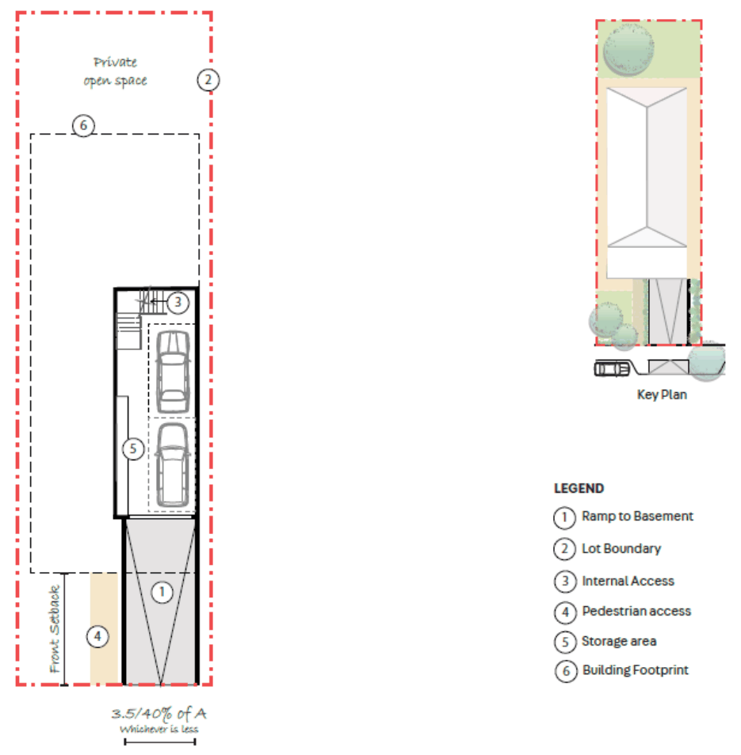

> [Picture on page 65: a picture, saved as a picture (images/ch-05-01-former-bankstown-lga-page-65-1.gif, 150 dpi).]

Figure 15a: Example of dwelling house where the basement (50m²) is providing tandem parking – refer to clause 15.5.

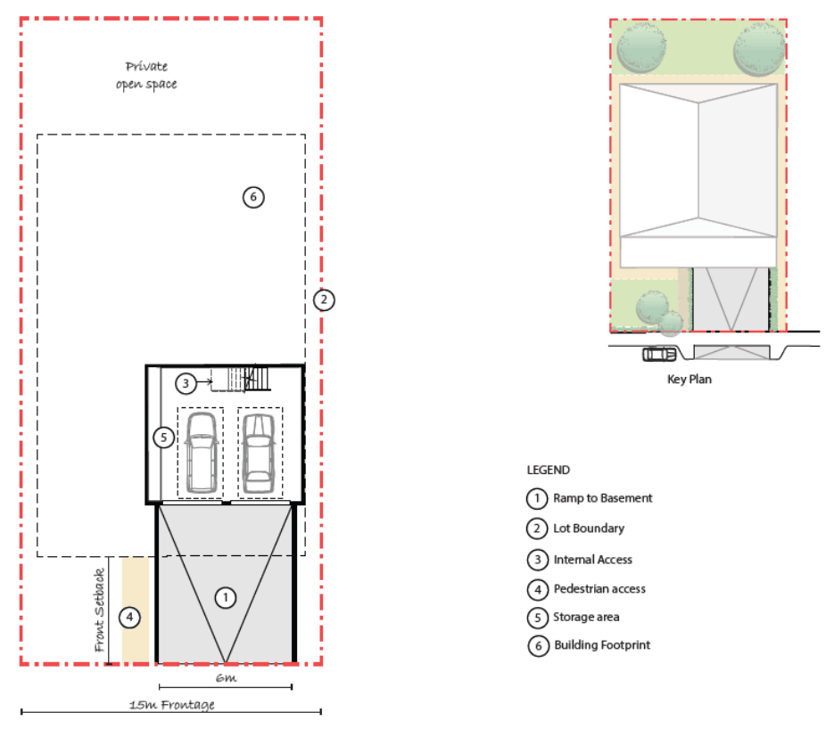

> [Picture on page 66: a picture, saved as a picture (images/ch-05-01-former-bankstown-lga-page-66-1.gif, 150 dpi).]

Figure 15b: Example of dwelling house where the basement (50m²) is providing side by side parking – refer to clause 15.6.

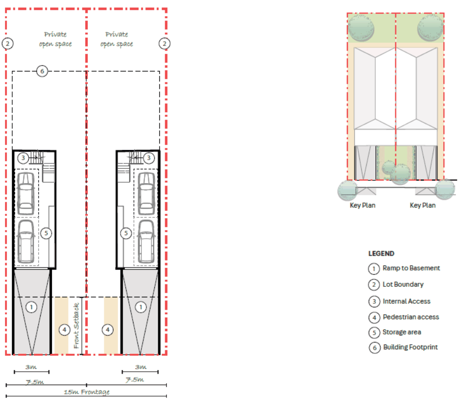

> [Picture on page 67: a picture, saved as a picture (images/ch-05-01-former-bankstown-lga-page-67-1.gif, 150 dpi).]

Figure 15c: Example of dual occupancy where the basement (50m²) is providing parking and separate driveways.

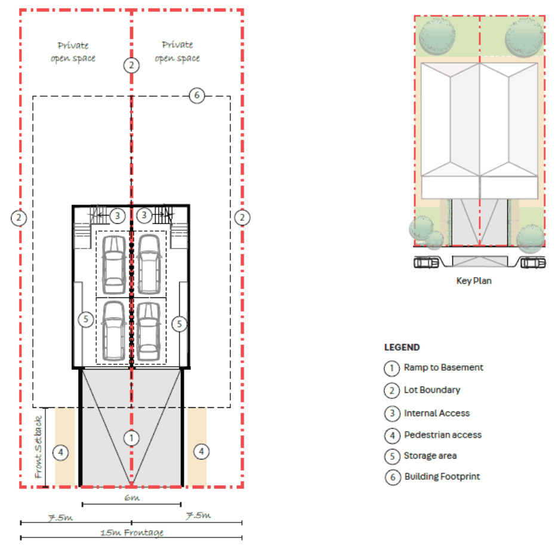

> [Picture on page 68: a picture, saved as a picture (images/ch-05-01-former-bankstown-lga-page-68-1.gif, 150 dpi).]

Figure 15d: Example of dual occupancy where the basement (50m²) is providing parking and a combined driveway.

#### APPENDICES

#### Appendix 1–Foreshore Protection Area

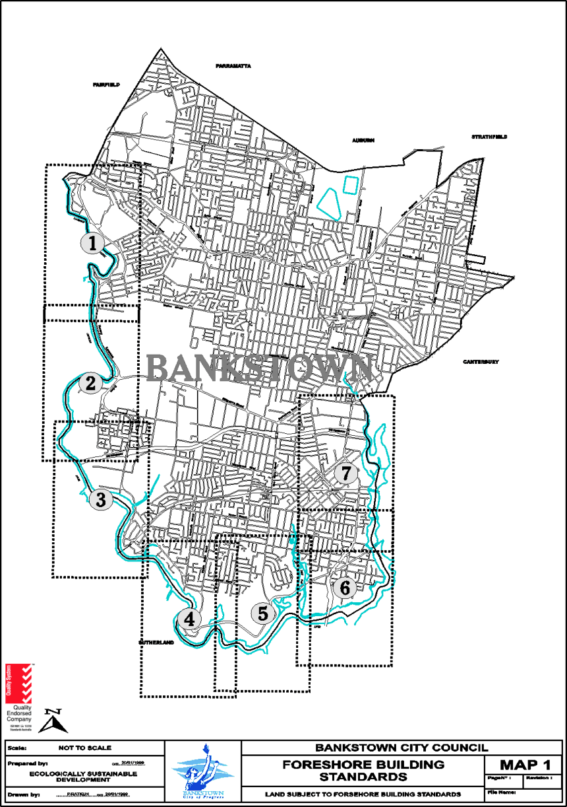

> [Picture on page 69: a picture, saved as a picture (images/ch-05-01-former-bankstown-lga-page-69-3.gif, 150 dpi).]

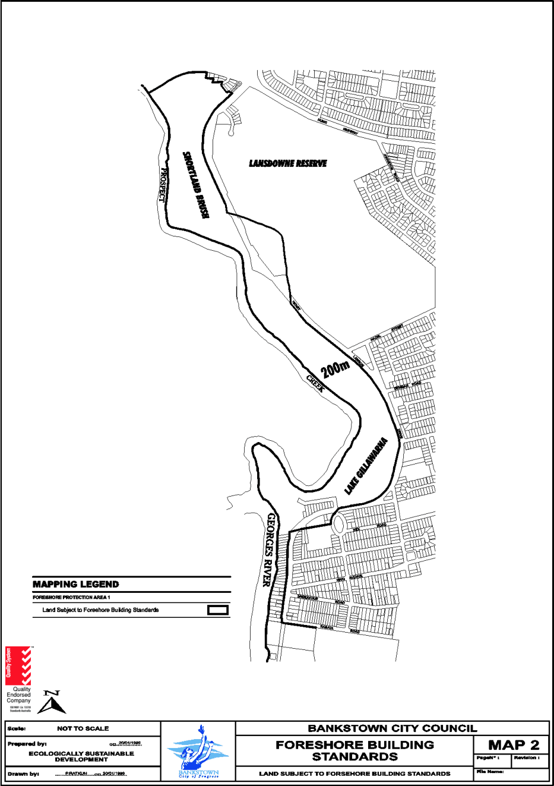

> [Picture on page 70: a picture, saved as a picture (images/ch-05-01-former-bankstown-lga-page-70-1.gif, 150 dpi).]

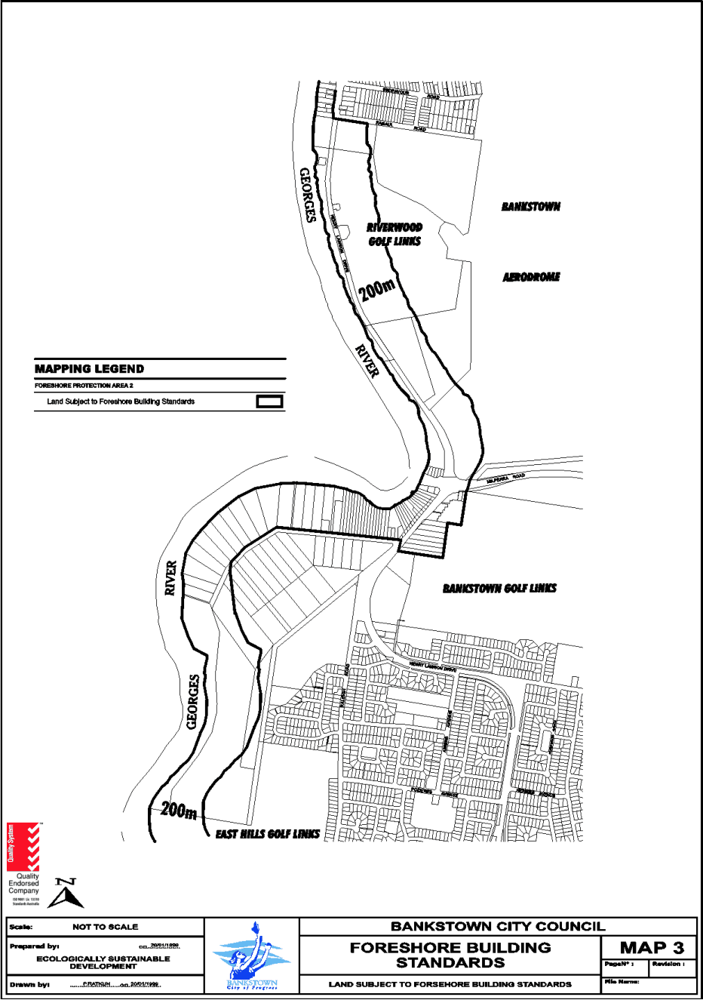

> [Picture on page 71: a picture, saved as a picture (images/ch-05-01-former-bankstown-lga-page-71-1.gif, 150 dpi).]

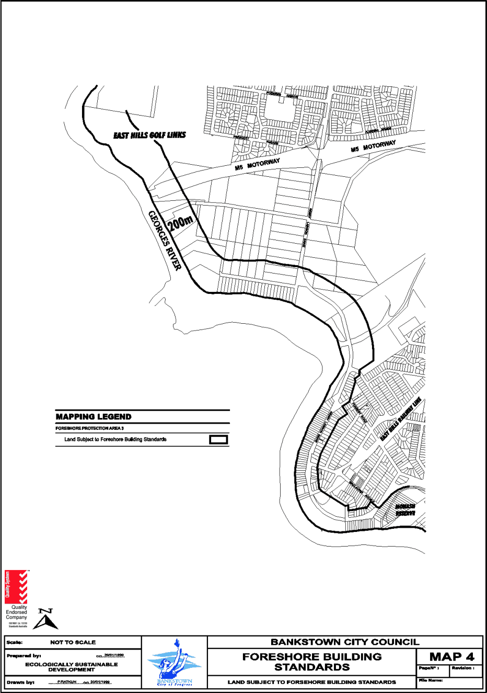

> [Picture on page 72: a picture, saved as a picture (images/ch-05-01-former-bankstown-lga-page-72-1.gif, 150 dpi).]

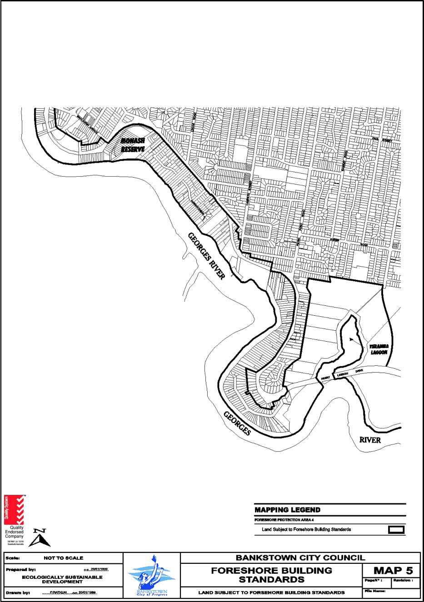

> [Picture on page 73: a picture, saved as a picture (images/ch-05-01-former-bankstown-lga-page-73-1.gif, 150 dpi).]

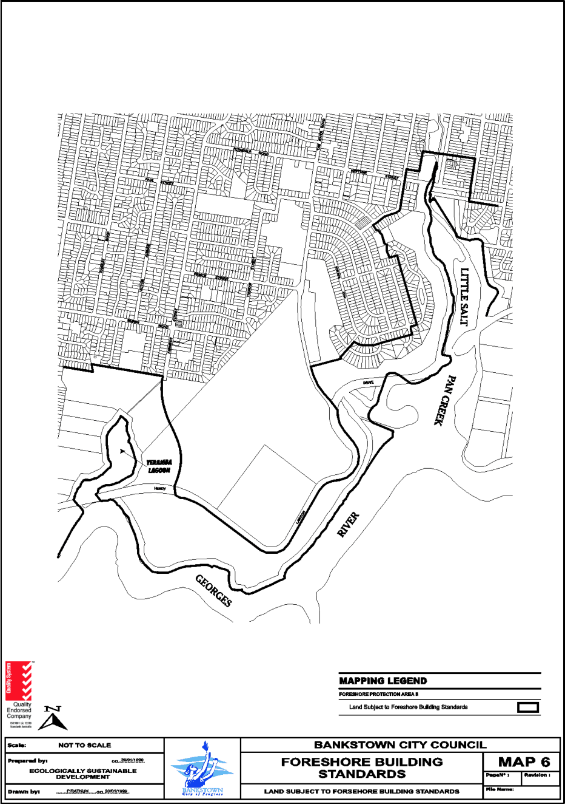

> [Picture on page 74: a picture, saved as a picture (images/ch-05-01-former-bankstown-lga-page-74-1.gif, 150 dpi).]

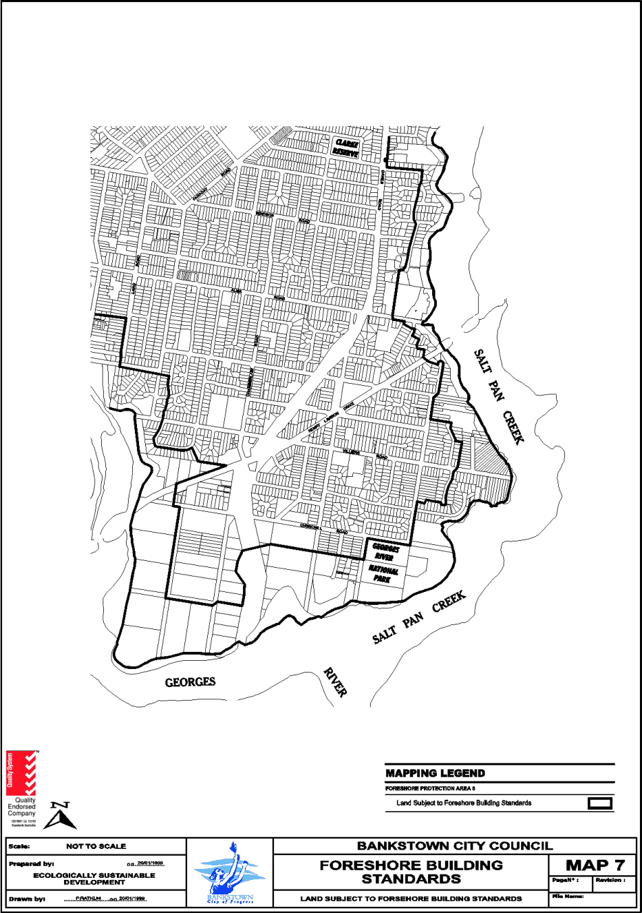

> [Picture on page 75: a picture, saved as a picture (images/ch-05-01-former-bankstown-lga-page-75-1.gif, 150 dpi).]

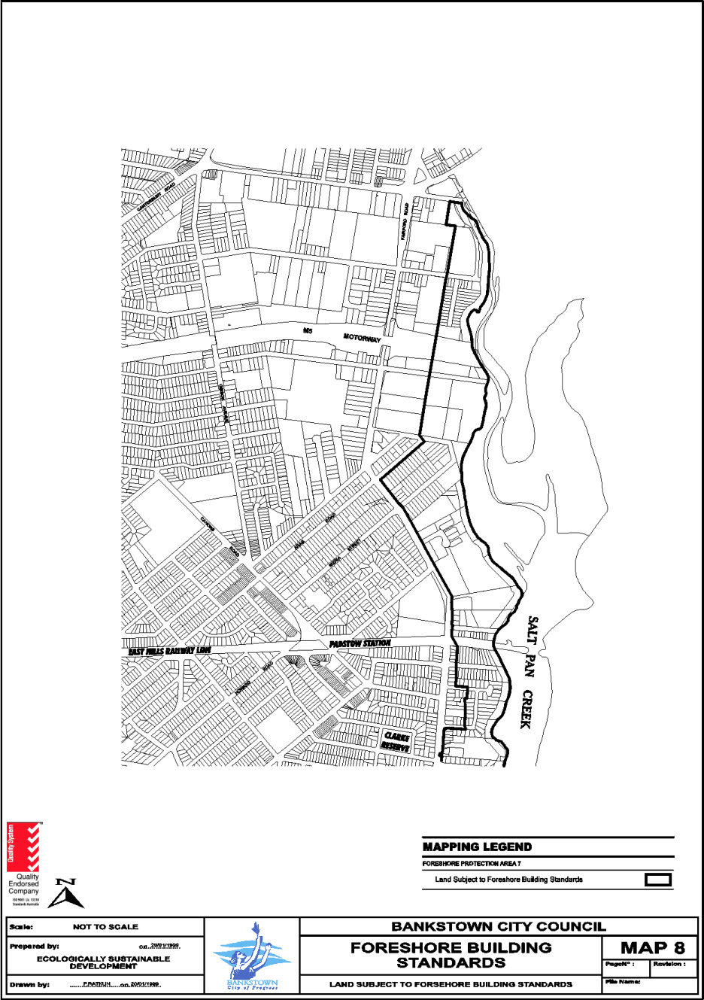

> [Picture on page 76: a picture, saved as a picture (images/ch-05-01-former-bankstown-lga-page-76-1.gif, 150 dpi).]

#### Appendix 2–Adopted road pattern for certain land in Georges Hall

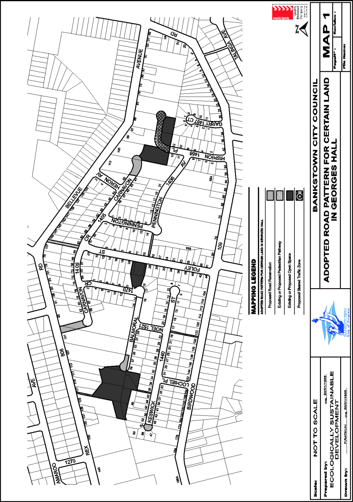

> [Picture on page 77: a picture, saved as a picture (images/ch-05-01-former-bankstown-lga-page-77-2.gif, 150 dpi).]

Appendix 3–Restriction of access from Balmoral Crescent to Rex Road in Georges Hall

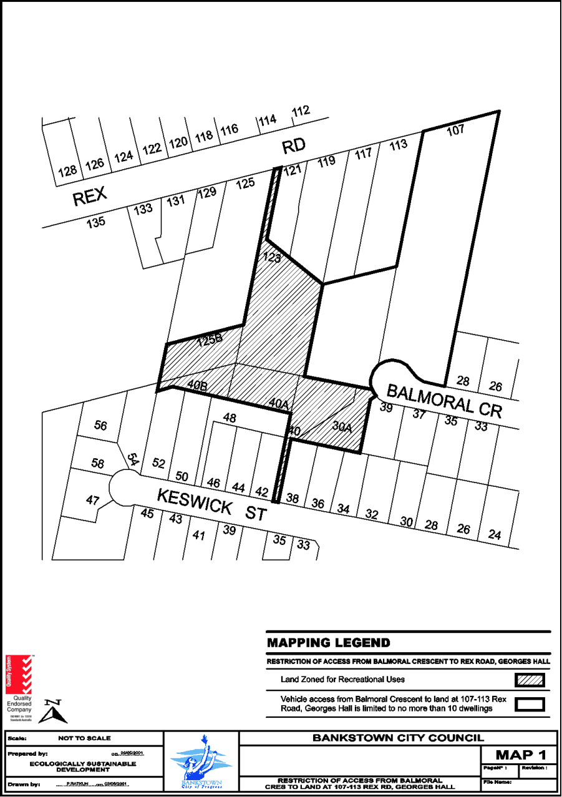

> [Picture on page 78: a picture, saved as a picture (images/ch-05-01-former-bankstown-lga-page-78-2.gif, 150 dpi).]
