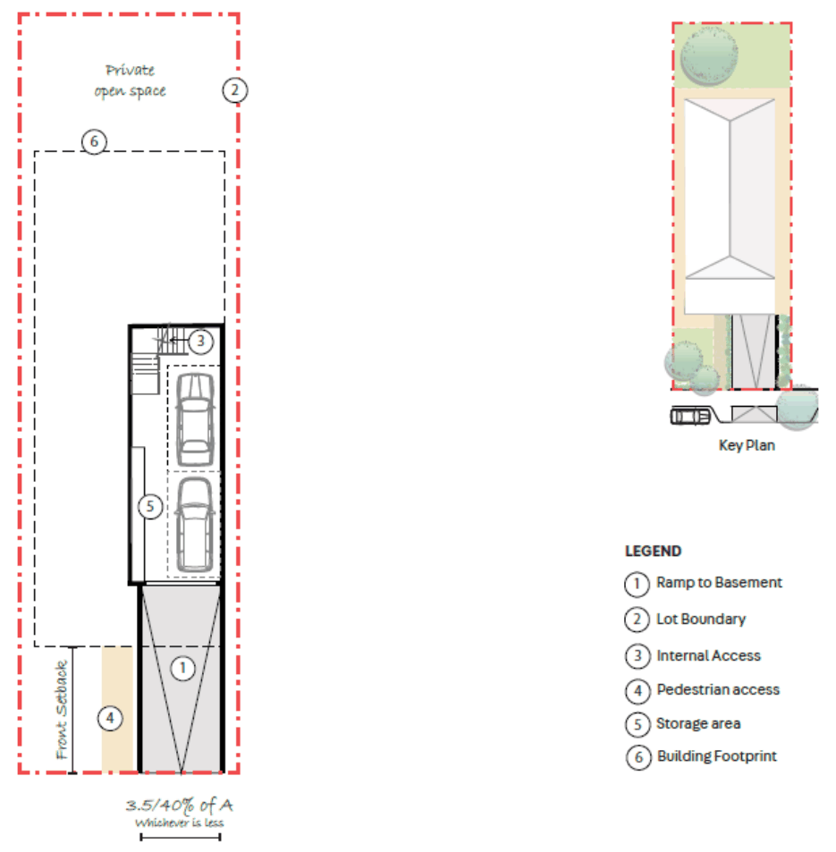
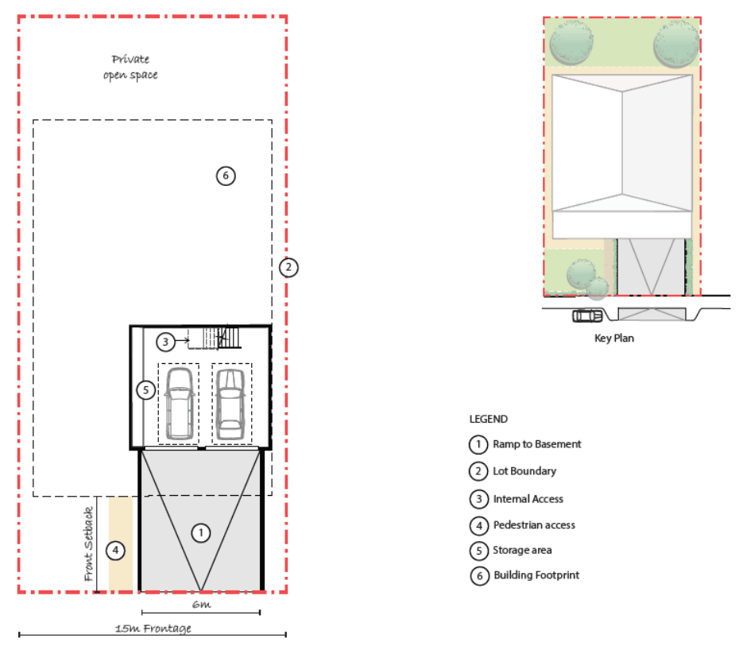
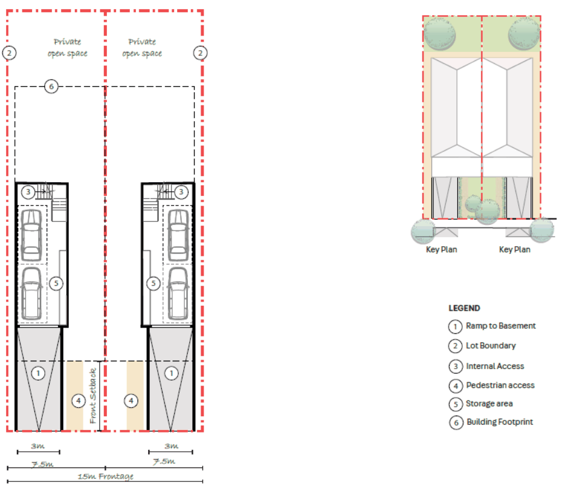
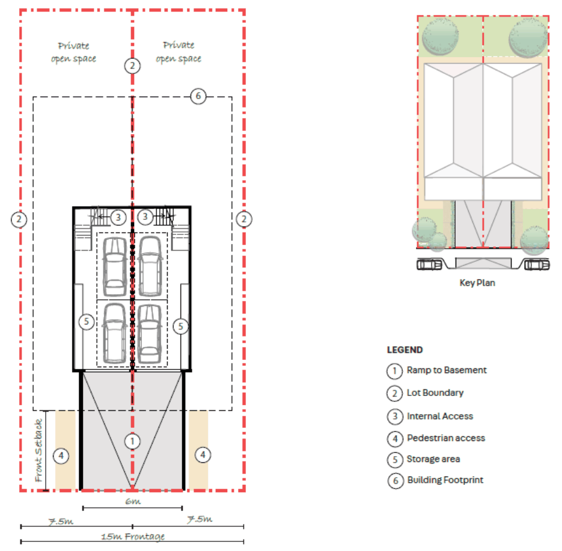

#### C3 High density residential environment

To have a high density residential environment in Zone R4 that provides high density housing (in the form of contemporary designed residential flat buildings) within a landscaped setting. Development should provide appropriate spaces between buildings, communal open spaces and deep soil zones to provide adequate amenity for residents.

#### Definitions

Local road means any road or street other than a major road.

Major road means the following roads in the former Canterbury Local Government Area:

• Albert Street;

• Bayview Avenue;

• Beamish Street (between Brighton Avenue and Canterbury Road);

• Belmore Road;

• Bexley Road;

• Bonds Road;

• Brighton Avenue;

• Burlington Avenue (between Fore Street and Karool Avenue);

• Burwood Road;

• Canterbury Road;

• Fore Street;

• Fifth Avenue;

• Georges River Road;

• Hartill-Law Avenue;

• Homer Street (between Bexley Road and the Cooks River);

• Jeffery Street (between Canterbury Road and King Street);

• King Street;

• Karool Avenue (between Permanent Avenue and Burlington Avenue);

• King Georges Road;

• Kingsgrove Road;

• Lakemba Street (between Albert Street and King Georges Road);

• Loch Street;

• Milton Street;

• Moorefields Road;

• Moxon Road;

• New Canterbury Road;

• Ninth Avenue;

• Orissa Street;

• Permanent Avenue;

• Punchbowl Road;

• Second Avenue;

• Thompson Street (between Burlington Avenue and Permanent Avenue);

• Viking Street;

• Wardell Road;

• William Street; and

• Wiggs Road.

## SECTION 2–DWELLING HOUSES AND OUTBUILDINGS

#### GENERAL OBJECTIVES

O1 To ensure all neighbourhoods are safe and comfortable.

O2 To ensure a diversity of well-designed dwellings that are sympathetic to the density and function of each neighbourhood.

O3 To ensure residential streets and yards are green and leafy, with substantial tree canopy.

O4 To ensure buildings are adequately setback from existing structures to facilitate household activities and landscaping.

O5 To ensure that development provides good amenity, solar access and privacy for occupiers of new and existing buildings.

O6 To ensure that development is of a high quality design, appearance and performance.

#### SITE PLANNING

### 2.1 Minimum lot size and frontage

#### Objectives

O1 To ensure that land is of an adequate size and shape to accommodate development whilst providing adequate amenity for occupants of the site and surrounds.

O2 To ensure there is adequate area for vehicle access and parking.

O3 To ensure sites have sufficient dimensions to accommodate adequate landscaped open spaces.

#### Development controls

C1 The minimum primary street frontage width for dwelling houses is 15m.

C2 Lots must be generally rectangular.

C3 Internal and battle-axe blocks and lots with irregular dimensions or shallow depths must satisfy the objectives of the DCP.

C4 Nothing in this section prevents Council giving consideration to the erection of a dwelling house on an allotment of land which existed as of 1 January 2013.

### 2.2 Site coverage

#### Objectives

O1 To ensure that the scale and mass of development achieves improved levels of residential amenity for new development and for existing dwellings.

O2 To ensure there is adequate unbuilt upon areas to allow for private open space, substantial landscaped areas and deep soil planting capable of supporting large trees.

#### Development controls

C1 All development must comply with the numerical requirements contained in the table below:

| Site Area | Maximum area of building footprint | Maximum floor area of all outbuildings | Maximum site coverage of all structures on a site |
|---|---|---|---|
| Up to 449m2 | 300m2 | 30m2 | 60% |
| 450m2 to 599m2 | 330m2 | 45m2 | 50% |
| 600m2 to 899m2 | 380m2 | 60m2 | 40% |
| 900m2 or above | 430m2 | 60m2 | 40% |

Table 1: Maximum building footprint, floor area of outbuildings and site coverage

### 2.3 Landscaping

#### Objectives

O1 To ensure new development is appropriately landscaped to provide a pleasant outlook and contribute to the amenity of a property.

O2 To minimise stormwater run-off by retaining deep soil areas that facilitate rainwater infiltration.

#### Development controls

C1 Deep soil permeable areas must be provided in accordance with the table below:

| Site area | Minimum deep soil area (% of site area) |
|---|---|
| Up to 449m2 | 15% |
| 450m2 to 599m2 | 20% |
| 600m2 or above | 25% |

Table 2: Minimum deep soil areas

C2 Deep soil areas must have a minimum dimension of 2.5m.

### 2.4 Layout and orientation

#### Objectives

O1 To encourage a more sustainable urban environment where energy efficiency is incorporated into the design, construction and use of buildings.

O2 To reduce consumption of energy from non-renewable sources, and reduced greenhouse gas emissions.

#### Development controls

C1 Orientate development to maximise solar access and natural lighting, without unduly increasing the building’s heat load.

C2 Site the development to avoid casting shadows onto a neighbouring dwelling’s primary living area, private open space and solar cells.

C3 Coordinate design for natural ventilation with passive solar design techniques.

C4 Site new development and private open space to avoid existing shadows cast from nearby buildings.

C5 Site a building to take maximum benefit from cross-breezes and prevailing winds.

C6 Do not compromise the creation of casual surveillance of the street, communal space and parking areas, through the required orientation.

#### BUILDING ENVELOPE

### 2.5 Height

The maximum permissible height of a building is prescribed in the LEP and varies across residential zones. The definition of height of building is defined under LEP. Operating in conjunction with the LEP height of building control, external wall height and storey provisions in this DCP prescribe the maximum height for the external enclosing walls of a building.

Note: Development adjacent to, or in the vicinity of, a heritage item may preclude achievement of maximum building heights.

#### Objectives

O1 To ensure that development is of a scale that is visually compatible with adjacent buildings, character of the area, and the objectives of the zone.

#### Development controls

Development for the purposes of dwelling houses must not exceed the following numerical requirements: A maximum two storey built form. A maximum external wall height of 7m where the maximum height of buildings standard under the LEP is 8.5m. A maximum external wall height of 8m where the maximum height of building standard under the LEP is 9.5m. Finished ground floor level is not to exceed 1m above the natural ground level. Note: Skillion and flat roof forms will be considered on merit.

Basement and sub-floor projection Any part of a basement or sub-floor area that projects greater than 1m above ground level comprises a storey.

Attics and roof terraces Attics and mezzanine floors do not comprise a storey.

Roof top terraces are not acceptable on any building or outbuilding in any residential zone.

Basement and sub-floor Basement and sub-floor parking is only suitable where compliance with Chapter 3.2 of this DCP can be demonstrated.

Retaining walls – Development without basement parking Walls that would enclose a sub-floor area:

(a) Maximum 2m for steeply sloping land; and

(b) Maximum 1m for all other land.

Retaining walls that would be located along, or immediately adjacent to, any boundary:

(a) Maximum 3m for steeply sloping land, but only to accommodate a garage that would be located at street level; and

(b) Maximum 1m for all other land.

Cut and fill – Development without basement parking Maximum 1m cut below ground level where it will extend beyond an exterior wall of the building.

No limit to cut below ground level where it will be contained entirely within the exterior walls of a building, however, excavated area is not to accommodate any habitable room that would be located substantially below ground level.

Maximum 600mm fill above ground level where it would extend beyond an exterior wall of a building.

If proposed cut and fill, or a retaining wall, would be deeper or higher than 1m, structural viability must be confirmed by suitably qualified engineers’ reports.

### 2.6 Setbacks

#### Objectives

O1 To establish the desired spatial proportions of the street and define the street edge.

O2 To limit the scale and bulk of development by retaining landscaped open space around.

O3 To contribute to the natural landscape by retaining adequate space for new trees and conserving existing visually prominent trees.

O4 To provide sufficient separation between buildings and adjacent land to limit the visual, environmental and likely potential amenity impacts of new development.

#### Development controls

Front, side and rear setbacks

C1 Development, including basement and sub-floor areas, fronting a major road must have a minimum front setback of 9m.

C2 Development must comply with the minimum front, side and rear setbacks as detailed in the following tables:

| Setback | Controls |
|---|---|
| Front Setback | • Minimum setback of 5.5m from the front boundary. • Maximum 2m recess for the main entrance from the front building line. • Where the existing front setback is less than 5.5m, further encroachments by alterations and additions are not acceptable. |
| Side Setbacks | • Minimum setback of 900mm from side boundaries. • Alterations and additions may be in line with the existing ground level walls. |
| Rear Setbacks | • Minimum setback of 6m from the rear boundary. |

Table 3: Dwelling houses with frontage of 12.5m or less

| Setback | Controls |
|---|---|
| Front Setback | • Minimum setback of 6m or the average of the existing setback of the nearest dwelling house to either side of the site. • Maximum 2m recess for the main entrance from the front building line. |
| Side Setbacks | • Minimum setback of minimum setback of 1m from side boundaries. • Corner lots: minimum setback of 2m from the secondary street frontage (the longer street boundary). |

| Setback | Controls |
|---|---|
| Rear Setbacks | • Minimum setback of 6m from the rear boundary. |

Table 4: Dwelling houses with frontages widths of 12.5m or greater

| Setback | Controls |
|---|---|
| Side Setbacks | • External wall height over 2.7m a minimum setback of 450mm from the side boundary. • External wall height not exceeding 2.7m may encroach into the minimum setback area. |

Table 5: Outbuildings (including alterations and additions)

Exceptions and other requirements

C3 External walls that enclose rooms, storage areas and/or garages are not to encroach beyond the specified setbacks.

C4 For first floor additions, front and side setbacks may match the ground floor wall alignment of the existing dwelling for a depth of 10m or 50% of the length of the facade, whichever is the greater.

C5 Minimum setback of 1m from any side or rear boundary for swimming pools and associated terraces. Landscaping shall be provided in the setback area to screen the pool from neighbours.

C6 Swimming pools must not be located within any front setback.

C7 One garage or carport may be constructed with a nil rear setback for sites that adjoin a rear laneway. The garage or carport must not comprise more than 50% of the rear boundary frontage to a lane and not be wider than 6m.

C8 For a residential building that does not have basement parking lightweight carports may extend beyond the required side boundary setback.

C9 Car parking structures must satisfy the Building Code of Australia requirements.

C10 For existing dwelling houses, a single space carport may encroach beyond the minimum front setback, where it can be demonstrated that:

(a) there is no existing garage on the site;

(b) there is no side or rear vehicle access to the site;

(c) the site does not contain a heritage item or is not within a heritage conservation area or local character area;

(d) the site is in the vicinity of existing, approved carports on adjacent sites that are forward of the front building line;

(e) the maximum width of the single carport is 3m;

(f) it is of a simple posted design, with no side panel infill;

(g) there is no solid panel lift or roller shutter door proposed;

(h) the carport is setback a minimum 1m from the primary and secondary street frontages;

(i) the carport achieves a high quality design and has a roof design that is compatible with the dwelling house.

C11 On land identified as having a height of 9.5m on the Map, the following parking structures may encroach beyond the minimum front or side setback: One carport that is not wider than 6m. On sites that rise from the street frontage, one garage that is not wider than 6m and no higher than 3m above street level.

C12 The following minor building elements may project up to 1m into the minimum side setback area: Roof eaves, awnings, pergolas and patios; Stair or ramp access to the ground floor; and Rainwater tanks.

C13 Elements that articulate a front elevation of a dwelling house, such as awnings, balconies, patios, pergolas, porches, porticoes and verandas, may project up to 1.5m into the required front setback articulation zone.

### 2.7 Building separation

#### Objectives

O1 To promote improved levels of residential amenity for new and existing development, including to preserve sunlight, privacy and general amenity for existing buildings.

O2 To ensure that development is of a scale that is visually compatible with adjacent buildings, character of the area, and the objectives of the zone.

#### Development controls

C1 The following controls apply to alterations and additions to dwelling houses:

(a) The top storey of any two-storey building should be designed, as a series of connected pavilion elements.

(b) Pavilion elements shall have a depth between 10m to 15m.

(c) Articulate pavilion elements by an additional side boundary setback, and identified by separate roofs.

#### BUILDING DESIGN

### 2.8 General design

#### Objectives

O1 To ensure that development is coordinated with, and complements, the public domain to enhance the character and the image of the streetscape.

O2 To ensure that development provides good amenity for occupants of new and existing development, including reasonable solar access, privacy, and natural ventilation.

O3 To ensure alterations and additions complement the architectural character of the existing building or is of a contemporary design that is appropriate in its context.

O4 To facilitate positive interaction between the private and public domain.

O5 To maximise passive surveillance to promote safety and security.

O6 To encourage effective articulation of building design to reduce the appearance of scale, enhance visual interest and ensure a diversity of built form.

O7 To ensure all elements of the facade and roof are integrated into the architectural form and detail of the building, and enhance streetscape appearance.

O8 To encourage high standards of amenity through appropriate dimensions and configurations of habitable rooms.

#### Development controls

Contemporary built form

C1 Contemporary architectural designs may be acceptable if:

(a) A heritage listing does not apply to the existing dwelling or to its immediate neighbours.

(b) The proposed addition is not visually prominent from the street or from a public space.

(c) Extensive remodelling of existing facades is proposed in accordance with controls of this DCP.

C2 New building forms and design features shall not mimic traditional features, but should reflect these in a contemporary design.

C3 Access to upper storeys must not be via external stairs.

C4 All dwellings must contain one kitchen and laundry facility.

C5 Retain and extend prominent elements of the existing roof (such as gables, hips or longitudinal ridges that run parallel to a street boundary).

C6 Contemporary roof forms may be acceptable on additions at ground floor level if concealed substantially behind the existing dwelling, and not visible from the street or other public space.

Building entries

C7 Entries to residential buildings must be clearly identifiable.

C8 The front door to a dwelling house may face a side boundary, or may be located beneath a carport, provided it is clearly identified by a porch or awning, and pathways.

C9 A minimum of one habitable room must be oriented towards the street to promote positive social interaction and community safety.

C10 Sight lines to the street from habitable rooms or entrances must not be obscured by ancillary structures.

Internal dwelling layout

C11 Design interiors to be capable of accommodating the range of furniture that is typical for the purpose of each room.

C12 The primary living area and principal bedroom must have a minimum dimension of 3.5m.

C13 Secondary bedrooms must have a minimum dimension of 3m.

C14 Provide general storage in addition to bedroom wardrobes and kitchen cupboards.

Facade treatment

C15 Development on corner lots must address both street frontages through facade treatment and articulation of elevations.

C16 Use non-reflective materials, do not randomly mix light and dark coloured bricks, and treat publicly accessible wall surfaces with anti-graffiti coating.

C17 Facade design should reflect the orientation of the site using elements such as sun shading devices, light shelves and bay windows.

C18 Facades visible from the street should be designed as a series of articulating panels or elements.

C19 The width of articulating panels should be consistent with the scale and rhythm characteristic of bungalows.

C20 The width of articulating panels shall be in accordance with the numerical requirements below:

| Facade | Street elevation | Side elevation |
|---|---|---|
| Width of articulating panels | 4m to 6m | 10m to 15m |

Table 6: Width of articulating panels

C21 Avoid long flat walls along street frontages - stagger the wall alignment with a step (not a fin wall of other protruding feature) of at least 0.5m for residential buildings.

C22 Vary the height of modules so they are not read as a continuous line on any one street between 2 - 4 storeys, step-back to the middle component and again at the top.

C23 Incorporate contrasting elements in the facade - use a harmonious range of high quality materials, finishes and detailing.

C24 Screen prominent corners with awnings, balconies, terraces or verandas that project at least 1 m from the general wall alignment.

Pavilions

C25 The top storey of any two-storey dwelling should be designed as a series of connected pavilion elements to minimise scale and bulk.

C26 Facades that exceed 25m in length shall be indented to create the appearance of multiple pavilion elements.

C27 Pavilion elements shall have a depth between 10-15m.

C28 Articulate upper storey pavilions with an additional side boundary setback, and identify by separate roofs.

Windows

C29 Large windows should be located at the corners of a building and may be designed as projecting bay-windows.

C30 Large windows should be screened with blinds, louvres, awnings or pergolas and be draft insulated.

C31 Windows must be rectangular.

C32 Square, circle and semi-circle windows are acceptable in moderation.

C33 Vertical proportioned window openings can include multi-panel windows or multi-panel doors.

C34 Windows and openings shall be appropriately located and shaded to reduce summer heat load and maximise sunlight in winter.

C35 Dormer windows on buildings in the residential zone do not appear as additional storey must comply with the following design requirements: Individual dormers are no wider than 1.5m in width; Provide a minimum 2.5m separation between dormers; and Dormers do not extend encroach above the ridgeline of the building.

Ventilation

C36 Incorporate features to facilitate natural ventilation and convective currents - such as opening windows, high vents and grills, high level ventilation (ridge and roof vents) in conjunction with low-level air intake (windows or vents).

C37 Where natural ventilation is not possible, energy efficient ventilation devices such as ceiling fans should be considered as an alternative to air conditioning. Explore innovative technologies to naturally ventilate internal building areas or rooms.

### 2.9 Roof design and features

#### Objectives

O1 To ensure that roof design is compatible with the building style and does not visually dominate the building or other roofs in the locality.

O2 To promote roof design that assists in regulating climate within the building.

O3 To reduce the impact of large surfaces of roof when viewed from other buildings and public spaces.

#### Development controls

Use a simple pitched roof that accentuates the shape of exterior walls, and minimises bulk and scale.

Avoid complex roof forms such as multiple gables, hips and valleys, or turrets.

Roof pitches are to be compatible and sympathetic to nearby buildings.

Parapet roofs that increase the height of exterior walls are to be minimised.

Use minor gables only to emphasise rooms or balconies that project from the body of a building.

Mansard roofs (or similar) are not permitted.

Pitched roofs should not exceed a pitch of 30 degrees.

C8 Relate roof design to the desired built form and context.

C9 Roofs with greater pitches will only be considered on merit taking into account matters such as streetscape, heritage value and design integrity.

#### AMENITY

### 2.10 Solar access and overshadowing

#### Objectives

O1 To ensure habitable rooms have reasonable daylight access.

O2 To minimise overshadowing of primary living areas , private open space and solar roof top systems.

O3 To enable occupants to adjust the quantity of daylight to suit their needs.

#### Development controls

Solar access to proposed development Where site orientation permits at least primary living areas of dwellings must receive a minimum of 3 hours of sunlight between 8.00am and 4.00pm on 21 June. Where existing overshadowing by buildings and fences is already greater than this control, sunlight is not to be reduced by more than 20%.

Principle areas of private open space must receive a minimum of 3 hours of sunlight between 8.00am and 4.00pm on 21 June to at least 50% of the open space surface

area. Where existing overshadowing by buildings and fences is already greater than this control, sunlight is not to be reduced by more than 20%.

Solar access to neighbouring development

C3 Proposed development must retain a minimum of 3 hours of sunlight between 8.00am and 4.00pm on 21 June for existing primary living areas and to 50% of the principal private open space.

C4 If a neighbouring dwelling currently receives less than 3 hours of sunlight, then the proposed development must not reduce the existing level of solar access to that property.

Sunlight to solar hot water or photovoltaic systems on adjoining properties must comply with the following:

(a) Systems must receive at least 3 hours of direct sunlight between 8.00am and 4.00pm on 21 June.

(b) If a system currently receives less than 3 hours sunlight, then the proposed development must not reduce the existing level of sunlight.

Clothes drying areas on adjoining residential properties must receive a minimum of 3 hours of sunlight on 21 June.

Shading devices Windows and openings shall be appropriately located and shaded to reduce summer heat load and maximise sunlight in winter.

Use shading devices to allow direct sunlight to enter and heat a building in winter and prevent direct sunlight entering and heating the building in summer. Devices include eaves, awnings, shutters, louvres, pergolas, balconies, colonnades or external planting.

Provide horizontal shading to north-facing windows and vertical shading to east or west windows.

Use moveable shading devices on large windows facing east and west that are capable of covering 100% of glazed areas. Eaves shall be a minimum of 350mm wide and allow for an overhang of approximately 65 degrees above the horizontal.

Avoid reducing internal natural daylight or interrupting views with shading devices.

Use double-glazing, solar coated windows, curtains, or internal shutters to prevent heat loss and provide extra summer protection.

Use high performance glass with a reflectivity below 20%.

Minimise external glare by avoiding reflective films and use of tint glass.

Use of draft insulation around windows and doors.

### 2.11 Visual privacy

#### Objectives

O1 To ensure reasonable levels of visual privacy is achieved for residents, inside a building and outside within the property, during the day and at night.

O2 To ensure visual privacy is not compromised whilst maximising outlook and views from main living areas and private open space.

O3 To promote passive surveillance of public and semi-public areas.

#### Development controls

C1 Locate and orient new development to maximise visual privacy between buildings, on and adjacent to the site.

C2 Minimise direct overlooking of rooms and private open space through the following:

(a) Provide adequate building separation, and rear and side setbacks; and

(b) Orient living room windows and private open space towards the street and/or rear of the lot to avoid direct overlooking between neighbouring residential properties.

C3 If living room windows or private open spaces would directly overlook a neighbouring dwelling:

(a) Provide effective screening with louvres, shutters, blinds or pergolas; and/or

(b) Use windows that are less than 600mm wide or have a minimum sill height of at least 1.5m above the associated floor level.

C4 Screening of bedroom windows is optional and dimensions are not restricted.

### 2.12 Acoustic privacy

#### Objectives

O1 To ensure reasonable levels of acoustic privacy are available for residents, externally and internally, during the day and at night.

O2 To minimise the effect of excessive ambient noise through siting and architectural design and detailing.

O3 To minimise the impact of rail and road noise and vibration for dwelling occupants.

O4 To protect new and existing dwellings from intrusive noise.

#### Development controls

C1 Protect sensitive rooms, such as bedrooms, from likely sources of noise such as major roads and neighbouring’ living areas.

C2 Bedroom windows in new dwellings that would be located at or close to ground level are be raised above, or screened from, any shared pedestrian pathway.

C3 Screen balconies or windows in living rooms or bedrooms that would face a driveway or basement ramp.

C4 Address all requirements in ‘Development Near Rail Corridors and Busy Roads – Interim Guideline (2008)’ published by the NSW Department of Planning.

#### FENCES AND ANCILLARY DEVELOPMENT

### 2.13 Fences

#### Objectives

To ensure that fences are integrated into the architectural form and detail of a building and present an appealing streetscape appearance.

To reduce the impact of large areas of fencing that detract from other buildings and fences in the area.

To facilitate positive interaction between private and public domain.

#### Development controls

Provide boundary definition by construction of an open fence or hedge to the front street boundary.

Front fences within the front boundary setback are to be no higher than 1.2m.

Side fences may be 1.8m high to the predominant building line. Forward of the building line, side fences must taper down to the height of the front fence at a height no greater than 1.2m.

On corner sites where the facade of a building presents to two street frontages, fences are to be no higher than 1.2m.

Front fences shall not be taller than 1.2m.

Screens with a minimum of 50% transparency may be up to 1.8m high along the front boundary.

Landscaping should not include visually solid hedges that may conceal intruders.

### 2.14  Outbuildings and swimming pools

#### Objectives

O1 To ensure an outbuilding is established in conjunction with the principal dwelling on the same site and is used solely for non-habitable purposes.

O2 To limit the number and size of outbuildings on a site.

O3 To ensure the building form is subservient to the principal dwelling on the same site in terms of visual bulk and scale.

O4 To ensure the building form and building design of outbuildings do not adversely impact on the amenity of neighbouring sites in terms of visual bulk, access to sunlight and privacy.

#### Development controls

Outbuildings

C1 Council allows a maximum of one outbuilding on a site.

C2 The outbuilding must be established in conjunction with the principal dwelling on the same site and must ensure that:

(a) it is separate from the principal dwelling and any secondary dwelling on the same site, and

(b) it is not used as a separate dwelling, and

(c) it does not contain cooking facilities, toilet and shower, and

(d) it does not function or can be adapted to function for industrial purposes.

C3 The maximum site cover of the outbuilding is:

(a) 36m2 where the site is less than 300m2 in area

(b) 45m2 where the site is 300m2 to 600m2 in area

(c) 60m2 where the site is greater than 600m2 in area.

For the purposes of this clause, site cover means the site area covered by the outbuilding and any attached roof, awning, balcony, deck, patio, pergola, terrace, verandah, carport, garage and the like.

C4 The outbuilding must not result in the principal dwelling on the site having less than the required landscaped area and private open space.

C5 The storey limit for the outbuilding is single storey. An attic or basement is not permitted in the outbuilding.

C6 The maximum building height for the outbuilding is 4.5m above ground level (existing).

C7 The outbuilding must locate behind the front building line.

C8 The minimum setback to the side and rear boundaries of the site is:

(a) zero setback for carports or masonry walls that do not contain windows, eaves and gutters provided the structures comply with the Building Code of Australia; or

(b) 0.45m for non-masonry walls that do not contain a windows, eaves and gutters; or

(c) 0.9m for walls with windows.

C9 The minimum setback to a dwelling, building, roof, awning, balcony, deck, patio, pergola, terrace, verandah, carport, garage and the like on the same site is 1.8m.

C10 The maximum roof pitch for the outbuilding is 25 degrees.

C11 Council does not allow the outbuilding to have roof-top balconies and the like.

C12 Development must retain and protect any significant trees on the site and adjoining sites. To achieve this clause, the development may require a design alteration or a reduction in the size of the outbuilding.

Swimming pools

C13 Swimming pools must not be located within any front setback.

C14 Minimum setback of 1m from any side or rear boundary for swimming pools and associated terraces. Landscaping shall be provided in the setback area to screen the pool from neighbours.

### 2.15 Building services

#### Objectives

O1 To reduce impact of services and utilities through their integration with the design of landscaped areas and buildings.

#### Development controls

All letterboxes be installed to meet Australia Post standards.

Design and provide discretely located mailboxes at the front of the property.

Integrate systems, services and utility areas with the design of the whole development – coordinate materials with those of the building and integrate with landscaping.

Facilities should not be visually obtrusive and should not detract from soft-landscaped areas that are located within the required setbacks or building separations.

Appliances that are fitted to the exterior of a building, and enclosures for service meters, do not detract from the desired architectural quality of new building, or the desired green character of streetscapes.

Unscreened appliances and meters should not be attached to any facade that would be visible from a street or driveway within the site:

(a) Screen air conditioning units behind balcony balustrades;

(b) Provide screened recesses for water heaters rather than surface - mounting them on exterior walls; and

(c) Locate meters in service cabinets.

Screen or treat air conditioning units, TV antennae, satellite dishes, ventilation ducts and other like structures so they are not visible on the street elevation.

Coordinate and integrate building services, such as drainage pipes, with overall facade and balcony design.

Location and design of service areas should include:

(a) Screening of clothes drying areas from public places; and

(b) Space for storage that is screened or integrated with the building design.

Minimise visual impact of solar hot water systems by:

(a) Placing the system as unobtrusively as possible, both to the street and neighbouring properties;

(b) Using a colour that is consistent with the colour of roof materials;

(c) Designing solar panels, where possible, as part of the roof;

(d) Setting the solar panels back from the street frontage and position below the ridgeline; and

(e) Separate the water storage tank from the solar collectors and place on a less visually obtrusive part of the roof, or within the building (for example, the roof space or laundry).

#### BASEMENTS

### 2.16 Basement size

#### Objectives

O1 To ensure the basement is well-designed and integrates into the overall design of the development.

O2 To ensure the basement is subservient in size and scale to the dwelling house on the site.

O3 To ensure the basement and earthworks do not have a detrimental impact on the environment, neighbouring properties and natural features on the site.

#### Development controls

C1 Development may propose a basement only where:

(a) the site has a minimum width of 7.5m at the front building line; and

(b) compliance with the Canterbury-Bankstown Local Environmental Plan 2023 (clause 6.2) can be demonstrated.

C2 Applications must submit a geotechnical report to assess soil conditions, groundwater impacts and potential effects on adjoining properties, and to inform appropriate design and construction measures.

C3 Despite clauses C5 and C6, Council may not support basement parking where Council determines that vehicles cannot safely enter or exit the basement.

C4 Where a basement is proposed, only one set of controls (C5, C6 or C7) may apply, depending on whether the basement provides parking or not. These controls cannot be combined.

C5 This clause applies to sites that are less than 15m wide at the front building line. Where the basement is providing parking:

(a) the combined area of parking, storage, plant rooms and any areas used for mechanical services or ducting must not be more than 50m²; and

(b) any area in the basement beyond the limit specified in subclause (a) must be included in the calculation of gross floor area; and

(c) the parking must be tandem parking.

C6 This clause applies to sites that are at least 15m wide at the front building line. Where the basement is providing parking:

(a) the combined area of parking, storage, plant rooms and any areas used for mechanical services or ducting must not be more than 50m²; and

(b) any area in the basement beyond the limit specified in subclause (a) must be included in the calculation of gross floor area; and

(c) the parking may be side by side parking.

C7 Where the basement is not providing parking:

(a) the combined area of storage, plant rooms and any areas used for mechanical services or ducting must not be more than 20m²; and

(b) any area in the basement beyond the limit specified in subclause (a) must be included in the calculation of gross floor area; and

(c) pedestrian access must only be provided internally or from the side or rear of the dwelling house. Pedestrian access from the side or rear of the dwelling house must not result in stairs or access encroaching into the minimum setback areas.

### 2.17 Setbacks

#### Objectives

O1 To ensure the basement does not adversely impact the streetscape, public domain, landscaped areas and amenity.

#### Development controls

C1 The basement must not extend beyond the perimeter of the floor level immediately above. For this clause, the perimeter includes the front porch.

### 2.18 Landscaped areas and driveways

#### Objectives

O1 To ensure the site has landscaped areas of sufficient size to enhance the streetscape and provide a high level of amenity.

O2 To provide deep soil zones to allow for and support healthy plant and tree growth.

O3 To protect existing street trees and on-street parking.

#### Development controls

C1 This clause applies to sites that are less than 15m wide at the front building line. The width of the driveway must not be more than 3.5m or 40% of the site width at the front building line, whichever is the lesser.

C2 This clause applies to sites that are at least 15m wide at the front building line. The width of the driveway must not be more than 40% of the site width at the front building line.

C3 The driveway and adjoining retaining walls must integrate into the overall design of the dwelling house and landscaped areas. Large areas of blank, minimally or poorly articulated retaining walls are not acceptable.

> [Picture on page 26: a picture, saved as a picture (images/ch-05-02-former-canterbury-lga-page-26-1.gif, 150 dpi).]

Figure 1: Example of dwelling house where the basement (50m²) is providing tandem parking – refer to 2.16(C5).

> [Picture on page 27: a picture, saved as a picture (images/ch-05-02-former-canterbury-lga-page-27-1.gif, 150 dpi).]

Figure 2: Example of dwelling house where the basement (50m²) is providing side by side parking – refer to 2.16(C6).

## SECTION 3–DUAL OCCUPANCIES AND SEMI-DETACHED DWELLINGS

#### GENERAL OBJECTIVES

To ensure all neighbourhoods are safe and comfortable.

To ensure a diversity of well-designed dwellings that are sympathetic to the density and function of each neighbourhood.

To ensure residential streets and yards are green and leafy, with substantial tree canopy.

To ensure buildings are adequately setback from existing structures to facilitate household activities and landscaping.

To ensure that development provides good amenity, solar access and privacy for occupiers of new and existing buildings.

To ensure that development is of a high quality design, appearance and performance.

#### SITE PLANNING

### 3.1 Minimum lot size and frontage

#### Objectives

To ensure that land is of an adequate size and shape to accommodate development whilst providing adequate amenity for occupants of the site and surrounds.

To ensure there is adequate area for vehicle access and parking.

To ensure sites have sufficient dimensions to accommodate adequate landscaped open spaces.

#### Development controls

C1 Dual occupancy and semi-detached dwellings must have a street frontage.

C2 Minimum 15m width, measured at the street boundary. On corner lots, this means the short boundary.

C3 Each dwelling is required to have a minimum frontage width of 7.5m.

C4 On irregular blocks, the site width is measured at the required front setback.

C5 Dual occupancy (detached) is acceptable only where each dwelling can face and have frontage to the street, such as on a corner site.

### 3.2 Private open space

#### Objectives

To ensure that all residents have access to private and functional open space areas.

To ensure private open space is tailored to the dwellings, and opportunities for active and passive recreation are provided for within the development.

To ensure private open space is designed to take advantage of environmental circumstances including solar access, views and prevailing breezes.

To promote the enjoyment of outdoor living.

To ensure private open space is located so that there is passive surveillance from main living areas of dwellings within a development.

To ensure new development is appropriately landscaped to provide a pleasant outlook and contribute to the amenity of a property.

#### Development controls

Semi-detached dwellings with a frontage of less than 7.5m must provide a minimum of 40m2 of private open space.

Dual occupancy and semi-detached dwellings with a frontage of 7.5m or greater must provide a minimum of 50m2 of private open space.

Dual occupancy and semi-detached dwellings must provide one area of private open space with a minimum dimension in any direction of 4m.

Dual occupancy and semi-detached dwellings must provide one area at least 2.5m x 2.5m suitable for outdoor dining facilities.

The design of private open space must satisfy the following criteria:

(a) Be located at ground level to the rear of an allotment behind the dual occupancy.

(b) Be located adjacent to the main living areas, such as a living room.

(c) Have a maximum gradient of 1:50.

(d) The principal area of open space for each dwelling may comprise a combination of privacy screens, sun-shading devices and landscaped areas.

(e) Be designed to prevent direct overlooking from a public place or from neighbouring buildings.

(f) Be designed to accommodate both recreation and service activities.

(g) Include a suitably screened area for clothes drying facilities.

(h) Be oriented to provide maximum exposure to midwinter sunlight whilst optimising privacy.

Ensure that balconies, verandas or pergolas do not encroach upon any required deep soil area.

### 3.3 Layout and orientation

#### Objectives

To encourage a more sustainable urban environment where energy efficiency is incorporated into the design, construction and use of buildings.

To reduce consumption of energy from non-renewable sources, and reduced greenhouse gas emissions.

#### Development controls

C1 Orientate development to maximise solar access and natural lighting, without unduly increasing the building’s heat load.

C2 Site the development to avoid casting shadows onto neighbouring dwelling’s primary living area, private open space and solar cells.

C3 Coordinate design for natural ventilation with passive solar design techniques.

C4 Site new development and private open space to avoid existing shadows cast from nearby buildings.

C5 Site a building to take maximum benefit from cross-breezes and prevailing winds.

C6 Do not compromise the creation of casual surveillance of the street, communal space and parking areas, through the required orientation.

#### BUILDING ENVELOPE

### 3.4 Height

#### Objective

To ensure that development is of a scale that is visually compatible with adjacent buildings, character of the area, and the objectives of the zone.

O2 Parking structures do not detract from the appearance of green streetscapes and residential streets.

#### Development controls

Height

C1 Development for the purposes of dual occupancy and semi-detached dwellings must not exceed the following numerical requirements: A maximum two storey built form. A maximum external wall height of 7m where the maximum height of buildings standard under the LEP is 8.5m. A maximum external wall height of 8m where the maximum height of building standard under the LEP is 9.5m.

Finished ground floor level is not to exceed 1m above the natural ground level.

Attics and roof terraces

C2 Attics and mezzanine floors do not comprise a storey.

C3 Roof top terraces are not acceptable on any building or outbuilding in any residential zone.

Retaining walls

C4 Walls that would enclose a sub-floor area:

(a) Maximum 2m for steeply sloping land; and

(b) Maximum 1m for all other land.

C5 Retaining walls that would be located along, or immediately adjacent to, any boundary:

(a) Maximum 3m for steeply sloping land, but only to accommodate a garage that would be located at street level; and

(b) Maximum 1m for all other land.

Cut and fill

C6 Maximum 1m cut below ground level where it will extend beyond an exterior wall of the building.

C7 No limit to cut below ground level where it will be contained entirely within the exterior walls of a building, however, excavated area is not to accommodate any habitable room that would be located substantially below ground level.

C8 Maximum 600mm fill above ground level where it would extend beyond an exterior wall of a building.

C9 If proposed cut and fill, or a retaining wall, would be deeper or higher than 1m, structural viability must be confirmed by suitably qualified engineers’ reports.

### 3.5 Setbacks

#### Objectives

To establish the desired spatial proportions of the street and define the street edge.

To limit the scale and bulk of development by retaining landscaped open space around.

To contribute to the natural landscape by retaining adequate space for new trees and conserving existing visually prominent trees.

To provide sufficient separation between buildings and adjacent land to limit the visual, environmental and likely potential amenity impacts of new development.

To minimise stormwater run-off by retaining deep soil areas that facilitate rainwater infiltration.

#### Development controls

Front, side and rear setbacks Development, including basement and sub-floor areas, fronting a major road must have a minimum front setback of 9m.

Development must comply with the minimum front, side and rear setbacks in the following tables:

| Setback | Controls • Minimum setback of 5.5m from the front boundary. • Maximum 2m recess for the main entrance from the front building line. • Where the existing front setback is less than 5.5m, further encroachments by alterations and additions are not acceptable. • Minimum setback of 900mm from side boundaries. • First floor alterations and additions may be in line with the existing ground level walls. • For semi-detached dwellings, provide an unroofed light well, with minimum dimensions of 1m x 3m, by setting back part of the external side wall a minimum of 2m from the side boundary. • For semi-detached dwellings, where a ground level addition to an existing dwelling is proposed, the external walls of the addition may be built to the same alignment as the common wall. • Minimum setback of 6m from the rear boundary. |
|---|---|
| Front Setback |  |
| Side Setbacks |  |
| Rear Setbacks |  |

Table 7: Semi-detached dwelling less than 12.5m

| Setback | Controls • Minimum setback of 6m from the front boundary. • Maximum 2m recess for the main entrance from the front building line. • Minimum setback of 1.2m from side boundaries. • Corner lots: minimum setback of 3.5m from the secondary street frontage (the longer street boundary). • Minimum setback of 6m from the rear boundary. |
|---|---|
| Front Setback |  |
| Side Setbacks |  |
| Rear Setbacks |  |

Table 8: Dual occupancy and semi-detached 12.5m or greater

Front and rear setbacks are to be provided as deep soil areas. Driveways and footpaths may cross deep soil areas.

Exceptions and other requirements Minimum setback of 1m from any side or rear boundary for swimming pools and associated terraces. Landscaping shall be provided in the setback area to screen the pool from neighbours.

Swimming pools must not be located within any front setback.

One garage or carport may be constructed with a nil rear setback for sites that adjoin a rear laneway. The garage or carport must not comprise more than 50% of the rear boundary frontage to a lane and not be wider than 6m.

Car parking structures must satisfy the Building Code of Australia requirements.

For existing dwellings one single space carport may encroach beyond the minimum front setback, where it can be demonstrated that vehicular access cannot be provided behind the building line given that side driveway access is less than 2.7m. Carports must not be wider than 3m.

On land identified as having a height of 9.5m on the Map, the following parking structures may encroach beyond the minimum front or side setback: One carport that is not wider than 6m. On sites that rise from the street frontage, one garage that is not wider than 6m and no higher than 3m above street level.

The following minor building elements may project up to 1m into the minimum side setback area:

(a) Roof eaves, awnings, pergolas and patios;

(b) Stair or ramp access to the ground floor;

(c) Rainwater tanks.

### 3.6 Building depth

#### Objectives

To promote improved levels of residential amenity for new and existing development, to preserve sunlight, privacy and general amenity for existing dwellings.

To ensure that development is of a scale that is visually compatible with adjacent buildings, character of the area, and the objectives of the zone.

#### Development controls

Dual occupancy housing and semi-detached dwellings must not exceed a building depth of 25m.

An exception to C1 above applies where a dual occupancy (attached) is proposed on a corner site and where one of the dwellings face the secondary (longest) street frontage. In that circustance, a building depth requirement of 35m from the primary street frontage must not be exceeded.

### 3.7 Building separation

#### Objectives

To promote improved levels of residential amenity for new and existing development, including to preserve sunlight, privacy and general amenity for existing buildings.

To ensure that development is of a scale that is visually compatible with adjacent buildings, character of the area, and the objectives of the zone.

#### Development controls

Where a detached dual occupancy is proposed and with each dwelling having a primary street frontage, a minimum building separation of 2.4m must be provided between the two dwellings (measured from the outer faces of the exterior wall of each dwelling). The 2.4m building separation must be shared equally in distance (i.e. 1.2m for each dwelling) between the two dwellings.

Garages or carports may be located in the separation area.

#### BUILDING DESIGN

### 3.8 General design

#### Objectives

To ensure that development is coordinated with, and complements, the public domain to enhance the character and the image of the streetscape.

To ensure that development provides good amenity for occupants of new and existing development, including reasonable solar access, privacy, and natural ventilation.

To ensure alterations and additions complement the architectural character of the existing building or is of a contemporary design that is appropriate in its context.

To facilitate positive interaction between the private and public domain.

To maximise passive surveillance to promote safety and security.

To encourage effective articulation of building design to reduce the appearance of scale, enhance visual interest and ensure a diversity of built form.

To ensure all elements of the facade and roof are integrated into the architectural form and detail of the building, and enhance streetscape appearance.

To encourage high standards of amenity through appropriate dimensions and configurations of habitable rooms.

#### Development controls

Contemporary built form

C1 Contemporary architectural designs may be acceptable if:

(a) A heritage listing does not apply to the existing dwelling or to its immediate neighbours.

(b) The proposed addition is not visually prominent from the street or from a public space.

(c) Extensive remodelling of existing facades is proposed in accordance with controls of this DCP.

C2 New building forms and design features shall not mimic traditional features, but should reflect these in a contemporary design.

C3 Access to upper storeys must not be via external stairs.

C4 All dwellings must contain one kitchen and laundry facility.

C5 Retain and extend prominent elements of the existing roof (such as gables, hips or longitudinal ridges that run parallel to a street boundary).

C6 Contemporary roof forms may be acceptable on additions at ground floor level if concealed substantially behind the existing dwelling, and not visible from the street or other public space.

Building entries

C7 Entries to residential buildings must be clearly identifiable.

C8 A minimum of one habitable room must be oriented towards the street to promote positive social interaction and community safety.

C9 Sight lines to the street from habitable rooms or entrances must not be obscured by ancillary structures.

Internal dwelling layout

C10 Design interiors to be capable of accommodating the range of furniture that is typical for the purpose of each room.

C11 The primary living area and principal bedroom must have a minimum width of 3.5m.

C12 Secondary bedrooms must have a minimum width of 3m.

C13 Provide general storage in addition to bedroom wardrobes and kitchen cupboards.

Facade treatment

C14 Development on corner lots must address both street frontages through facade treatment and articulation of elevations.

C15 Use non-reflective materials, do not randomly mix light and dark coloured bricks, and treat publicly accessible wall surfaces with anti-graffiti coating.

C16 Facade design should reflect the orientation of the site using elements such as sun shading devices, light shelves and bay windows.

C17 Facades visible from the street should be designed as a series of articulating panels or elements.

C18 The width of articulating panels should be consistent with the scale and rhythm characteristic of bungalows.

C19 The width of articulating panels shall be in accordance with the numerical requirements below:

| Façade | Street elevation | Side elevation |
|---|---|---|
| Width of articulating panels | 4m to 6m | 10m to 15m |

Table 9: Width of articulating panels

C20 Avoid long flat walls along street frontages - stagger the wall alignment with a step (not a fin wall of other protruding feature) of at least 0.5m for residential buildings.

C21 Vary the height of modules so they are not read as a continuous line on any one street between 2 - 4 storeys, step-back to the middle component and again at the top.

C22 Incorporate contrasting elements in the facade - use a harmonious range of high quality materials, finishes and detailing.

C23 Screen prominent corners with awnings, balconies, terraces or verandas that project at least 1 m from the general wall alignment.

Pavilions

C24 The top storey of any two-storey dwelling should be designed as a series of connected pavilion elements to minimise scale and bulk.

C25 Facades that exceed 25m in length shall be indented to create the appearance of multiple pavilion elements.

C26 Pavilion elements shall have a depth between 10-15m.

C27 Articulate upper storey pavilions with an additional side boundary setback, and identify by separate roofs.

Windows

C28 Large windows should be located at the corners of a building and may be designed as projecting bay-windows.

C29 Large windows should be screened with blinds, louvres, awnings or pergolas.

C30 Windows must be rectangular.

C31 Square, circle and semi-circle windows are acceptable in moderation.

C32 Vertical proportioned window openings can include multi-panel windows or multi-panel doors.

C33 Windows and openings shall be appropriately located and shaded to reduce summer heat load and maximise sunlight in winter.

C34 Dormer windows on buildings in the residential zone must comply with the following design requirements: Should not appear as an additional storey; Are no wider than 1.5m in width; Provide a minimum 2.5m separation between dormers; and Do not extend above the ridgeline of the building.

Ventilation

C35 Incorporate features to facilitate natural ventilation and convective currents - such as opening windows, high vents and grills, high level ventilation (ridge and roof vents) in conjunction with low-level air intake (windows or vents).

C36 Where natural ventilation is not possible, energy efficient ventilation devices such as ceiling fans should be considered as an alternative to air conditioning. Explore innovative technologies to naturally ventilate internal building areas or rooms.

### 3.9 Roof design and features

#### Objectives

O1 To ensure that roof design is compatible with the building style and does not visually dominate the building or other roofs in the locality.

O2 To promote roof design that assists in regulating climate within the building.

O3 To reduce the impact of large surfaces of roof when viewed from other buildings and public spaces.

#### Development controls

Use a simple pitched roof that accentuates the shape of exterior walls, and minimises bulk and scale.

Avoid complex roof forms with multiple gables, hips and valleys, or turrets.

Roof pitches are to be compatible and sympathetic to nearby buildings.

Parapet roofs that increase the height of exterior walls are to be minimised.

Use minor gables only to emphasise rooms or balconies that project from the body of a building.

Mansard roofs (or similar) are not permitted.

Pitched roofs should not exceed a pitch of 30 degrees.

Relate roof design to the desired built form and context.

Roofs with greater pitches will be considered on merit taking into account matters such as streetscape, heritage value and design integrity.

Relate roof design to the desired built form and context.

### 3.10 Fencing

#### Objectives

To ensure that fences are integrated into the architectural form and detail of a building and present an appealing streetscape appearance.

To reduce the impact of large areas of fencing that detract from other buildings and fences in the area.

To facilitate positive interaction between private and public domain.

#### Development controls

Provide boundary definition by construction of an open fence or low hedge to the front street boundary.

Front fences within the front boundary setback are to be no higher than 1.2m.

Side fences may be 1.8m high to the predominant building line. Forward of the building line, side fences must taper down to the height of the front fence at a height no greater than 1.2m.

On corner sites where the facade of a building presents to two street frontages, fences are to be no higher than 1.2m.

Screen walls around private open spaces shall not be taller than 1.2m, although screens with 50% transparency may be up to 1.8m in height.

### 3.11 Building services

#### Objectives

To reduce impact of services and utilities through their integration with the design of landscaped areas and buildings.

#### Development controls

C1 All letterboxes be installed to meet Australia Post standards.

C2 Design and provide discretely located mailboxes at the front of the property.

C3 Integrate systems, services and utility areas with the design of the whole development – coordinate materials with those of the building and integrate with landscaping.

C4 Facilities should not be visually obtrusive and should not detract from soft-landscaped areas that are located within the required setbacks or building separations.

C5 Appliances that are fitted to the exterior of a building, and enclosures for service meters, do not detract from the desired architectural quality of new building, or the desired green character of streetscapes.

C6 Unscreened appliances and meters should not be attached to any facade that would be visible from a street or driveway within the site:

(a) Screen air conditioning units behind balcony balustrades;

(b) Provide screened recesses for water heaters rather than surface - mounting them on exterior walls; and

(c) Locate meters in service cabinets.

C7 Screen or treat air conditioning units, TV antennae, satellite dishes, ventilation ducts and other like structures so they are not visible on the street elevation.

C8 Coordinate and integrate building services, such as drainage pipes, with overall facade and balcony design.

C9 Location and design of service areas should include:

(a) Screening of clothes drying areas from public places; and

(a) Space for storage that is screened or integrated with the building design.

C10 Minimise visual impact of solar hot water systems by: Placing the system as unobtrusively as possible, both to the street and neighbouring properties; Using a colour that is consistent with the colour of roof materials; Designing solar panels, where possible, as part of the roof; Setting the solar panels back from the street frontage and position below the ridgeline; and Separate the water storage tank from the solar collectors and place on a less visually obtrusive part of the roof, or within the building (for example, the roof space or laundry).

#### AMENITY

### 3.12 Solar access and overshadowing

#### Objectives

To ensure habitable rooms have reasonable daylight access.

To minimise overshadowing of primary living areas, private open space and solar roof top systems.

To enable occupants to adjust the quantity of daylight to suit their needs.

#### Development controls

Solar access to proposed development

C1 Where site orientation permits at least primary living areas of dwellings must receive a minimum of 3 hours of sunlight between 8.00am and 4.00pm on 21 June. Where existing overshadowing by buildings and fences is already greater than this control, sunlight is not to be reduced by more than 20%.

C2 Principle areas of private open space must receive a minimum of 3 hours of sunlight between 8.00am and 4.00pm on 21 June to at least 50% of the open space surface

area. Where existing overshadowing by buildings and fences is already greater than this control, sunlight is not to be reduced by more than 20%.

Solar access to neighbouring development

C3 Proposed development must retain a minimum of 3 hours of sunlight between 8.00am and 4.00pm on 21 June for existing primary living areas and to 50% of the principal private open space.

C4 If a neighbouring dwelling currently receives less than 3 hours of sunlight, then the proposed development must not reduce the existing level of solar access to that property.

C5 Sunlight to solar hot water or photovoltaic systems on adjoining properties must comply with the following:

(a) Systems must receive at least 3 hours of direct sunlight between 8.00am and 4.00pm on 21 June.

(b) If a system currently receives less than 3 hours sunlight, then proposed development must not reduce the existing level of sunlight.

C6 Clothes drying areas on adjoining residential properties must receive a minimum of 3 hours of sunlight on 21 June.

Shading devices

C7 Windows and openings shall be appropriately located and shaded to reduce summer heat load and maximise sunlight in winter.

C8 Use shading devices to allow direct sunlight to enter and heat a building in winter and prevent direct sunlight entering and heating the building in summer. Devices include eaves, awnings, shutters, louvres, pergolas, balconies, colonnades or external planting.

C9 Provide horizontal shading to north-facing windows and vertical shading to east or west windows.

C10 Use moveable shading devices on large windows facing east and west that are capable of covering 100% of glazed areas. Eaves shall be a minimum of 350mm wide and allow for an overhang of approximately 65 degrees above the horizontal.

C11 Avoid reducing internal natural daylight or interrupting views with shading devices.

C12 Use double-glazing, solar coated windows, curtains, or internal shutters to prevent heat loss and provide extra summer protection.

C13 Use high performance glass with a reflectivity below 20%.

C14 Minimise external glare by avoiding reflective films and use of tint glass.

### 3.13 Visual privacy

#### Objectives

To ensure reasonable levels of visual privacy is achieved for residents, inside a building and outside within the property, during the day and at night.

To ensure visual privacy is not compromised whilst maximising outlook and views from main living areas and private open space.

To promote passive surveillance of public and semi-public areas.

#### Development controls

Locate and orient new development to maximise visual privacy between buildings, on and adjacent to the site.

Minimise direct overlooking of rooms and private open space through the following:

(a) Provide adequate building separation, and rear and side setbacks; and

(b) Orient living room windows and private open space towards the street and/or rear of the lot to avoid direct overlooking between neighbouring residential properties.

If living room windows or private open spaces would directly overlook a neighbouring dwelling:

(a) Provide effective screening with louvres, shutters, blinds or pergolas; and/or

(b) Use windows that are less than 600mm wide or have a minimum sill height of at least 1.5m above the associated floor level.

If living room windows or private open spaces would directly overlook a neighbouring dwelling:

(c) Provide effective screening with louvres, shutters, blinds or pergolas; and/or

(d) Use windows that are less than 600mm wide or have a minimum sill height of at least 1.5m above the associated floor level.

Screening of bedroom windows is optional and dimensions are not restricted.

### 3.14 Acoustic privacy

#### Objectives

O1 To ensure reasonable levels of acoustic privacy are available for residents, externally and internally, during the day and at night.

O2 To minimise the effect of excessive ambient noise through siting and architectural design and detailing.

O3 To minimise the impact of rail and road noise and vibration for dwelling occupants.

O4 To protect new and existing dwellings from intrusive noise.

#### Development controls

Protect sensitive rooms, such as bedrooms, from likely sources of noise such as major roads and neighbouring’ living areas.

Bedroom windows in new dwellings that would be located at or close to ground level are be raised above, or screened from, any shared pedestrian pathway.

Screen balconies or windows in living rooms or bedrooms that would face a driveway or basement ramp.

Address all requirements in ‘Development Near Rail Corridors and Busy Roads - Interim Guideline (2008)’ published by the NSW Department of Planning.

### 3.15 Torrens Title subdivision

#### Development control

C1 Torrens Title subdivision of any dual occupancy approved by the former Canterbury City Council prior to 1 November 2005 are to be considered on its individual merits and subject to the following criteria:

(a) an objection under clause 4.6 of the Canterbury-Bankstown Local Environmental Plan 2023 being submitted with the application objecting to the minimum frontage requirements applied to subdivision of lots containing an existing dwelling contained in the Canterbury-Bankstown Local Environmental Plan 2023, if necessary; and

(b) the proposed subdivision would have been permitted at the time the original consent for the dual occupancy was issued; and

(c) the proposed subdivision complies with a minimum 230m2 lot size; and

(d) the proposal does not include dual occupancies involving the conversion of existing garages or outbuildings, granny flats or the like as it was never the intention of Council that these types of dual occupancies should be subdivided.

#### BASEMENTS

### 3.16 Basement size

#### Objectives

O1 To ensure the basement is well-designed and integrates into the overall design of the development.

O2 To ensure the basement is subservient in size and scale to the dwellings on the site.

O3 To ensure the basement and earthworks do not have a detrimental impact on the environment, neighbouring properties and natural features on the site.

#### Development controls

C1 Development may propose a basement only where:

(a) each dwelling has a minimum lot width of 7.5m at the front building line after any proposed subdivision; and

(b) compliance with the Canterbury-Bankstown Local Environmental Plan 2023 (clause 6.2) can be demonstrated.

C2 Applications must submit a geotechnical report to assess soil conditions, groundwater impacts and potential effects on adjoining properties, and to inform appropriate design and construction measures.

C3 Despite clause C5, Council may not support basement parking where Council determines that vehicles cannot safely enter or exit the basement.

C4 Where a basement is proposed, only one set of controls (C5 or C6) may apply, depending on whether the basement provides parking or not. These controls cannot be combined.

C5 Where the basement is providing parking:

(a) the combined area of parking, storage, plant rooms and any areas used for mechanical services or ducting must not be more than 25m² where:

(i) the lot width is up to 10m at the front building line after any proposed subdivision, and

(ii) the dwelling has fewer than three bedrooms; or

(b) the combined area of parking, storage, plant rooms and any areas used for mechanical services or ducting must not be more than 50m² in all other circumstances; and

(c) any area in the basement beyond the limit specified in subclauses (a) and (b) must be included in the calculation of gross floor area; and

(d) the parking must be tandem parking.

C6 Where the basement is not providing parking:

(a) the combined area of storage, plant rooms and any areas used for mechanical services or ducting must not be more than 20m²; and

(b) any area in the basement beyond the limit specified in subclause (a) must be included in the calculation of gross floor area; and

(c) pedestrian access must only be provided internally or from the side or rear of the dwellings. Pedestrian access from the side or rear of the dwellings must not result in stairs or access encroaching into the minimum setback areas.

### 3.17 Setbacks

#### Objectives

O1 To ensure the basement does not adversely impact the streetscape, public domain, landscaped areas and amenity.

#### Development controls

C1 The basement must not extend beyond the perimeter of the floor level immediately above. For this clause, the perimeter includes the front porch.

### 3.18 Landscaped areas and driveways

#### Objectives

O1 To ensure the site has landscaped areas of sufficient size to enhance the streetscape and provide a high level of amenity.

O2 To provide deep soil zones to allow for and support healthy plant and tree growth.

O3 To protect existing street trees and on-street parking.

#### Development controls

C1 The width of the driveway must not be more than 3.5m or 40% of the lot width at the front building line after any proposed subdivision, whichever is the lesser.

C2 The driveway and adjoining retaining walls must integrate into the overall design of the dwellings and landscaped areas. Large areas of blank, minimally or poorly articulated retaining walls are not acceptable.

> [Picture on page 45: a picture, saved as a picture (images/ch-05-02-former-canterbury-lga-page-45-1.gif, 150 dpi).]

Figure 1: Example of dual occupancy where the basement (50m²) is providing parking and separate driveways.

> [Picture on page 46: a picture, saved as a picture (images/ch-05-02-former-canterbury-lga-page-46-1.gif, 150 dpi).]

Figure 2: Example of dual occupancy where the basement (50m²) is providing parking and a combined driveway.

## SECTION 4–MULTI DWELLING HOUSING AND ATTACHED DWELLNGS

#### GENERAL OBJECTIVES

To ensure all neighbourhoods are safe and comfortable.

To accommodate a mix of households in a diversity of well-designed dwellings that are sympathetic to the density and function of each neighbourhood.

To ensure residential streets and yards are green and leafy, with substantial tree canopy.

To ensure buildings are adequately separated to facilitate household activities and landscaping.

To ensure that development achieves good amenity, sunlight and privacy for occupants of new and existing buildings.

To ensure that development is of a high quality design, appearance and performance.

#### SITE PLANNING

### 4.1 Minimum lot sizes and frontage

#### Objectives

To ensure that land to be developed is of an adequate size and shape to accommodate development whilst providing adequate amenity for occupants of the site and surrounds.

To ensure there is adequate area for vehicle access and parking.

To ensure sites have sufficient dimensions to accommodate adequate landscaped open spaces.

#### Development controls

Multi dwelling housing and attached dwellings must have a street frontage.

The minimum primary street frontage width for multi dwelling housing and attached dwellings is:

(a) 27m for development along major roads; or

(b) 20m for development any local road.

### 4.2 Isolated Sites

#### Objectives

To ensure that land adjoining a development site is not left sterilised or isolated so that it is incapable of being reasonably developed under the applicable controls.

To encourage the development of existing isolated sites in a manner that responds to the sites, context and constraints and maintains high levels of amenity for future occupants and neighbours.

#### Development controls

C1 Development on land within Zone R3 Medium Density Residential or Zone R4 High Density Residential is not to result in a site adjoining such land having an area of less than 1,000m2 or a width of less than 20m at the front building line for the purpose of multi dwelling housing.

### 4.3 Private open space

#### Objectives

To ensure that all residents have access to private and functional open space areas.

To ensure private open space is tailored to the type of dwelling or dwellings, and provides opportunities for active and passive recreation within the development.

To ensure private open space is designed to take advantage of environmental circumstances including solar access, views and prevailing breezes.

To promote the enjoyment of outdoor living.

To ensure private open space is located so that there is passive surveillance from main living areas of dwellings within the development.

To ensure new development is appropriately landscaped to provide a pleasant outlook and contribute to the amenity of a property.

To ensure all residents have access to consolidated, semi-private and functional communal open space.

#### Development controls

General design

C1 Attached dwellings and multi dwelling housing must provide 40m² of private open space per dwelling.

C2 Private open space must include an area 2.5m by 2.5m suitable for outdoor dining facilities.

C3 Private open space must be located adjacent to the main living areas, such as a living room, dining room or kitchen.

C4 The principal area of open space for each dwelling may comprise a combination of privacy-screens, sun-shading devices and landscaped areas.

C5 Be designed to prevent direct overlooking from a public space, communal place or from neighbouring buildings.

C6 Be designed to accommodate both recreation and service activities.

C7 Include a suitably screened area for clothes drying facilities.

C8 Be oriented to provide maximum exposure to midwinter daylight whilst optimising privacy.

C9 On corner sites, private open space is permitted to be provided in the front setback area for dwelling(s) facing the primary street frontage.

C10 On corner sites, private open space is not permitted to be provided within the front setback areas, facing the secondary street

Ground level design

C11 Private open space at ground level must be a minimum of 4m in any direction for attached dwellings and multi dwelling housing.

C12 Private open space at ground level shall have a maximum gradient of 1:50.

C13 Ensure that balconies, verandas or pergolas do not encroach upon any required deep soil area.

Balconies

C14 Design and detail the balcony to take advantage of local climate and context.

C15 Where practical face balconies predominantly north, east or west to optimise solar access.

C16 Orient balconies towards views of local neighbourhoods, prominent open spaces and district city skylines.

C17 Use sun screens, pergolas, shutters and operable walls to control sunlight and wind.

C18 Consider operable screens, or operable walls/sliding doors with a balustrade where noise or high winds exclude completely open balconies.

C19 Consider cantilevered, partially cantilevered or recessed balconies in response to requirements for daylight access, wind protection, acoustic and visual privacy.

C20 Where practical, limit the depth of a balcony so that it does not prevent sunlight entering the apartment below.

C21 Design balustrades to allow views and passive surveillance of the street while providing for safety and visual privacy. Use a proportion of solid to transparent materials to address sight lines from the street, public domain or adjacent development.

C22 Use screening devices to obscure seated persons, clothes drying areas, bicycle storage or air conditioning units from public view.

C23 Provide additional amenity and choice with a secondary balcony or operable wall with balustrades adjacent to bedrooms.

### 4.4 Layout and orientation

#### Objectives

To encourage a more sustainable urban environment where energy efficiency is incorporated into the design, construction and use of buildings.

To reduce consumption of energy from non-renewable sources, and reduced greenhouse gas emissions.

#### Development controls

C1 Orientate development to maximise solar access and natural lighting, without unduly increasing the building’s heat load.

C2 Site the development to avoid casting shadows onto neighbouring dwelling’s primary living area, private open space and solar cells.

C3 Coordinate design for natural ventilation with passive solar design techniques.

C4 Site new development and private open space to avoid existing shadows cast from nearby buildings.

C5 Site a building to take maximum benefit from cross-breezes and prevailing winds.

C6 Do not compromise the creation of casual surveillance of the street, communal space and parking areas, through the required orientation.

#### BUILDING ENVELOPE

### 4.5 Height

#### Objective

O1 To ensure that development is of a scale that is visually compatible with adjacent buildings, character of the area, and the objectives of the zone.

O2 To ensure basements are well-designed and integrate into the overall design of the development.

#### Development controls

Height Development for the purposes of multi dwelling housing must not exceed the following numerical requirements:

(a) Maximum height of one storey where the building is located more than 20m (in addition to the required front setback) or a distance of 65% of the total length of the allotment, as measured from the front boundary (whichever is the greater).

(b) Maximum height of two storeys except in locations stated in (a) above.

(c) Two storey dwellings may be permitted at the rear of an allotment in R3 zones only where that part of the site faces an industrial development, a road, a railway line or an area of open space.

(d) Maximum external wall height of 3.8m where the one storey restriction applies.

(e) Maximum external wall height of 7m where two storeys are permitted and the height of buildings under the LEP is 8.5m.

Development for the purposes of attached dwellings must not exceed the following numerical requirements: Maximum of two storeys and 7m maximum external wall height, where the height of buildings under the LEP is 8.5m. Maximum three storeys and 10m maximum external wall height, where the height of buildings under the LEP is 11.5m.

Basement and sub-floor projection

C3 Any part of a basement or sub-floor area that projects greater than 1m above ground level comprises a storey.

Attics and roof terraces

C4 Attics and mezzanine floors do not comprise a storey.

C5 Roof top terraces are not acceptable on any building or outbuilding in any residential zone.

Basement and sub-floor

C6 Attached dwelling development must not include basement or subfloor parking.

C7 Basement and sub-floor parking is suitable in the R4 High Density Residential Zone under the LEP for multi dwelling housing.

C8 The provision of basement parking for multi dwelling housing in the R3 Medium Residential Zone must ensure:

(a) the basement architecturally integrates with the development; and

(b) the basement does not extend beyond the perimeter of the floor level immediately above. For this clause, the perimeter includes the front porch; and

(c) there will be no adverse impacts on the streetscape, public domain, landscaped areas and amenity; and

(d) the driveway and associated retaining walls integrate into the overall design of the dwellings and landscaped areas. Large areas of blank, minimally or poorly articulated retaining walls are not acceptable.

C9 Basement and sub-floor parking is only suitable where compliance with Chapter 3.2 of this DCP can be demonstrated.

C10 Any part of a basement or sub-floor area that projects greater than 1m above ground level comprises a storey.

Retaining walls – development without basement parking

C11 Walls that would enclose a sub-floor area:

(a) Maximum 2m for steeply sloping land; and

(b) Maximum 1m for all other land.

C12 Retaining walls that would be located along, or immediately adjacent to, any boundary:

(a) Maximum 3m for steeply sloping land, but only to accommodate a garage that would be located at street level; and

(b) Maximum 1m for all other land.

Cut and fill – development without basement parking

C13 Maximum 1m cut below ground level where it will extend beyond an exterior wall of the building.

C14 No limit to cut below ground level where it will be contained entirely within the exterior walls of a building, however, excavated area is not to accommodate any habitable room that would be located substantially below ground level.

C15 Maximum 600mm fill above ground level where it would extend beyond an exterior wall of a building.

C16 If proposed cut and fill, or a retaining wall, would be deeper or higher than 1m, structural viability must be confirmed by suitably qualified engineers’ reports.

### 4.6 Setbacks

#### Objectives

O1 To establish the desired spatial proportions of the street and define the street edge.

O2 To limit the scale and bulk of development.

O3 To contribute to the natural landscape by retaining adequate space for new trees and conserving existing visually prominent trees.

O4 To provide sufficient separation between buildings and adjacent land to limit the visual, environmental and likely potential amenity impacts of new development.

O5 To minimise stormwater run-off by retaining deep soil areas that facilitate rainwater infiltration.

#### Development controls

Development, including basement and sub-floor areas, fronting a major road must have a minimum front setback of 9m.

Setbacks in the R3 zone Multi dwelling housing and attached dwelling development must comply with the minimum setbacks as follows:

(a) A minimum setback of 6m from the front boundary.

(b) A minimum setback of 3m from the rear boundary where the building the subject of the setback, is single storey.

(c) Minimum 3m or 5m width of deep soil along the front and rear boundaries based on setback requirements.

(d) On corner lots a minimum of 5.5m from the longer street frontage.

Multi dwelling housing development must comply with the following side setbacks:

(a) A minimum of setback of 1.5m from the side boundaries for dwellings that would be fronting the street or front setback.

(b) A minimum setback of 2.5m from the side boundaries for building that does not front the street or front setback.

(c) A minimum of 1m width of deep soil alongside boundaries.

Setbacks in the R4 zone Multi dwelling housing development must comply with the minimum setbacks as follows:

(a) A minimum setback of 6m from the front and rear boundary.

(b) A minimum setback of 4m from the side boundaries.

Attached dwelling development must have a 6m setback from front and rear boundaries.

A minimum 2m width of deep soil alongside boundaries and minimum of 5m wide along front/rear boundaries must be provided in the setback areas.

Exceptions and other requirements External walls that enclose rooms, storage areas and/or garages are not to encroach beyond the specified setbacks.

Minimum setback of 1m from any side or rear boundary for swimming pools and associated terraces. Landscaping shall be provided in the setback area to screen the pool from neighbours.

Swimming pools must not be located within any front setback.

One garage or carport may be constructed with a nil rear setback for sites that adjoin a rear laneway. The garage or carport must not comprise more than 50% of the rear boundary frontage to a lane and not be wider than 6m.

For a residential building that does not have basement parking lightweight carports may extend beyond the required side boundary setback.

Car parking structures must satisfy the Building Code of Australia requirements.

For existing dwellings one single space carport may encroach beyond the minimum front setback, where it can be demonstrated that vehicular access cannot be provided behind the building line given that side driveway access is less than 2.7m. Carports must not be wider than 3m.

The following minor building elements may project up to 1m into the minimum side setback area:

(a) Roof eaves, awnings, pergolas and patios;

(b) Stair or ramp access to the ground floor; and

(c) Rainwater tanks.

### 4.7 Building depth

#### Objectives

To promote improved levels of residential amenity for new and existing development, to preserve sunlight, privacy and general amenity for existing dwellings.

O2 To ensure that development is of a scale that is visually compatible with adjacent buildings, character of the area, and the objectives of the zone.

#### Development controls

Building depth must not exceed a maximum of 25m.

The building depth may be increased to 35m in the R4 Zone provided facades incorporate deep soil courtyards that are:

(a) Parallel to front or rear boundaries (or that have an orientation which is

(b) generally parallel to those boundaries) provided that the adjacent deep soil setbacks each accommodate at least three major canopy trees; or

(c) Parallel to side boundaries (or have an orientation that is generally parallel to side boundaries) provided that the facades will incorporate deep soil courtyards that each have a minimum area 6m by 6m and will each accommodate at least one major canopy tree.

### 4.8 Building separation

#### Objectives

To ensure reasonable solar access and privacy is available to residents in new buildings and residents in existing buildings.

To ensure taller buildings provide greater separation to buildings on adjoining land facilitating spatial relationships that are proportional to the heights of buildings.

#### Development controls

Multi dwelling housing must provide a minimum 5m separation between buildings that are on one site (measured from the outer faces of the exterior wall of each building).

In the separation area: Deep soil or private open spaces are permitted as well as communal open space. Driveways, walkways and building lobbies are permitted (driveways should have planted verges at least 1m wide comprising canopy trees, along both sides). Garages, carports or outdoor parking are not permitted.

#### BUILDING DESIGN

### 4.9 General design

#### Objectives

To ensure that development is coordinated with, and complements, the public domain to enhance the character and the image of the streetscape.

To ensure that development provides good amenity for occupants of new and existing development, including reasonable solar access, privacy, and natural ventilation.

To ensure alterations and additions complement the architectural character of the existing building or is of a contemporary design that is appropriate in its context.

To facilitate positive interaction between the private and public domain.

To maximise passive surveillance to promote safety and security.

To encourage effective articulation of building design to reduce the appearance of scale, enhance visual interest and ensure a diversity of built form.

To ensure all elements of the facade and roof are integrated into the architectural form and detail of the building, and enhance streetscape appearance.

#### Development controls

Contemporary built form

C1 Contemporary architectural designs may be acceptable if:

(a) A heritage listing does not apply to the existing dwelling or to its immediate neighbours.

(b) The proposed addition is not visually prominent from the street or from a public space.

(c) Extensive remodelling of existing facades is proposed in accordance with controls of this DCP.

C2 New building forms and design features shall not mimic traditional features, but should reflect these in a contemporary design.

C3 Access to upper storeys must not be via external stairs.

C4 All dwellings must contain one kitchen and laundry facility.

C5 Retain and extend prominent elements of the existing roof (such as gables, hips or longitudinal ridges that run parallel to a street boundary).

C6 Contemporary roof forms may be acceptable on additions at ground floor level if concealed substantially behind the existing dwelling, and not visible from the street or other public space.

Building entries

C7 Entries to residential buildings must be clearly identifiable.

C8 A minimum of one habitable room per dwelling must be oriented towards the street to promote positive social interaction and community safety.

C9 Sight lines to the street from habitable rooms or entrances must not be obscured by ancillary structures.

C10 In multiple unit development, face at least one habitable room or private open space area towards a communal space, internal driveway or pedestrian way.

C11 Ground level private terraces located within the front setback must be setback at least 1m from the street boundary to accommodate a landscape strip which should remain in communal ownership.

C12 Landscaping of street setbacks should not include continuous visually-solid hedges that would block sight lines from dwellings or conceal intruders.

C13 Screen walls around private open spaces shall not be taller than 1.2m, although screens with 50% transparency may be up to 1.8m in height.

C14 The combined width of front fencing is not to occupy more than 50% of the frontage of the site.

C15 Dwellings that face the street must have private entrances direct from the street footpath.

Facade treatment

C16 Development on corner lots must address both street frontages through facade treatment and articulation of elevations.

C17 Use non-reflective materials, do not randomly mix light and dark coloured bricks, and treat publicly accessible wall surfaces with anti-graffiti coating.

C18 Facade design should reflect the orientation of the site using elements such as sun shading devices, light shelves and bay windows.

C19 Facades visible from the street should be designed as a series of articulating panels or elements.

C20 The width of articulating panels should be consistent with the scale and rhythm characteristic of bungalows.

C21 The width of articulating panels shall be in accordance with the numerical requirements below:

| Facade | Street Elevation | Side Elevation |
|---|---|---|
| Width of articulating panels | 4m to 6m | 10m to 15m |

Table 10: Width of articulating panels

C22 Avoid long flat walls along street frontages - stagger the wall alignment with a step (not a fin wall of other protruding feature) of at least 0.5m for residential buildings.

C23 Incorporate contrasting elements in the facade - use a harmonious range of high quality materials, finishes and detailing.

C24 Screen prominent corners with awnings, balconies, terraces or verandas that project at least 1 m from the general wall alignment.

Pavilions

C25 The top storey of any two-storey dwelling should be designed as a series of connected pavilion elements.

C26 Facades that exceed 25m in length shall be indented to create the appearance of multiple pavilion elements.

C27 Pavilion elements shall have a depth between 10-15m.

C28 Articulate upper storey pavilions with an additional side boundary setback, and identify by separate roofs.

C29 Separate pavilion elements in multi dwelling housing by courtyards that are at least 6m wide.

Windows

C30 Large windows should be located at the corners of a building and may be designed as projecting bay-windows.

C31 Large windows should be screened with blinds, louvres, awnings or pergolas.

C32 Windows must be rectangular.

C33 Square, circle and semi-circle windows are acceptable in moderation.

C34 Vertical proportioned window openings can include multi-panel windows or multi-panel doors.

C35 Windows and openings shall be appropriately located and shaded to reduce summer heat load and maximise sunlight in winter.

C36 Dormer windows on buildings in the residential zone do not appear as additional storey must comply with the following design requirements: Individual dormers are no wider than 1.5m in width; Provide a minimum 2.5m separation between dormers; and Dormers do not extend encroach above the ridgeline of the building.

Ventilation

C37 Incorporate features to facilitate natural ventilation and convective currents - such as opening windows, high vents and grills, high level ventilation (ridge and roof vents) in conjunction with low-level air intake (windows or vents).

C38 Where natural ventilation is not possible, energy efficient ventilation devices such as ceiling fans should be considered as an alternative to air conditioning. Explore innovative technologies to naturally ventilate internal building areas or rooms.

### 4.10 Roof design and features

#### Objectives

To ensure that roof design is compatible with the building style and does not visually dominate the building or other roofs in the locality.

To promote roof design that assists in regulating climate within the building.

To reduce the impact of large surfaces of roof when viewed from other buildings and public spaces.

#### Development controls

Use a simple pitched roof that accentuates the shape of exterior walls, and minimises bulk and scale.

Avoid complex roof forms with multiple gables, hips and valleys, or turrets.

Roof pitches are to be compatible and sympathetic to nearby buildings.

Parapet roofs that increase the height of exterior walls are to be minimised.

Use minor gables only to emphasise rooms or balconies that project from the body of a building.

Mansard roofs (or similar) are not permitted.

Pitched roofs should not exceed a pitch of 30 degrees.

Relate roof design to the desired built form and context.

Roofs with greater pitches will be considered on merit taking into account matters such as streetscape, heritage value and design integrity.

Relate roof design to the desired built form and context.

### 4.11 Dwelling layout and mix

#### Objectives

To encourage high standards of amenity through appropriate dimensions and configurations of habitable rooms.

To ensure a variety of dwelling types are provided, capable of accommodating diverse housing needs.

#### Development controls

C1 Design interiors to be capable of accommodating the range of furniture that is typical for the purpose of each room.

C2 The primary living area and principal bedroom must have a minimum width of 3.5m.

C3 Secondary bedrooms must have a minimum width of 3m.

C4 Provide general storage in addition to bedroom wardrobes and kitchen cupboards.

C5 The minimum amount of storage required is 6m³ for one bedroom dwellings 8m³ for two bedroom dwellings, or 10m³ for dwellings with three or more bedrooms.

C6 Stairwells should be designed to receive natural daylight and ventilation.

#### AMENITY

### 4.12 Solar access and overshadowing

#### Objectives

To ensure habitable rooms have reasonable daylight access.

To minimise overshadowing of primary living areas, private open space and solar roof top systems.

To enable occupants to adjust the quantity of daylight to suit their needs.

#### Development controls

Solar access to proposed development

C1 Where site orientation permits at least primary living areas of dwellings must receive a minimum of 3 hours of sunlight between 8.00am and 4.00pm on 21 June. Where existing overshadowing by buildings and fences is already greater than this control, sunlight is not to be reduced by more than 20%.

C2 Principle areas of private open space must receive a minimum of 3 hours of sunlight between 8.00am and 4.00pm on 21 June to at least 50% of the open space surface

area. Where existing overshadowing by buildings and fences is already greater than this control, sunlight is not to be reduced by more than 20%.

Solar access to neighbouring development

C3 Proposed development must retain a minimum of 3 hours of sunlight between 8.00am and 4.00pm on 21 June for existing primary living areas and to 50% of the principal private open space.

C4 If a neighbouring dwelling currently receives less than 3 hours of sunlight, then the proposed development must not reduce the existing level of solar access to that property.

C5 Sunlight to solar hot water or photovoltaic systems on adjoining properties must comply with the following:

(a) Systems must receive at least 3 hours of direct sunlight between 8.00am and 4.00pm on 21 June.

(b) If a system currently receives less than 3 hours sunlight, then proposed development must not reduce the existing level of sunlight.

C6 Clothes drying areas on adjoining residential properties must receive a minimum of 2 hours of sunlight on 21 June.

Shading devices

C7 Windows and openings shall be appropriately located and shaded to reduce summer heat load and maximise sunlight in winter.

C8 Use shading devices to allow direct sunlight to enter and heat a building in winter and prevent direct sunlight entering and heating the building in summer. Devices include eaves, awnings, shutters, louvres, pergolas, balconies, colonnades or external planting.

C9 Provide horizontal shading to north-facing windows and vertical shading to east or west windows.

C10 Use moveable shading devices on large windows facing east and west, that are capable of covering 100% of glazed areas. Eaves shall be a minimum of 350mm wide and allow for an overhang of approximately 65 degrees above the horizontal.

C11 Avoid reducing internal natural daylight or interrupting views with shading devices.

C12 Use double-glazing, solar coated windows, curtains, or internal shutters to prevent heat loss and provide extra summer protection.

C13 Use high performance glass with a reflectivity below 20%.

C14 Minimise external glare by avoiding reflective films and use of tint glass.

### 4.13 Visual privacy

#### Objectives

O1 To ensure reasonable levels of visual privacy is achieved for residents, inside a building and outside within the property, during the day and at night.

O2 To ensure visual privacy is not compromised whilst maximising outlook and views from main living areas and private open space.

O3 To promote passive surveillance of public and semi-public areas.

#### Development controls

Locate and orient new development to maximise visual privacy between buildings, on and adjacent to the site.

Minimise direct overlooking of rooms and private open space through the following:

(a) Provide adequate building separation, and rear and side setbacks; and

(b) Orient living room windows and private open space towards the street and/or rear of the lot to avoid direct overlooking between neighbouring residential properties.

If living room windows or private open spaces would directly overlook a neighbouring dwelling:

(a) Provide effective screening with louvres, shutters, blinds or pergolas; and/or

(b) Use windows that are less than 600mm wide or have a minimum sill height of at least 1.5m above the associated floor level.

Screening of bedroom windows is optional and dimensions are not restricted.

### 4.14 Acoustic privacy

#### Objectives

O1 To ensure reasonable levels of acoustic privacy are available for residents, externally and internally, during the day and at night.

O2 To minimise the effect of excessive ambient noise through siting and architectural design and detailing.

O3 To minimise the impact of rail and road noise and vibration for dwelling occupants.

O4 To protect new and existing dwellings from intrusive noise.

#### Development controls

C1 Protect sensitive rooms, such as bedrooms, from likely sources of noise such as major roads and neighbouring living areas.

C2 Bedroom windows in new dwellings that would be located at or close to ground level are be raised above, or screened from, any shared pedestrian pathway.

C3 Screen balconies or windows in living rooms or bedrooms that would face a driveway or basement ramp.

C4 Address all requirements in ‘Development Near Rail Corridors and Busy Roads - Interim Guideline (2008)’ published by the NSW Department of Planning.

#### FENCES AND ANCILLARY DEVELOPMENT

### 4.15 Fences

#### Objectives

O1 To ensure that fences are integrated into the architectural form and detail of a building and present an appealing streetscape appearance.

O2 To reduce the impact of large areas of fencing that detract from other buildings and fences in the area.

O3 To facilitate positive interaction between private and public domain.

#### Development controls

C1 Provide boundary definition by construction of an open fence or low hedge to the front street boundary.

C2 Front fences within the front boundary setback are to be no higher than 1.2m.

C3 Side fences may be 1.8m high to the predominant building line. Forward of the building line, side fences must taper down to the height of the front fence at a height no greater than 1.2m.

C4 On corner sites where the facade of a building presents to two street frontages, fences are to be no higher than 1.2m.

C5 Screen walls around private open spaces shall not be taller than 1.2m, although screens with 50% transparency may be up to 1.8m in height.

### 4.16 Building services

#### Objectives

To reduce impact of services and utilities through their integration with the design of landscaped areas and buildings.

#### Development controls

C1 All letterboxes be installed to meet Australia Post standards.

C2 Design and provide discretely located mailboxes at the front of the property.

C3 Integrate systems, services and utility areas (such as plant rooms, hydrants, equipment and the like) with the design of the whole development – coordinate materials with those of the building and integrate with landscaping.

C4 The location and design of substations must be shown on the plans.

C5 Substations should be located underground. Where not possible, substations are to be integrated into the building design and concealed from public view.

C6 Substations must not be located forward of the front building line.

C7 Facilities should not be visually obtrusive and should not detract from soft-landscaped areas that are located within the required setbacks or building separations.

C8 Appliances that are fitted to the exterior of a building, and enclosures for service meters, do not detract from the desired architectural quality of new building, or the desired green character of streetscapes.

C9 Unscreened appliances and meters should not be attached to any facade that would be visible from a street or driveway within the site:

(a) Screen air conditioning units behind balcony balustrades;

(b) Provide screened recesses for water heaters rather than surface- mounting them on exterior walls; and

(c) Locate meters in service cabinets.

C10 Screen or treat air conditioning units, TV antennae, satellite dishes, ventilation ducts and other like structures so they are not visible on the street elevation.

C11 Coordinate and integrate building services, such as drainage pipes, with overall facade and balcony design.

C12 Location and design of service areas should include:

(a) Screening of clothes drying areas from public and semi-public places; and

(b) Space for storage that is screened or integrated with the building design.

C13 Minimise visual impact of solar hot water systems by: Placing the system as unobtrusively as possible, both to the street and neighbouring properties; Using a colour that is consistent with the colour of roof materials; Designing solar panels, where possible, as part of the roof; Setting the solar panels back from the street frontage and position below the ridgeline; and Separate the water storage tank from the solar collectors and place on a less visually obtrusive part of the roof, or within the building (for example, the roof space or laundry).

## SECTION 5–RESIDENTIAL FLAT BUILDINGS

The controls are separated into the following sections:

• Section 5.1 – General objectives

• Section 5.2 – State Environmental Planning Policy (Housing) 2021 (Chapter 4) applications, three storeys or greater with four or more dwellings

• Section 5.3 – Non-State Environmental Planning Policy (Housing) 2021 (Chapter 4) applications

### 5.1 GENERAL OBJECTIVES

To ensure all neighbourhoods are safe and comfortable.

To accommodate a mix of households in a diversity of well-designed dwellings that are sympathetic to the density and function of each neighbourhood.

To ensure residential streets and yards are green and leafy, with substantial tree canopy.

To ensure buildings are adequately separated to facilitate household activities and landscaping.

To ensure that development achieves good amenity, sunlight and privacy for occupants of new and existing buildings.

To ensure that development is of a high quality design, appearance and performance.

### 5.2 SEPP (HOUSING) 2021 (CHAPTER 4) APPLICATIONS

Three storeys or greater with four or more dwellings This section of the DCP provides controls for applications to which the State Environmental Planning Policy (Housing) 2021 (Chapter 4) applies. The State Environmental Planning Policy (Housing) 2021 (Chapter 4) applies to residential flat buildings three storeys or greater with four or more Dwellings.

Note: The controls in Section 5.3 of this chapter apply to applications to which the State Environmental Planning Policy (Housing) 2021 (Chapter 4) does not apply.

#### SITE PLANNING

#### 5.2.1 Minimum lot sizes and frontage

#### Objectives

O1 To ensure that land to be developed is of an adequate size and shape to accommodate development whilst providing adequate amenity for occupants of the site and surrounds.

O2 To ensure there is adequate area for vehicle access and parking.

O3 To ensure sites have sufficient dimensions to accommodate adequate landscaped open spaces.

#### Development controls

Residential flat buildings must have a street frontage.

The minimum primary street frontage width for attached dwellings, multi dwelling housing and residential flat buildings up to three storeys is:

(a) 27m for development along major roads; or

(b) 20m for development along any local road.

The minimum primary street frontage width for residential flat buildings four storeys or greater is 30m.

#### 5.2.2 Isolated sites

#### Objectives

To ensure that land adjoining a development site is not left sterilised or isolated so that it is incapable of being reasonably developed under the applicable controls.

To encourage the development of existing isolated sites in a manner that responds to the sites, context and constraints and maintains high levels of amenity for future occupants and neighbours.

#### Development controls

C1 Development on land within Zone R4 High Density Residential is not to result in a site adjoining such land having an area of less than 1,000m2 or a width of less than 20m at the front building line for the purpose of multi dwelling housing.

#### 5.2.3 Open space

#### Objectives

To ensure dwellings provide appropriate sized balconies to enhance residential amenity.

To ensure primary balconies are appropriately located to enhance liveability for residents.

To ensure balcony design is integrated into and contributes to the overall architectural form and detail of the building.

To ensure private balconies and communal open space are designed to maximise safety.

To ensure an adequate area of communal open space is provide to enhance residential amenity and to provide opportunities for landscaping.

To ensure communal open space is designed to allow for a range of activities, respond to site conditions and be attractive and inviting.

To ensure open space is designed to maximise safety.

#### Development controls

Balconies The State Environmental Planning Policy (Housing) 2021 (Chapter 4) states that a DCP cannot be inconsistent with the provisions of the Apartment Design Guide (ADG) made under that SEPP in relation to balconies and developments to which the SEPP relates. The ADG therefore sets the objectives and controls for baclonies in the LGA for residential flat buildings to which the State Environmental Planning Policy (Housing) 2021 (Chapter 4) relates. Refer to the objectives, design criteria and design guidance outlined in 4E Private Open Space and Balconies of the ADG.

Communal open space Residential flat buildings must provide communal open space areas equivalent to at least 25% of the open space on a site that is created by the required setbacks and building separations.

Communal open space may be provided on podiums, terraces, or in any deep-soil setback or separation between buildings in residential flat buildings.

At least one side must have a minimum 6m length for each area of communal open space.

Consolidate communal open space into recognisable areas with reasonable area, facilities and landscape for the uses it will accommodate, and design to generate a variety of visible pedestrian activity.

Consolidate communal open space into recognisable areas with reasonable area, facilities and landscape for the uses it will accommodate, and design to generate a variety of visible pedestrian activity.

Provide communal open space in locations that are sunny, and are adjacent to, as well as visible from, the main building lobby.

Provide windows that overlook communal open space and approaches to the building to generate a variety of visible pedestrian activity in the main building lobby.

Screen walls surrounding any communal area are no higher than 1.2m, although screens with 50% transparency may be up to 1.8m high.

#### 5.2.4 Layout and orientation

#### Objectives

To encourage a more sustainable urban environment where energy efficiency is incorporated into the design, construction and use of buildings.

To reduce consumption of energy from non-renewable sources, and reduced greenhouse gas emissions.

#### Development controls

C1 Orientate development to maximise solar access and natural lighting, without unduly increasing the building’s heat load.

C2 Site the development to avoid casting shadows onto neighbouring dwelling’s primary living area, private open space and solar cells.

C3 Coordinate design for natural ventilation with passive solar design techniques.

C4 Site new development and private open space to avoid existing shadows cast from nearby buildings.

C5 Site a building to take maximum benefit from cross-breezes and prevailing winds.

C6 Do not compromise the creation of casual surveillance of the street, communal space and parking areas, through the required orientation.

#### BUILDING ENVELOPE

#### 5.2.5 Height

#### Objectives

O1 To ensure that development is of a scale that is visually compatible with adjacent buildings, character of the area, and the objectives of the zone.

#### Development controls

Height

C1 Development for the purposes of residential flat buildings must not exceed the following numerical requirements:

(a) Maximum three storeys and 10m maximum external wall height, where the height of buildings under the LEP is 11.5m.

Basement and sub-floor projection

C2 Any part of a basement or sub-floor area that projects greater than 1m above ground level comprises a storey.

Attics and roof terraces

C3 Attics and mezzanine floors do not comprise a storey.

Basement and sub-floor

C4 Basement parking may be suitable for residential flat buildings provided that compliance with Chapter 3.2 of this DCP can be demonstrated.

Retaining walls – Development without basement parking

C5 Walls that would enclose a sub-floor area:

(a) Maximum 2m height for steeply sloping land; and

(b) Maximum 1m height for all other land.

C6 Retaining walls that would be located along, or immediately adjacent to, any boundary:

(a) Maximum 3m height for steeply sloping land, but only to accommodate a garage that would be located at street level; and

(b) Maximum 1m height for all other land.

Cut and fill – Development without basement parking

C7 Maximum 1m cut below ground level where it will extend beyond an exterior wall of the building.

C8 No limit to cut below ground level where it will be contained entirely within the exterior walls of a building, however, excavated area is not to accommodate any habitable room that would be located substantially below ground level.

C9 Maximum 600mm fill above ground level where it would extend beyond an exterior wall of a building.

C10 If proposed cut and fill, or a retaining wall, would be deeper or higher than 1m, structural viability must be confirmed by suitably qualified engineers’ reports.

#### 5.2.6 Setbacks

#### Objectives

To establish the desired spatial proportions of the street and define the street edge.

To limit the scale and bulk of development by retaining landscaped open space around.

To contribute to the natural landscape by retaining adequate space for new trees and conserving existing visually prominent trees.

To provide sufficient separation between buildings and adjacent land to limit the visual, environmental and likely potential amenity impacts of new development.

To minimise stormwater run-off by retaining deep soil areas that facilitate rainwater infiltration.

#### Development controls

Front, side and rear

C1 Development, including basement and sub-floor areas, fronting a major road must have a minimum front setback of 9m.

C2 Development must comply with the minimum setbacks as follows:

(a) A minimum setback of 6m from the front and rear boundary.

(b) A minimum setback of 4m from the side boundaries.

(c) All buildings shall provide a building form comprising a podium base element and an upper element which provides an additional setback in accordance with the table below:

| Total Number of Storeys | Podium Base Element | Upper Storey Elements |
|---|---|---|
| 4 storey | 3 storey | 1 storey |
| 5 storey | 3 storey | 2 storey |
| 6 storey | 4 storey | 2 storey |

Table 11: Upper storey setbacks

C3 A minimum width of deep soil alongside boundaries of 2m and minimum of 5m wide along front/rear boundaries.

Exceptions and other requirements

C4 External walls that enclose rooms, storage areas and/or garages are not to encroach beyond the specified setbacks.

C5 Minimum setback of 1m from any side or rear boundary for swimming pools and associated terraces. Landscaping shall be provided in the setback area to screen the pool from neighbours.

C6 Swimming pools must not be located within any front setback.

C7 One garage or carport may be constructed with a nil rear setback for sites that adjoin a rear laneway. The garage or carport must not comprise more than 50% of the rear boundary frontage to a lane and not be wider than 6m.

C8 For a residential building that does not have basement parking lightweight carports may extend beyond the required side boundary setback.

C9 Car parking structures must satisfy the Building Code of Australia requirements.

C10 The following minor building elements may project up to 1m into the minimum side setback area:

(a) Roof eaves, awnings, pergolas and patios;

(b) Stair or ramp access to the ground floor;

(c) Rainwater tanks; and

(d) Terraces above basement parking that are no higher than 1m above ground level (except dwelling houses, semi-detached dwellings and dual occupancy).

#### 5.2.7  Building depth

#### Objectives

To promote improved levels of residential amenity for new and existing development, to preserve sunlight, privacy and general amenity for existing dwellings.

To ensure that development is of a scale that is visually compatible with adjacent buildings, character of the area, and the objectives of the zone.

#### Development controls

C1 Building depth must not exceed a maximum of 25m.

C2 The building depth may be increased to 35m in the R4 Zone provided facades incorporate deep soil courtyards that are:

(a) Parallel to front or rear boundaries (or that have an orientation which is generally parallel to those boundaries) provided that the adjacent deep soil setbacks each accommodate at least three major canopy trees; or

(b) Parallel to side boundaries (or have an orientation that is generally parallel to side boundaries) provided that the facades will incorporate deep soil courtyards that each have a minimum area 6m by 6m and will each accommodate at least one major canopy tree.

#### 5.2.8 Building separation

C1 The State Environmental Planning Policy (Housing) 2021 (Chapter 4) states that a DCP cannot be inconsistent with the provisions of the Apartment Design Guide (ADG) made under that SEPP in relation to visual privacy (building seperation) to which the SEPP relates.

The ADG therefore sets the objectives and controls for building separation in the LGA for residential flat buildings to which the State Environmental Planning Policy (Housing) 2021 (Chapter 4) relates. Refer to 3F Visual Privacy of the ADG for objectives, design criteria and design guidance.

#### 5.2.9 Floor to ceiling heights

C1 Refer to 4C Ceiling Heights of the ADG made under the State Environmental Planning Policy (Housing) 2021 (Chapter 4) for objectives, design criteria and design guidance in relation to minimum ceiling heights.

#### BUILDING DESIGN

#### 5.2.10  General design

#### Objectives

To ensure that development is coordinated with, and complements, the public domain to enhance the character and the image of the streetscape.

To ensure that development provides good amenity for occupants of new and existing development, including reasonable solar access, privacy, and natural ventilation.

To ensure alterations and additions complement the architectural character of the existing building or is of a contemporary design that is appropriate in its context.

To facilitate positive interaction between the private and public domain.

To maximise passive surveillance to promote safety and security.

To encourage effective articulation of building design to reduce the appearance of scale, enhance visual interest and ensure a diversity of built form.

To ensure all elements of the facade and roof are integrated into the architectural form and detail of the building, and enhance streetscape appearance.

O8 To minimise the effect of blank walls.

#### Development controls

Contemporary built form

C1 Contemporary architectural designs may be acceptable if:

(a) A heritage listing does not apply to the existing dwelling or to its immediate neighbours.

(b) The proposed addition is not visually prominent from the street or from a public space.

(c) Extensive remodelling of existing facades is proposed in accordance with controls of this DCP.

C2 New building forms and design features shall not mimic traditional features, but should reflect these in a contemporary design.

C3 Access to upper storeys must not be via external stairs.

C4 All dwellings must contain one kitchen and laundry facility.

C5 Retain and extend prominent elements of the existing roof (such as gables, hips or longitudinal ridges that run parallel to a street boundary).

C6 Contemporary roof forms may be acceptable on additions at ground floor level if concealed substantially behind the existing dwelling, and not visible from the street or other public space.

Building entries

C7 Entries to residential buildings must be clearly identifiable.

C8 Provide the main common entry and separate private ground floor apartment entries where it is desirable to activate the street edge or reinforce a rhythm along the street.

C9 A minimum of one habitable room per dwelling must be oriented towards the street to promote positive social interaction and community safety.

C10 Sight lines to the street from habitable rooms or entrances must not be obscured by ancillary structures.

C11 Ground level private terraces located within the front setback must be setback at least 1m from the street boundary to accommodate a landscape strip which should remain in communal ownership.

C12 Private open spaces accessed from the street must be clearly articulated.

Facade treatment

C13 Development on corner lots must address both street frontages through facade treatment and articulation of elevations.

C14 Facade design should reflect the orientation of the site using elements such as sun shading devices, light shelves and bay windows.

C15 Facades visible from the street should be designed as a series of articulating panels.

C16 Width of articulating panels should be consistent with the scale and rhythm characteristic of bungalows.

C17 The width of articulating panels shall be in accordance with the numerical requirements below:

| Development Type | Street Elevation Facades | Side Facades | Elevation |
|---|---|---|---|
| Residential Flat Buildings up to three storeys | 4m to 6m 10m |  | to 15m |
| Residential Flat Buildings four storeys or | 6m to 8m 10m |  | to 15m |
| greater |  |  |  |

Table 12: Articulating panels numerical requirements

C18 Avoid long flat walls along street frontages - stagger the wall alignment with a step (not a fin wall of other protruding feature) of at least 0.5m for residential buildings.

C19 Vary the height of modules so they are not read as a continuous line on any one street between 2 - 4 storeys, step-back to the middle component and again at the top.

C20 Incorporate contrasting elements in the facade - use a harmonious range of high quality materials, finishes and detailing.

C21 Screen prominent corners with awnings, balconies, terraces or verandas that project at least 1 m from the general wall alignment.

C22 For residential flat buildings, layer and step facades in order to avoid building forms that are bland, bulky or over scaled by:

(a) Complying with base and upper element setback controls; and

(b) Incorporating balconies, staggered alignments for exterior walls and through contrasting design elements.

Pavilions

C23 The top storey of any two-storey dwelling should be designed as a series of connected pavilion elements to minimise scale and bulk.

C24 Facades that exceed 25m in length shall be indented to create the appearance of multiple pavilion elements.

C25 Pavilion elements shall have a depth between 10-15m.

C26 Articulate upper storey pavilions with an additional side boundary setback, and identify by separate roofs.

C27 Residential flat buildings up to three storeys facades that would be wider than 25m should be indented so that the new building would appear like a cluster of pavilion elements:

(a) Width of each pavilion should be between 10-12m

(b) Pavilion elements should be separated by courtyards that are less than 6m wide.

C28 Residential flat buildings four or more storeys:

(a) Facades should be layered and stepped in order to avoid building forms that are bland, bulky and over scaled.

(b) Layering of facades should incorporate the base and upper storey elements.

(c) Layering of facades should incorporate the base and upper storey elements.

(d) Stepping of facades should be provided by balconies, staggered alignments for exterior walls and by contrasting design elements.

Windows

C29 Large windows should be located at the corners of a building and may be designed as projecting bay-windows.

C30 Large windows should be screened with blinds, louvres, awnings or pergolas.

C31 Windows must be rectangular.

C32 Square, circle and semi-circle windows are acceptable in moderation.

C33 Vertical proportioned window openings can include multi-panel windows or multi-panel doors.

C34 Windows and openings shall be appropriately located and shaded to reduce summer heat load and maximise sunlight in winter.

C35 Dormer windows on buildings in the residential zone do not appear as additional storey must comply with the following design requirements: Individual dormers are no wider than 1.5m in width; Provide a minimum 2.5m separation between dormers; and Dormers do not extend encroach above the ridgeline of the building.

Blank walls

C36 Large areas of blank, minimally or poorly articulated walls are not acceptable. Measures to avoid this may include windows, awnings, sun shading devices, pergolas, green walls, public art or a recognisable increased setback to the upper storey.

C37 Blank walls are not permitted where facing the public domain.

C38 The maximum length of any blank wall must not exceed 5m.

C39 The maximum height of a blank wall must not exceed 3m.

C40 Where adjacent development is unlikely to occur in the short term, blank side walls should include public art or murals.

#### 5.2.11 Roof design and features

#### Objectives

To ensure that roof design is compatible with the building style and does not visually dominate the building or other roofs in the locality.

To promote roof design that assists in regulating climate within the building.

To reduce the impact of large surfaces of roof when viewed from other buildings and public spaces.

#### Development controls

Building three storeys or less

C1 Use a simple pitched roof that accentuates the shape of exterior walls, and minimises bulk and scale.

C2 Avoid complex roof forms with multiple gables, hips and valleys, or turrets.

C3 Roof pitches are to be compatible and sympathetic to nearby buildings.

C4 Parapet roofs that increase the height of exterior walls are to be minimised.

C5 Use minor gables only to emphasise rooms or balconies that project from the body of a building.

C6 Mansard roofs (or similar) are not permitted.

C7 Pitched roofs should not exceed a pitch of 30 degrees.

C8 Relate roof design to the desired built form and context.

C9 Roofs with greater pitches will be considered on merit taking into account matters such as streetscape, heritage value and design integrity.

C10 Relate roof design to the desired built form and context.

Building four storeys or greater

C11 Roofs must not exceed a pitch of 10 degrees.

C12 Emphasise building articulation with the shape and alignment of the roof.

C13 Emphasise corner apartments or prominent balcony structures with raised roof elements.

C14 Relate roof design to the size and scale of the building, the building elevations and three dimensional building forms – including the design of any parapet or terminating elements, and the selection of roof materials.

C15 Respond to the orientation of the site, for example, by using eaves and skillion roofs to respond to sun access.

C16 Integrate service elements into the design of the roof - including lift over-runs, service plant, chimneys, vent stacks, telecommunication infrastructure, gutters, downpipes and signage.

#### AMENITY

#### 5.2.12 Solar access and overshadowing

The State Environmental Planning Policy (Housing) 2021 (Chapter 4) states that a DCP cannot be inconsistent with the provisions of the Apartment Design Guide (ADG) made under that SEPP in relation to solar and daylight access (solar access and overshadowing in this DCP) and development to which the SEPP relates.

The ADG therefore sets the objectives and controls for solar access and overshadowing in the LGA for residential flat buildings to which the State Environmental Planning Policy (Housing) 2021 (Chapter 4) relates. Refer to 4A Solar and Daylight Access of the ADG for objectives, design criteria and design guidance. Refer to an additonal control below regarding common circulation areas including lift wells.

#### Objectives

To ensure habitable areas have reasonable daylight access.

To mininise overshadowing of primary living areas, private open space and solar roof top systems.

#### Development controls

C1 Daylight is to be provided to all common circulation areas (including lift wells) that are above ground.

Solar access to neighbouring development

C2 Proposed development must retain a minimum of 3 hours of sunlight between 8.00am and 4.00pm on 21 June for existing primary living areas and to 50% of the principal private open space.

C3 If a neighbouring dwelling currently receives less than 3 hours of sunlight, then the proposed development must not reduce the existing level of solar access to that property.

C4 Sunlight to solar hot water or photovoltaic systems on adjoining properties must comply with the following:

(a) Systems must receive at least 3 hours of direct sunlight between 8.00am and 4.00pm on 21 June.

(b) If a system currently receives less than 3 hours sunlight, then proposed development must not reduce the existing level of sunlight.

C5 Clothes drying areas on adjoining residential properties must receive a minimum of 3 hours of sunlight on 21 June.

#### 5.2.13 Acoustic privacy

#### Objectives

To ensure reasonable levels of acoustic privacy are available for residents, externally and internally, during the day and at night.

To minimise the effect of excessive ambient noise through siting and architectural design and detailing.

To minimise the impact of rail and road noise and vibration for dwelling occupants.

To protect new and existing dwellings from intrusive noise.

#### Development controls

Protect sensitive rooms, such as bedrooms, from likely sources of noise such as major roads and neighbouring’ living areas.

Above ground access to new dwellings must not include communal balconies that would be located immediately next to a bedroom window.

Bedroom windows in new dwellings that would be located at or close to ground level are be raised above, or screened from, any shared pedestrian pathway.

Screen balconies or windows in living rooms or bedrooms that would face a driveway or basement ramp.

Address all requirements in ‘Development Near Rail Corridors and Busy Roads - Interim Guideline (2008)’ published by the NSW Department of Planning.

#### FENCES AND ANCILLARY DEVELOPMENT

#### 5.2.14  Fences

#### Objectives

To ensure that fences are integrated into the architectural form and detail of a building and present an appealing streetscape appearance.

To reduce the impact of large areas of fencing that detract from other buildings and fences in the area.

To facilitate positive interaction between private and public domain.

#### Development controls

C1 Provide boundary definition by construction of an open fence or low hedge to the front street boundary.

C2 Front fences within the front boundary setback are to be no higher than 1.2m.

C3 Side fences may be 1.8m high to the predominant building line. Forward of the building line, side fences must taper down to the height of the front fence at a height no greater than 1.2m.

C4 On corner sites where the facade of a building presents to two street frontages, fences are to be no higher than 1.2m.

C5 Screen walls around private open spaces shall not be taller than 1.2m, although screens with 50% transparency may be up to 1.8m in height.

#### 5.2.15  Building services

#### Objectives

To reduce impact of services and utilities through their integration with the design of landscaped areas and buildings.

O2 To ensure development contribute to a high quality streetscape.

O3 To minimise visual clutter in the streetscape associated with overhead infrastructure.

#### Development controls

All letterboxes be installed to meet Australia Post standards.

Design and provide discretely located mailboxes at the front of the property.

Integrate systems, services and utility areas (such as plant rooms, hydrants, equipment and the like) with the design of the whole development – coordinate materials with those of the building and integrate with landscaping.

Facilities should not be visually obtrusive and should not detract from soft-landscaped areas that are located within the required setbacks or building separations.

The location and design of substations must be shown on the plans.

Substations should be located underground. Where not possible, substations are to be integrated into the building design and concealed from public view.

Substations must not be located forward of the front building line.

Appliances that are fitted to the exterior of a building, and enclosures for service meters, do not detract from the desired architectural quality of new building, or the desired green character of streetscapes.

Unscreened appliances and meters should not be attached to any facade that would be visible from a street or driveway within the site:

(a) Screen air conditioning units behind balcony balustrades;

(b) Provide screened recesses for water heaters rather than surface- mounting them on exterior walls; and

(c) Locate meters in service cabinets.

Screen or treat air conditioning units, TV antennae, satellite dishes, ventilation ducts and other like structures so they are not visible on the street elevation.

Coordinate and integrate building services, such as drainage pipes, with overall facade and balcony design.

Location and design of service areas should include:

(a) Screening of clothes drying areas from public and semi-public places; and

(b) Space for storage that is screened or integrated with the building design.

Minimise visual impact of solar hot water systems by: Placing the system as unobtrusively as possible, both to the street and neighbouring properties; Using a colour that is consistent with the colour of roof materials; Designing solar panels, where possible, as part of the roof; Setting the solar panels back from the street frontage and position below the ridgeline; and Separate the water storage tank from the solar collectors and place on a less visually obtrusive part of the roof, or within the building (for example, the roof space or laundry).

C14 New buildings must ensure:

(a) all overhead wires, including but not limited to electrical and telecommunication services wires, along the street frontages of the site are located underground as part of the development;

(b) any redundant power poles are removed and replaced with underground supplied street lighting columns;

(c) all works are carried out at the landowner’s expense.

#### 5.2.16 Parking and access

#### Development controls

A development must have regard to the objectives, design criteria and design guidance of the Apartment Design Guide (ADG) under the State Environmental Planning Policy (Housing) 2021 (Chapter 4). Under the SEPP, an application cannot be refused based on car parking if the development complies with the minimum amount of car parking specified in Part 3J of the ADG.

Under Part 3J of the ADG:

(a) The minimum amount of car parking for residents and visitors for the shop top housing component of a development on sites that are within 800m of a railway station, is set out in the RTA Guide to Traffic Generating Developments, or the car parking requirement prescribed in Chapter 3.2 of this DCP, whichever is the lesser.

(b) The minimum amount of car parking for residents and visitors for shop top housing component of a development on sites located further than 800m from a railway station is as per Chapter 3.2 of this DCP.

The minimum amount of car parking required under Part 3J is reiterated above as it was included in the ADG at the time that this DCP came into effect. Applicants are requested to review the ADG on the NSW Department of Planning’s website to confirm the minimum amount of car parking required in the ADG. Applicants are also requested to refer to the RTA Guide for Traffic Generating Developments as provided on the Transport for NSW website.

Refer to the controls in this chapter of the DCP for engineering and technical requirements in relation to transport and parking.

### 5.3 NON-SEPP (HOUSING) 2021 (CHAPTER 4) APPLICATIONS

This section of the DCP provides controls for applications to which the State Environmental Planning Policy (Housing) 2021 (Chapter 4) does not apply.

Note: The State Environmental Planning Policy (Housing) 2021 (Chapter 4) applies to residential flat buildings three storeys or greater with four or more dwellings. The controls in Section 5.2 of this chapter apply to State Environmental Planning Policy (Housing) 2021 (Chapter 4) applications.

#### SITE PLANNING

#### 5.3.1 Minimum lot sizes and frontage

#### Objectives

To ensure that land to be developed is of an adequate size and shape to accommodate development whilst providing adequate amenity for occupants of the site and surrounds.

To ensure there is adequate area for vehicle access and parking.

To ensure sites have sufficient dimensions to accommodate adequate landscaped open spaces.

#### Development controls

C1 Residential flat buildings must have a street frontage.

C2 The minimum primary street frontage width for attached dwellings, multi dwelling housing and residential flat buildings up to three storeys is:

(a) 27m for development along major roads; or

(b) 20m for development along any local road.

C3 The minimum primary street frontage width for residential flat buildings four storeys or greater is 30m.

#### 5.3.2 Isolated sites

#### Objectives

To ensure that land adjoining a development site is not left sterilised or isolated so that it is incapable of being reasonably developed under the applicable controls.

To encourage the development of existing isolated sites in a manner that responds to the sites, context and constraints and maintains high levels of amenity for future occupants and neighbours.

#### Development controls

C1 Development on land within Zone R4 High Density Residential is not to result in a site adjoining such land having an area of less than 1,000m2 or a width of less than 20m at the front building line for the purpose of multi dwelling housing.

#### 5.3.3 Open space

#### Objectives

To ensure that all residents have access to private and functional open space areas.

To ensure private open space is tailored to the type of dwelling or dwellings, and provides opportunities for active and passive recreation within the development.

To ensure private open space is designed to take advantage of environmental circumstances including solar access, views and prevailing breezes.

To promote the enjoyment of outdoor living.

To ensure private open space is located so that there is passive surveillance from main living areas of dwellings within the development.

To ensure new development is appropriately landscaped to provide a pleasant outlook and contribute to the amenity of a property.

To ensure all residents have access to consolidated, semi-private and functional communal open space.

#### Development controls

General design Provide one or more balconies, or terraces, to each dwelling, that have a combined area of at least: For one bedroom dwellings – 9m2 For two bedroom dwellings – 12m2 For dwellings with three or more bedrooms – 16m2

Provide communal areas equivalent to at least 15% of the open space on a site that is created by the required setbacks and building separations.

Private open space must include an area 2.5m by 2.5m suitable for outdoor dining facilities.

Private open space must be located adjacent to the main living areas, such as a living room, dining room or kitchen.

The principal area of open space for each dwelling may comprise a combination of privacy-screens, sun-shading devices and landscaped areas.

Be designed to prevent direct overlooking from a public space, communal place or from neighbouring buildings.

Be designed to accommodate both recreation and service activities.

Include a suitably screened area for clothes drying facilities.

Be oriented to provide maximum exposure to midwinter daylight whilst optimising privacy.

Ground level design Private open space at ground level shall have a maximum gradient of 1:50.

Ensure that balconies, verandas or pergolas do not encroach upon any required deep soil area.

Balconies Design and detail the balcony to take advantage of local climate and context.

Where practical face balconies predominantly north, east or west to optimise solar access.

Orient balconies towards views of local neighbourhoods, prominent open spaces and district city skylines.

Use sun screens, pergolas, shutters and operable walls to control sunlight and wind.

Consider operable screens, or operable walls/sliding doors with a balustrade where noise or high winds exclude completely open balconies.

Consider cantilevered, partially cantilevered or recessed balconies in response to requirements for daylight access, wind protection, acoustic and visual privacy.

Where practical, limit the depth of a balcony so that it does not prevent sunlight entering the apartment below.

Design balustrades to allow views and passive surveillance of the street while providing for safety and visual privacy. Use a proportion of solid to transparent materials to address sight lines from the street, public domain or adjacent development.

Use screening devices to obscure seated persons, clothes drying areas, bicycle storage or air conditioning units from public view.

Provide additional amenity and choice with a secondary balcony or operable wall with balustrades adjacent to bedrooms.

Communal open space Residential flat buildings must provide communal open space areas equivalent to at least 15% of the open space on a site that is created by the required setbacks and building separations.

Communal open space may be provided on podiums, terraces or in any deep-soil setback or separation between buildings in residential flat buildings.

At least one side must have a minimum 6m length for each area of communal open space.

Consolidate communal open space into recognisable areas with reasonable area, facilities and landscape for the uses it will accommodate, and design to generate a variety of visible pedestrian activity.

Consolidate communal open space into recognisable areas with reasonable area, facilities and landscape for the uses it will accommodate, and design to generate a variety of visible pedestrian activity.

Provide communal open space in locations that are sunny, and are adjacent to, as well as visible from, the main building lobby.

Provide windows that overlook communal open space and approaches to the building to generate a variety of visible pedestrian activity in the main building lobby.

Screen walls surrounding any communal area are no higher than 1.2m, although screens with 50% transparency may be up to 1.8m high.

#### 5.3.4 Layout and orientation

#### Objectives

To encourage a more sustainable urban environment where energy efficiency is incorporated into the design, construction and use of buildings.

To reduce consumption of energy from non-renewable sources, and reduced greenhouse gas emissions.

#### Development controls

C1 Orientate development to maximise solar access and natural lighting, without unduly increasing the building’s heat load.

C2 Site the development to avoid casting shadows onto neighbouring dwelling’s primary living area, private open space and solar cells.

C3 Coordinate design for natural ventilation with passive solar design techniques.

C4 Site new development and private open space to avoid existing shadows cast from nearby buildings.

C5 Site a building to take maximum benefit from cross-breezes and prevailing winds.

C6 Do not compromise the creation of casual surveillance of the street, communal space and parking areas, through the required orientation.

#### BUILDING ENVELOPE

#### 5.3.5 Height

#### Objective

O1 To ensure that development is of a scale that is visually compatible with adjacent buildings, character of the area, and the objectives of the zone.

#### Development controls

Height

C1 Development for the purposes of residential flat buildings must not exceed the following numerical requirements:

(a) Maximum of two storeys and 7m maximum external wall height, where the height of buildings under the LEP is 8.5m.

(b) Maximum three storeys and 10m maximum external wall height, where the height of buildings under the LEP is 11.5m.

Basement and sub-floor projection

C2 Any part of a basement or sub-floor area that projects greater than 1m above ground level comprises a storey.

Attics and roof terraces

C3 Attics and mezzanine floors do not comprise a storey.

C4 Roof top terraces are not acceptable on any building or outbuilding in any residential zone.

Basement and sub-floor

C5 Basement parking may be suitable for residential flat buildings provided that compliance with Chapter 3.2 of this DCP can be demonstrated.

Retaining walls – Development without basement parking

C6 Walls that would enclose a sub-floor area:

(a) Maximum 2m for steeply sloping land; and

(b) Maximum 1m for all other land.

C7 Retaining walls that would be located along, or immediately adjacent to, any boundary:

(a) Maximum 3m for steeply sloping land, but only to accommodate a garage that would be located at street level; and

(b) Maximum 1m for all other land.

Cut and fill – Development without basement parking

C8 Maximum 1m cut below ground level where it will extend beyond an exterior wall of the building.

C9 No limit to cut below ground level where it will be contained entirely within the exterior walls of a building, however, excavated area is not to accommodate any habitable room that would be located substantially below ground level.

C10 Maximum 600mm fill above ground level where it would extend beyond an exterior wall of a building.

C11 If proposed cut and fill, or a retaining wall, would be deeper or higher than 1m, structural viability must be confirmed by suitably qualified engineers’ reports.

#### 5.3.6 Setbacks

#### Objectives

To establish the desired spatial proportions of the street and define the street edge.

To limit the scale and bulk of development by retaining landscaped open space around.

To contribute to the natural landscape by retaining adequate space for new trees and conserving existing visually prominent trees.

To provide sufficient separation between buildings and adjacent land to limit the visual, environmental and likely potential amenity impacts of new development.

To minimise stormwater run-off by retaining deep soil areas that facilitate rainwater infiltration.

#### Development controls

Front, side and rear

C1 Development, including basement and sub-floor areas, fronting a major road must have a minimum front setback of 9m.

C2 Development must comply with the minimum setbacks as follows:

(a) A minimum setback of 6m from the front and rear boundary.

(b) A minimum setback of 4m from the side boundaries.

(c) All buildings shall provide a building form comprising a podium base element and an upper element which provides an additional setback in accordance with the table below:

| Total Number of Storeys | Podium Base Element | Upper Storey Elements |
|---|---|---|
| 4 storey | 3 storey | 1 storey |
| 5 storey | 3 storey | 2 storey |
| 6 storey | 4 storey | 2 storey |

Table 13: Upper storey setbacks

C3 A minimum width of deep soil alongside boundaries and minimum of 5m wide along front/rear boundaries.

Exceptions and other requirements

C4 External walls that enclose rooms, storage areas and/or garages are not to encroach beyond the specified setbacks.

C5 Minimum setback of 1m from any side or rear boundary for swimming pools and associated terraces. Landscaping shall be provided in the setback area to screen the pool from neighbours.

C6 Swimming pools must not be located within any front setback.

C7 One garage or carport may be constructed with a nil rear setback for sites that adjoin a rear laneway. The garage or carport must not comprise more than 50% of the rear boundary frontage to a lane and not be wider than 6m.

C8 For a residential building that does not have basement parking lightweight carports may extend beyond the required side boundary setback.

C9 Car parking structures must satisfy the Building Code of Australia requirements.

C10 For existing dwellings one single space carport may encroach beyond the minimum front setback, where it can be demonstrated that vehicular access cannot be provided behind the building line given that side driveway access is less than 2.7m. Carports must not be wider than 3m.

C11 The following minor building elements may project up to 1m into the minimum side setback area:

(a) Roof eaves, awnings, pergolas and patios;

(b) Stair or ramp access to the ground floor;

(c) Rainwater tanks; and

(d) Terraces above basement parking that are no higher than 1m above ground level (except dwelling houses, semi-detached dwellings and dual occupancy).

#### 5.3.7 Building depth

#### Objectives

To promote improved levels of residential amenity for new and existing development, to preserve sunlight, privacy and general amenity for existing dwellings.

To ensure that development is of a scale that is visually compatible with adjacent buildings, character of the area, and the objectives of the zone.

#### Development controls

C1 Building depth must not exceed a maximum of 25m.

C2 The building depth may be increased to 35m in the R4 Zone provided facades incorporate deep soil courtyards that are:

(a) Parallel to front or rear boundaries (or that have an orientation which is generally parallel to those boundaries) provided that the adjacent deep soil setbacks each accommodate at least three major canopy trees; or

(b) Parallel to side boundaries (or have an orientation that is generally parallel to side boundaries) provided that the facades will incorporate deep soil courtyards that each have a minimum area 6m by 6m and will each accommodate at least one major canopy tree.

#### 5.3.8 Building separation

#### Objectives

O1 To ensure reasonable solar access and privacy is available to residents in new buildings and residents in existing buildings.

O2 To ensure taller buildings provide greater separation to buildings on adjoining land facilitating spatial relationships that are proportional to the heights of buildings.

#### Development controls

Minimum 6 m between buildings on one lot.

Less than five storeys - at least 12m between windows and/or balconies so as to provide a 6m setback from the boundary to the building.

Five or six storeys - at least 18m between windows and/or balconies.

Setback unscreened windows facing side or rear boundaries, at least half of the separation distance that is specified above.

In the separation area: Deep soil or private open spaces are permitted in the separation area as well as communal open space. Driveways, walkways and building lobbies are permitted driveways should have planted verges at least 1m wide comprising canopy trees, along both sides. Garages, carports or outdoor parking are not permitted.

#### BUILDING DESIGN

#### 5.3.9 General design

#### Objectives

To ensure that development is coordinated with, and complements, the public domain to enhance the character and the image of the streetscape.

To ensure that development provides good amenity for occupants of new and existing development, including reasonable solar access, privacy, and natural ventilation.

To ensure alterations and additions complement the architectural character of the existing building or is of a contemporary design that is appropriate in its context.

To facilitate positive interaction between the private and public domain.

To maximise passive surveillance to promote safety and security.

To encourage effective articulation of building design to reduce the appearance of scale, enhance visual interest and ensure a diversity of built form.

To ensure all elements of the facade and roof are integrated into the architectural form and detail of the building, and enhance streetscape appearance.

O8 To minimise the effect of blank walls.

#### Development controls

Contemporary built form

C1 Contemporary architectural designs may be acceptable if:

(a) A heritage listing does not apply to the existing dwelling or to its immediate neighbours.

(b) The proposed addition is not visually prominent from the street or from a public space.

(c) Extensive remodelling of existing facades is proposed in accordance with controls of this DCP.

C2 New building forms and design features shall not mimic traditional features, but should reflect these in a contemporary design.

C3 Access to upper storeys must not be via external stairs.

C4 All dwellings must contain one kitchen and laundry facility.

C5 Retain and extend prominent elements of the existing roof (such as gables, hips or longitudinal ridges that run parallel to a street boundary).

C6 Contemporary roof forms may be acceptable on additions at ground floor level if concealed substantially behind the existing dwelling, and not visible from the street or other public space.

Building entries

C7 Entries to residential buildings must be clearly identifiable.

C8 Provide the main common entry and separate private ground floor apartment entries where it is desirable to activate the street edge or reinforce a rhythm along the street.

C9 A minimum of one habitable room per dwelling must be oriented towards the street to promote positive social interaction and community safety.

C10 Sight lines to the street from habitable rooms or entrances must not be obscured by ancillary structures.

C11 Ground level private terraces located within the front setback must be setback at least 1m from the street boundary to accommodate a landscape strip which should remain in communal ownership.

C12 Private open spaces accessed from the street must be clearly articulated.

Facade treatment

C13 Development on corner lots must address both street frontages through facade treatment and articulation of elevations.

C14 Facade design should reflect the orientation of the site using elements such as sun shading devices, light shelves and bay windows.

C15 Facades visible from the street should be designed as a series of articulating panels.

C16 Width of articulating panels should be consistent with the scale and rhythm characteristic of bungalows.

C17 The width of articulating panels shall be in accordance with the numerical requirements below:

| Development Type | Street Elevation Facades | Side Elevation Facades |
|---|---|---|
| Residential Flat Buildings up to three storeys | 4m to 6m | 10m to 15m |
| Residential Flat Buildings four storeys or greater | 6m to 8m | 10m to 15m |

Table 14: Articulating panels numerical requirements

C18 Avoid long flat walls along street frontages - stagger the wall alignment with a step (not a fin wall of other protruding feature) of at least 0.5m for residential buildings.

C19 Vary the height of modules so they are not read as a continuous line on any one street between 2 - 4 storeys, step-back to the middle component and again at the top.

C20 Incorporate contrasting elements in the facade - use a harmonious range of high quality materials, finishes and detailing.

C21 Screen prominent corners with awnings, balconies, terraces or verandas that project at least 1 m from the general wall alignment.

C22 For residential flat buildings, layer and step facades in order to avoid building forms that are bland, bulky or over scaled by:

(a) Complying with base and upper element setback controls; and

(b) Incorporating balconies, staggered alignments for exterior walls and through

contrasting design elements.

Pavilions

C23 The top storey of any two-storey dwelling should be designed as a series of connected pavilion elements to minimise scale and bulk.

C24 Facades that exceed 25m in length shall be indented to create the appearance of multiple pavilion elements.

C25 Pavilion elements shall have a depth between 10-15m.

C26 Articulate upper storey pavilions with an additional side boundary setback, and identify by separate roofs.

C27 Residential flat buildings up to three storeys facades that would be wider than 25m should be indented so that the new building would appear like a cluster of pavilion elements:

(a) Width of each pavilion should be between 10-12m

(b) Pavilion elements should be separated by courtyards that are less than 6m wide.

C28 Residential flat buildings four or more storeys:

(a) Facades should be layered and stepped in order to avoid building forms that are bland, bulky and over scaled.

(b) Layering of facades should incorporate the base and upper storey elements.

(c) Layering of facades should incorporate the base and upper storey elements.

(d) Stepping of facades should be provided by balconies, staggered alignments for exterior walls and by contrasting design elements.

Windows

C29 Large windows should be located at the corners of a building and may be designed as projecting bay-windows.

C30 Large windows should be screened with blinds, louvres, awnings or pergolas.

C31 Windows must be rectangular.

C32 Square, circle and semi-circle windows are acceptable in moderation.

C33 Vertical proportioned window openings can include multi-panel windows or multi-panel doors.

C34 Windows and openings shall be appropriately located and shaded to reduce summer heat load and maximise sunlight in winter.

C35 Dormer windows on buildings in the residential zone do not appear as additional storey must comply with the following design requirements: Individual dormers are no wider than 1.5m in width; Provide a minimum 2.5m separation between dormers; and Dormers do not extend encroach above the ridgeline of the building.

Blank walls

C36 Large areas of blank, minimally or poorly articulated walls are not acceptable. Measures to avoid this may include windows, awnings, sun shading devices, pergolas, green walls, public art or a recognisable increased setback to the upper storey.

C37 Blank walls are not permitted where facing the public domain.

C38 The maximum length of any blank wall must not exceed 5m.

C39 The maximum height of a blank wall must not exceed 3m.

C40 Where adjacent development is unlikely to occur in the short term, blank side walls should include public art or murals.

#### 5.3.10 Roof design and features

#### Objectives

To ensure that roof design is compatible with the building style and does not visually dominate the building or other roofs in the locality.

To promote roof design that assists in regulating climate within the building.

To reduce the impact of large surfaces of roof when viewed from other buildings and public spaces.

#### Development controls

Building three storeys or less

C1 Use a simple pitched roof that accentuates the shape of exterior walls, and minimises bulk and scale.

C2 Avoid complex roof forms with multiple gables, hips and valleys, or turrets.

C3 Roof pitches are to be compatible and sympathetic to nearby buildings.

C4 Parapet roofs that increase the height of exterior walls are to be minimised.

C5 Use minor gables only to emphasise rooms or balconies that project from the body of a building.

C6 Mansard roofs (or similar) are not permitted.

C7 Pitched roofs should not exceed a pitch of 30 degrees.

C8 Relate roof design to the desired built form and context.

C9 Roofs with greater pitches will be considered on merit taking into account matters such as streetscape, heritage value and design integrity.

C10 Relate roof design to the desired built form and context.

Building four storeys or greater

C11 Roofs must not exceed a pitch of 10 degrees.

C12 Emphasise building articulation with the shape and alignment of the roof.

C13 Emphasise corner apartments or prominent balcony structures with raised roof elements.

C14 Relate roof design to the size and scale of the building, the building elevations and three dimensional building forms – including the design of any parapet or terminating elements, and the selection of roof materials.

C15 Respond to the orientation of the site, for example, by using eaves and skillion roofs to respond to sun access.

C16 Integrate service elements into the design of the roof - including lift over-runs, service plant, chimneys, vent stacks, telecommunication infrastructure, gutters, downpipes and signage.

#### 5.3.11 Dwelling layout and mix

#### Objectives

To encourage high standards of amenity through appropriate dimensions and configurations of habitable rooms.

To ensure a variety of dwelling types are provided, capable of accommodating diverse housing needs.

#### Development controls

C1 Design interiors to be capable of accommodating the range of furniture that is typical for the purpose of each room.

C2 The primary living area and principal bedroom must have a minimum width of 3.5m.

C3 Secondary bedrooms must have a minimum width of 3m.

C4 Provide general storage in addition to bedroom wardrobes and kitchen cupboards.

C5 The minimum amount of storage required is 6m³ for one bedroom dwellings 8m³ for two bedroom dwellings, or 10m³ for dwellings with three or more bedrooms.

C6 Stairwells should be designed to receive natural daylight and ventilation.

#### AMENITY

#### 5.3.12 Solar access and overshadowing

#### Objectives

O1 To ensure habitable rooms have reasonable daylight access.

O2 To minimise overshadowing of primary living areas, private open space and solar roof top systems.

O3 To enable occupants to adjust the quantity of daylight to suit their needs.

#### Development controls

Solar access to proposed development

C1 Where site orientation permits at least primary living areas of dwellings must receive a minimum of 3 hours of sunlight between 8.00am and 4.00pm on 21 June. Where existing overshadowing by buildings and fences is already greater than this control, sunlight is not to be reduced by more than 20%.

C2 Principle areas of private open space must receive a minimum of 3 hours of sunlight between 8.00am and 4.00pm on 21 June to at least 50% of the open space surface

area. Where existing overshadowing by buildings and fences is already greater than this control, sunlight is not to be reduced by more than 20%.

C3 Daylight is to be provided to all common circulation areas (including lift wells) that are above ground.

Solar access to neighbouring development

C4 Proposed development must retain a minimum of 3 hours of sunlight between 8.00am and 4.00pm on 21 June for existing primary living areas and to 50% of the principal private open space.

C5 If a neighbouring dwelling currently receives less than 3 hours of sunlight, then the proposed development must not reduce the existing level of solar access to that property.

C6 Sunlight to solar hot water or photovoltaic systems on adjoining properties must comply with the following:

(a) Systems must receive at least 3 hours of direct sunlight between 8.00am and 4.00pm on 21 June.

(b) If a system currently receives less than 3 hours sunlight, then proposed development must not reduce the existing level of sunlight.

C7 Clothes drying areas on adjoining residential properties must receive a minimum of 3 hours of sunlight on 21 June.

Shading devices

C8 Windows and openings shall be appropriately located and shaded to reduce summer heat load and maximise sunlight in winter.

C9 Use shading devices to allow direct sunlight to enter and heat a building in winter and prevent direct sunlight entering and heating the building in summer. Devices include eaves, awnings, shutters, louvres, pergolas, balconies, colonnades or external planting.

C10 Provide horizontal shading to north-facing windows and vertical shading to east or west windows.

C11 Use moveable shading devices on large windows facing east and west, that are capable of covering 100% of glazed areas. Eaves shall be a minimum of 350mm wide and allow for an overhang of approximately 65 degrees above the horizontal.

C12 Avoid reducing internal natural daylight or interrupting views with shading devices.

C13 Use double-glazing, solar coated windows, curtains, or internal shutters to prevent heat loss and provide extra summer protection.

C14 Use high performance glass with a reflectivity below 20%.

C15 Minimise external glare by avoiding reflective films and use of tint glass.

#### 5.3.13 Visual privacy

#### Objectives

O1 To ensure reasonable levels of visual privacy is achieved for residents, inside a building and outside within the property, during the day and at night.

O2 To ensure visual privacy is not compromised whilst maximising outlook and views from main living areas and private open space.

O3 To promote passive surveillance of public and semi-public areas.

#### Development controls

C1 Locate and orient new development to maximise visual privacy between buildings, on and adjacent to the site.

C2 Minimise direct overlooking of rooms and private open space through the following:

(a) Provide adequate building separation, and rear and side setbacks; and

(b) Orient living room windows and private open space towards the street and/or rear of the lot to avoid direct overlooking between neighbouring residential properties.

C3 If living room windows or private open spaces would directly overlook a neighbouring dwelling:

(a) Provide effective screening with louvres, shutters, blinds or pergolas; and/or

(b) Use windows that are less than 600mm wide or have a minimum sill height of at least 1.5m above the associated floor level.

C4 Screening of bedroom windows is optional and dimensions are not restricted.

#### 5.3.14 Acoustic privacy

#### Objectives

To ensure reasonable levels of acoustic privacy are available for residents, externally and internally, during the day and at night.

To minimise the effect of excessive ambient noise through siting and architectural design and detailing.

To minimise the impact of rail and road noise and vibration for dwelling occupants.

To protect new and existing dwellings from intrusive noise.

#### Development controls

C1 Protect sensitive rooms, such as bedrooms, from likely sources of noise such as major roads and neighbouring’ living areas.

C2 Above ground access to new dwellings must not include communal balconies that would be located immediately next to a bedroom window.

C3 Bedroom windows in new dwellings that would be located at or close to ground level are be raised above, or screened from, any shared pedestrian pathway.

C4 Screen balconies or windows in living rooms or bedrooms that would face a driveway or basement ramp.

C5 Address all requirements in ‘Development Near Rail Corridors and Busy Roads - Interim Guideline (2008)’ published by the NSW Department of Planning.

#### FENCES AND ANCILLARY DEVELOPMENT

#### 5.3.15 Fences

#### Objectives

To ensure that fences are integrated into the architectural form and detail of a building and present an appealing streetscape appearance.

To reduce the impact of large areas of fencing that detract from other buildings and fences in the area.

To facilitate positive interaction between private and public domain.

#### Development controls

C1 Provide boundary definition by construction of an open fence or low hedge to the front street boundary.

C2 Front fences within the front boundary setback are to be no higher than 1.2m.

C3 Side fences may be 1.8m high to the predominant building line. Forward of the building line, side fences must taper down to the height of the front fence at a height no greater than 1.2m.

C4 On corner sites where the facade of a building presents to two street frontages, fences are to be no higher than 1.2m.

C5 Screen walls around private open spaces shall not be taller than 1.2m, although screens with 50% transparency may be up to 1.8m in height.

#### 5.3.16 Building services

#### Objectives

To reduce impact of services and utilities through their integration with the design of landscaped areas and buildings.

O2 To ensure development contribute to a high quality streetscape.

O3 To minimise visual clutter in the streetscape associated with overhead infrastructure.

#### Development controls

C1 All letterboxes be installed to meet Australia Post standards.

C2 Design and provide discretely located mailboxes at the front of the property.

C3 Integrate systems, services and utility areas (such as plant rooms, hydrants, equipment and the like) with the design of the whole development – coordinate materials with those of the building and integrate with landscaping.

C4 Facilities should not be visually obtrusive and should not detract from soft-landscaped areas that are located within the required setbacks or building separations.

C5 Appliances that are fitted to the exterior of a building, and enclosures for service meters, do not detract from the desired architectural quality of new building, or the desired green character of streetscapes.

C6 The location and design of substations must be shown on the plans.

C7 Substations should be located underground. Where not possible, substations are to be integrated into the building design and concealed from public view.

C8 Substations must not be located forward of the front building line.

C9 Unscreened appliances and meters should not be attached to any facade that would be visible from a street or driveway within the site:

(a) Screen air conditioning units behind balcony balustrades;

(b) Provide screened recesses for water heaters rather than surface- mounting them on exterior walls; and

(c) Locate meters in service cabinets.

C10 Screen or treat air conditioning units, TV antennae, satellite dishes, ventilation ducts and other like structures so they are not visible on the street elevation.

C11 Coordinate and integrate building services, such as drainage pipes, with overall facade and balcony design.

C12 Location and design of service areas should include:

(a) Screening of clothes drying areas from public and semi-public places; and

(b) Space for storage that is screened or integrated with the building design.

C13 Minimise visual impact of solar hot water systems by: Placing the system as unobtrusively as possible, both to the street and neighbouring properties; Using a colour that is consistent with the colour of roof materials; Designing solar panels, where possible, as part of the roof; Setting the solar panels back from the street frontage and position below the ridgeline; and Separate the water storage tank from the solar collectors and place on a less visually obtrusive part of the roof, or within the building (for example, the roof space or laundry).

C14 New buildings must ensure:

(a) all overhead wires, including but not limited to electrical and telecommunication services wires, along the street frontages of the site are located underground as part of the development;

(b) any redundant power poles are removed and replaced with underground supplied street lighting columns;

(c) all works are carried out at the landowner’s expense.

## SECTION 6–SHOP TOP HOUSING

The controls are separated into the following sections:

• Section 6.1 – General objectives

• Section 6.2 – State Environmental Planning Policy (Housing) 2021 (Chapter 4) applications, three storeys or greater with four or more dwellings

• Section 6.3 – Non-State Environmental Planning Policy (Housing) 2021 (Chapter 4) applications

### 6.1 GENERAL OBJECTIVES

O1 To encourage lively business centres capable of accommodating a mix of retail, commercial and community activities, that caters to the community, relative to their size and intended function.

O2 To ensure long-term social and economic viability of business centres is maintained and they remain significant to the community for their individual character, ease of access, and urbane appeal.

O3 To maintain commercial activity at ground level to promote pedestrian activity and contribute to lively streets in centres.

O4 To maintain facades in business centres where they contribute to the character of the streetscape.

O5 To ensure frontages are appropriate for the location and will maximise activity at the public/private interface, and provides weather protection for pedestrians.

O6 To minimise impacts of commercial activities on adjacent residential properties.

### 6.2 SEPP (HOUSING) 2021 (CHAPTER 4) APPLICATIONS

Three storeys or greater with four or more dwellings This section of the DCP provides controls for applications to which the State Environmental Planning Policy (Housing) 2021 (Chapter 4) applies. The State Environmental Planning Policy (Housing) 2021 (Chapter 4) applies to shop top housing three storeys or greater with four or more dwellings.

Note: The controls in Section 6.3 of this chapter apply to applications to which the State Environmental Planning Policy (Housing) 2021 (Chapter 4) does not apply.

#### SITE PLANNING

#### 6.2.1 Isolated sites

Isolation of sites occurs where a property that adjoins a development site would be narrower or smaller than required to be developed under the Canterbury-Bankstown LEP

2023\. Consequently, the isolated site would be incapable of accommodating the form of redevelopment envisaged by the planning controls.

#### Objectives

To ensure that land adjoining a development site is not left sterilised or isolated so that it is incapable of being reasonably developed under the applicable controls.

To encourage the development of existing isolated sites in a manner that responds to the sites, context and constraints and maintains high levels of amenity for future occupants and neighbours.

#### Development controls

C1 Development on land within Zone R4 High Density Residential is not to result in a site adjoining such land having an area of less than 1,000m2 or a width of less than 20m at the front building line for the purpose of multi dwelling housing.

Development on land within Zone E3 Productivity Support that is identified as ‘Area 9’ on the Special Provisions Map is not to result in a site adjoining such land having a site frontage of less than 30m for the purpose of shop top housing.

#### 6.2.2 Landscaping

Refer to Chapter 3.7 of this DCP for objectives and controls relating to landscaping and tree preservation.

#### 6.2.3 Balconies and communal open space

#### Objectives

To ensure dwellings provide appropriate sized balconies to enhance residential amenity.

To ensure primary balconies are appropriately located to enhance liveability for residents.

To ensure balcony design is integrated into and contributes to the overall architectural form and detail of the building.

To ensure private balconies and communal open space are designed to maximise safety.

To ensure an adequate area of communal open space is provide to enhance residential amenity and to provide opportunities for landscaping.

Communal open space is designed to allow for a range of activities, respond to site conditions and be attractive and inviting.

To ensure open space is designed to maximise safety.

#### Development controls

Balconies The ADG sets the objectives and controls for baclonies in the LGA for shop top housing to which the State Environmental Planning Policy (Housing) 2021 (Chapter 4) relates. Refer to the objectives, design criteria and design guidance outlined in 4E Private Open Space and Balconies of the ADG.

Communal open space

C1 Provide a minimum of 15% of the site area for the purposes of communal open space on redevelopment sites larger than 500m.

C2 Communal open space may be provided on podiums terraces, or in any deep-soil setback or separation between buildings. Roof top terraces will only be permitted in circumstances where there will be no adverse impacts to adjoining properties in terms of visual and acoustic privacy.

C3 Each area of communal open space must have a minimum dimension of 6m and larger developments should consider greater dimensions.

C4 Provide consolidated areas of communal open space with reasonable area, facilities and landscape for the uses it will accommodate and design to generate a variety of visible pedestrian activity.

C5 Provide communal open space in locations that are sunny, and are adjacent to, as well as visible from, the main building lobby.

C6 Provide windows that overlook communal open space and the approaches to the main building lobby to generate a variety of visible pedestrian activity.

C7 Screen walls surrounding any communal area are to be no higher than 1.2m, although screens with 50% transparency may be up to 1.8m high.

C8 Provision of child play areas within communal open space is encouraged.

C9 Indoor recreation areas such as gyms are encouraged and will count towards communal open space requirements. Note: In addition to the above controls, developments must demonstrate how the design criteria and design guidance of the ADG in relation to communal open space is being met.

#### 6.2.4 Layout and orientation

#### Objectives

To encourage a more sustainable urban environment where energy efficiency is incorporated into the design, construction and use of buildings.

To reduce consumption of energy from non-renewable sources, and reduced greenhouse gas emissions.

#### Development controls

C1 Orientate development to maximise solar access and natural lighting, without unduly increasing the building’s heat load.

C2 Site the development to avoid casting shadows onto neighbouring dwelling’s primary living area, private open space and solar cells.

C3 Coordinate design for natural ventilation with passive solar design techniques.

C4 Site new development and private open space to avoid existing shadows cast from nearby buildings.

C5 Site a building to take maximum benefit from cross-breezes and prevailing winds.

C6 Do not compromise the creation of active street frontage or casual surveillance of the street, communal space and parking areas, through the required orientation.

#### BUILDING ENVELOPE

#### 6.2.5 Floor to ceiling height

C1 Refer to 4C Ceiling Heights of the ADG made under the State Environmental Planning Policy (Housing) 2021 (Chapter 4) for objectives, design criteria and design guidance in relation to minimum ceiling heights.

#### 6.2.6 Setbacks

#### Objectives

To establish the desired spatial proportions of the street and define the street edge.

To minimise building size and bulk by setting back upper storeys.

To minimise amenity impacts on adjoining properties.

#### Development controls

A minimum side boundary setback of 4.5m is required in the E3 Productivity Support zone that is identified as ‘Area 9’ on the Special Provisions Map. The State Environmental Planning Policy (Housing) 2021 (Chapter 4) separation requirements will apply for buildings with height of four storeys and above.

#### 6.2.7 Building depth

The ADG sets the objectives and controls for building depth in the LGA for shop top housing to which the State Environmental Planning Policy (Housing) 2021 (Chapter 4) relates. Refer to 4B Natural Ventilation of the ADG for objectives, design criteria and design guidance.

#### 6.2.8 Building separation and visual privacy

The ADG sets the objectives and controls for building separation in the LGA for shop top housing to which the State Environmental Planning Policy (Housing) 2021 (Chapter 4) relates. Refer to 3F Visual Privacy of the ADG for objectives, design criteria and design guidance.

#### BUILDING DESIGN

#### 6.2.9 Built form

#### Objectives

O1 To protect features of existing buildings that influence streetscape and local character.

O2 To ensure alterations and additions complement the architectural character of the existing building.

O3 To facilitate positive interaction between the private and public domain.

O4 To encourage passive surveillance of streets and other publicly accessible places, and promotion of safety and security.

O5 To encourage articulated building design to reduce the appearance of scale, enhance visual interest and ensure a diversity of built form.

O6 To ensure all elements of the facade and roof are integrated into the architectural form and detail of the building.

O7 To achieve an appealing streetscape appearance.

#### Development controls

Building entries

Provide accessible entries for all potential use such as the transporting of furniture.

Face habitable rooms towards the street, private open space, communal space, internal driveway or pedestrian ways in order to promote positive social interaction and community safety.

Facade treatment Refer to Chapter 7 of this DCP for objectives and controls relating to facade treatment for shop top housing development.

#### 6.2.10 Roof design and features

#### Objectives

To ensure roof design and features are compatible with the building style and use.

#### Development controls

Roof top terraces Roof terraces are permitted with consent in Zones E1 and E3 except land that is identified as ‘Area 1’ on the Land Zoning Map.

A management strategy is required, and must be approved by Council as part of the application, for any proposed roof terrace.

Supplement open space on roof terraces by providing space and appropriate building systems to support the desired landscape design, incorporating shade structures and windscreens to encourage use of roof top open space.

Demonstrate that roof terrace has been designed so as to protect the privacy, solar access and amenity of adjoining buildings. Measures to minimise overlooking of adjoining properties include screening or planting between properties, and preventing rooftop users from standing at the edge of roof terraces that look into adjoining properties through planting and screens.

Allow for views and passive surveillance of streets and public open space from roof terraces.

#### 6.2.11 Building services

#### Objective

To reduce the impact of services and utilities through their integration with the design of landscaped areas and buildings.

O2 To ensure development contribute to a high quality streetscape.

O3 To minimise visual clutter in the streetscape associated with overhead infrastructure.

#### Development controls

C1 All letterboxes be installed to meet Australia Post standards.

C2 Design and provide discretely located mailboxes at the front of the property.

C3 Integrate systems, services and utility areas (such as plant rooms, hydrants, equipment and the like) with the design of the whole development – coordinate materials with those of the building and integrate with landscaping.

C4 The location and design of substations must be shown on the plans.

C5 Substations should be located underground. Where not possible, substations are to be integrated into the building design and concealed from public view.

C6 Substations must not be located forward of the front building line.

C7 Facilities should not be visually obtrusive and should not detract from soft-landscaped areas that are located within the required setbacks or building separations.

C8 Appliances that are fitted to the exterior of a building, and enclosures for service meters, do not detract from the desired architectural quality of new building, or the desired green character of streetscapes.

C9 Unscreened appliances and meters should not be attached to any facade that would be visible from a street or driveway within the site:

(a) Screen air conditioning units behind balcony balustrades;

(b) Provide screened recesses for water heaters rather than surface- mounting them on exterior walls; and

(c) Locate meters in service cabinets.

C10 Screen or treat air conditioning units, TV antennae, satellite dishes, ventilation ducts and other like structures so they are not visible on the street elevation.

C11 Coordinate and integrate building services, such as drainage pipes, with overall facade and balcony design.

C12 Location and design of service areas should include:

(a) Screening of clothes drying areas from public and semi-public places; and

(b) Space for storage that is screened or integrated with the building design.

C13 Minimise visual impact of solar hot water systems by: Placing the system as unobtrusively as possible, both to the street and neighbouring properties; Using a colour that is consistent with the colour of roof materials; Designing solar panels, where possible, as part of the roof; Setting the solar panels back from the street frontage and position below the ridgeline; and Separate the water storage tank from the solar collectors and place on a less

visually obtrusive part of the roof, or within the building (for example, the roof space or laundry).

C14 New buildings must ensure:

(a) all overhead wires, including but not limited to electrical and telecommunication services wires, along the street frontages of the site are located underground as part of the development;

(b) any redundant power poles are removed and replaced with underground supplied street lighting columns;

(c) all works are carried out at the landowner’s expense.

#### AMENITY

This section of the DCP contains amenity provisions for solar access and overshadowing, acoustic privacy. Visual privacy and ventilation objectives and controls are provided in Section 6.2.8 Building Separation and Visual Privacy of this chapter of the DCP.

#### 6.2.12 Solar access and overshadowing

The ADG sets the objectives and controls for solar access and overshadowing in the LGA for shop top housing to which the State Environmental Planning Policy (Housing) 2021 (Chapter

4\) relates. Refer to 4A Solar and Daylight Access of the ADG for objectives, design criteria and design guidance. Refer to an additonal control below regarding common circulation areas including lift wells.

#### Objectives

To ensure habitable areas have reasonable daylight access.

#### Development controls

C1 Daylight is to be provided to all common circulation areas (including lift wells) that are above ground.

Solar access to neighbouring development

C2 Proposed development must ensure a neighbouring dwelling retains a minimum of 3 hours of sunlight between 8.00am and 4.00pm on 21 June for existing primary living areas and to 50% of the principal private open space.

C3 If a neighbouring dwelling currently receives less than 3 hours of sunlight, then the proposed development must not reduce the existing level of solar access to that property.

C4 Sunlight to solar hot water or photovoltaic systems on adjoining properties must comply with the following:

(a) Systems must receive at least 3 hours of direct sunlight between 8.00am and 4.00pm on 21 June.

(b) If a system currently receives less than 3 hours sunlight, then proposed development must not reduce the existing level of sunlight.

C5 Clothes drying areas on adjoining residential properties must receive a minimum of 3 hours of sunlight on 21 June.

#### 6.2.13  Acoustic privacy

#### Objectives

O1 To ensure reasonable levels of acoustic privacy are available for residents, externally and internally, during the day and at night.

O2 To minimise the effect of excessive ambient noise through siting and architectural design and detailing.

O3 To minimise the impact of rail and road noise and vibration for building occupants.

O4 To protect new and existing dwellings from intrusive noise.

#### Development controls

Locate sensitive rooms, such as bedrooms, from likely sources of noise such as major roads and neighbouring’ living areas.

Above ground access to new dwellings must not include communal balconies that would be located immediately next to a bedroom window.

Bedroom windows in new dwellings that would be located at or close to ground level are be raised above, or screened from, any shared pedestrian pathway.

Screen balconies or windows in living rooms or bedrooms that would face a driveway or basement ramp.

On land adjoining railway or busy roads, address all requirements in ‘Development Near Rail Corridors and Busy Roads - Interim Guideline’ which has been published by the NSW Department of Planning.

Design the layout of lower levels facing the road or rail to:

(a) The position of windows facing the noise source and ensure that total unprotected window area is minimal so as to limit the amount of airborne noise entering the built fabric;

(b) Ensure that the detailing of the window types addressing the corridors are designed and constructed to attenuate excessive noise - (double and triple glazing and insulated to manufacturers standards); and

(c) Ensure that balcony parapet walls are constructed of solid masonry or materials of similar sound attenuating qualities.

When designing the public spaces fronting busy roads and the rail corridor at ground level, consider the use of elements such as moving water and screens to achieve sound attenuation.

#### 6.2.14 Parking and access

C1 A development must have regard to the objectives, design criteria and design guidance of the Apartment Design Guide (ADG) under the State Environmental Planning Policy (Housing) 2021 (Chapter 4). Under the SEPP, an application cannot be refused based on car parking if the development complies with the minimum amount of car parking specified in Part 3J of the ADG.

Under Part 3J of the ADG:

• The minimum amount of car parking for residents and visitors for the shop top housing component of a development on sites that are within 800m of a railway station, is set out in the RTA Guide to Traffic Generating Developments, or the car parking requirement prescribed in Chapter 3 of this DCP, whichever is the lesser.

• The minimum amount of car parking for residents and visitors for shop top housing component of a development on sites located further than 800m from a railway station is as per Chapter 3 of this DCP.

C2 The minimum amount of car parking required under Part 3J is reiterated above as it was included in the ADG at the time that this DCP came into effect. Applicants are requested to review the ADG on the NSW Department of Planning’s website to confirm the minimum amount of car parking required in the ADG. Applicants are also requested to refer to the RTA Guide for Traffic Generating Developments as provided on the Transport for NSW website.

C3 Refer to the controls in this section of the DCP for engineering and technical requirements in relation to transport and parking.

### 6.3 NON-SEPP (HOUSING) 2021 (CHAPTER 4) APPLICATIONS

This section of the DCP provides controls for applications to which the State Environmental Planning Policy (Housing) 2021 (Chapter 4) does not apply.

Note: The State Environmental Planning Policy (Housing) 2021 (Chapter 4) applies to residential flat buildings three storeys or greater with four or more dwellings. The controls in Section 6.2 of this chapter apply to State Environmental Planning Policy (Housing) 2021 (Chapter 4) applications for shop top housing.

#### SITE PLANNING

#### 6.3.1 Isolated sites

Isolation of sites occurs where a property that adjoins a development site would be narrower or smaller than required to be developed under the Canterbury-Bankstown LEP

2023\. Consequently, the isolated site would be incapable of accommodating the form of redevelopment envisaged by the planning controls.

#### Objectives

To ensure that land adjoining a development site is not left sterilised or isolated so that it is incapable of being reasonably developed under the applicable controls.

To encourage the development of existing isolated sites in a manner that responds to the sites, context and constraints and maintains high levels of amenity for future occupants and neighbours.

#### Development controls

C1 Development on land within Zone R4 High Density Residential is not to result in a site adjoining such land having an area of less than 1,000m2 or a width of less than 20m at the front building line for the purpose of multi dwelling housing.

Development on land within Zone E3 Productivity Support that is identified as ‘Area 9’ on the Special Provisions Map is not to result in a site adjoining such land having a site frontage of less than 30m for the purpose of shop top housing.

#### 6.3.2 Landscaping

C1 Refer to Chapter 3.7 of this DCP for objectives and controls relating to landscaping and tree preservation.

#### 6.3.3 Balconies and communal open space

#### Objectives

All residents have access to private and functional open space on their land, such as private yards, courtyards and balconies or roof top terraces.

All residents in multiple dwelling buildings have access to consolidated, semi-private and functional communal open space on their land.

Private and communal open space is:

(a) Tailored to the type of dwelling or dwellings, or tailored to the use if not residential, and provides residents and other users with active and passive recreation opportunities;

(b) Designed to take advantage of environmental circumstances such as solar access, views and prevailing breezes;

(c) Designed to promote the enjoyment of outdoor living;

(d) Located and landscaped to provide a pleasant outlook and contribute to the pleasant appearance of a property; and

(e) Located so that there is passive surveillance from residences and other premises.

Public and semi-pubic outdoor space is provided in the centres and other non-residential zones.

#### Development controls

Balconies and private courtyards Provide primary and secondary balcony/private open space, with a combined area of at least 10% of the dwelling floor space, for apartments with two or more bedrooms.

Provide minimum area of 8m2 for a primary balcony for one-bedroom apartment.

Provide minimum area of 12m2 for primary balcony for apartments with two or more bedrooms.

Provide minimum depth of 2m for primary balcony.

Private open space design In shop top housing, open space may include a balcony or garden terrace on a podium level.

Provide privacy to the principal area of private open space – locate or screen to prevent direct overlooking from a public or communal place, or from neighbouring buildings.

Locate the principal open space adjacent to the main living areas, such as living room, dining room or kitchen, to extend the living space of the dwelling, and provide: Direct access from a living room, dining room or a family room; One area at least 2.5m by 2.5m which is suitable for outdoor dining and can accommodate a dining table and two to four chairs; and One additional area that is suitable for outdoor clothes drying, and is concealed by shutters, screens, fences or tall opaque balustrades.

Design open space to accommodate a variety of activities.

For dwellings with a single open space, irregular “L” or “U” shapes are preferred in order to separate recreation and service activities. If more than one open space is provided for any dwelling, each space should be designed for specific recreation and service activities.

Design the principal area of open space for each dwelling as an ‘outdoor room’ that has: A combination of privacy-screens, sun-shading and green backdrops that are provided by pergolas or shrubs and trees, Orientation that provides maximum exposure to midwinter sunlight as well as optimising privacy, Location immediately next to principal indoor living areas.

Balconies design Provide additional amenity and choice with a secondary balcony (such as Juliet balcony) or operable wall with balustrades, adjacent to bedrooms.

Design and detail the balcony to take advantage of local climate and context. This may be achieved by:

(a) Facing predominantly north, east or west to optimise solar access,

(b) Facing towards views of local neighbourhoods, prominent open spaces and district city skylines,

(c) Using sun screens, pergolas, shutters and operable walls to control sunlight and wind,

(d) Using operable screens, or operable walls/sliding doors with a balustrade where noise or high winds exclude completely open balcony,

(e) Using cantilevered, partially cantilevered or recessed balcony in response to requirements for daylight access, wind protection, acoustic and visual privacy; and

(f) Limiting the depth of a balcony so that it does not prevent sunlight entering the apartment below.

Design balustrades to allow views and casual surveillance of the street while providing for safety and visual privacy. Design considerations may include:

(a) Using a proportion of solid to transparent materials to address sight lines from the street, public domain or adjacent development; and

(b) Providing screening from the public, for example, for a person seated looking at a view, clothes drying areas, bicycle storage or air conditioning units.

Communal open space Provide a minimum of 15% of the site area for the purposes of communal open space on redevelopment sites larger than 500m.

Communal open space may be provided on podiums terraces, or in any deep-soil setback or separation between buildings. Roof top terraces will only be permitted in circumstances where there will be no adverse impacts to adjoining properties in terms of visual and acoustic privacy.

Each area of communal open space must have a minimum dimension of 6m and larger developments should consider greater dimensions.

Provide consolidated areas of communal open space with reasonable area, facilities and landscape for the uses it will accommodate and design to generate a variety of visible pedestrian activity.

Provide communal open space in locations that are sunny, and are adjacent to, as well as visible from, the main building lobby.

Provide windows that overlook communal open space and the approaches to the main building lobby to generate a variety of visible pedestrian activity.

Screen walls surrounding any communal area are to be no higher than 1.2m, although screens with 50% transparency may be up to 1.8m high.

Provision of child play areas within communal open space is encouraged.

Indoor recreation areas such as gyms are encouraged and will count towards communal open space requirements.

Note: In addition to the above controls, developments must demonstrate how the design criteria and design guidance of the ADG in relation to communal open space is being met.

#### 6.3.4 Layout and orientation

#### Objectives

To encourage a more sustainable urban environment where energy efficiency is incorporated into the design, construction and use of buildings.

To reduce consumption of energy from non-renewable sources, and reduced greenhouse gas emissions.

#### Development controls

C1 Orientate development to maximise solar access and natural lighting, without unduly increasing the building’s heat load.

C2 Site the development to avoid casting shadows onto neighbouring dwelling’s primary living area, private open space and solar cells.

C3 Coordinate design for natural ventilation with passive solar design techniques.

C4 Site new development and private open space to avoid existing shadows cast from nearby buildings.

C5 Site a building to take maximum benefit from cross-breezes and prevailing winds.

C6 Do not compromise the creation of active street frontage or casual surveillance of the street, communal space and parking areas, through the required orientation.

#### BUILDING ENVELOPE

#### 6.3.5 Floor to ceiling height

#### Objectives

New buildings have a scale that is visually compatible with adjacent buildings and heritage buildings, where this may require height of new development to lower than the permitted height.

Transition in scale and bulk from highest in the middle of centres to lower at the interface with residential zones and residential buildings.

Greater guidance as to the required built form through the provision of maximum storeys controls.

Floor to ceiling height is adequate for the operation of the intended and potential use.

Good residential amenity within buildings and externally, including natural light access for dwellings.

#### Development controls

Floor to ceiling heights must:

(a) Provide a minimum 3.3m floor to ceiling height for the ground floor.

(b) Provide a minimum 2.7m floor to ceiling height for residential floors.

A floor to ceiling height of 3m per storey is required in the E3 zone that is not identified as ‘Area 9’ on the Special Provisions Map.

The floor to ceiling height may need to be increased to meet the requirements of the intended use, however, the maximum building height will still need to be complied with.

#### 6.3.6 Setbacks

#### Objectives

To establish the desired spatial proportions of the street and define the street edge.

To minimise building size and bulk by setting back upper storeys.

To minimise amenity impacts on adjoining properties.

#### Development controls

A minimum side boundary setback of 4.5m is required in the E3 zone that is identified as ‘Area 9’ on the Special Provisions Map. The State Environmental Planning Policy (Housing) 2021 (Chapter 4) separation requirements will apply for buildings with

height of four storeys and above.

#### 6.3.7 Building depth

#### Objectives

Natural daylight is available in all parts of the building so that artificial light is not necessary during daylight hours.

Narrow cross-section buildings on upper levels are appropriate width to allow for dual aspect apartments, natural ventilation and daylight access.

#### Development controls

Maximum 18m depth from glass line to glass line.

Light source is not to include a light well when calculating the 18m depth.

Upper levels are setback to limit the depth of residential floors above deeper commercial or retail floors.

#### 6.3.8 Building separation

#### Objective

O1 Separation between buildings promotes improved levels of residential amenity in new development, and preserves reasonable sunlight, privacy and general amenity for residents of existing dwellings.

#### Development controls

As a minimum provide the separation, specified in the following table, between buildings on adjoining sites, or on the same site.

| Storey | Habitable room /balcony to habitable room/balcony | Habitable room /balcony to non- habitable room | Between non- habitable rooms |
|---|---|---|---|
| Up to 3 | 6 | 4 | 3 |
| Fourth | 12 | 9 | 6 |
| Fifth to eighth | 18 | 13 | 9 |
| Ninth + | 24 | 18 | 12 |

Table 15: Building separation for non-State Environmental Planning Policy (Housing) 2021 (Chapter 4) developments

Provide an unobstructed separation and ensure that the two ends are open – do not use walls at the end of the separation, do not cover the building separation with any roof or structures, do not use internal light wells as the separation.

If the building separation is above a podium, it may accommodate residential terraces and courtyards (whether private or communal).

Residential windows may face into a building separation, but only if the separation is completely open. When the building set back creates a terrace, the building separation distance for the floor below applies across the terrace.

Zero building separation can be used in appropriate contexts, such as in a main street, to maintain a street wall building type with party walls.

#### BUILDING DESIGN

#### 6.3.9 Built form

#### Objectives

O1 To protect features of existing buildings that influence streetscape and local character.

O2 To ensure alterations and additions complement the architectural character of the existing building.

O3 To facilitate positive interaction between the private and public domain.

O4 To encourage passive surveillance of streets and other publicly accessible places, and promotion of safety and security.

O5 To encourage articulated building design to reduce the appearance of scale, enhance visual interest and ensure a diversity of built form.

O6 To ensure all elements of the facade and roof are integrated into the architectural form and detail of the building.

O7 To achieve an appealing streetscape appearance.

#### Development controls

Building entries

C1 Provide accessible entries for all potential use such as the transporting of furniture.

C2 Face habitable rooms towards the street, private open space, communal space, internal driveway or pedestrian ways in order to promote positive social interaction and community safety.

Facade treatment

C3 Refer to Chapter 7 of his DCP for objectives and controls relating to facade treatment for shop top housing development.

#### 6.3.10 Roof design and features

#### Objectives

To ensure roof design and features are compatible with the building style and use.

#### Development controls

Roof top terraces

C1 Roof terraces are permitted with consent in Zones E1 and E3 except land that is identified as ‘Area 1’ on the Land Zoning Map.

C2 A management strategy is required, and must be approved by Council as part of the application, for any proposed roof terrace.

C3 Supplement open space on roof terraces by providing space and appropriate building systems to support the desired landscape design, incorporating shade structures and windscreens to encourage use of roof top open space.

C4 Demonstrate that roof terrace has been designed so as to protect the privacy, solar access and amenity of adjoining buildings. Measures to minimise overlooking of adjoining properties include screening or planting between properties, and preventing rooftop users from standing at the edge of roof terraces that look into adjoining properties through planting and screens.

C5 Allow for views and passive surveillance of streets and public open space from roof terraces.

#### 6.3.11 Dwelling layout

#### Objectives

Adequate room sizes and storage areas are provided for new dwellings.

#### Development controls

Dimension and design interiors to accommodate the range of furniture that is typical for the purpose of each room.

Each living area and principal bedroom has a minimum width of 3.5m.

Secondary bedroom has a minimum width of 3m.

Provide general storage in addition to bedroom wardrobes and kitchen cupboards is provided in each dwelling and/or as lockable spaces within parking areas.

The minimum amount of storage required is 6m3 for one bedroom dwellings 8m3 for two bedroom dwellings, or 10m3 for dwellings with three or more bedrooms.

These volumes may be accommodated by simple measures such as deep cupboards or increasing the depth of required parking spaces.

#### 6.3.12 Building services

#### Objective

To reduce the impact of services and utilities through their integration with the design of landscaped areas and buildings.

O2 To ensure development contribute to a high quality streetscape.

O3 To minimise visual clutter in the streetscape associated with overhead infrastructure.

#### Development controls

C1 All letterboxes be installed to meet Australia Post standards.

C2 Design and provide discretely located mailboxes at the front of the property.

C3 Integrate systems, services and utility areas (such as plant rooms, hydrants, equipment and the like) with the design of the whole development – coordinate materials with those of the building and integrate with landscaping.

C4 The location of substations is to be shown on plans.

C5 Substations should be provided underground where possible. Where not possible, substations are to be concealed and incorporated into the overall building design.

C6 Substations located at ground level must be setback as far from the street frontage as possible, not be located in between the building form and the street frontage, and must be screened with landscaping.

C7 Facilities should not be visually obtrusive and should not detract from soft-landscaped areas that are located within the required setbacks or building separations.

C8 Appliances that are fitted to the exterior of a building, and enclosures for service meters, do not detract from the desired architectural quality of new building, or the desired green character of streetscapes.

C9 Unscreened appliances and meters should not be attached to any facade that would be visible from a street or driveway within the site:

(a) Screen air conditioning units behind balcony balustrades;

(b) Provide screened recesses for water heaters rather than surface- mounting them on exterior walls; and

(c) Locate meters in service cabinets.

C10 Screen or treat air conditioning units, TV antennae, satellite dishes, ventilation ducts and other like structures so they are not visible on the street elevation.

C11 Coordinate and integrate building services, such as drainage pipes, with overall facade and balcony design.

C12 Location and design of service areas should include:

(a) Screening of clothes drying areas from public and semi-public places; and

(b) Space for storage that is screened or integrated with the building design.

C13 Minimise visual impact of solar hot water systems by:

(a) Placing the system as unobtrusively as possible, both to the street and neighbouring properties;

(b) Using a colour that is consistent with the colour of roof materials;

(c) Designing solar panels, where possible, as part of the roof;

(d) Setting the solar panels back from the street frontage and position below the ridgeline; and

(e) Separate the water storage tank from the solar collectors and place on a less visually obtrusive part of the roof, or within the building (for example, the roof space or laundry).

C14 New buildings must ensure:

(a) all overhead wires, including but not limited to electrical and telecommunication services wires, along the street frontages of the site are located underground as part of the development;

(b) any redundant power poles are removed and replaced with underground supplied street lighting columns;

(c) all works are carried out at the landowner’s expense.

#### AMENITY

This section of the DCP contains amenity provisions for solar access and overshadowing and acoustic privacy. Visual privacy and ventilation objectives and controls are provided in Section 6.3.8 Building Separation of this chapter of the DCP.

#### 6.3.13 Solar access and overshadowing

#### Objectives

To ensure habitable rooms have reasonable daylight access.

To minimise overshadowing of primary living areas, private open space and solar roof top systems.

To enable occupants to adjust the quantity of daylight to suit their needs.

Solar access to proposed development

C1 Where site orientation permits at least primary living areas of dwellings must receive a minimum of 3 hours of sunlight between 8.00am and 4.00pm on 21 June. Where existing overshadowing by buildings and fences is already greater than this control, sunlight is not to be reduced by more than 20%.

C2 Principle areas of private open space must receive a minimum of 3 hours of sunlight between 8.00am and 4.00pm on 21 June to at least 50% of the open space surface

area. Where existing overshadowing by buildings and fences is already greater than this control, sunlight is not to be reduced by more than 20%.

C3 Daylight is to be provided to all common circulation areas (including lift wells) that are above ground.

Solar access to neighbouring development

C4 Proposed development must ensure a neighbouring dwelling retains a minimum of 3 hours of sunlight between 8.00am and 4.00pm on 21 June for existing primary living areas and to 50% of the principal private open space.

C5 If a neighbouring dwelling currently receives less than 3 hours of sunlight, then the proposed development must not reduce the existing level of solar access to that property.

C6 Sunlight to solar hot water or photovoltaic systems on adjoining properties must comply with the following:

(a) Systems must receive at least 3 hours of direct sunlight between 8.00am and 4.00pm on 21 June.

(b) If a system currently receives less than 3 hours sunlight, then proposed development must not reduce the existing level of sunlight.

C7 Clothes drying areas on adjoining residential properties must receive a minimum of 3 hours of sunlight on 21 June.

Shading devices

C8 Windows and openings shall be appropriately located and shaded to reduce summer heat load and maximise sunlight in winter.

C9 Use shading devices to allow direct sunlight to enter and heat a building in winter and prevent direct sunlight entering and heating the building in summer. Devices include eaves, awnings, shutters, louvres, pergolas, balconies, colonnades or external planting.

C10 Provide horizontal shading to north-facing windows and vertical shading to east or west windows.

C11 Use moveable shading devices on large windows facing east and west, that are capable of covering 100% of glazed areas. Eaves shall be a minimum of 350mm wide and allow for an overhang of approximately 65 degrees above the horizontal.

C12 Avoid reducing internal natural daylight or interrupting views with shading devices.

C13 Use double-glazing, solar coated windows, curtains, or internal shutters to prevent heat loss and provide extra summer protection.

C14 Use high performance glass with a reflectivity below 20%.

C15 Minimise external glare by avoiding reflective films and use of tint glass.

#### 6.3.14 Acoustic privacy

#### Objectives

O1 To ensure reasonable levels of acoustic privacy are available for residents, externally and internally, during the day and at night.

O2 To minimise the effect of excessive ambient noise through siting and architectural design and detailing.

O3 To minimise the impact of rail and road noise and vibration for building occupants.

O4 To protect new and existing dwellings from intrusive noise.

#### Development controls

C1 Locate sensitive rooms, such as bedrooms, from likely sources of noise such as major roads and neighbouring’ living areas.

C2 Above ground access to new dwellings must not include communal balconies that would be located immediately next to a bedroom window.

C3 Bedroom windows in new dwellings that would be located at or close to ground level are be raised above, or screened from, any shared pedestrian pathway.

C4 Screen balconies or windows in living rooms or bedrooms that would face a driveway or basement ramp.

C5 On land adjoining railway or busy roads, address all requirements in ‘Development Near Rail Corridors and Busy Roads - Interim Guideline’ which has been published by the NSW Department of Planning.

C6 Design the layout of lower levels facing the road or rail to:

(a) The position of windows facing the noise source and ensure that total unprotected window area is minimal so as to limit the amount of airborne noise entering the built fabric;

(b) Ensure that the detailing of the window types addressing the corridors are designed and constructed to attenuate excessive noise - (double and triple glazing and insulated to manufacturers standards); and

(c) Ensure that balcony parapet walls are constructed of solid masonry or materials of similar sound attenuating qualities.

C7 When designing the public spaces fronting busy roads and the rail corridor at ground level, consider the use of elements such as moving water and screens to achieve sound attenuation.

## SECTION 7–SECONDARY DWELLINGS

Secondary dwellings are defined under the Canterbury-Bankstown LEP 2023. Secondary dwellings can be carried out under the State Environmental Planning Policy (Housing) 2021 and the Canterbury-Bankstown LEP 2023. Where an application is required, an assessment of the relevant provisions of the State Environmental Planning Policy (Housing) 2021 and the Canterbury-Bankstown LEP 2023 will be undertaken.

Minimum frontage controls in this DCP supplement the LEP provisions to ensure only sites with suitable dimensions capable of providing adequate residential amenity are developed.

#### Objectives

To ensure that land to be developed is of an adequate size and shape to accommodate development whilst providing adequate amenity for occupants of the site and surrounds.

To ensure there is adequate area for vehicle access and parking.

To ensure sites have sufficient dimensions to accommodate adequate landscaped open spaces.

#### Development controls

C1 Where an application to Council is made for a secondary dwelling, the minimum frontage required for secondary dwellings will be considered on merit taking into consideration compliance with Canterbury City Council’s Secondary Dwelling (Granny Flat) Policy (adopted on 15 October 2009 by CDC Minute 295).

C2 All applications for secondary dwellings will be assessed against Schedule 1 of the State Environmental Planning Policy (Housing) 2021.

## SECTION 8–BOARDING HOUSES

#### GENERAL OBJECTIVES

O1 To encourage the provision of high quality boarding houses within the Canterbury- Bankstown Local Government Area.

O2 To ensure an acceptable level of amenity in boarding house premises to meet the needs of the residents.

O3 To ensure that all boarding houses are compatible with the scale and character of the surrounding built form.

O4 To ensure the building form, building design and landscaping of boarding houses are compatible with the suburban character of the residential areas.

O5 To ensure the building form and building design of boarding houses do not adversely impact on the amenity of neighbouring properties in terms of visual bulk, access to sunlight and privacy.

#### SITE PLANNING

### 8.1 Minimum lot sizes and frontage

Minimum lot size and frontage controls are contained in the LEP. Minimum frontage controls in this DCP supplement the LEP provisions to ensure only sites with suitable dimensions capable of providing adequate residential amenity are developed.

#### Objectives

To ensure that land to be developed is of an adequate size and shape to accommodate development whilst providing adequate amenity for occupants of the site and surrounds.

To ensure there is adequate area for vehicle access and parking.

To ensure sites have sufficient dimensions to accommodate adequate landscaped open spaces.

#### Development controls

New development shall comply with the relevant minimum lot size and site frontage controls prescribed in the LEP.

Boarding houses are not permitted on battle-axe allotments.

### 8.2 Isolated sites

Isolation of sites occurs where a property that adjoins a development site would be narrower or smaller than required to be developed under the Canterbury-Bankstown LEP

2023\. Consequently, the isolated site would be incapable of accommodating the form of redevelopment envisaged by the planning controls.

#### Objectives

O1 To ensure that land adjoining a development site is not left sterilised or isolated so that it is incapable of being reasonably developed under the applicable controls.

O2 To encourage the development of existing isolated sites in a manner that responds to the sites, context and constraints and maintains high levels of amenity for future occupants and neighbours.

#### Development controls

C1 Development on land within Zone R3 Medium Density Residential or Zone R4 High Density Residential is not to result in a site adjoining such land having an area of less than 1,000m2 or a width of less than 20m at the front building line for the purpose of multi dwelling housing.

### 8.3 Layout and orientation

#### Objectives

To encourage a more sustainable urban environment where energy efficiency is incorporated into the design, construction and use of buildings.

To reduce consumption of energy from non-renewable sources, and reduced greenhouse gas emissions.

#### Development controls

C1 Orientate development to maximise solar access and natural lighting, without unduly increasing the building’s heat load.

C2 Site the development to avoid casting shadows onto neighbouring dwelling’s primary living area, private open space and solar cells.

C3 Coordinate design for natural ventilation with passive solar design techniques.

C4 Site new development and private open space to avoid existing shadows cast from nearby buildings.

C5 Site a building to take maximum benefit from cross-breezes and prevailing winds.

C6 Do not compromise the creation of casual surveillance of the street, communal space and parking areas, through the required orientation.

C7 Consider opportunities for the provision of private open space for individual rooms where it will not result in a visual or acoustic privacy impact upon neighbouring properties.

#### BUILDING ENVELOPE

### 8.4 Floor space ratio, height, building depth

#### Development controls

C1 New development shall comply with the relevant height and floor space ratio controls prescribed in the LEP.

C2 New boarding houses (including alterations and additions) shall comply with the building envelope controls of this DCP (unless specified in this chapter) for comparable predominant building type in the relevant zone provided in the table below:

| Zone in which boarding house development is proposed | Chapter in DCP | Relevant Building Envelope Control |
|---|---|---|
| R2 Low Density Residential | Chapter 5.2 | Section 2 |
| R3 Medium Density Residential | Chapter 5.2 | Section 4 |
| R4 High Density Residential | Chapter 5.2 | Section 5 |
| E1 Local Centre | Chapter 7 | Chapter 7.1 and 7.3 |
| E3 Productivity Support that is identified as ‘Area 9’ on the Special Provisions Map | Chapter 8 | Chapter 8.1 and 8.2 |

Table 16: Envelope controls for boarding houses

### 8.5 Setbacks for boarding houses

#### Objectives

To establish the desired spatial proportions of the street and define the street edge.

To limit the scale and bulk of development by retaining landscaped open space around.

To contribute to the natural landscape by retaining adequate space for new trees and conserving existing visually prominent trees.

To provide sufficient separation between buildings and adjacent land to limit the visual, environmental and likely potential amenity impacts of new development.

To minimise stormwater run-off by retaining deep soil areas that facilitate rainwater infiltration.

#### Development controls

C1 The following setbacks apply to boarding houses in the relevant zone:

| Setbacks | R2 and R3 |  |  | E3 that is identified as ‘Area 9’ |
|---|---|---|---|---|
|  |  | R4 | E1 | on the Special Provisions Map |
| Front | • Minimum setback of 6m • On a major road: a minimum setback of 9m from front boundary | • Minimum setback of 6m • On a major road: a minimum setback of 9m from front boundary | Refer to Chapter 7.3. | Refer to Section 6 of this chapter for side setbacks in E3 zone. |
| Side | • Minimum setback of 2.5m • Corner lots: minimum of 5.5m from the secondary frontage (the longer street boundary) | • Minimum setback of 4m • Corner lots: minimum of 5.5m from the secondary frontage (the longer street boundary) |  |  |
| Rear | • Minimum setback of 6m | • Minimum setback of 6m |  |  |
| Deep soil | • Minimum of 5m width of deep soil along the front and rear boundary based on the setback requirement. | A minimum setback of deep soil along the side boundaries of 2m and minimum of 5m wide along the front/rear boundaries. |  |  |

Table 17: Setback requirements for boarding houses

Note: If there is any inconsistency between the setback controls for boarding houses in this chapter and other chapters of the DCP, the setback controls in this chapter will prevail.

### 8.6 Building design

#### Objectives

O1 To ensure boarding houses complement the local character and streetscape and meet the objectives of the land use zone.

O2 To ensure development is of a scale and form that is compatible with the character and quality of streetscapes.

#### Development controls

C1 New boarding houses (including alterations and additions) shall comply with the relevant building design controls of this DCP (unless specified in this chapter) for comparable predominant building type in the relevant zone provided in the table below:

| Zone in which boarding house development is proposed | Chapter in DCP | Relevant Building Design control |
|---|---|---|
| R2 Low Density Residential | Chapter 5.2 | Section 2 |
| R3 Medium Density Residential | Chapter 5.2 | Section 4 |
| R4 High Density Residential | Chapter 5.2 | Section 5 |
| E1 Local Centre | Chapter 7 | Chapter 7.1 and 7.3 |
| E3 Productivity Support that is identified as ‘Area 9’ on the Special Provisions Map | Chapter 8 | Chapter 8.1 and 8.2 |

Table 18: Building design requirements for boarding houses

Note: The design principles of the State Environmental Planning Policy (Housing) 2021 (Chapter 4) and the Apartment Design Guide do not apply to boarding houses.

### 8.7 Car parking

#### Development controls

C1 Boarding houses shall comply with Chapter 3.2 of this DCP.

#### AMENITY

### 8.8 Solar access and overshadowing

#### Objectives

To ensure habitable rooms have reasonable daylight access.

To minimise overshadowing of primary living areas and private open space.

To enable occupants to adjust the quantity of daylight to suit their needs.

#### Development controls

Solar access to proposed development

C1 Boarding houses should be located so that solar access to at least 50% of the communal open space areas and to communal living windows is achieved for at least 3 hours of sunlight between 8.00am and 4.00pm on 21 June.

C2 Where site orientation permits boarding rooms must receive a minimum of 3 hours of sunlight between 8.00am and 4.00pm on 21 June.

C3 Principle areas of private open space must receive a minimum of 3 hours of sunlight between 8.00am and 4.00pm on 21 June to at least 50% of the open space surface area.

C4 All habitable rooms are to have access to natural ventilation through an external window.

C5 Natural light is to be available from an external window or from a light well – not from a skylight. Access to light is to be provided by way of a window or door with a minimum floor area of the room of 10%. Note: Skylight as a sole source of light is not permitted.

Solar access to neighbouring development

C6 Proposed development must ensure a neighbouring dwelling retains a minimum of 3 hours of sunlight between 8.00am and 4.00pm on 21 June for existing primary living areas and communal rooms and to 50% of the principal private open space.

C7 If a neighbouring dwelling or a boarding house currently receives less than 3 hours of sunlight, then the proposed development must not reduce the existing level of solar access to that property.

C8 Sunlight to solar hot water or photovoltaic systems on adjoining properties must comply with the following:

(a) Systems must receive at least 3 hours of direct sunlight between 8.00am and 4.00pm on 21 June.

(b) If a system currently receives less than 3 hours sunlight, then proposed development must not reduce the existing level of sunlight.

C9 Clothes drying areas on adjoining residential properties must receive a minimum of 3 hours of sunlight on 21 June.

Shading devices

C10 Windows and openings shall be appropriately located and shaded to reduce summer heat load and maximise sunlight in winter.

C11 Use shading devices to allow direct sunlight to enter and heat a building in winter and prevent direct sunlight entering and heating the building in summer. Devices include eaves, awnings, shutters, louvres, pergolas, balconies, colonnades or external planting.

C12 Provide horizontal shading to north-facing windows and vertical shading to east or west windows.

C13 Use moveable shading devices on large windows facing east and west that are capable of covering 100% of glazed areas. Eaves shall be a minimum of 350mm wide and allow for an overhang of approximately 65 degrees above the horizontal.

C14 Avoid reducing internal natural daylight or interrupting views with shading devices.

C15 Use double-glazing, solar coated windows, curtains, or internal shutters to prevent heat loss and provide extra summer protection.

C16 Use high performance glass with a reflectivity below 20%.

C17 Minimise external glare by avoiding reflective films and use of tint glass.

### 8.9 Visual privacy

#### Objectives

O1 To ensure reasonable levels of visual privacy is achieved for residents, inside a building and outside within the property, during the day and at night.

O2 To ensure visual privacy is not compromised whilst maximising outlook and views from main living areas and private open space.

O3 To promote passive surveillance of public and semi-public areas.

#### Development controls

C1 Locate and orient new development to maximise visual privacy between buildings, on and adjacent to the site.

C2 Minimise direct overlooking of rooms, common rooms and private open space through the following:

(a) Provide adequate building separation, and rear and side setbacks; and

(b) Orient living room and communal room windows and private open space towards the street and/or rear of the lot to avoid direct overlooking between neighbouring residential properties.

C3 If living room windows or communal room windows of private open spaces would directly overlook a neighbouring dwelling:

(a) Provide effective screening with louvres, shutters, blinds or pergolas; and/or

(b) Use windows that are less than 600mm wide or have a minimum sill height of at least 1.6m above the associated floor level.

C4 Screening of bedroom windows and boarding room windows will be considered on merit and dimensions are not restricted based on potential privacy impacts.

### 8.10 Acoustic privacy

#### Objectives

O1 To ensure reasonable levels of acoustic privacy are available for residents, externally and internally, during the day and at night.

O2 To minimise the effect of excessive ambient noise through siting and architectural design and detailing.

O3 To minimise the impact of rail and road noise and vibration for dwelling occupants.

O4 To protect new and existing dwellings from intrusive noise.

#### Development controls

C1 Protect sensitive rooms, such as bedrooms and boarding rooms, from likely sources of noise such as major roads and neighbouring living areas.

C2 Bedroom windows and boarding room windows in new developments that would be located at or close to ground level are be raised above, or screened from, any shared pedestrian pathway.

C3 Screen balconies or windows in living rooms, communal rooms, bedrooms or boarding rooms that would face a driveway or basement ramp.

C4 Address all requirements in ‘Development Near Rail Corridors and Busy Roads - Interim Guideline (2008)’ published by the NSW Department of Planning.

#### FENCES AND ANCILLARY DEVELOPMENT

### 8.11 Fences

#### Objectives

O1 To ensure that fences are integrated into the architectural form and detail of a building and present an appealing streetscape appearance.

O2 To reduce the impact of large areas of fencing that detract from other buildings and fences in the area.

O3 To facilitate positive interaction between private and public domain.

#### Development controls

C1 Provide boundary definition by construction of an open fence or low hedge to the front street boundary.

C2 Front fences within the front boundary setback are to be no higher than 1.2m.

C3 Side fences may be 1.8m high to the predominant building line. Forward of the building line, side fences must taper down to the height of the front fence at a height no greater than 1.2m.

C4 On corner sites where the facade of a building presents to two street frontages, fences are to be no higher than 1.2m.

C5 Screen walls around private open spaces shall not be taller than 1.2m, although screens with 50% transparency may be up to 1.8m in height.

### 8.12 Building services

#### Objectives

To reduce impact of services and utilities through their integration with the design of landscaped areas and buildings.

O2 To ensure development contribute to a high quality streetscape.

O3 To minimise visual clutter in the streetscape associated with overhead infrastructure.

#### Development controls

C1 All letterboxes be installed to meet Australia Post standards.

C2 Design and provide discretely located mailboxes at the front of the property.

C3 The location and design of substations+ must be shown on the plans.

C4 Substations should be located underground. Where not possible, substations are to be integrated into the building design and concealed from public view.

C5 Substations must not be located forward of the front building line.

C6 Integrate systems, services and utility areas with the design of the whole development – coordinate materials with those of the building and integrate with landscaping.

C7 Facilities should not be visually obtrusive and should not detract from soft-landscaped areas that are located within the required setbacks or building separations.

C8 Appliances that are fitted to the exterior of a building, and enclosures for service meters, do not detract from the desired architectural quality of new building, or the desired green character of streetscapes.

C9 Unscreened appliances and meters should not be attached to any facade that would be visible from a street or driveway within the site:

(a) Screen air conditioning units behind balcony balustrades;

(b) Provide screened recesses for water heaters rather than surface- mounting them on exterior walls; and

(c) Locate meters in service cabinets.

C10 Screen or treat air conditioning units, TV antennae, satellite dishes, ventilation ducts and other like structures so they are not visible on the street elevation.

C11 Coordinate and integrate building services, such as drainage pipes, with overall facade and balcony design.

C12 Location and design of service areas should include:

(a) Screening of clothes drying areas from public and semi-public places; and

(b) Space for storage that is screened or integrated with the building design.

C13 Minimise visual impact of solar hot water systems by: Placing the system as unobtrusively as possible, both to the street and neighbouring properties; Using a colour that is consistent with the colour of roof materials; Designing solar panels, where possible, as part of the roof; Setting the solar panels back from the street frontage and position below the ridgeline; and Separating the water storage tank from the solar collectors and place on a less visually obtrusive part of the roof, or within the building (for example, the roof space or laundry).

C14 New buildings must ensure:

(a) all overhead wires, including but not limited to electrical and telecommunication services wires, along the street frontages of the site are located underground as part of the development;

(b) any redundant power poles are removed and replaced with underground supplied street lighting columns;

(c) all works are carried out at the landowner’s expense.

## SECTION 9–LIVABLE HOUSING

#### Explanation

Connective City 2036 encourages homes that enable the community to age-in-place and are easier to use for all occupants including seniors, people with temporary injuries, families with young children, and people with disabilities and their families. A key action is to provide a mix of housing products where the rooms and layout are of a size that are usable by a broader cross-section of the community. This section applies to the construction of new dwellings. It does not apply to modifications to existing dwellings.

#### Objectives

O1 To meet the changing needs of residents throughout their lifetime and to better enable residents to age-in-place.

O2 To ensure dwellings are easy to enter, easy to navigate in and around, and be capable of easy and cost-effective adaption.

#### Development controls

C1 Development must comply with the following requirements:

| Development types | Development controls |
|---|---|
| Dwelling houses | New dwellings are to provide: • capability for a safe and continuous path of travel from the street or car parking area into the dwelling; • internal doorways to rooms on the entry level used for living, dining, bedroom, bathroom, kitchen, laundry and sanitary compartment purposes with a minimum clear opening width of 820mm. Internal corridors/passageways to these doorways should provide a minimum clear width of 1,000mm to facilitate comfortable and unimpeded movement between spaces; • a toilet at the ground floor level; • a bathroom that contains a hobless shower recess; • reinforced walls around the toilet, shower and bath to support safe installation of grabrails at a later date; • stairways that are designed with handrails and safe access. The above dimensions and clearances are to be demonstrated on a floor plan. Should the National Construction Code apply livable housing design requirements to class 1a buildings in NSW, the new dwelling must achieve the Silver Standard of the Livable Housing Design Guidelines. |
| Secondary dwellings | New secondary dwellings are to provide: • capability for a safe and continuous path of travel from the street or car parking area into the dwelling; |

| Development types | Development controls • internal doorways to rooms on the entry level used for living, dining, bedroom, bathroom, kitchen, laundry and sanitary compartment purposes with a minimum clear opening width of 820mm. Internal corridors/passageways to these doorways should provide a minimum clear width of 1,000mm to facilitate comfortable and unimpeded movement between spaces; • a bathroom that contains a hobless shower recess; • reinforced walls around the toilet, shower and bath to support safe installation of grabrails at a later date. Should the National Construction Code apply livable housing design requirements to class 1a buildings in NSW, the new dwelling must achieve the Silver Standard of the Livable Housing Design Guidelines. |
|---|---|
| Dual occupancies and semi-detached dwelling | New dual occupancy dwellings are to provide: • capability for a safe and continuous path of travel from the street or car parking area into the dwelling; • internal doorways to rooms on the entry level used for living, dining, bedroom, bathroom, kitchen, laundry and sanitary compartment purposes with a minimum clear opening width of 820mm. Internal corridors/passageways to these doorways should provide a minimum clear width of 1,000mm to facilitate comfortable and unimpeded movement between spaces; • a toilet at the ground floor level; • a bathroom that contains a hobless shower recess; • reinforced walls around the toilet, shower and bath to support safe installation of grabrails at a later date; • stairways that are designed with handrails and safe access. The above dimensions and clearances are to be demonstrated on a floor plan. Should the National Construction Code apply livable housing design requirements to class 1a buildings in NSW, at least one dwelling must achieve the Gold Standard; and the second dwelling must achieve the Silver Standard of the Livable Housing Design Guidelines. |
| Multi dwelling housing and attached dwellings | Where there are five or more dwellings, at least 20% of new dwellings are to provide: • capability for a safe and continuous path of travel from the street or car parking area into the dwelling; • internal doorways to rooms on the entry level used for living, dining, bedroom, bathroom, kitchen, laundry and sanitary compartment purposes with a minimum clear opening width of 820mm. Internal corridors/passageways to these doorways should provide a minimum clear width of 1,000mm to facilitate comfortable and unimpeded movement between spaces; • a toilet at the ground floor level; • a bathroom that contains a hobless shower recess; • reinforced walls around the toilet, shower and bath to support safe installation of grabrails at a later date; |

| Development types | Development controls • stairways that are designed with handrails and safe access. A further 20% of dwellings are to have: • a bedroom at the ground floor of 10m2; • increased corridor dimensions to 1,200mm; • a front door landing of 1,350mm x 1,350mm; • a clear 850mm opening for any doors at the ground floor; • a minimum 1,200mm between the walls of the ground floor bathroom or between amenities if located in a combined bathroom; • a 1,200mm clearance in front of the toilet from the door opening; • a straight stairwell that is at least 1m wide and adjacent to a load bearing wall. The above dimensions and clearances are to be demonstrated on a floor plan. Should the National Construction Code apply livable housing design requirements to class 1a buildings in NSW, a minimum 40% of new dwellings must comply with the Livable Housing Design Guidelines (Livable Housing Australia), to be split as follows: • a minimum 20% of new dwellings must achieve the Silver Standard; and • a minimum 20% of new dwellings must achieve the Gold Standard. |
|---|---|
| Residential flat buildings and shop top housing | A minimum 40% of new dwellings must comply with the Livable Housing Design Guidelines (Livable Housing Australia), to be split as follows: • a minimum 20% of new dwellings must achieve the Silver Standard; and • a minimum 20% of new dwellings must achieve the Gold Standard. However, it is noted that shop top housing will not deliver dwellings at the ground floor as this would be inconsistent with the LEP definition. Council may vary the Livable Housing Design Guidelines (Design Element 1–Dwelling Access) if it is demonstrated to Council’s satisfaction that it is not possible to achieve step-free pathways. |
| Boarding houses and co-living housing | A minimum 20% of new boarding rooms or private rooms must achieve the Silver Standard of the Livable Housing Design Guidelines (Livable Housing Australia). Council may vary the Livable Housing Design Guidelines (Design Element 1–Dwelling Access) if it is demonstrated to Council’s satisfaction that it is not possible to achieve step-free pathways. |

## SECTION 10–SOLAR LIGHT REFLECTIVITY (GLARE)

#### Objectives

O1 To minimise the reflection of sunlight from buildings to surrounding areas and buildings.

O2 To ensure building materials do not lead to hazardous, undesirable or uncomfortable glare to pedestrians, motorists or occupants of surrounding buildings.

#### Development controls

C1 New buildings with four or more storeys must submit a Reflectivity Report that analyses potential solar light reflectivity and resulting glare from the proposed development on pedestrians, motorists and surrounding areas.

C2 Solar light reflectivity from building materials used on facades must not exceed 20% at the angle of incidence.
