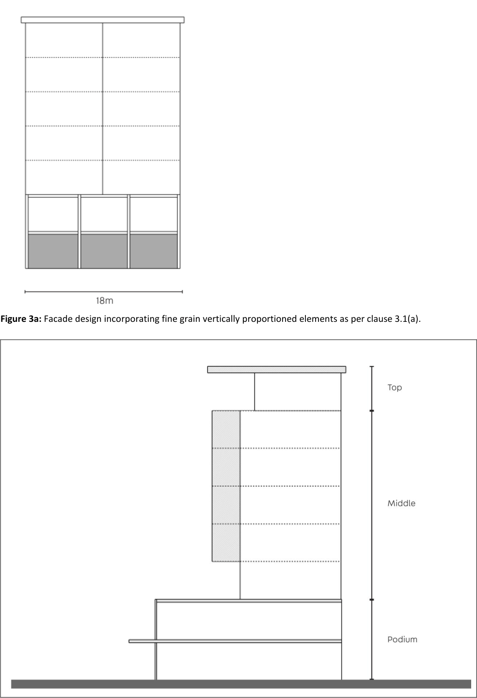
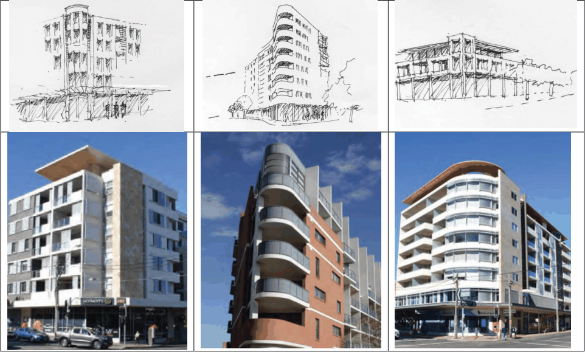

### 3.2 Facade designs may include but are not limited to:

(a) Articulating building entries.

(b) Distinguishing between the base, middle and top sections of the facade.

(c) Expressing the building towers above the podium through a change in facade details, materials and colour.

(d) Selecting balcony types that respond to the building orientation and proximity to public domain.

(e) Using architectural features such as awnings to give a human scale at street level.

(f) Recessing elements such as windows or balconies to create visual depth in the facade.

(g) Emphasising the difference between solid and void to create a sense of shadow and light.

(h) Using any other architectural elements to Council's satisfaction.

3.3 Building designs and window openings should be vertically proportioned in height, form and articulation.

3.4 Facade designs must comprise high quality materials and finishes.

3.5 Building services such as downpipes and balcony drainage must integrate with the facade design.

3.6 The design of balcony balustrades on the lower levels may be predominantly solid and/or opaque to provide privacy to residents and to screen drying areas.

#### Blank walls

3.7 Large areas of blank, minimally or poorly articulated walls are not acceptable. Measures to avoid this may include windows, awnings, sun shading devices, pergolas, green walls, public art or a recognisable increased setback to the upper storey.

3.8 Blank walls are not permitted where facing the public domain.

3.9 The maximum length of any blank wall must not exceed 5m.

3.10 The maximum height of a blank wall must not exceed 3m.

3.11 Where adjacent development is unlikely to occur in the short term, blank side walls should include public art or murals.

#### Solar light reflectivity (glare)

3.12 New buildings with four or more storeys must submit a Reflectivity Report that analyses potential solar light reflectivity and resulting glare from the proposed development on pedestrians, motorists and surrounding areas.

3.13 Solar light reflectivity from building materials used on facades must not exceed 20% at the angle of incidence.

> [Picture on page 11: a picture, saved as a picture (images/ch-06-01-general-requirements-page-11-1.gif, 150 dpi).]

Figure 3a: Facade design incorporating fine grain vertically proportioned elements as per clause 3.1(a).

Figure 3b: Podium, middle and top

## SECTION 4–CORNER BUILDINGS

#### Explanation

Corner buildings are highly visible from the street and provide opportunities for improved legibility of centres, distinctive architectural expression and good design outcomes.

#### Objectives

O1 To ensure corner buildings define the street edge through good design.

#### Development controls

4.1 Development on corner sites must ensure the building design incorporates one or more of the following elements at the street corner:

(a) architectural roof feature;

(b) stepping down or recessing of the built form from the corner;

(c) splayed treatments;

(d) use of materials/ colours;

(e) any other architectural elements to Council's satisfaction.

> [Picture on page 12: a picture, saved as a picture (images/ch-06-01-general-requirements-page-12-15.gif, 150 dpi).]

Figure 4a: Architectural roof

feature

Figure 4b: Splayed treatments Figure 4c: Different setback for the

top floor

## SECTION 5–ROOF DESIGNS

#### Explanation

Roof forms in centres are largely concealed by parapets as seen from streets and other public domain areas. Common forms are skillion roofs sloping to the rear or, for larger buildings, a simple hip roof. The design and articulation of the roof form is an important contribution to good design.

#### Objectives

O1 To integrate roof designs with the building form.

#### Development controls

5.1 Development must incorporate a high quality roof design that:

(a) achieves a unique and contemporary architectural appearance; and

(b) combines high quality materials and finishes.

5.2 Attics are not permitted.

5.3 Pitched roofs should use light coloured metal decking to improve energy performance. Pitched roofs to the street facade are not permitted.

5.4 Plant and service equipment must be concealed or satisfactorily screened from public view.
