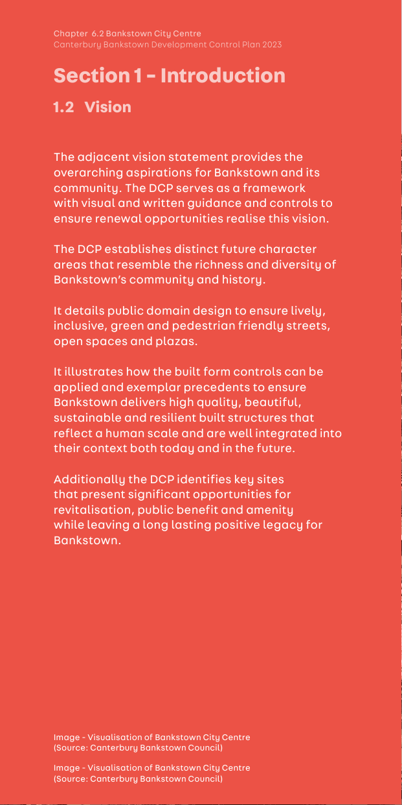
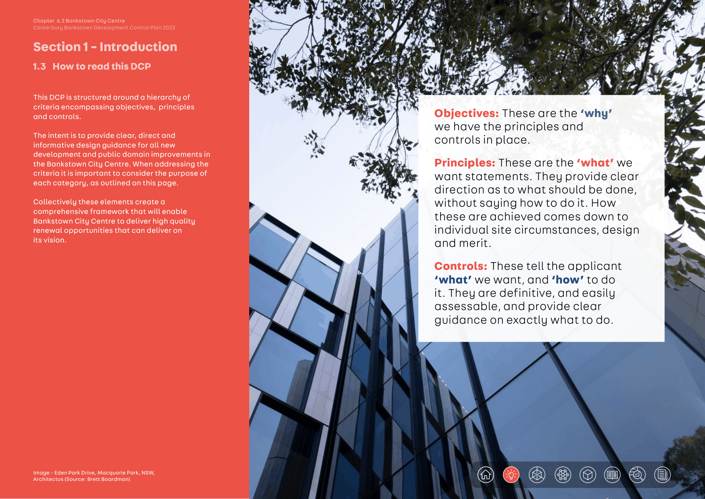

## Section 1 - Introduction

### 1.1	 Application of this DCP

This chapter of the Canterbury Bankstown DCP 2023 (CBDCP 2023) supports the LEP by providing additional objectives and development controls to enhance the function, design and amenity of development within the Bankstown City Centre.

This chapter of the CBDCP 2023 applies to all development on the land within the Bankstown City Centre as identified in Figure 1.

The other chapters of the CBDCP 2023 continue to apply to all land covered by this DCP chapter. The other chapters of the CBDCP 2023 must be addressed as part of Development Applications lodged for development in Bankstown City Centre. Where there is an inconsistency between the controls in this chapter and other chapters in the CBDCP 2023 in relation to development in the Bankstown City Centre, this chapter prevails.

> [Picture on page 9: a picture, saved as a picture (images/ch-06-02-bankstown-city-centre-page-9-1.gif, 150 dpi).]
> Words printed on the picture (title and legend, copied from the PDF):
> Image - Visualisation of Bankstown City Centre
> (Source: Canterbury Bankstown Council)
> Image - Visualisation of Bankstown City Centre
> (Source: Canterbury Bankstown Council)

### 1.2	 Vision

The adjacent vision statement provides the overarching aspirations for Bankstown and its community. The DCP serves as a framework with visual and written guidance and controls to ensure renewal opportunities realise this vision.

The DCP establishes distinct future character areas that resemble the richness and diversity of Bankstown’s community and history.

It details public domain design to ensure lively, inclusive, green and pedestrian friendly streets, open spaces and plazas.

It illustrates how the built form controls can be applied and exemplar precedents to ensure Bankstown delivers high quality, beautiful, sustainable and resilient built structures that reflect a human scale and are well integrated into their context both today and in the future.

Additionally the DCP identifies key sites that present significant opportunities for revitalisation, public benefit and amenity while leaving a long lasting positive legacy for Bankstown.

### Vision statement

Bankstown City Centre is the

### beating heart of Canterbury

### Bankstown and a destination

### for Greater Sydney. Walkable streets are framed

by beautiful parks and

### great architecture. The city

### embraces environmentally

### sustainable living.

### Anchored by a prominent

### university, health institutions

and a world-class metro,

### Bankstown is a leading centre

### for innovative jobs, housing

choice and green transport. People are drawn to the

### City for its delicious food

and vibrant art culture,

### entertainment and nightlife.

> [Picture on page 10: a picture, saved as a picture (images/ch-06-02-bankstown-city-centre-page-10-1.gif, 150 dpi).]
> Words printed on the picture (title and legend, copied from the PDF):
> Image - Eden Park Drive, Macquarie Park, NSW,
> Architectus (Source: Brett Boardman)

### 1.3	 How to read this DCP

This DCP is structured around a hierarchy of criteria encompassing objectives,  principles and controls.

The intent is to provide clear, direct and informative design guidance for all new development and public domain improvements in the Bankstown City Centre. When addressing the criteria it is important to consider the purpose of each category, as outlined on this page.

Collectively these elements create a comprehensive framework that will enable Bankstown City Centre to deliver high quality renewal opportunities that can deliver on its vision.

### Objectives: These are the ‘why’

we have the principles and

### controls in place. Principles: These are the ‘what’ we

### want statements. They provide clear

direction as to what should be done,

### without saying how to do it. How

these are achieved comes down to

### individual site circumstances, design

### and merit. Controls: These tell the applicant

### ‘what’ we want, and ‘how’ to do

### it. They are definitive, and easily

### assessable, and provide clear

### guidance on exactly what to do.

Proposed development in Bankstown City Centre must demonstrate consistency with and contribute to the vision for Bankstown City Centre, its character areas, and have regard to

### the Connection to Country Principles.

### PLACE

### UNDERSTANDING
