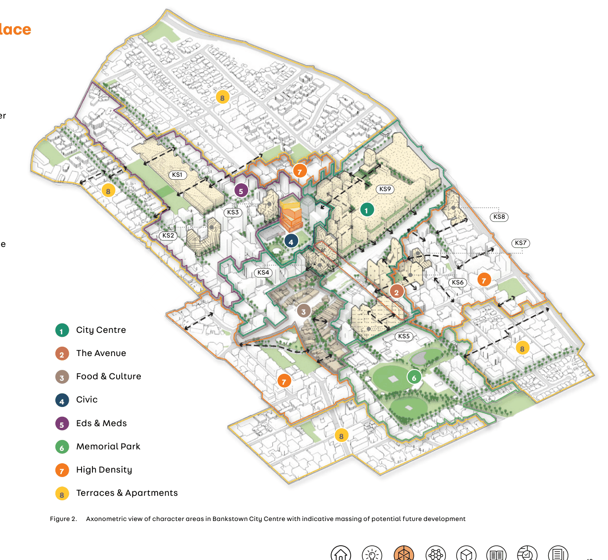
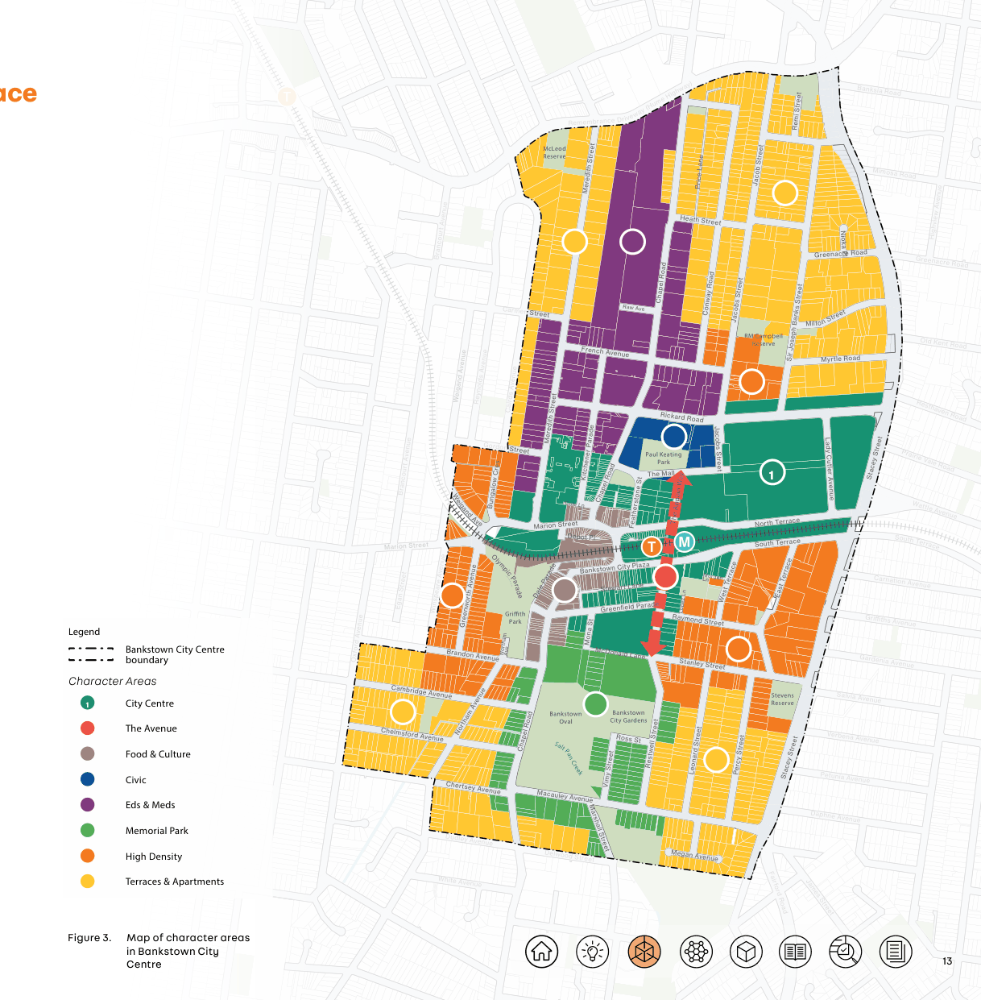
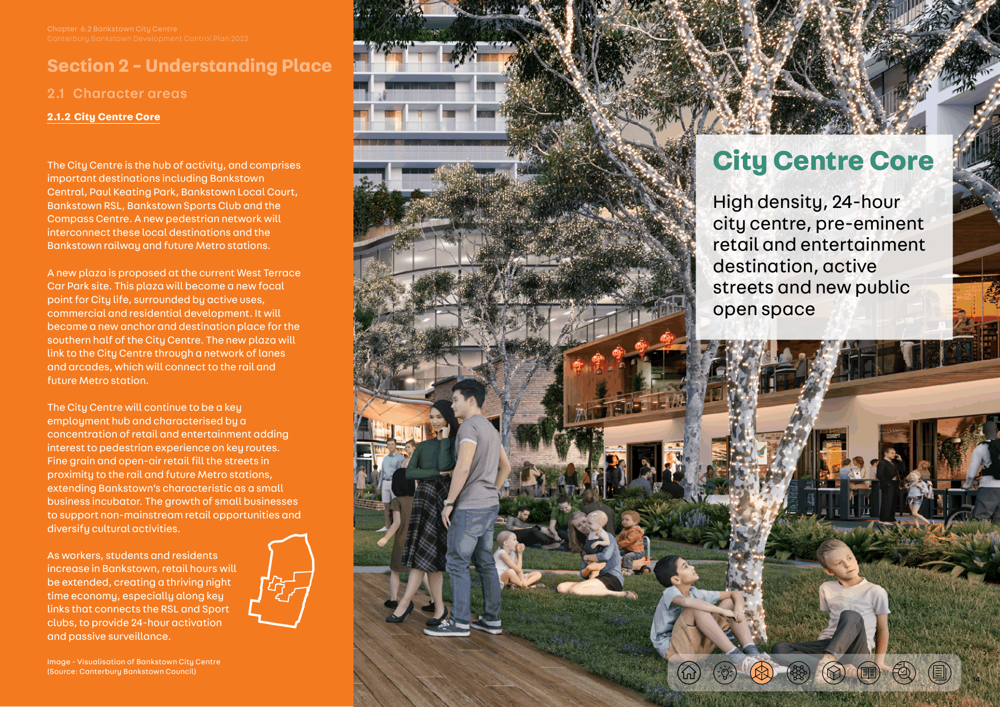
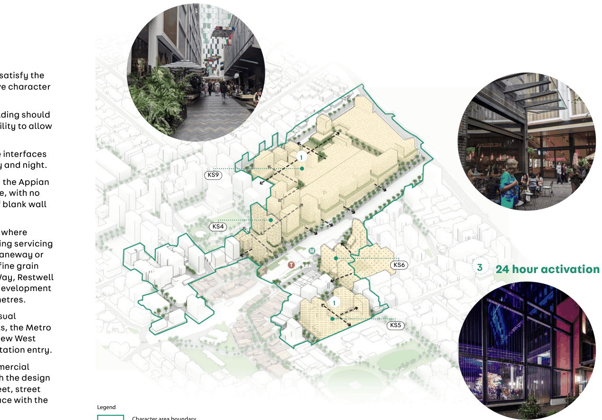

## Section 2 - Understanding Place

### 2.1	 Character areas

#### 2.1.1	 Overview of Character Areas

Bankstown City Centre has eight unique character Areas. Character Areas identify where there is a consistent and distinct existing character to be retained and enhanced or where a strategic assessment has determined the area will change and have a desired future character. Character Areas ensures that new development aims to have a consistent approach to matters including, however not limited to built form, function, heritage, landscape and street trees, streetscapes and materials and finishes. Different areas of distinct character make a place special and unique.

> [Picture on page 12: a map, saved as a picture (images/ch-06-02-bankstown-city-centre-page-12-17.gif, 150 dpi); the street names and other small labels are on the picture.]
> Words printed on the picture (title and legend, copied from the PDF):
> 1 City Centre
> 2 The Avenue
> 3 Food & Culture
> 5 Eds & Meds
> 6 Memorial Park
> 7 High Density
> 8 Terraces & Apartments
> Axonometric view of character areas in Bankstown City Centre with indicative massing of potential future development

Figure 2.

### 2.1	 Character areas

#### 2.1.1	 Overview of Character Areas

As part of a Development Application the

applicant must demonstrate that their proposal

is consistent with the Character Area it is located

within. For map of character area boundaries see

Figure 3.

> [Picture on page 13: a map, saved as a picture (images/ch-06-02-bankstown-city-centre-page-13-8.gif, 150 dpi); the street names and other small labels are on the picture.]
> Words printed on the picture (title and legend, copied from the PDF):
> Bankstown City Centre
> 1 City Centre
> Food & Culture
> Eds & Meds
> Terraces & Apartments
> in Bankstown City
> way (Hume Highway
> Old Kent Road
> Sir Joseph Banks Street Myrtle Road
> Weigand Avenue Reynolds Avenue
> Prairie Vale Road
> Lady Cutler Avenue
> The Appian Way
> Bankstown City Plaza
> e Dale Parade
> Winspeare Avenue Griffith
> Chapel Road P
> Leonard Street Percy Street
> Road James Street

Figure 3. Map of character areas

> [Picture on page 14: a picture, saved as a picture (images/ch-06-02-bankstown-city-centre-page-14-1.gif, 150 dpi).]
> Words printed on the picture (title and legend, copied from the PDF):
> Image - Visualisation of Bankstown City Centre
> (Source: Canterbury Bankstown Council)

### 2.1   Character areas

#### 2.1.2	City Centre Core

### City Centre Core

The City Centre is the hub of activity, and comprises important destinations including Bankstown Central, Paul Keating Park, Bankstown Local Court, Bankstown RSL, Bankstown Sports Club and the Compass Centre. A new pedestrian network will interconnect these local destinations and the Bankstown railway and future Metro stations.

### High density, 24-hour

### city centre, pre-eminent

### retail and entertainment

### destination, active

### streets and new public

### open space

A new plaza is proposed at the current West Terrace Car Park site. This plaza will become a new focal point for City life, surrounded by active uses, commercial and residential development. It will become a new anchor and destination place for the southern half of the City Centre. The new plaza will link to the City Centre through a network of lanes and arcades, which will connect to the rail and future Metro station.

The City Centre will continue to be a key employment hub and characterised by a concentration of retail and entertainment adding interest to pedestrian experience on key routes. Fine grain and open-air retail fill the streets in proximity to the rail and future Metro stations, extending Bankstown’s characteristic as a small business incubator. The growth of small businesses to support non-mainstream retail opportunities and diversify cultural activities.

As workers, students and residents increase in Bankstown, retail hours will be extended, creating a thriving night time economy, especially along key links that connects the RSL and Sport clubs, to provide 24-hour activation and passive surveillance.

### 2.1	 Character areas

#### 2.1.2	City Centre Core

#### Principles

P1. Development must achieve and satisfy the outcomes expressed in the above character statement.

P2. 	 Non-residential parts of the building should be designed for maximum flexibility to allow for a range of uses.

P3. 	 Ensure building and streetscape interfaces allow for active edges in the day and night. P4. 	 Ensure development addressing the Appian Way and Restwell Street is active, with no driveways or expansive areas of blank wall or services.

P5. 	 As part of major redevelopment where vehicle access, waste and building servicing is accessed and provided off a laneway or secondary street, reinforce the fine grain retail character of The Appian Way, Restwell Street, Greenfield Parade with development having a shop entry every 6-12 metres. P6. 	 Deliver through-site links and visual connectivity between key streets, the Metro Station, Paul Keating Park, the new West Terrace Plaza and the Railway Station entry. P7. Maintain and reinforce the commercial character of the locality through the design of ground floor edges to the street, street wall heights and building interface with the public domain.

Images

2 -  Darling Square, Haymarket, NSW (Source: Architectus) 3 - Industry Lanes, Richmond, VIC, Architectus (Source: Trevor Mein)

> [Picture on page 15: a picture, saved as a picture (images/ch-06-02-bankstown-city-centre-page-15-35.gif, 150 dpi).]
> Words printed on the picture (title and legend, copied from the PDF):
> 1
> KS9
> KS4
> 1
> Legend
> Character area boundary
> KS6
> KS5

Through site links

Key site

Figure 4. Axonometric view of character areas in City Centre Core with indicative massing of potential future development

#### 3
