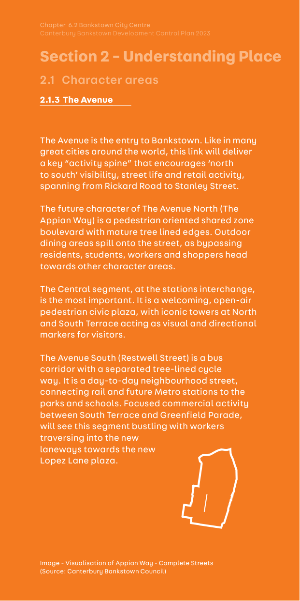
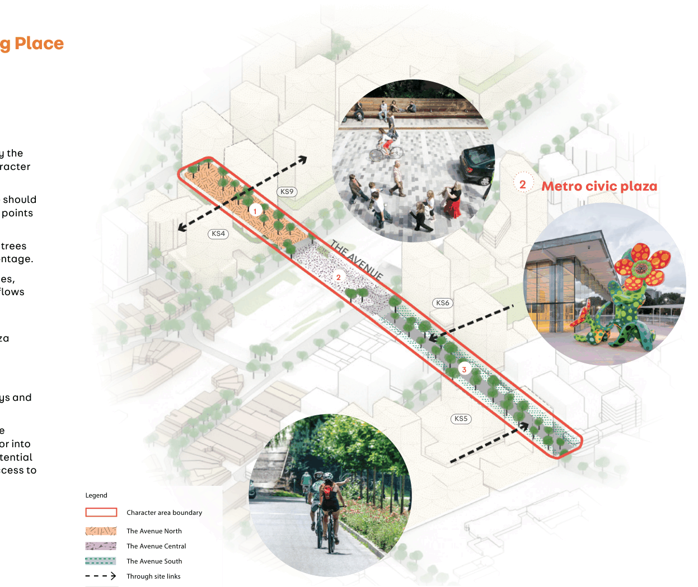
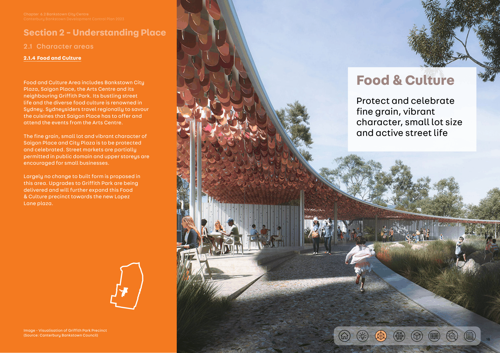
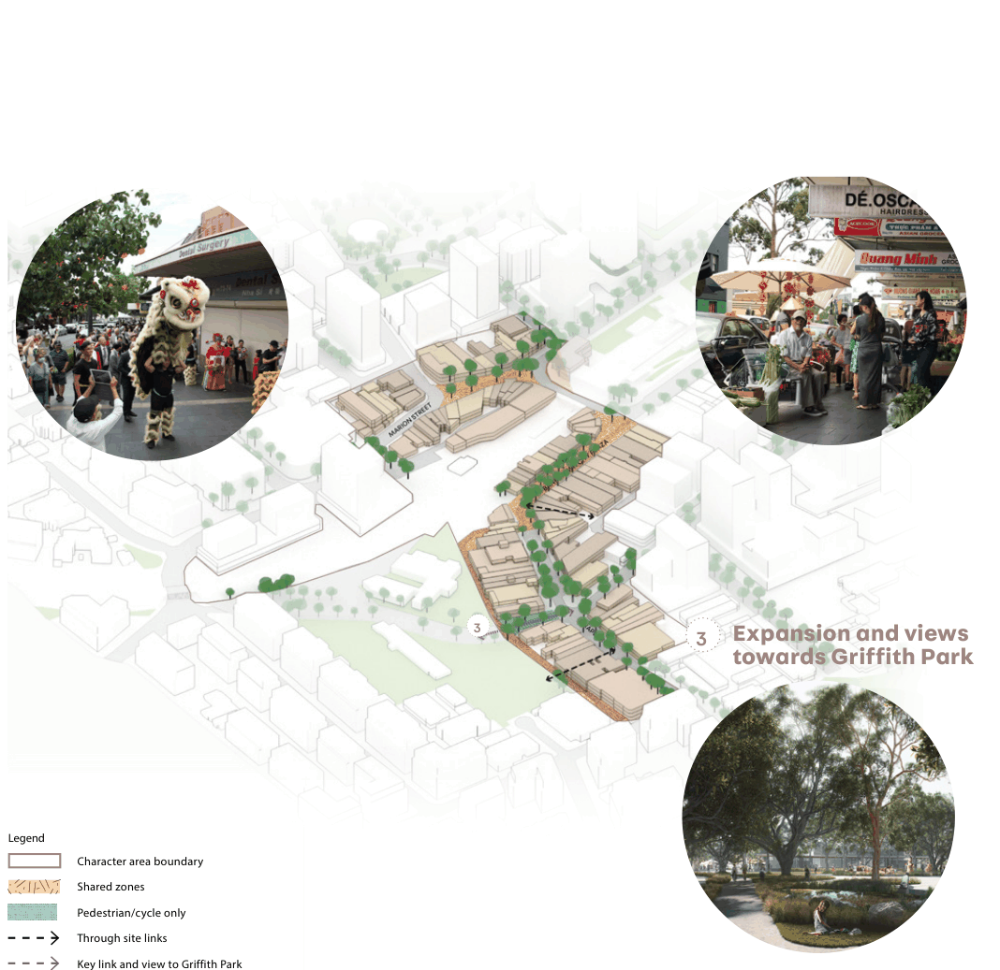

#### 24 hour activation

> [Picture on page 16: a picture, saved as a picture (images/ch-06-02-bankstown-city-centre-page-16-1.gif, 150 dpi).]
> Words printed on the picture (title and legend, copied from the PDF):
> Image - Visualisation of Appian Way - Complete Streets
> (Source: Canterbury Bankstown Council)

### 2.1   Character areas

#### 2.1.3	The Avenue

> [Picture text on page 16 is stored in the PDF without readable letters (no character map), so it could not be copied; see the original PDF.]

### The Avenue

The Avenue is the entry to Bankstown. Like in many great cities around the world, this link will deliver a key “activity spine” that encourages ‘north to south’ visibility, street life and retail activity, spanning from Rickard Road to Stanley Street.

### Pedestrian-oriented

### corridor imagined as

### Bankstown’s central

activity spine and

### ‘high street’

The future character of The Avenue North (The Appian Way) is a pedestrian oriented shared zone boulevard with mature tree lined edges. Outdoor dining areas spill onto the street, as bypassing residents, students, workers and shoppers head towards other character areas.

The Central segment, at the stations interchange, is the most important. It is a welcoming, open-air pedestrian civic plaza, with iconic towers at North and South Terrace acting as visual and directional markers for visitors.

The Avenue South (Restwell Street) is a bus corridor with a separated tree-lined cycle

way. It is a day-to-day neighbourhood street, connecting rail and future Metro stations to the parks and schools. Focused commercial activity between South Terrace and Greenfield Parade, will see this segment bustling with workers traversing into the new laneways towards the new Lopez Lane plaza.

### 2.1   Character areas

#### 2.1.3   The Avenue

#### Principles

P1. Development must achieve and satisfy the outcomes expressed in the above character statement.

P2. 	 Any development fronting The Avenue should be fine grain in nature with shop entry points every 6-12 metres.

P3. 	 Planting of appropriate large canopy trees every 5-10  metres along this street frontage. P4. 	 Provide for outdoor dining opportunities, whilst maintaining pedestrian traffic flows north-south.

P5. 	 Provide for public art within new development facing the new civic plaza between the Metro Station and the Railway Station.

P6. 	 Provide clear and legible entries into shopping centres, large sites, laneways and through-site links from The Avenue. P7. Future development is to acknowledge Restwell Street as the main bus corridor into Bankstown from the south with the potential for location of bus stops to provide access to businesses along the street.

Images

1 - New Road, Brighton, UK (Source: Gehl Architects) 2 -Sydney Modern, Sydney, NSW Architectus (Source: Iwan Baan)

> [Picture on page 17: a map, saved as a picture (images/ch-06-02-bankstown-city-centre-page-17-30.gif, 150 dpi); the street names and other small labels are on the picture.]
> Words printed on the picture (title and legend, copied from the PDF):
> Character area boundary
> The Avenue North
> The Avenue Central
> The Avenue South
> Through site links

#### 2

#### Metro civic plaza

Key sites boundary

Figure 5. Axonometric view of the avenue character area with

indicative massing of future development

> [Picture on page 18: a picture, saved as a picture (images/ch-06-02-bankstown-city-centre-page-18-1.gif, 150 dpi).]
> Words printed on the picture (title and legend, copied from the PDF):
> Image - Visualisation of Griffith Park Precinct
> (Source: Canterbury Bankstown Council)

### 2.1   Character areas

#### 2.1.4	Food and Culture

### Food & Culture

Food and Culture Area includes Bankstown City Plaza, Saigon Place, the Arts Centre and its neighbouring Griffith Park. Its bustling street life and the diverse food culture is renowned in Sydney. Sydneysiders travel regionally to savour the cuisines that Saigon Place has to offer and attend the events from the Arts Centre.

### Protect and celebrate

### fine grain, vibrant

### character, small lot size

### and active street life

The fine grain, small lot and vibrant character of Saigon Place and City Plaza is to be protected and celebrated. Street markets are partially permitted in public domain and upper storeys are encouraged for small businesses.

Largely no change to built form is proposed in this area. Upgrades to Griffith Park are being delivered and will further expand this Food & Culture precinct towards the new Lopez Lane plaza.

### 2.1   Character areas

#### 2.1.4   Food and Culture

#### Principles

P1. Development must achieve and satisfy the outcomes expressed in the above character statement.

P2. 	 Celebrate Saigon Place as the primary high street in the Bankstown City Centre. P3. 	 Development should address and activate Chapel Road, Saigon Place, Marion Street and Greenfield Parade, with a shop or building entry every 6-12 metres. P4. 	 Visual connections to and from Griffith Park should be enhanced.

P5. 	 Through-site links should be enhanced and maintained.

P6. 	 Activation of the first floor facing active streets should be considered. P7. Public art should be incorporated on any blank walls facing laneways or streets.

Images

1-2 - Saigon Place, Bankstown, NSW (Source: Canterbury Bankstown Council) 3 - Visualisation of Griffith Park (Source: Canterbury Bankstown Council)

> [Picture on page 19: a picture, saved as a picture (images/ch-06-02-bankstown-city-centre-page-19-24.gif, 150 dpi).]
> Words printed on the picture (title and legend, copied from the PDF):
> 3
> Legend
> Character area boundary
> Shared zones
> Pedestrian/cycle only
> Through site links
> Key link and view to Griffith Park

Fine grain retail

Figure 6. Axonometric view of the food and culture character area with indicative massing of future development
