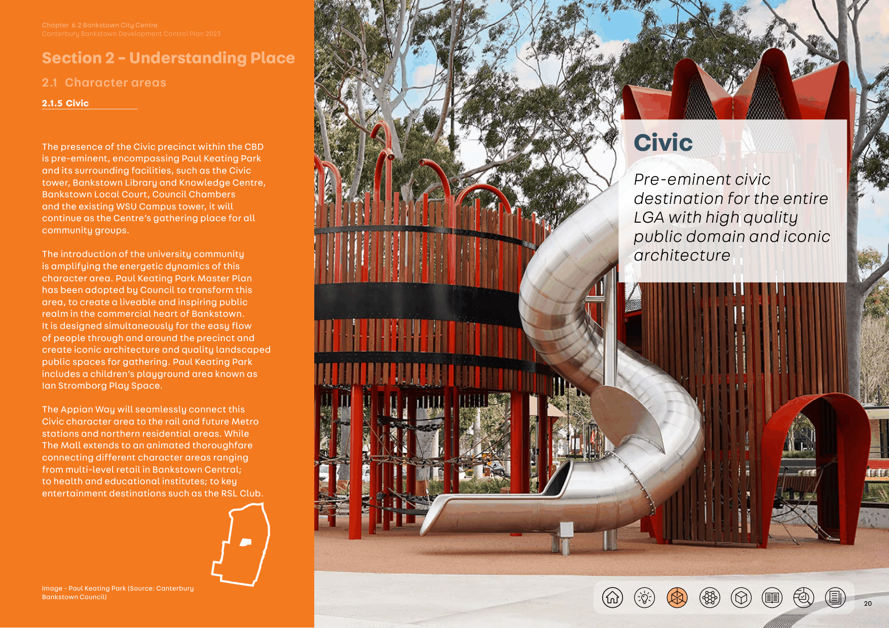
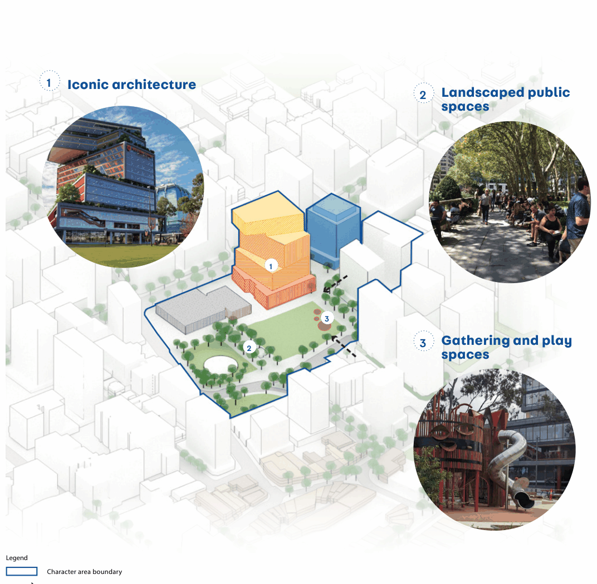

#### 3 Expansion and views

#### towards Griffith Park

> [Picture on page 20: a picture, saved as a picture (images/ch-06-02-bankstown-city-centre-page-20-1.gif, 150 dpi).]
> Words printed on the picture (title and legend, copied from the PDF):
> Image - Paul Keating Park (Source: Canterbury
> Bankstown Council)

### 2.1   Character areas

#### 2.1.5	 Civic

### Civic

The presence of the Civic precinct within the CBD is pre-eminent, encompassing Paul Keating Park and its surrounding facilities, such as the Civic tower, Bankstown Library and Knowledge Centre, Bankstown Local Court, Council Chambers and the existing WSU Campus tower, it will continue as the Centre’s gathering place for all community groups.

### Pre-eminent civic

### destination for the entire

### LGA with high quality

### public domain and iconic

### architecture

The introduction of the university community is amplifying the energetic dynamics of this character area. Paul Keating Park Master Plan has been adopted by Council to transform this area, to create a liveable and inspiring public realm in the commercial heart of Bankstown. It is designed simultaneously for the easy flow of people through and around the precinct and create iconic architecture and quality landscaped public spaces for gathering. Paul Keating Park includes a children’s playground area known as Ian Stromborg Play Space.

The Appian Way will seamlessly connect this Civic character area to the rail and future Metro stations and northern residential areas. While The Mall extends to an animated thoroughfare connecting different character areas ranging from multi-level retail in Bankstown Central; to health and educational institutes; to key entertainment destinations such as the RSL Club.

### 2.1   Character areas

#### 2.1.5   Civic

#### Principles

P1. Development must achieve and satisfy the outcomes expressed in the above character statement.

P2. 	 Development should have a civic style frontage to Paul Keating Park, The Appian Way, Rickard Road, Chapel Road and The Mall, with double height designs in the podium and building foyers, civic building entries and masonry and glass materials. P3. 	 Visual connections to and from Paul Keating Park should be enhanced.

P4. 	 Building design should be iconic in nature, and be considered ‘in the round’ (with designs giving regard to how the building is perceived from all sides).

P5. 	 Development could setback in part and provide relief to the public domain with small break out spaces for seating and landscaping.

P6. 	 Public art should be provided in building foyers that is visible and illuminated in the evening for activation and visual interest.

Images

1 - Western Sydney University Bankstown Campus 2 - Bryant Park, New York (Source: Architectus)

3 - Ian Stromborg Play Space, Bankstown

> [Picture on page 21: a picture, saved as a picture (images/ch-06-02-bankstown-city-centre-page-21-30.gif, 150 dpi).]
> Words printed on the picture (title and legend, copied from the PDF):
> 1
> 3
> 2
> Legend
> Character area boundary

#### 1

#### Iconic architecture

Through site links

Figure 7. Axonometric view of the civic food and culture character area with indicative massing of future development
