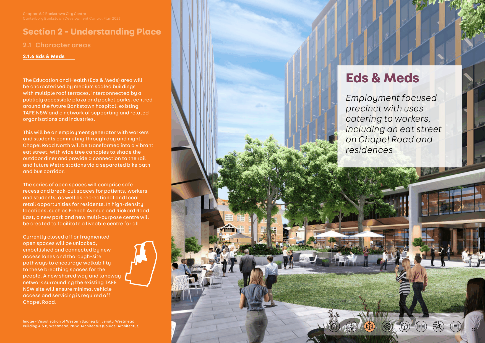
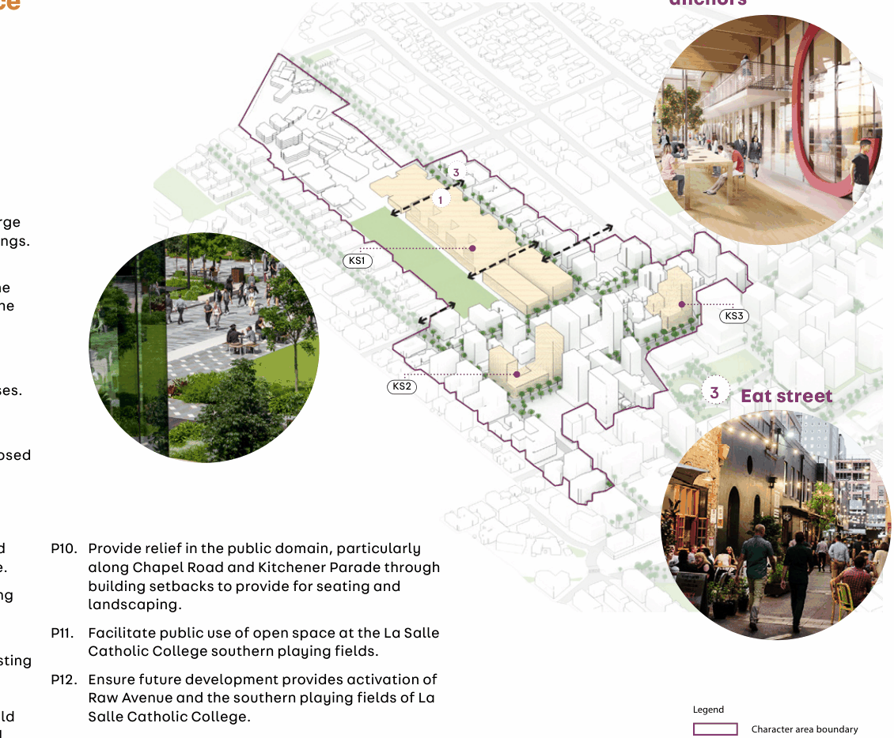
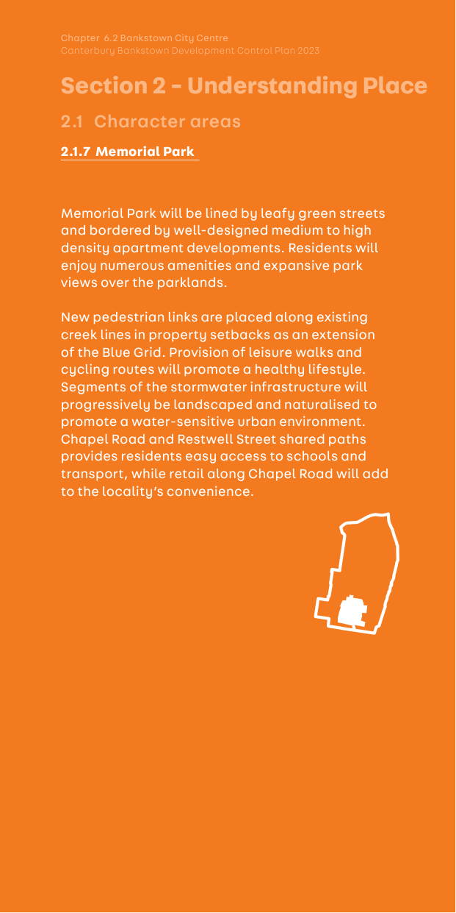
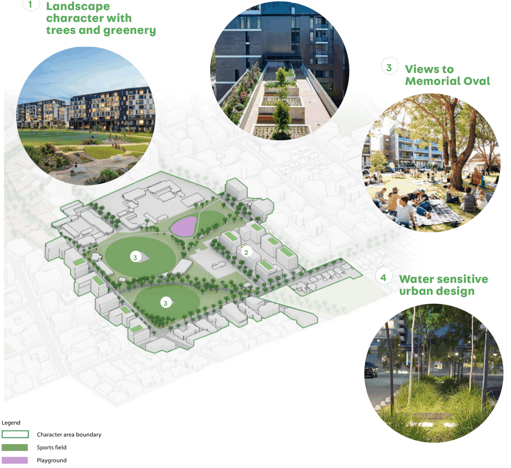
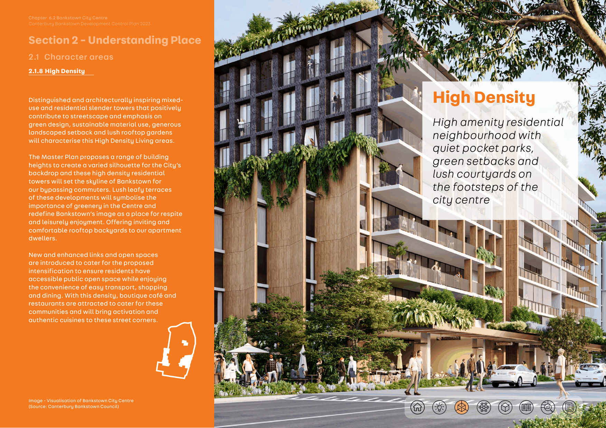
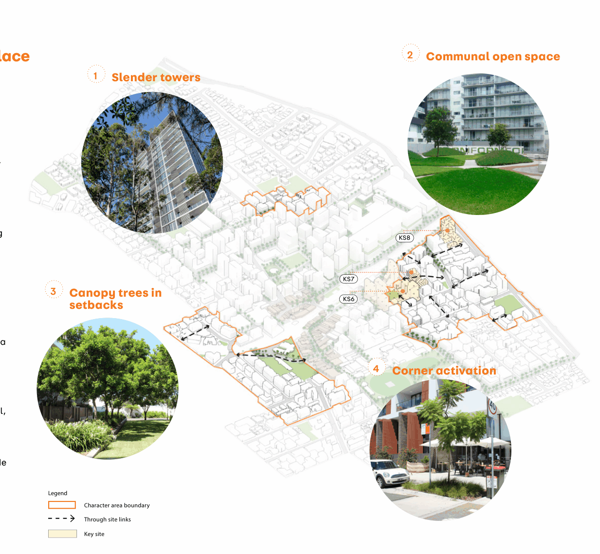
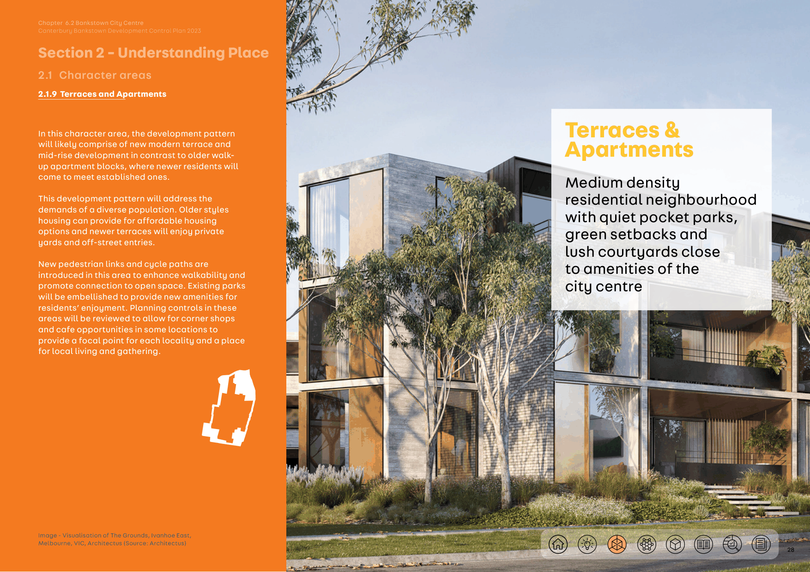
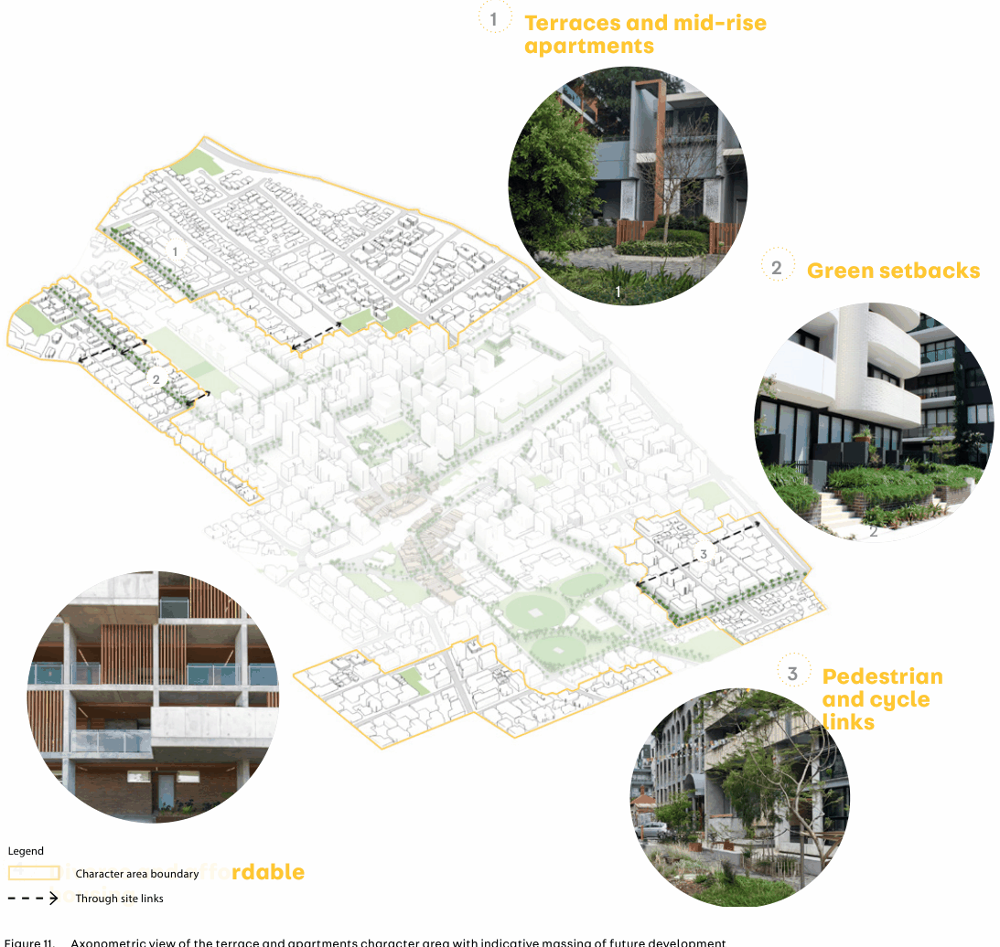
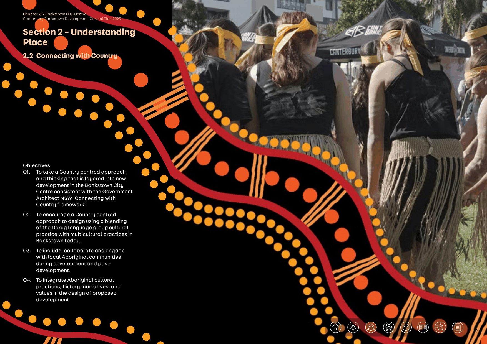

#### 2 Landscaped public

#### spaces

#### 3 Gathering and play

#### spaces

> [Picture on page 22: a picture, saved as a picture (images/ch-06-02-bankstown-city-centre-page-22-1.gif, 150 dpi).]
> Words printed on the picture (title and legend, copied from the PDF):
> Image - Visualisation of Western Sydney University  Westmead
> Building A & B, Westmead, NSW, Architectus (Source: Architectus)

### 2.1   Character areas

#### 2.1.6	Eds & Meds

### Eds & Meds

The Education and Health (Eds & Meds) area will be characterised by medium scaled buildings with multiple roof terraces, interconnected by a publicly accessible plaza and pocket parks, centred around the future Bankstown hospital, existing TAFE NSW and a network of supporting and related organisations and industries.

### Employment focused

### precinct with uses

catering to workers,

### including an eat street

on Chapel Road and

### residences

This will be an employment generator with workers and students commuting through day and night. Chapel Road North will be transformed into a vibrant eat street, with wide tree canopies to shade the outdoor diner and provide a connection to the rail and future Metro stations via a separated bike path and bus corridor.

The series of open spaces will comprise safe recess and break-out spaces for patients, workers and students, as well as recreational and local retail opportunities for residents. In high-density locations, such as French Avenue and Rickard Road East, a new park and new multi-purpose centre will be created to facilitate a liveable centre for all.

Currently closed off or fragmented open spaces will be unlocked, embellished and connected by new access lanes and thorough-site pathways to encourage walkability to these breathing spaces for the people. A new shared way and laneway network surrounding the existing TAFE NSW site will ensure minimal vehicle access and servicing is required off Chapel Road.

### 2.1   Character areas

#### 2.1.6   Eds & Meds

#### Principles

P1. Development must achieve and satisfy the outcomes expressed in the above character statement.

P2. 	 Allow for active rooftop uses, particularly on large format, specialised health and education buildings. P3. 	 Maintain public access via Raw Avenue or an alternative public street from Chapel Road to the playing fields of LaSalle Catholic College and the Sydney Archdiocese.

P4. 	 Buildings should be designed to be flexible and adaptable to maximise their use for medical, education and institutional development and uses. P5. 	 Provide active frontages to Chapel Road North between Heath Street and Rickard Road for activation and 24 hour activity around the proposed Bankstown Hospital and TAFE. P6. 	 Allow for outdoor dining opportunities along Chapel Road.

P7. Protect and enhance the significant landscaped character of Chapel Road and Kitchener Parade. P8. 	 Protect and enhance view corridors to the Uniting Church Spire at 72 Kitchener Parade. P9. 	 The design of new development at St Paul’s Anglican Church should maximise the use of existing building fabric, such as stained glass windows, masonry and the iconic bell-tower/spire design to Chapel Road. Surrounding development should be complimentary and include landscaping and materiality that complements the Church building.

Image

1 - 1 Central Courtyard, Macquarie University, NSW, Architectus (Source: Architectus)

P10. 	 Provide relief in the public domain, particularly along Chapel Road and Kitchener Parade through building setbacks to provide for seating and landscaping.

P11. 	 Facilitate public use of open space at the La Salle Catholic College southern playing fields. P12. 	 Ensure future development provides activation of Raw Avenue and the southern playing fields of La Salle Catholic College.

P13. 	 New development must be sensitive to medical uses in the area and ensure the impacts of vibration, noise, air emissions and vehicle movements are considered.

Figure 8. Axonometric view of the eds and meds character area with indicative massing of future development

#### Health and education

> [Picture on page 23: a picture, saved as a picture (images/ch-06-02-bankstown-city-centre-page-23-52.gif, 150 dpi).]
> Words printed on the picture (title and legend, copied from the PDF):
> 3
> 1
> KS1
> KS2
> KS3
> Legend
> Character area boundary

#### anchors

#### 3

#### Eat street

Through site links

Key site

> [Picture on page 24: a picture, saved as a picture (images/ch-06-02-bankstown-city-centre-page-24-1.gif, 150 dpi).]

### 2.1   Character areas

#### 2.1.7	 Memorial Park

### Memorial Park

Memorial Park will be lined by leafy green streets and bordered by well-designed medium to high density apartment developments. Residents will enjoy numerous amenities and expansive park views over the parklands.

### High amenity residential

neighbourhood with generous views of

### the park and leafy

### green streets

New pedestrian links are placed along existing creek lines in property setbacks as an extension of the Blue Grid. Provision of leisure walks and cycling routes will promote a healthy lifestyle. Segments of the stormwater infrastructure will progressively be landscaped and naturalised to promote a water-sensitive urban environment. Chapel Road and Restwell Street shared paths provides residents easy access to schools and transport, while retail along Chapel Road will add to the locality’s convenience.

### 2.1   Character areas

#### 2.1.7   Memorial Park

#### Principles

P1. Development must achieve and satisfy the outcomes expressed in the above character statement.

P2. 	 Allow for active rooftop uses, particularly on large format, specialised health and education buildings.

P3. 	 Maintain and enhance the landscaped character of this precinct, with large canopy trees along street frontages every 5-10 metres.

P4. 	 Development facing the streets and Memorial Oval should have larger balconies with space for planter boxes and green façade treatments to enhance the landscaped character of the precinct. P5. 	 Maximise views of Memorial Oval from the public domain, balconies and living areas. P6. 	 Prioritise naturalised stormwater treatment in the public and private domain and a high standard of water sensitive urban design.

Images

1 -Harold Park, Glebe, NSW (Source: Architectus) 2 - NewLife Darling Harbour, NSW, Architectus  (Source: Architectus)

#### 1

#### Landscape

character with

#### trees and greenery

Figure 9. Axonometric view of the memorial park character area with indicative massing of future development

#### Rooftop activation

> [Picture on page 25: a picture, saved as a picture (images/ch-06-02-bankstown-city-centre-page-25-35.gif, 150 dpi).]
> Words printed on the picture (title and legend, copied from the PDF):
> 3
> 3
> Legend
> Character area boundary
> Sports field
> Playground
> 2

#### 3

Views to

#### Memorial Oval

#### 4

#### Water sensitive

#### urban design

> [Picture on page 26: a picture, saved as a picture (images/ch-06-02-bankstown-city-centre-page-26-1.gif, 150 dpi).]
> Words printed on the picture (title and legend, copied from the PDF):
> Image - Visualisation of Bankstown City Centre
> (Source: Canterbury Bankstown Council)

### 2.1   Character areas

#### 2.1.8	High Density

### High Density

Distinguished and architecturally inspiring mixed-use and residential slender towers that positively contribute to streetscape and emphasis on green design, sustainable material use, generous landscaped setback and lush rooftop gardens will characterise this High Density Living areas.

### High amenity residential

neighbourhood with quiet pocket parks, green setbacks and lush courtyards on the footsteps of the

### city centre

The Master Plan proposes a range of building heights to create a varied silhouette for the City’s backdrop and these high density residential towers will set the skyline of Bankstown for our bypassing commuters. Lush leafy terraces of these developments will symbolise the importance of greenery in the Centre and redefine Bankstown’s image as a place for respite and leisurely enjoyment. Offering inviting and comfortable rooftop backyards to our apartment dwellers.

New and enhanced links and open spaces are introduced to cater for the proposed intensification to ensure residents have accessible public open space while enjoying the convenience of easy transport, shopping and dining. With this density, boutique café and restaurants are attracted to cater for these communities and will bring activation and authentic cuisines to these street corners.

### 2.1   Character areas

#### 2.1.8   High Density

#### Principles

P1. Development must achieve and satisfy the outcomes expressed in the above character statement.

P2. 	 Minimise the impact of building services on the primary street frontage, and maximise landscaping and presence of the building. P3. 	 Provide direct street access to street-facing apartments at the ground floor. P4. 	 Provide well-landscaped front courtyards and setbacks.

P5. 	 Provide façade and courtyard lighting that complements the building design and provides a safe, interesting and vibrant feel along the street at night.

P6. 	 Ensure the front setback and landscape area allows for a large canopy tree. P7. Provide communal or private resident access (to adjacent apartments) to podium rooftops.

P8. 	 Encourage the provision of small scale retail, commercial, food and drink premise uses at street corners.

P9. 	 Provide for interesting and varied façade treatments and building designs that provide for high quality internal living spaces.

Images

1 - Natura, Macquarie Park, NSW, Architectus (Source: Architectus) 2 - Zetland, NSW (Source: Architectus)

3 - 4- Erskineville, NSW (Source: Architectus)

> [Picture on page 27: a picture, saved as a picture (images/ch-06-02-bankstown-city-centre-page-27-33.gif, 150 dpi).]
> Words printed on the picture (title and legend, copied from the PDF):
> 1
> 1
> Legend
> Character area boundary
> Through site links
> Key site
> KS7
> KS6
> P7
> KS8

#### 1

#### Slender towers

#### 3

Canopy trees in

#### setbacks

Figure 10.	 Axonometric view of the high density character area with indicative massing of future development

#### 4

#### Communal open space

#### Corner activation

> [Picture on page 28: a picture, saved as a picture (images/ch-06-02-bankstown-city-centre-page-28-1.gif, 150 dpi).]
> Words printed on the picture (title and legend, copied from the PDF):
> Image - Visualisation of The Grounds, Ivanhoe East,
> Melbourne, VIC, Architectus (Source: Architectus)

### 2.1   Character areas

#### 2.1.9	 Terraces and Apartments

In this character area, the development pattern will likely comprise of new modern terrace and mid-rise development in contrast to older walk-up apartment blocks, where newer residents will come to meet established ones.

This development pattern will address the demands of a diverse population. Older styles housing can provide for affordable housing options and newer terraces will enjoy private yards and off-street entries.

New pedestrian links and cycle paths are introduced in this area to enhance walkability and promote connection to open space. Existing parks will be embellished to provide new amenities for residents’ enjoyment. Planning controls in these areas will be reviewed to allow for corner shops and cafe opportunities in some locations to provide a focal point for each locality and a place for local living and gathering.

### Terraces &

### Apartments

### Medium density

### residential neighbourhood

with quiet pocket parks,

green setbacks and

### lush courtyards close

to amenities of the

### city centre

### 2.1   Character areas

#### 2.1.9   Terraces and Apartments

#### Principles

P1. Development must achieve and satisfy the outcomes expressed in the above character statement.

P2. 	 Minimise the impact of building services on the primary street frontage, and maximise landscaping and presence of the building. P3. 	 Provide direct street access to street-facing apartments and terraces at the ground floor. P4. 	 Provide well-landscaped front courtyards and setbacks.

P5. 	 Provide lighting that complements the building design and provides a safe, interesting and vibrant feel along the street at night.

P6. 	 Facilitate executive or premium housing as well as affordable housing as part of the dwelling mix of multi-dwelling housing, attached housing or apartment development to support the potential worker mix at the hospital and Bankstown’s role as a strategic employment, health and education centre.

Images

1 - 2 - Zetland, NSW (Source: Architectus)

Nightingale  Skye House, Brunswick, VIC (Source: Architectus) 3 - Zetland, NSW (Source: Architectus)

4 - Platform Apartments, North Eveleigh, NSW Architectus, (Source: Architectus)

> [Picture on page 29: a picture, saved as a picture (images/ch-06-02-bankstown-city-centre-page-29-31.gif, 150 dpi).]
> Words printed on the picture (title and legend, copied from the PDF):
> 1
> 2
> Legend
> Character area boundary
> Through site links
> 1
> 3
> 2
> Axonometric view of the terrace and apartments character area with indicative massing of future development

Figure 11.

#### 4

#### Diverse and affordable

#### housing

#### Terraces and mid-rise

#### apartments

#### 2

#### Green setbacks

#### 3

#### Pedestrian

#### and cycle

#### links

> [Picture on page 30: a picture, saved as a picture (images/ch-06-02-bankstown-city-centre-page-30-1.gif, 150 dpi).]
> Words printed on the picture (title and legend, copied from the PDF):
> with local Aboriginal communities
> during development and post-
> development.

### 2.2	 Connecting with Country

#### Objectives

O1. 	 To take a Country centred approach and thinking that is layered into new development in the Bankstown City Centre consistent with the Government Architect NSW ‘Connecting with Country framework’. O2. 	 To encourage a Country centred approach to design using a blending of the Darug language group cultural practice with multicultural practices in Bankstown today. O3. 	 To include, collaborate and engage

O4. 	 To integrate Aboriginal cultural practices, history, narratives, and values in the design of proposed development.

### Place

### 2.2 Connecting with Country

#### Design Guidance

G1. 	 If development falls under Clause 6.15 Design Excellence in the Canterbury Bankstown Local Environmental Plan 2023 (CBLEP 2023), it should give regard to DCP guidance outlined in this Section. This design guidance is optional for development that is not applicable to Clause 6.15 of the CBLEP 2023. G2. 	 The design of the development should acknowledge Sections 3 and 4 of the CWCF by demonstrating the delivery of outcomes that reflect consideration of all aspects of Country.

G3. 	 It should be demonstrated that there has been an assessment of the scale and significance of the development to determine the appropriate scope of engagement with the Aboriginal community and its representatives – whether it be high, medium or low - as outlined in Section

3.1 of the CWCF. If collaborating with the Aboriginal community, it is important to adhere to protocols outlined in the Engaging with Aboriginal Communities Practice Note. G4. 	 As set out in Section 3.4 of the CWCF, an Aboriginal perspective should be adopted throughout the four project delivery phases. These include project formation, project design, project delivery and project maintenance

G5. 	 The development should demonstrate that an analysis of the surrounding context has been conducted to connect the development site into existing and proposed landscape elements, open spaces, links and any district or other views.

G6. 	 If the development process includes seeking knowledge and input from the Aboriginal community, Aboriginal people should be invited to co-design and co-manage projects to ensure they retain authorship and control of their cultural knowledge and intellectual property. Developments are to demonstrate the methods and outcomes from engagement with Aboriginal communities.

G7. 	 If significant items such as ancestral remains or artefacts are discovered during subsoil investigations, excavation, demolition or other earthworks - proper engagement with the Aboriginal community should take place to determine culturally appropriate handling, repatriation or reburial.

G8. 	 Development that proposes open space and landscaping should demonstrate consideration of ‘walking Country’ which reflects Aboriginal cultural practices, artefacts, artwork and narratives. Aspects involving the senses of seeing, hearing, touching, smelling and tasting, should be included.

G9. 	 Design aspects of each development should give regard to the culture and heritage of the traditional custodians of the land, the Darug People, on which the development is proposed. The following design opportunities should be considered to ensure a Country-centred approach:

a) 	 Connect design with the natural environment and landscape setting, being: people, animals, resources and plants equally.

b) 	 Acknowledge shared history between Aboriginal and colonial settlers to promote healing and reconciliation.

c) 	 Incorporate sustainable practices by using natural building materials that have a cultural and heritage significance.

d) 	 Use Aboriginal place names to encourage understanding and provoke awareness.

e) 	 Incorporate storytelling and knowledge of the past to inspire and educate.

f) 	 Focus on details and patterns to insert cultural meaning.

G10. 	 The development should consider Country-centred design for both public and private domains equally, being both: building façades and interior spaces, public and communal open space, internal corridors and public pathways (through-site links).

### Place

### 2.2 Connecting with Country

G11. 	 Consider embedding (a) ‘Healthy Country’ principles with respect to the analysis, coordination with, and protection of existing site topography, local biodiversity, and site hydrology, as well as the referenced landscape elements, and (b) explore opportunities for ‘Healthy Community’ like community employment during the project design, delivery and maintenance and to provide ongoing access to Country within the development proposal, acknowledging the strong cultural identity and connectedness, that Community has with Country G12. 	 Provide acknowledgement, interpretation and learning opportunities about Country. G13. 	 All work prepared to address the Connecting with Country objectives and design guidance must address the NSW Indigenous Cultural and Intellectual Property Protocol, to ensure applicants are aware of their duties with respect to the integration of this content.

> [Picture on page 32: a picture, saved as a picture (images/ch-06-02-bankstown-city-centre-page-32-26.gif, 150 dpi).]

### PUBLIC DOMAIN

### DESIGNING THE
