## Section 3 - Designing the public domain

#### Overview

Public spaces are the streets, squares and parks and are the most enduring spaces of a city. These spaces provide a shared social and cultural domain that provides the city its structure. Beautiful city spaces help provide a better life for residents, workers and visitors to cities.

The Bankstown Complete Streets CBD Transport and Place Plan (Bankstown Complete Streets) provides guidance in relation to the street hierarchy for the Bankstown City Centre and context for the design of a building’s interface with the public domain. Development Applications must refer to Bankstown Complete Streets during the initial design stages, to ensure that the public domain is prioritised, and respected, as part of the design development. New public domain works must also respect existing heritage items and areas.

The decision if work in the public domain will be carried out by the developer or by Council will be determined as part of the Development Application process. Work in the public domain may be carried out by the developer to Council’s specifications if related to their development. Otherwise, work in the public domain is usually carried out by Council.

### 3.2 Tree canopy

and cover

3.3 Undergrounding of

overhead wires

### ‘Cultures and climates differ

### all over the world, but people

are the same. They’ll gather in

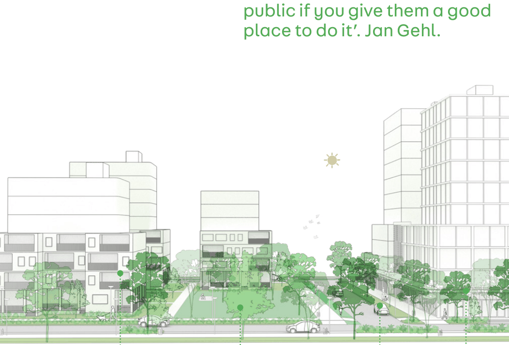

> [Picture on page 34: a picture, saved as a picture (images/ch-06-02-bankstown-city-centre-page-34-37.gif, 150 dpi).]

### public if you give them a good

### place to do it’. Jan Gehl.

### 3.1 Streets

### 3.5 Community

infrastructure

### 3.4 Open space

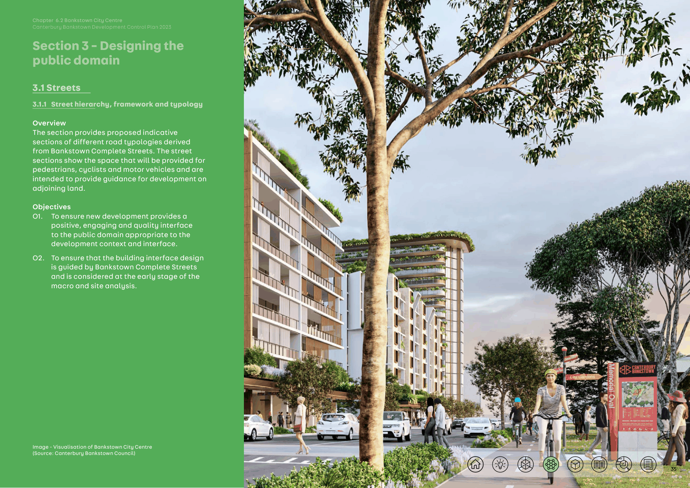

> [Picture on page 35: a picture, saved as a picture (images/ch-06-02-bankstown-city-centre-page-35-1.gif, 150 dpi).]
> Words printed on the picture (title and legend, copied from the PDF):
> Image - Visualisation of Bankstown City Centre
> (Source: Canterbury Bankstown Council)

### public domain

### 3.1	Streets

#### 3.1.1	 Street hierarchy, framework and typology Overview

The section provides proposed indicative sections of different road typologies derived from Bankstown Complete Streets. The street sections show the space that will be provided for pedestrians, cyclists and motor vehicles and are intended to provide guidance for development on adjoining land.

#### Objectives

O1. 	 To ensure new development provides a positive, engaging and quality interface to the public domain appropriate to the development context and interface. O2. 	 To ensure that the building interface design is guided by Bankstown Complete Streets and is considered at the early stage of the macro and site analysis.

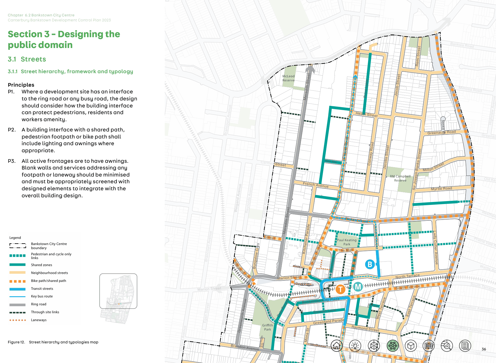

> [Picture on page 36: a map, saved as a picture (images/ch-06-02-bankstown-city-centre-page-36-1.gif, 150 dpi); the street names and other small labels are on the picture.]
> Words printed on the picture (title and legend, copied from the PDF):
> Bankstown City Centre
> Pedestrian and cycle only
> Bike path/shared path
> Key bus route
> Through site links
> way (Hume Highway
> Sir Joseph Banks Street Myrtle Road
> Weigand Avenue Reynolds Avenue
> Prairie Vale Ro
> Lady Cutler Avenue
> The Appian Way
> Bankstown City Plaza
> e Dale Parade
> Greenfield Parade Lopez Ln

Figure 12.	 Street hierarchy and typologies map

### public domain

### 3.1   Streets

#### 3.1.1   Street hierarchy, framework and typology Principles

P1. Where a development site has an interface to the ring road or any busy road, the design should consider how the building interface can protect pedestrians, residents and workers amenity.

P2. 	 A building interface with a shared path, pedestrian footpath or bike path shall include lighting and awnings where appropriate.

P3. 	 All active frontages are to have awnings. Blank walls and services addressing any footpath or laneway should be minimised and must be appropriately screened with designed elements to integrate with the overall building design.

Ca

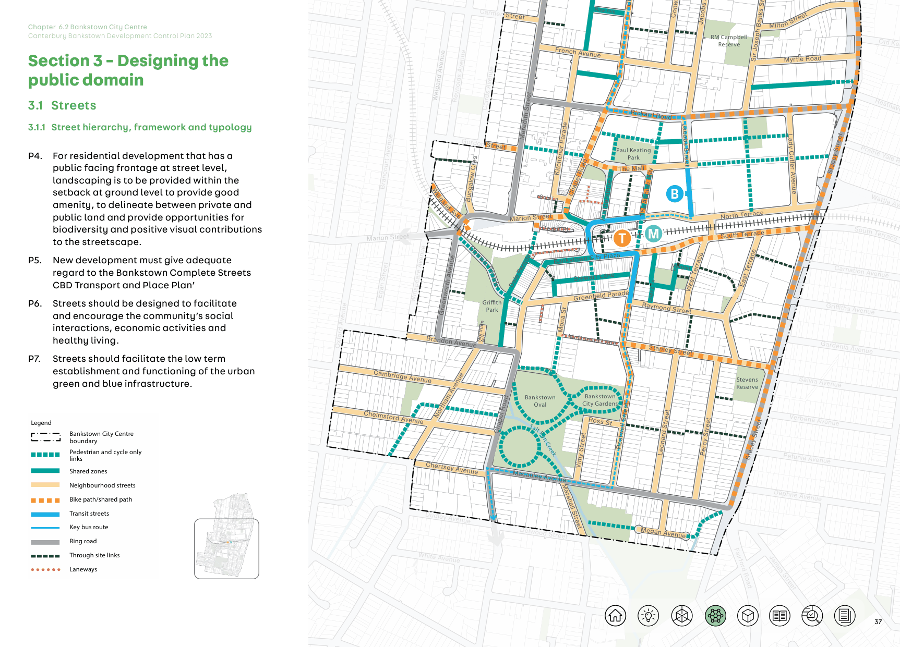

> [Picture on page 37: a map, saved as a picture (images/ch-06-02-bankstown-city-centre-page-37-1.gif, 150 dpi); the street names and other small labels are on the picture.]
> Words printed on the picture (title and legend, copied from the PDF):
> Bankstown City Centre
> Pedestrian and cycle only
> Bike path/shared path
> Key bus route
> Through site links
> Sir Joseph Banks Str Myrtle Road
> Weigand Avenue Reynolds Avenue
> Prairie Vale Ro
> Lady Cutler Avenue
> The Appian Way
> Bankstown City Plaza
> e Dale Parade
> Chapel Road P
> Leonard Street Percy Street
> Road James Street

### public domain

### 3.1   Streets

#### 3.1.1   Street hierarchy, framework and typology

P4. 	 For residential development that has a public facing frontage at street level, landscaping is to be provided within the setback at ground level to provide good amenity, to delineate between private and public land and provide opportunities for biodiversity and positive visual contributions to the streetscape.

P5. 	 New development must give adequate regard to the Bankstown Complete Streets CBD Transport and Place Plan’ P6. 	 Streets should be designed to facilitate and encourage the community’s social interactions, economic activities and healthy living.

P7. Streets should facilitate the low term establishment and functioning of the urban green and blue infrastructure.

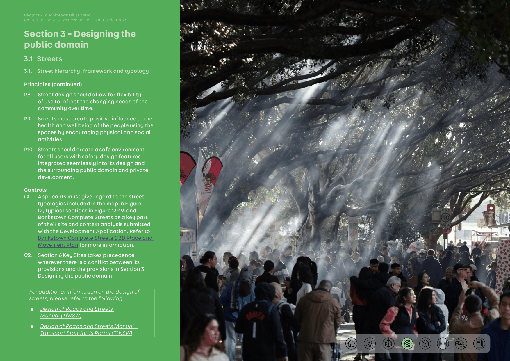

> [Picture on page 38: a picture, saved as a picture (images/ch-06-02-bankstown-city-centre-page-38-1.gif, 150 dpi).]
> Words printed on the picture (title and legend, copied from the PDF):
> For additional information on the design of
> streets, please refer to the following:
> • Design of Roads and Streets
> Manual (TfNSW)
> • Design of Roads and Streets Manual -
> Transport Standards Portal (TfNSW)

### public domain

### 3.1   Streets

#### 3.1.1   Street hierarchy, framework and typology Principles (continued)

P8. 	 Street design should allow for flexibility of use to reflect the changing needs of the community over time. P9. 	 Streets must create positive influence to the health and wellbeing of the people using the spaces by encouraging physical and social activities. P10. 	 Streets should create a safe environment for all users with safety design features integrated seemlessly into its design and the surrounding public domain and private development.

#### Controls

C1. 	 Applicants must give regard to the street typologies included in the map in Figure 12, typical sections in Figure 13-19, and Bankstown Complete Streets as a key part of their site and context analysis submitted with the Development Application. Refer to Bankstown Complete Streets CBD Place and Movement Plan for more information. C2. 	 Section 6 Key Sites takes precedence wherever there is a conflict between its provisions and the provisions in Section 3 Designing the public domain.

### public domain

### 3.1   Streets

#### 3.1.1   Street hierarchy, framework and typology Pedestrian and cycleway through site link

Through-site links provide an important function in the form of pedestrian links and bike links to improve pedestrian permeability, and help break up large street blocks and increase the potential for direct and clear connections between building

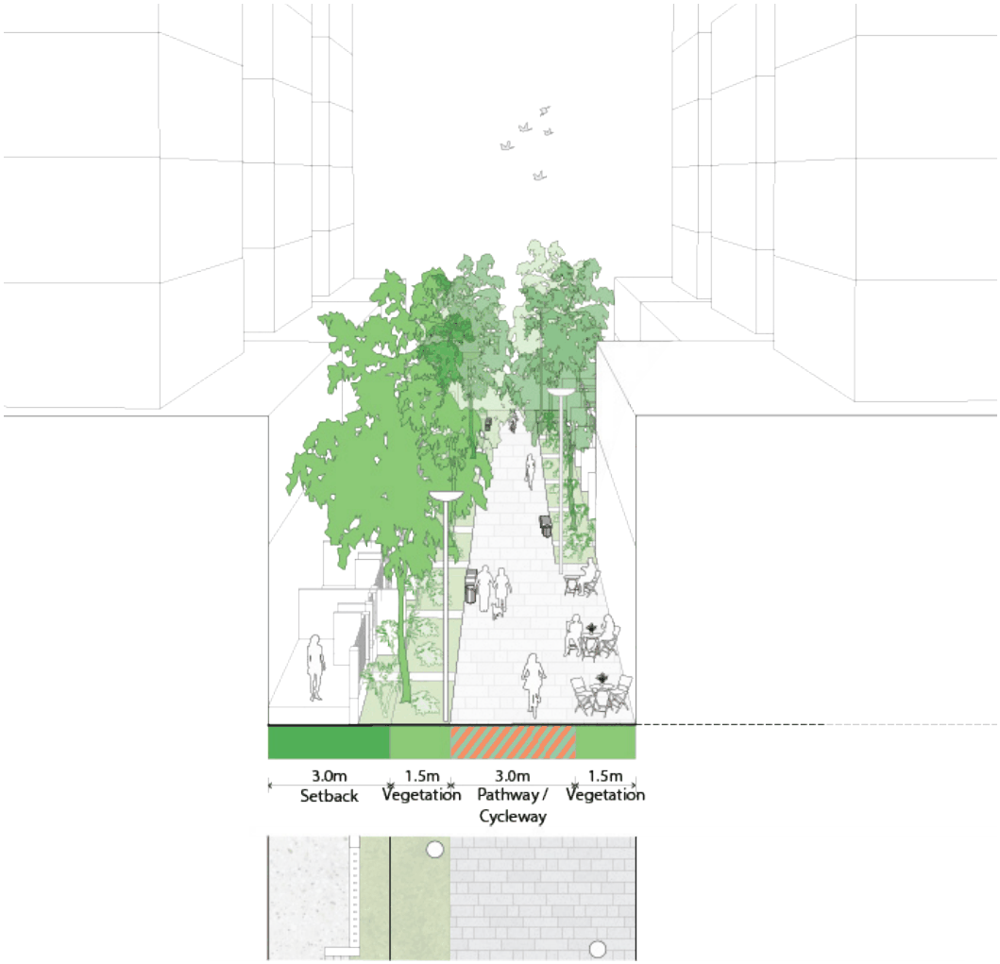

> [Picture on page 39: a picture, saved as a picture (images/ch-06-02-bankstown-city-centre-page-39-10.gif, 150 dpi).]

Figure 13. Section and plan of typical pedestrian and cycle through site link  with minimum width of 6m

### public domain

### 3.1   Streets

#### )

### ADE

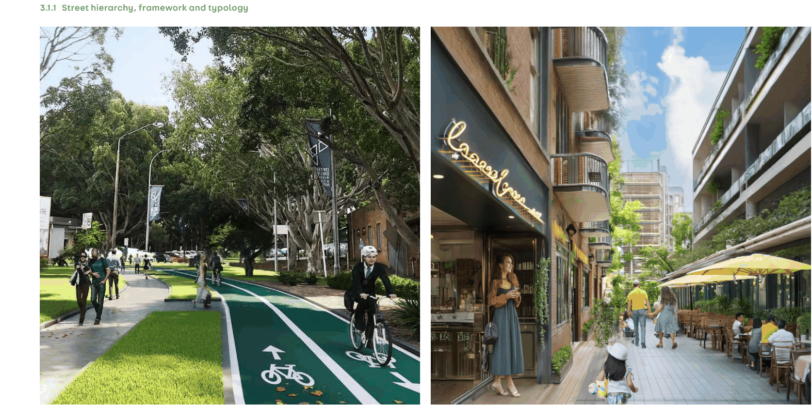

> [Picture on page 40: a picture, saved as a picture (images/ch-06-02-bankstown-city-centre-page-40-5.gif, 150 dpi).]

#### 3.1.1   Street hierarchy, framework and typology

Render of vision for pedestrian and cycle through site link - future Olympic Parade - Complete Streets (Source: Canterbury Bankstown Council)

Render of vision for through site link with active retail (Source: Architectus)

### public domain

### 3.1   Streets

#### 3.1.1   Street hierarchy, framework and typology

Laneway

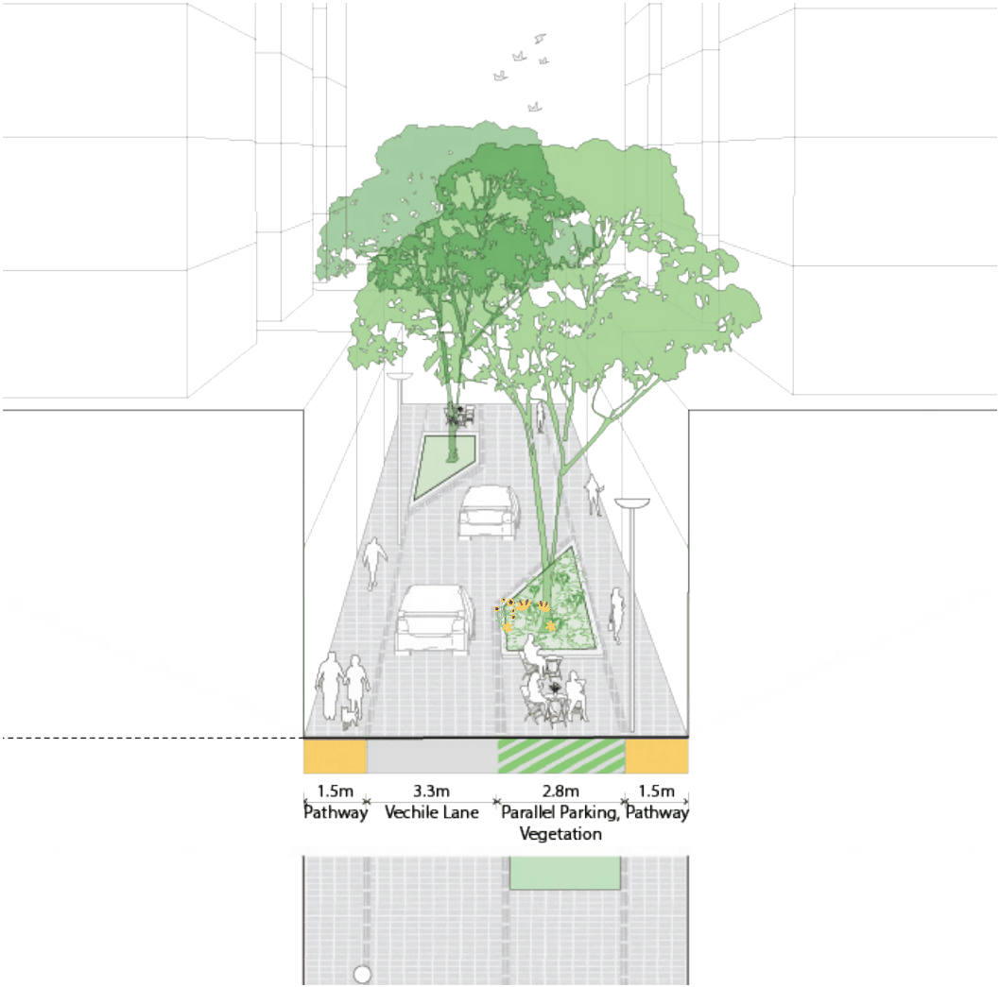

> [Picture on page 41: a picture, saved as a picture (images/ch-06-02-bankstown-city-centre-page-41-5.gif, 150 dpi).]

Figure 14.	 Section and plan of typical laneway with minimum

width of 9m

### public domain

### 3.1   Streets

#### 3.1.1   Street hierarchy, framework and typology

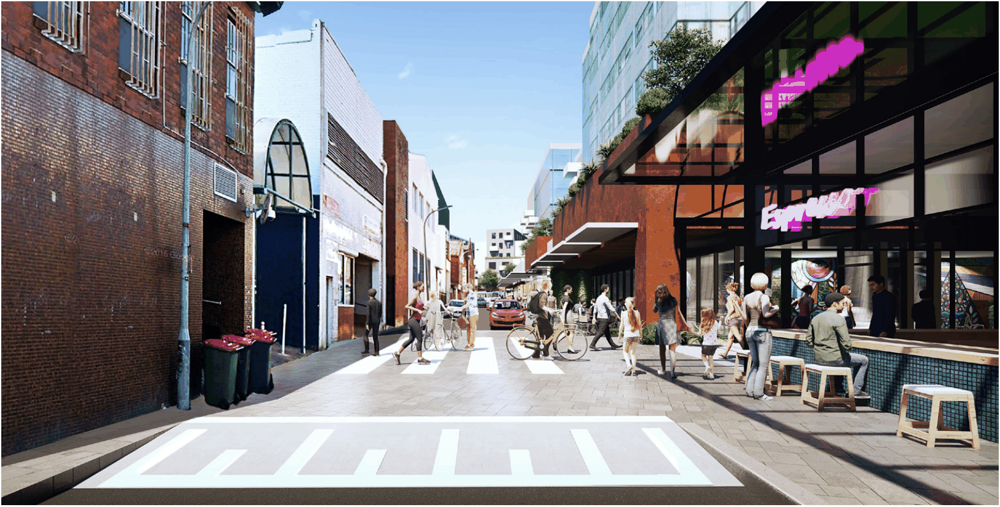

> [Picture on page 42: a picture, saved as a picture (images/ch-06-02-bankstown-city-centre-page-42-4.gif, 150 dpi).]

Render of vision for laneway - future Stewart Lane - Complete Streets (Source: Canterbury Bankstown Council)

### public domain

### 3.1   Streets

#### 3.1.1   Street hierarchy, framework and typology

Shared street

Flexible with pedestrian focus; traffic calming and safe design; 10km/hr design speed.

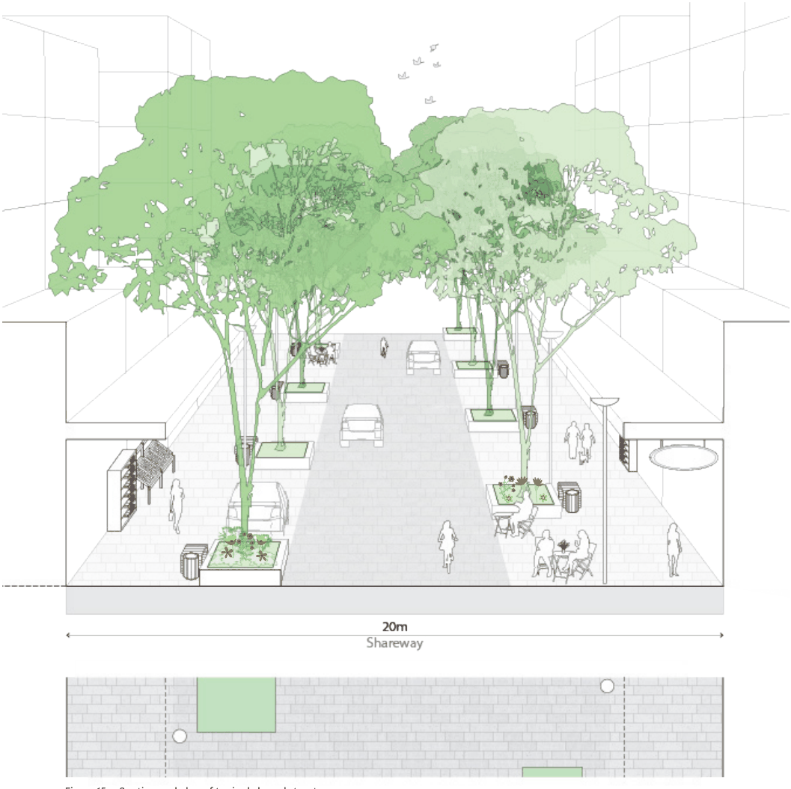

> [Picture on page 43: a picture, saved as a picture (images/ch-06-02-bankstown-city-centre-page-43-7.gif, 150 dpi).]

Figure 15. Section and plan of typical shared street

### public domain

### 3.1   Streets

#### 3.1.1   Street hierarchy, framework and typology

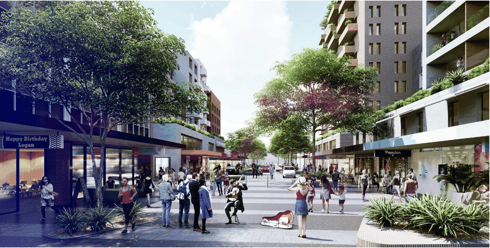

> [Picture on page 44: a picture, saved as a picture (images/ch-06-02-bankstown-city-centre-page-44-4.gif, 150 dpi).]

Render of vision for shared street- Appian Way - Complete Streets (Source: Canterbury Bankstown Council)

### public domain

### 3.1   Streets

#### 3.1.1   Street hierarchy, framework and typology

Neighbourhood street

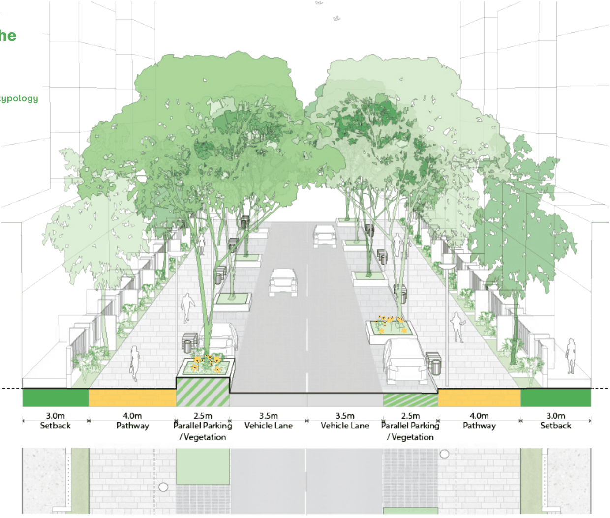

> [Picture on page 45: a picture, saved as a picture (images/ch-06-02-bankstown-city-centre-page-45-5.gif, 150 dpi).]

Figure 16. Section and plan of typical neighbourhood street

### public domain

### 3.1   Streets

#### 3.1.1   Street hierarchy, framework and typology

Neighbourhood street with cycle lane

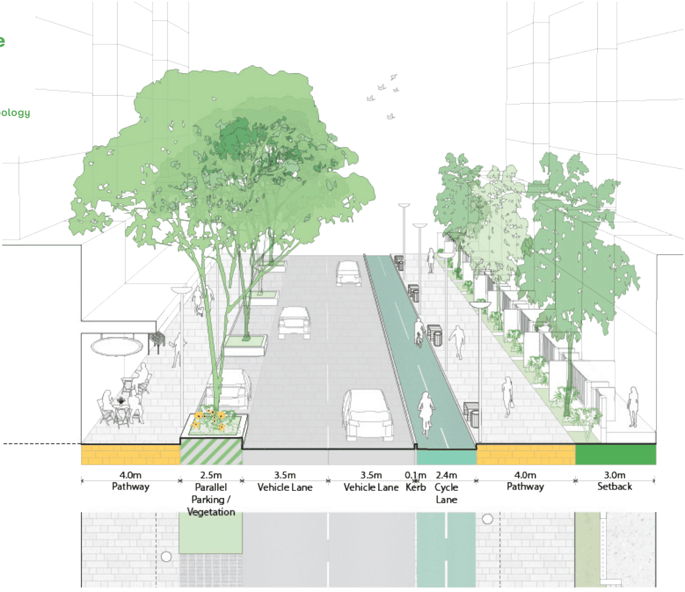

> [Picture on page 46: a picture, saved as a picture (images/ch-06-02-bankstown-city-centre-page-46-5.gif, 150 dpi).]

Figure 17. Section and plan of typical neighbourhood street with cycle lane

### public domain

### 3.1   Streets

#### 3.1.1   Street hierarchy, framework and typology

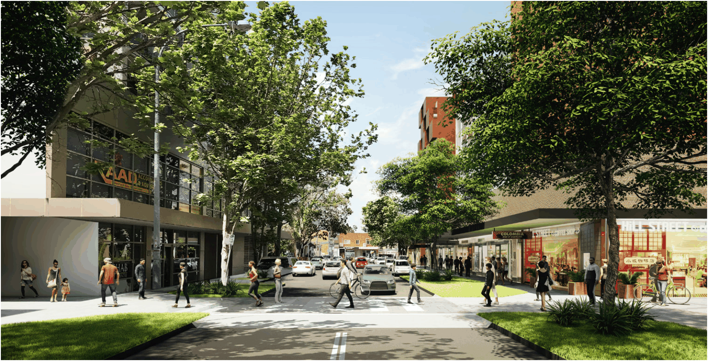

> [Picture on page 47: a picture, saved as a picture (images/ch-06-02-bankstown-city-centre-page-47-4.gif, 150 dpi).]

Render of vision for neighbourhood Street - Kitchener Parade, Bankstown - Complete Streets (Source: Canterbury Bankstown Council)

### public domain

### 3.1   Streets

#### 3.1.1   Street hierarchy, framework and typology

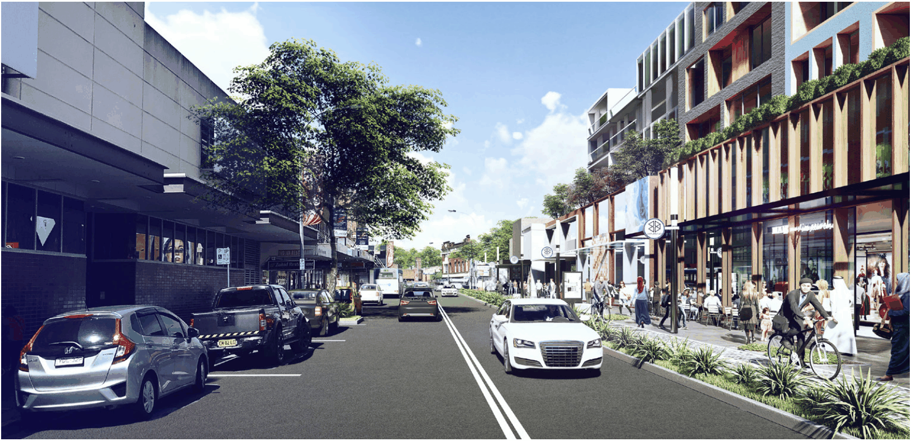

> [Picture on page 48: a picture, saved as a picture (images/ch-06-02-bankstown-city-centre-page-48-4.gif, 150 dpi).]

Render of vision for neighbourhood Street with cycle lane- future Chapel Road, Bankstown - Complete Streets (Source: Canterbury Bankstown Council)

### public domain

### 3.1   Streets

#### 3.1.1   Street hierarchy, framework and typology Transit street

These streets have bus and pedestrian priority and major bus routes.

Refer to Bankstown Complete Streets CBD Place and Movement Plan for more information

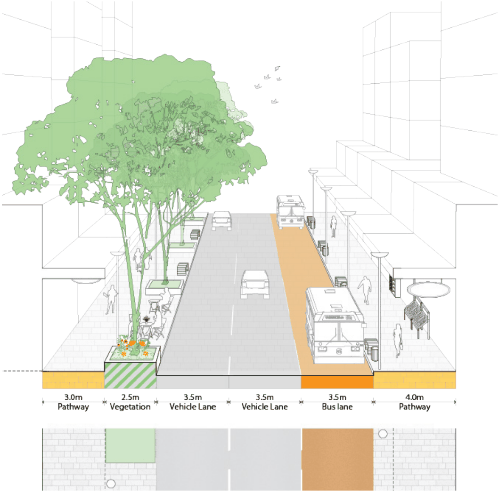

> [Picture on page 49: a picture, saved as a picture (images/ch-06-02-bankstown-city-centre-page-49-9.gif, 150 dpi).]

Figure 18.	 Section and plan of typical transit street

### public domain

### 3.1   Streets

#### 3.1.1   Street hierarchy, framework and typology Ring road

Primarily serves a movement function. Entry gateway to the city centre that draws vehicle traffic away from the pedestrianised centre of the Bankstown City Centre.

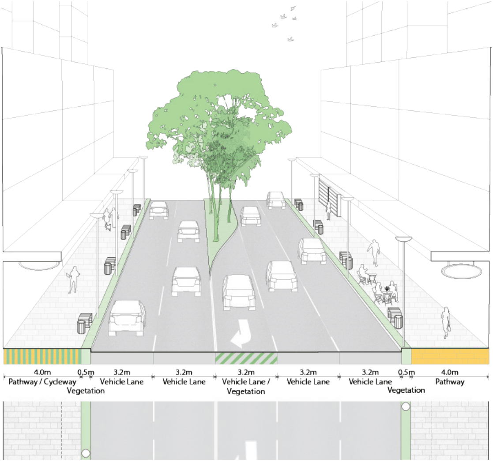

> [Picture on page 50: a picture, saved as a picture (images/ch-06-02-bankstown-city-centre-page-50-9.gif, 150 dpi).]

Figure 19. Section and plan of typical ring road

### public domain

### 3.1   Streets

#### 3.1.1   Street hierarchy, framework and typology

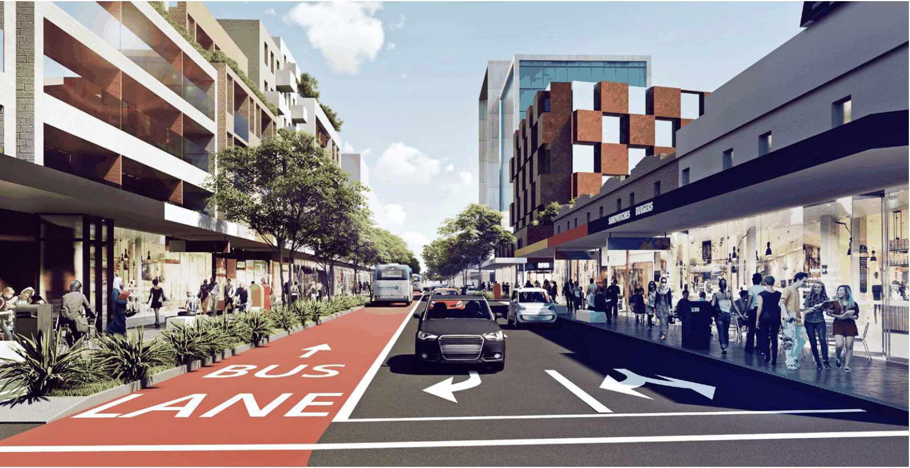

> [Picture on page 51: a picture, saved as a picture (images/ch-06-02-bankstown-city-centre-page-51-4.gif, 150 dpi).]

Render of vision for transit street - future Restwell Street - Complete Streets (Source: Canterbury Bankstown Council)

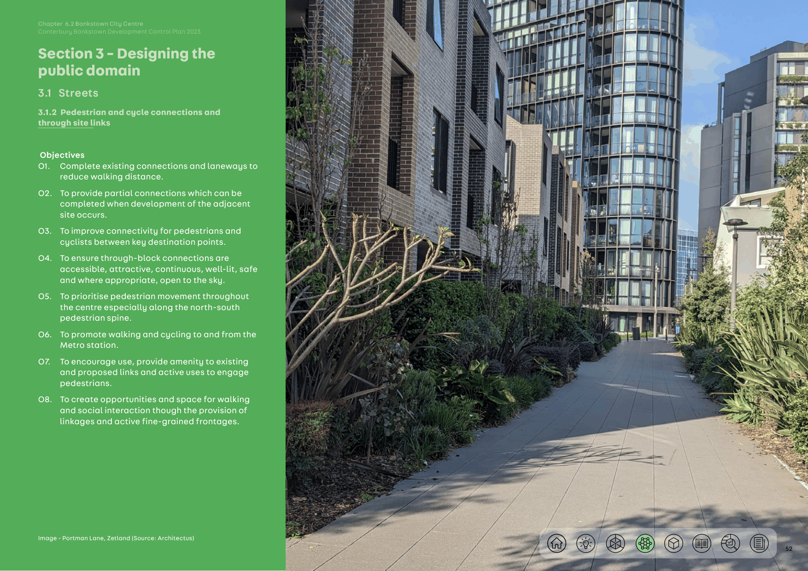

> [Picture on page 52: a picture, saved as a picture (images/ch-06-02-bankstown-city-centre-page-52-1.gif, 150 dpi).]
> Words printed on the picture (title and legend, copied from the PDF):
> reduce walking distance.
> Metro station.
> Image - Portman Lane, Zetland (Source: Architectus)

### public domain

### 3.1   Streets

#### 3.1.2  Pedestrian and cycle connections and

through site links

#### Objectives

O1. 	 Complete existing connections and laneways to

O2. 	 To provide partial connections which can be completed when development of the adjacent site occurs. O3. 	 To improve connectivity for pedestrians and cyclists between key destination points. O4. 	 To ensure through-block connections are accessible, attractive, continuous, well-lit, safe and where appropriate, open to the sky. O5. 	 To prioritise pedestrian movement throughout the centre especially along the north-south pedestrian spine. O6. 	 To promote walking and cycling to and from the

O7. 	 To encourage use, provide amenity to existing and proposed links and active uses to engage pedestrians. O8. 	 To create opportunities and space for walking and social interaction though the provision of linkages and active fine-grained frontages.

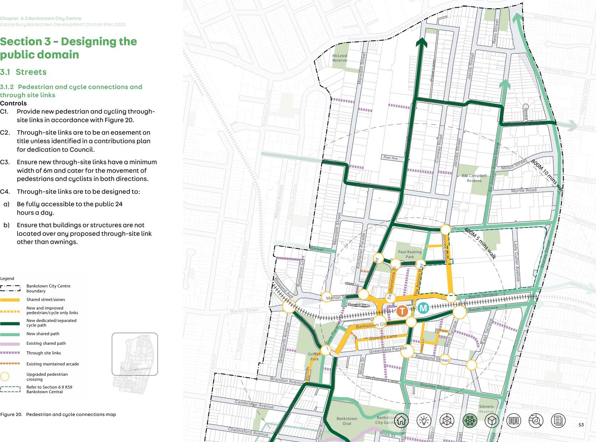

> [Picture on page 53: a map, saved as a picture (images/ch-06-02-bankstown-city-centre-page-53-1.gif, 150 dpi); the street names and other small labels are on the picture.]
> Words printed on the picture (title and legend, copied from the PDF):
> hours a day.
> Bankstown City Centre
> New and improved
> pedestrian/cycle only links
> New shared path
> Existing shared path
> Through site links
> Existing maintained arcade
> Refer to Section 6.9 KS9
> way (Hume Highway
> Old Kent R
> Sir Joseph Banks Street Myrtle Road alk
> Weigand Avenue Reynolds Avenue
> Rickard Road 40
> Prairie Vale Road
> Lady Cutler Avenue
> The Appian Way
> Bankstown City Plaza
> e Dale Parade
> Greenfield Parade Lopez Ln
> t well Street

Figure 20.	 Pedestrian and cycle connections map

### public domain

### 3.1   Streets

#### 3.1.2   Pedestrian and cycle connections and

through site links

#### Controls

C1. Provide new pedestrian and cycling through-site links in accordance with Figure 20. C2. 	 Through-site links are to be an easement on title unless identified in a contributions plan for dedication to Council. C3. 	 Ensure new through-site links have a minimum width of 6m and cater for the movement of pedestrians and cyclists in both directions. C4. 	 Through-site links are to be designed to:

a) 	 Be fully accessible to the public 24

b) 	 Ensure that buildings or structures are not located over any proposed through-site link other than awnings.

P

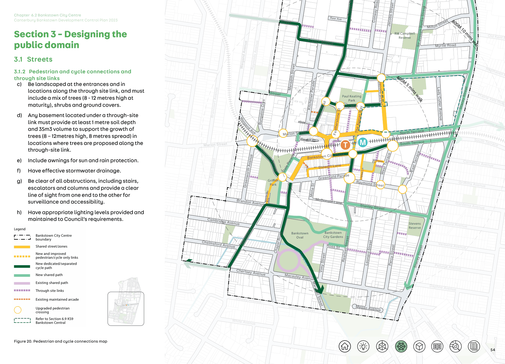

> [Picture on page 54: a map, saved as a picture (images/ch-06-02-bankstown-city-centre-page-54-1.gif, 150 dpi); the street names and other small labels are on the picture.]
> Words printed on the picture (title and legend, copied from the PDF):
> maintained to Council’s requirements.
> Bankstown City Centre
> New and improved
> pedestrian/cycle only links
> New shared path
> Existing shared path
> Through site links
> Existing maintained arcade
> Refer to Section 6.9 KS9
> Old Kent R
> Sir Joseph Banks Street Myrtle Road alk
> Weigand Avenue Reynolds Avenue
> Rickard Road 40
> Prairie Vale Road
> Lady Cutler Avenue
> The Appian Way
> Bankstown City Plaza
> e Dale Parade
> Chapel Road P
> Leonard Street Percy Street
> Road James Street

Figure 20. Pedestrian and cycle connections map

### public domain

### 3.1   Streets

#### 3.1.2   Pedestrian and cycle connections and

through site links

c) 	 Be landscaped at the entrances and in locations along the through site link, and must include a mix of trees (8 - 12 metres high at maturity), shrubs and ground covers.

d) 	 Any basement located under a through-site link must provide at least 1 metre soil depth and 35m3 volume to support the growth of trees (8 – 12metres high, 8 metres spread) in locations where trees are proposed along the through-site link.

e) 	 Include awnings for sun and rain protection.

f) Have effective stormwater drainage.

g) 	 Be clear of all obstructions, including stairs, escalators and columns and provide a clear line of sight from one end to the other for surveillance and accessibility.

h) 	 Have appropriate lighting levels provided and

### 3.1   Streets

#### 3.1.2   Pedestrian and cycle connections and through site links Controls (continued)

C5. 	 The maintenance of the through-site link in perpetuity including cleaning, repairing and replacing damaged or worn paving, furniture and the like and maintaining landscaping in a healthy condition is the responsibility of the land owner, not Council. A maintenance plan for the build through-site link must be submitted with the Development Application that includes an indicative maintenance schedule including frequency of maintenance and equipment to be used. C6. 	 In retail and commercial developments through-site

#### 2

storeys

links may be within a building provided they are:

a) 	 Two storeys in height or where proposed at a single storey ground level, have a minimum floor to ceiling height of 6m, refer to Figure 21

#### 3m 6m

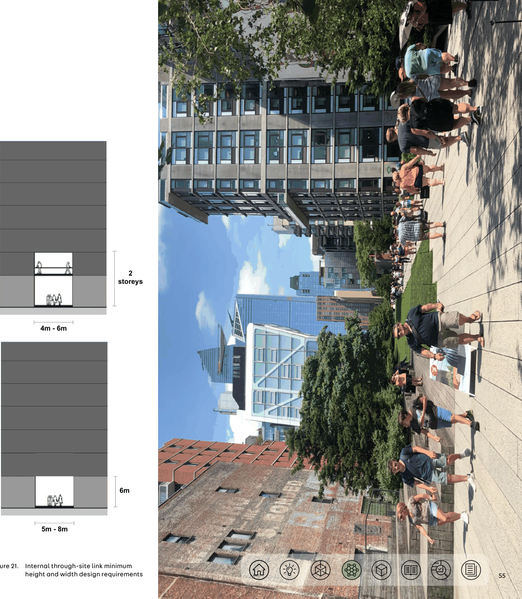

> [Picture on page 55: a picture, saved as a picture (images/ch-06-02-bankstown-city-centre-page-55-24.gif, 150 dpi).]

#### 4m - 6m

> Words printed on the picture (title and legend, copied from the PDF):
> d through site link
> - pedestrian bridge optional

#### 6m

b) 	 4m – 6m wide where provided within a two storey

c service lane

b shared lane

height, or 5m – 8m wide where provided at a single floor level, refer to Figure 21

#### Note:

ote:

c) 	 at ground level and lined with active uses

d) 	 designed to have access to natural light from

seating

footpath with flush kerb

shared service road

- pedestrian setback

- footpath with flush kerb

- shared service road

skylights in the middle of the link

e) 	 open at each end or, where air conditioned, provide entry doors that are glazed and comprise a minimum 50% of the width of the entrance

f) publicly accessible from 6am to 10pm each day, and

g) 	 connecting streets or lanes and have a clear line of

#### 2

storeys

#### 6m

sight between entrances.

#### 3m 6m

#### 4m - 6m

#### 5m - 8m

hrough site link

c service lane

e t

d through site link

Min.6m floor to

Image - The Highline, New York, US (Source: Architectus)

ceiling

Figure 21.	 Internal through-site link minimum

#### Note:

#### Note:

height and width design requirements

- pedestrian bridge optional

- pedestrian setback

- footpath with flush kerb

> Words printed on the picture (title and legend, copied from the PDF):
> 5m - 8m
> hrough site link
> Min.6m floor to

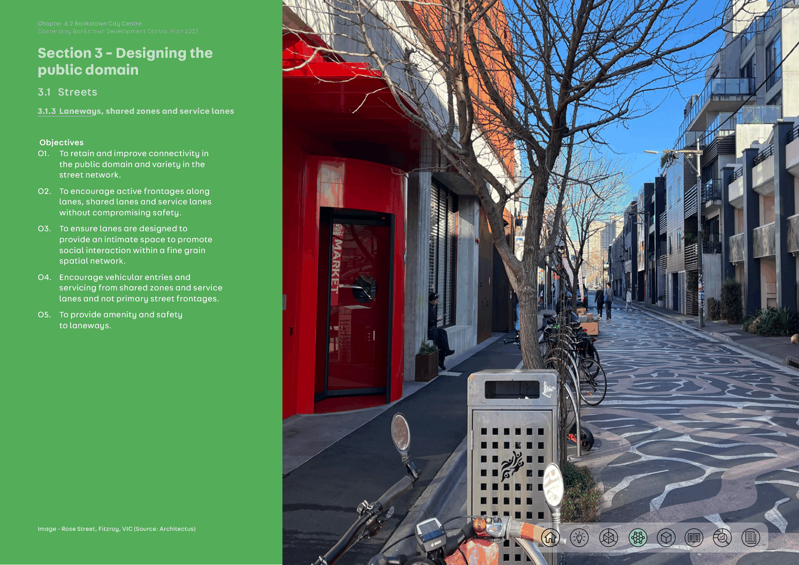

> [Picture on page 56: a picture, saved as a picture (images/ch-06-02-bankstown-city-centre-page-56-1.gif, 150 dpi).]
> Words printed on the picture (title and legend, copied from the PDF):
> to laneways.
> Image - Rose Street, Fitzroy, VIC (Source: Architectus)

### public domain

### 3.1   Streets

#### 3.1.3	 Laneways, shared zones and service lanes

#### Objectives

O1. 	 To retain and improve connectivity in the public domain and variety in the street network. O2. 	 To encourage active frontages along lanes, shared lanes and service lanes without compromising safety. O3. 	 To ensure lanes are designed to provide an intimate space to promote social interaction within a fine grain spatial network. O4. 	 Encourage vehicular entries and servicing from shared zones and service lanes and not primary street frontages. O5. 	 To provide amenity and safety

### public domain

### 3.1   Streets

#### 3.1.3 Laneways, shared zones and service lanes Controls

C1. 	 Provide new laneways and shared streets on private land as part of new development in accordance with Figure 20. C2. 	 New laneways and shared streets are to be dedicated to Council prior to a final Occupation Certificate being issued. Council reserves the right to not accept dedication and any proposed dedication must be discussed at a pre-lodgement meeting. C3. 	 Development is to provide for the co-ordination of proposed connections with neighbouring sites, including level adjustments and detailed plans. This detail is to be provided together with the development application. C4. 	 Lighting, paving, street furniture and tree planting are to clearly indicate the priority of the pedestrian or cycling user (to be provided in accordance with Canterbury Bankstown Council’s specifications and design standards). C5. 	 Access to basements, parking and waste collection areas are to be from service laneways or shared streets. C6. 	 All laneways must be open to the sky, be accessible to the public at all times, provide direct throughways with direct sight lines and be unencumbered by basements and infrastructure. C7. 	 Vehicle entries to basement carparks must not create traffic conflict or undermine the attractiveness or safety of the pedestrian experience.

Image - Nightingale  Skye House, Brunswick, VIC (Source: Architectus)

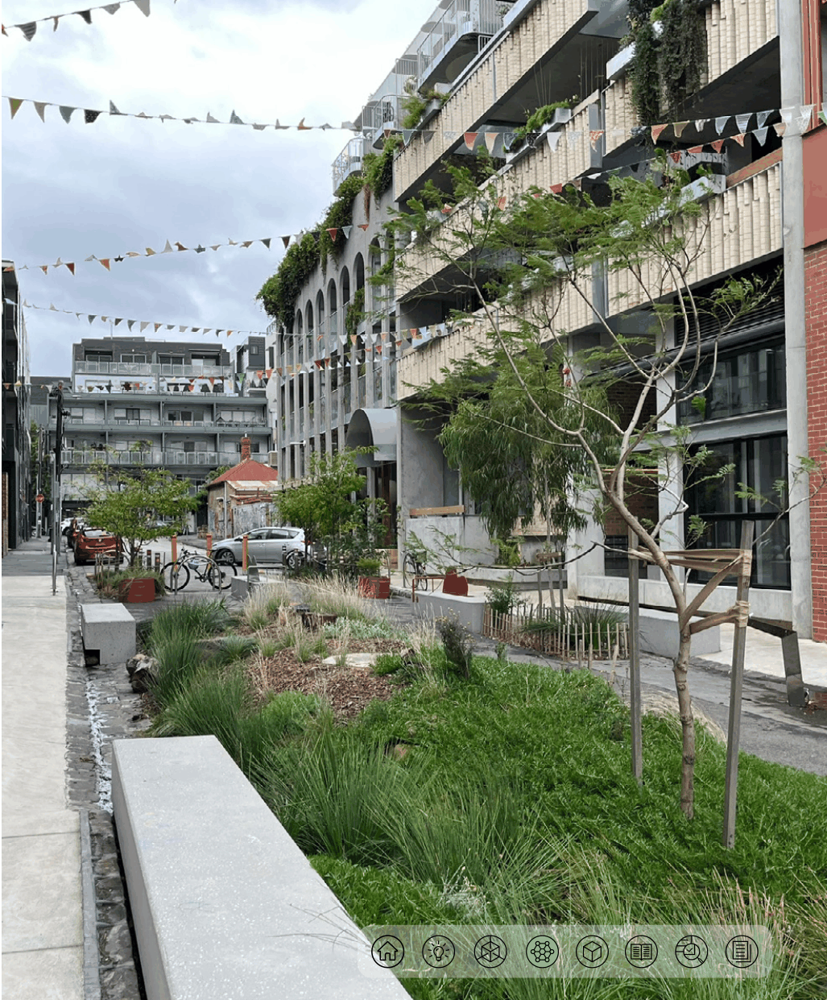

> [Picture on page 57: a picture, saved as a picture (images/ch-06-02-bankstown-city-centre-page-57-34.gif, 150 dpi).]

### public domain

### 3.1   Streets

#### 3.1.3 Laneways, shared zones and service lanes Controls (continued)

a) 	 Ground treatment at the intersection of driveways and pedestrian paths must reflect the adjacent public domain treatment and prioritise pedestrian flows.

b) 	 The first 6m of the basement ramp is to be at the same level as the footpath to ensure visibility between vehicles and pedestrians when vehicles exit the basement.

C8. 	 Any future development of the Bankstown Girls High School is to provide public pedestrian and bicycle access to Memorial Oval via Mona Street. C9. 	 Provide public access 24 hours, 7 days per week through either dedication to Council or a right of way easement for public access. C10. 	 Vehicle entries to basement carparks must not create traffic conflict or undermine the attractiveness or safety of the pedestrian experience.

a) 	 Ground treatment at the intersection of driveways and pedestrian paths must reflect the adjacent public domain treatment and prioritise pedestrian flows.

b) 	 The first 6m of the basement ramp is to be at the same level as the footpath to ensure visibility between vehicles and pedestrians when vehicles exit the basement.

C11. 	 Any future development of the Bankstown Girls High School is to provide public pedestrian and bicycle access to Memorial Oval via Mona Street. C12. 	 Provide public access 24 hours, 7 days per week through either dedication to Council or a right of way easement for public access.

Image - Elephant and Castle, South London, UK (Source: Architectus)

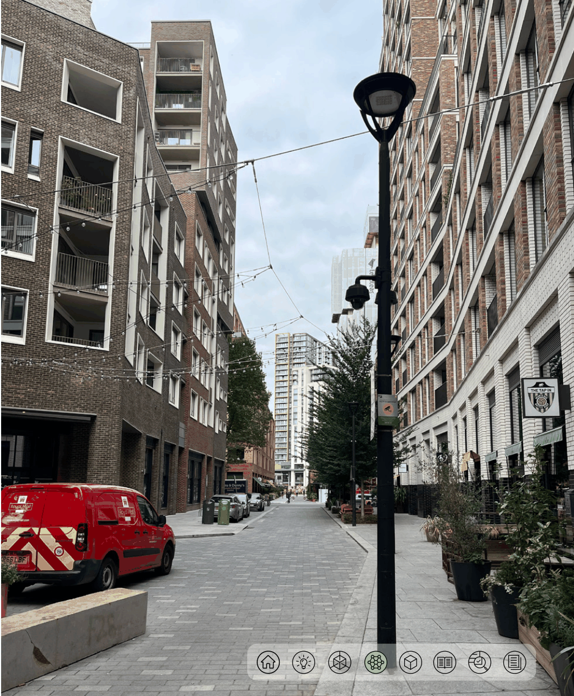

> [Picture on page 58: a picture, saved as a picture (images/ch-06-02-bankstown-city-centre-page-58-37.gif, 150 dpi).]

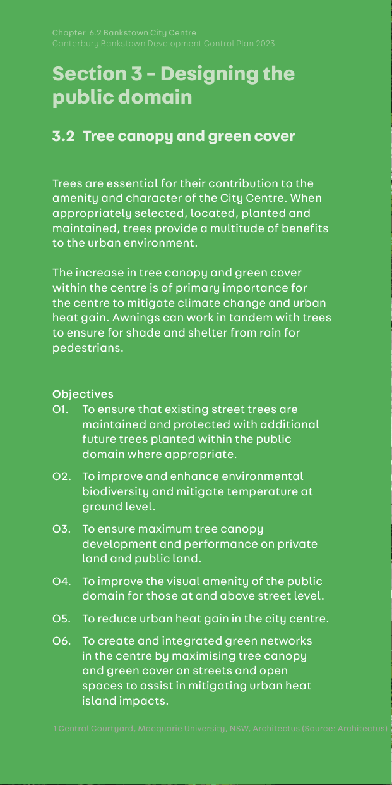

> [Picture on page 59: a picture, saved as a picture (images/ch-06-02-bankstown-city-centre-page-59-1.gif, 150 dpi).]
> Words printed on the picture (title and legend, copied from the PDF):
> 1 Central Courtyard, Macquarie University, NSW, Architectus (Source: Architectus)

### public domain

### 3.2	 Tree canopy and green cover

Trees are essential for their contribution to the amenity and character of the City Centre. When appropriately selected, located, planted and maintained, trees provide a multitude of benefits to the urban environment.

The increase in tree canopy and green cover within the centre is of primary importance for the centre to mitigate climate change and urban heat gain. Awnings can work in tandem with trees to ensure for shade and shelter from rain for pedestrians.

#### Objectives

O1. 	 To ensure that existing street trees are maintained and protected with additional future trees planted within the public domain where appropriate. O2. 	 To improve and enhance environmental biodiversity and mitigate temperature at ground level. O3. 	 To ensure maximum tree canopy development and performance on private land and public land. O4. 	 To improve the visual amenity of the public domain for those at and above street level. O5. 	 To reduce urban heat gain in the city centre. O6. 	 To create and integrated green networks in the centre by maximising tree canopy and green cover on streets and open spaces to assist in mitigating urban heat island impacts.

### public domain

### 3.2   Tree canopy and green cover

#### Objectives (continued)

O7. 	 To create a contiguous tree canopy to mitigate climate change and improve health and wellbeing of people and ecosystems. O8. 	 To incorporate water sensitive urban design in new and upgraded streets and other civic infrastructure to harness rainwater, improve water quality and promote vegetation growth. O9. 	 To create comfortable microclimates for the community and promote health and wellbeing. O10. 	 The design of the canopy trees should be laid out such that sufficient room is provided for the trees to achieve their desired mature

size. Canopy overlap should not exceed 25%.

Image - Markham Avenue, Ashburton, VIC, Architectus (Source: Architectus)

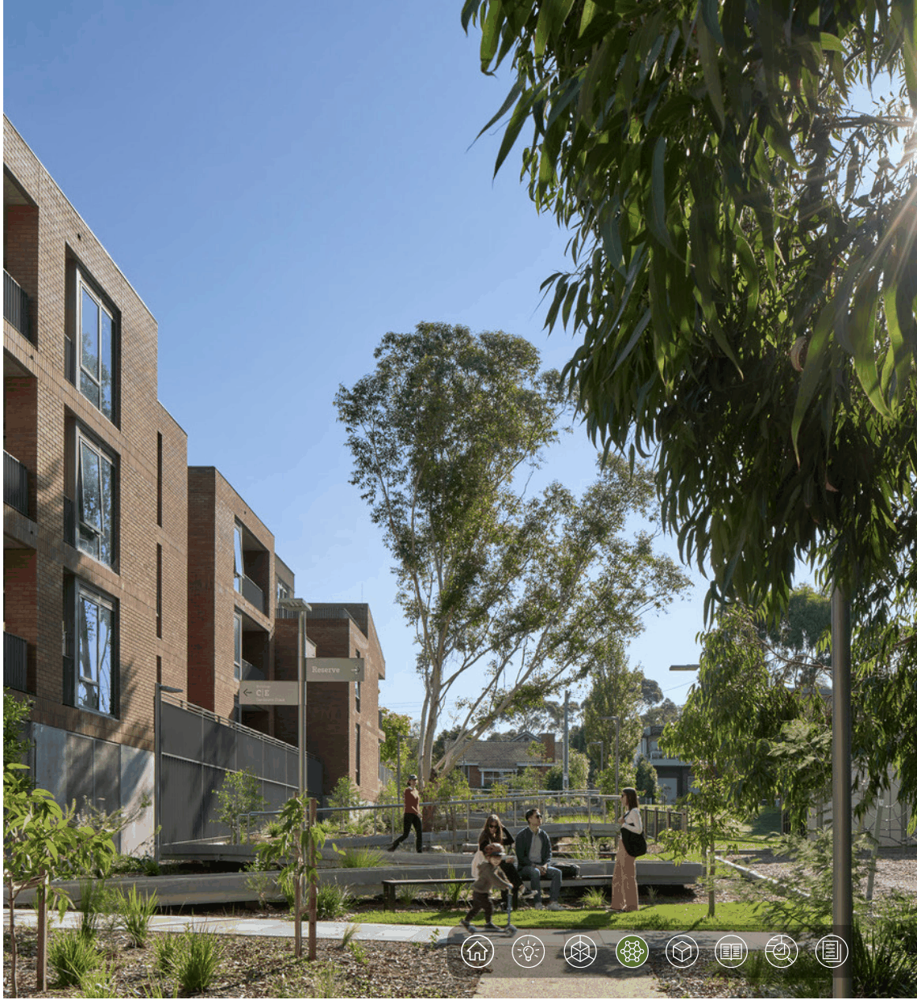

> [Picture on page 60: a picture, saved as a picture (images/ch-06-02-bankstown-city-centre-page-60-21.gif, 150 dpi).]

### public domain

### 3.2   Tree canopy and green cover

#### Controls

C1. Minimum tree canopy cover is required on private land within Bankstown City Centre as per Figure 22.

C2. 	 Tree canopy cover refers to the layer of leaves, branches, and stems of trees that cover the ground when viewed from above, expressed as proportion of the total site area, calculated in accordance with the following:

a) 	 Canopy area is to include the expected mature size (crown spread at maturity) of existing and proposed trees.

b) 	 Only trees with a minimum crown spread of 3m in diameter are to be included. Trees with a crown spread less than 3m diameter are to be excluded from tree canopy cover calculations.

c) 	 Any overlap in canopy area is to be counted once.

d) 	 Canopy area extending outside of site boundaries is to be excluded.

e) 	 Canopy area extending within a development site from trees planted in adjoining sites is to be excluded.

f) 	 Trees located over structures, including podiums and rooftops, are to be included.

C3. 	 Areas of deep soil are to be provided in accordance with the ADG, where relevant. Areas of deep soil are to be provided within landscaped areas, in accordance with the ADG, where relevant.

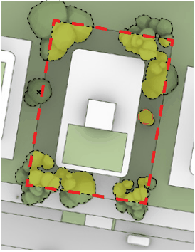

> [Picture on page 61: a picture, saved as a picture (images/ch-06-02-bankstown-city-centre-page-61-34.gif, 150 dpi).]

Legend Site boundary

3m diameter

Area included in canopy area

Area excluded in canopy area

Deep soil zone

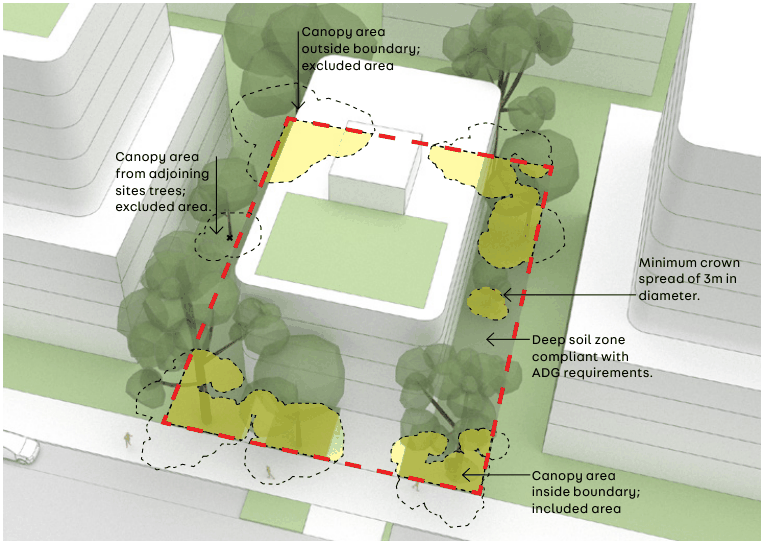

> [Picture on page 61: a map, saved as a picture (images/ch-06-02-bankstown-city-centre-page-61-41.gif, 150 dpi); the street names and other small labels are on the picture.]
> Words printed on the picture (title and legend, copied from the PDF):
> spread of 3m in
> Deep soil zone

Figure 22.	 Key controls for tree canopy and deep soil for a residential development

| Zones | Type of development | Minimum canopy coverage (whether on structure or deep soil) |
|---|---|---|
| Within E1 Local Centre, E2 Commercial | Non residential | 5% |
| Centre, MU1 Mixed Use and SP2 Educational Establishment Zones | Mixed use including residential Residential only | 10% 15% |

Figure 23.	 Minimum canopy coverage on private land based on land use

### public domain

### 3.2   Tree canopy and green cover

#### Controls (continued)

C4. 	 New development within E1 Local Centre, E2 Commercial Centre, MU1 Mixed Use and SP2 Educational Establishment zones must deliver 50% of the site area as ‘green cover’ which can be any combination of the following:

a) 	 Deep soil zones

b) 	 Landscape areas

c) 	 Layered planting on structure (including small and medium trees, as per the Apartment Design Guide)

d) 	 Green roofs and awnings

e) 	 Permanent planting on balconies and podiums (including built-in planter boxes) — Note: The roof area of the site that contains proposed or existing rooftop photovoltaic (solar) panels may be counted towards ‘green cover’ that is provided on rooftop areas.

C5. 	 At-grade car parking as part of all development is to provide one tree per five car spaces. Each tree is to achieve a mature canopy of at least 50m2, supported by adequate soil volumes. C6. 	 The Development Application is to include confirmation from a suitably qualified horticulturist (AQF Level 5 Arborist) in the form of a report that proposed planting complies with the requirements of this section, including suitable soil volumes to enable mature canopy sizes to be achieved.

Image - Griffith Park, Bankstown, NSW (Source: Canterbury Bankstown Council)

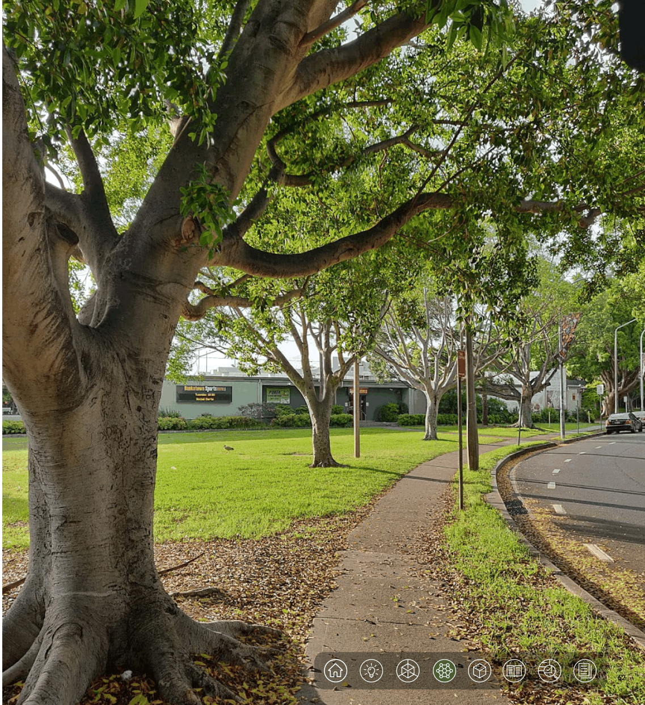

> [Picture on page 62: a picture, saved as a picture (images/ch-06-02-bankstown-city-centre-page-62-36.gif, 150 dpi).]

### public domain

### 3.2   Tree canopy and green cover

#### Controls (continued)

C7. For any on-street car parking interspersed tree pits must be placed:

a) 	 Two tree pits for every three parallel parking

b) 	 Two tree pits for every five 90 degree or angled parking

c) 	 Integrated use of water sensitive urban design.

C8. 	 Applicants must have regard to the urban street tree masterplan as shown in Figure 24, in relation to tree type and its location. Native evergreen trees must be a species of the Sydney Turpentine-Ironbark Forest community. C9. 	 New street trees must have a pot size of at least 45 litres and no greater than 200 litres. C10. 	 Street trees must not be planted directly under awnings. Awnings must feature ‘cut outs’ that allow for new trees to grow. C11. 	 Kerbside tree planting and landscaping along bus routes should be designed to prevent tree trunks, branches and canopies from obstructing double deck buses travelling along streets and at bus stops. C12. 	 At bus stops, any trees or fixed structures should be set back at least 800mm back from the kerb to prevent buses striking trees when pulling in and out of stops. C13. 	 Landscaping should avoid obstructing sightlines on the approach to bus stops so that waiting passengers can see approaching buses and vice-versa. Image - 1 Eden Park Drive, North Ryde, NSW, Architectus (Source: Brett Boardman)

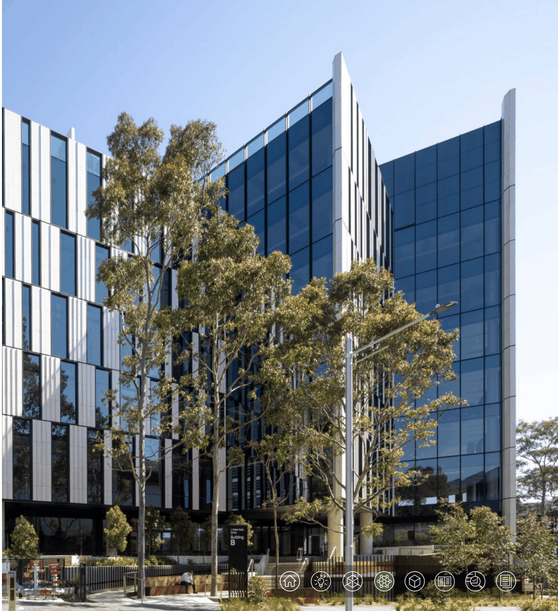

> [Picture on page 63: a picture, saved as a picture (images/ch-06-02-bankstown-city-centre-page-63-38.gif, 150 dpi).]

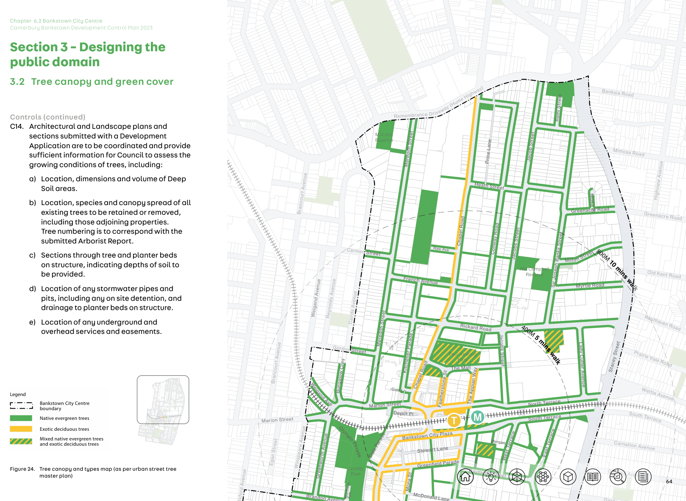

> [Picture on page 64: a map, saved as a picture (images/ch-06-02-bankstown-city-centre-page-64-1.gif, 150 dpi); the street names and other small labels are on the picture.]
> Words printed on the picture (title and legend, copied from the PDF):
> overhead services and easements.
> Bankstown City Centre
> Native evergreen trees
> Exotic deciduous trees
> Mixed native evergreen trees
> and exotic deciduous trees
> way (Hume Highway
> Old Kent Road
> Sir Joseph Banks Street Myrtle Road wal
> Weigand Avenue Reynolds Avenue
> Rickard Road 40
> Prairie Vale Road
> Lady Cutler Avenue
> The Appian Way
> Bankstown City Plaza
> e Dale Parade
> Greenfield Parade Lopez Ln

Figure 24.	 Tree canopy and types map (as per urban street tree

### public domain

### 3.2   Tree canopy and green cover

#### Controls (continued)

C14. 	 Architectural and Landscape plans and sections submitted with a Development Application are to be coordinated and provide sufficient information for Council to assess the growing conditions of trees, including:

a) 	 Location, dimensions and volume of Deep

b) 	 Location, species and canopy spread of all existing trees to be retained or removed, including those adjoining properties. Tree numbering is to correspond with the submitted Arborist Report.

c) 	 Sections through tree and planter beds on structure, indicating depths of soil to be provided.

d) 	 Location of any stormwater pipes and pits, including any on site detention, and drainage to planter beds on structure.

e) 	 Location of any underground and

Sta

Gardenia A

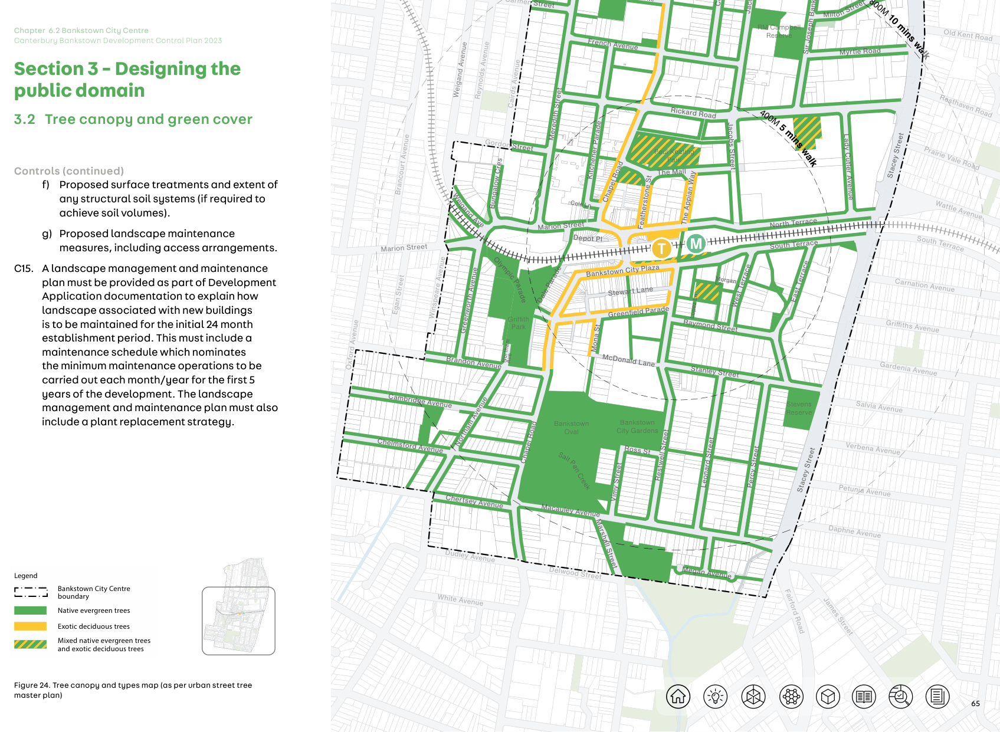

> [Picture on page 65: a map, saved as a picture (images/ch-06-02-bankstown-city-centre-page-65-1.gif, 150 dpi); the street names and other small labels are on the picture.]
> Words printed on the picture (title and legend, copied from the PDF):
> g) 	 Proposed landscape maintenance
> measures, including access arrangements.
> Bankstown City Centre
> Native evergreen trees
> Exotic deciduous trees
> Mixed native evergreen trees
> and exotic deciduous trees
> Old Kent Road
> Sir Joseph Bank Myrtle Road wal
> Weigand Avenue Reynolds Avenue
> Rickard Road 40
> Prairie Vale Road
> Lady Cutler Avenue
> The Appian Way
> Bankstown City Plaza
> e Dale Parade
> Greenfield Parade Lopez Ln
> Chapel Road P
> Leonard Street Percy Street
> Road James Street

Figure 24. Tree canopy and types map (as per urban street tree

### public domain

### 3.2   Tree canopy and green cover

#### Controls (continued)

f) 	 Proposed surface treatments and extent of any structural soil systems (if required to achieve soil volumes).

C15. 	 A landscape management and maintenance plan must be provided as part of Development Application documentation to explain how landscape associated with new buildings is to be maintained for the initial 24 month establishment period. This must include a maintenance schedule which nominates the minimum maintenance operations to be carried out each month/year for the first 5 years of the development. The landscape management and maintenance plan must also include a plant replacement strategy.

Raw Ave

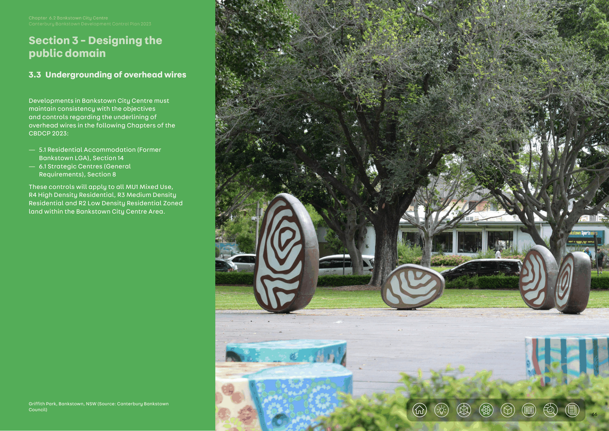

> [Picture on page 66: a picture, saved as a picture (images/ch-06-02-bankstown-city-centre-page-66-1.gif, 150 dpi).]
> Words printed on the picture (title and legend, copied from the PDF):
> Bankstown LGA), Section 14
> Requirements), Section 8
> Griffith Park, Bankstown, NSW (Source: Canterbury Bankstown
> Council)

### public domain

### 3.3	 Undergrounding of overhead wires

Developments in Bankstown City Centre must maintain consistency with the objectives and controls regarding the underlining of overhead wires in the following Chapters of the CBDCP 2023:

— 5.1 Residential Accommodation (Former

— 6.1 Strategic Centres (General

These controls will apply to all MU1 Mixed Use,

R4 High Density Residential, R3 Medium Density Residential and R2 Low Density Residential Zoned land within the Bankstown City Centre Area.

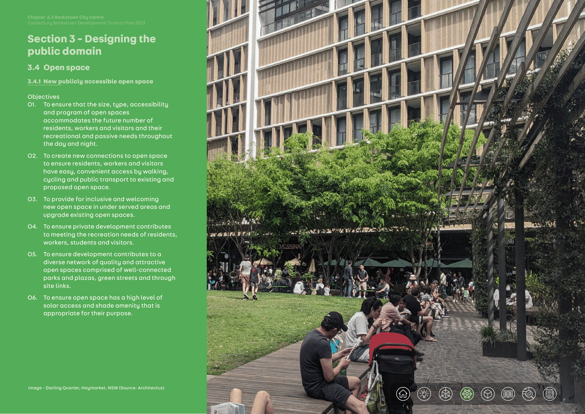

> [Picture on page 67: a picture, saved as a picture (images/ch-06-02-bankstown-city-centre-page-67-1.gif, 150 dpi).]
> Words printed on the picture (title and legend, copied from the PDF):
> Image - Darling Quarter, Haymarket, NSW (Source: Architectus)

### public domain

### 3.4	 Open space

#### 3.4.1	 New publicly accessible open space

Objectives O1. 	 To ensure that the size, type, accessibility and program of open spaces accommodates the future number of residents, workers and visitors and their recreational and passive needs throughout the day and night. O2. 	 To create new connections to open space to ensure residents, workers and visitors have easy, convenient access by walking, cycling and public transport to existing and proposed open space. O3. 	 To provide for inclusive and welcoming new open space in under served areas and upgrade existing open spaces. O4. 	 To ensure private development contributes to meeting the recreation needs of residents, workers, students and visitors. O5. 	 To ensure development contributes to a diverse network of quality and attractive open spaces comprised of well-connected parks and plazas, green streets and through site links. O6. 	 To ensure open space has a high level of solar access and shade amenity that is appropriate for their purpose.

### public domain

### 3.4   Open space

#### 3.4.1   New publicly accessible open space Principles

P1. Provide safe and interesting linkages and support existing links for children to playgrounds and schools. P2. 	 Provide equitable access and a variety of amenity and recreational options to accommodate the different community needs. P3. 	 The design of new open space should use a palette of high quality and robust materials to maximise the design lifespan and create beautiful places. P4. 	 Create and enhance natural ecologies within the urban fabric through the use of diverse native landscape species. P5. 	 Paths of travel through public open space must respond to ‘desire paths’ and be lit in the evening to improve safety and accessibility for users.

Image - Chippendale Green, Chippendale, NSW (Source: Architectus)

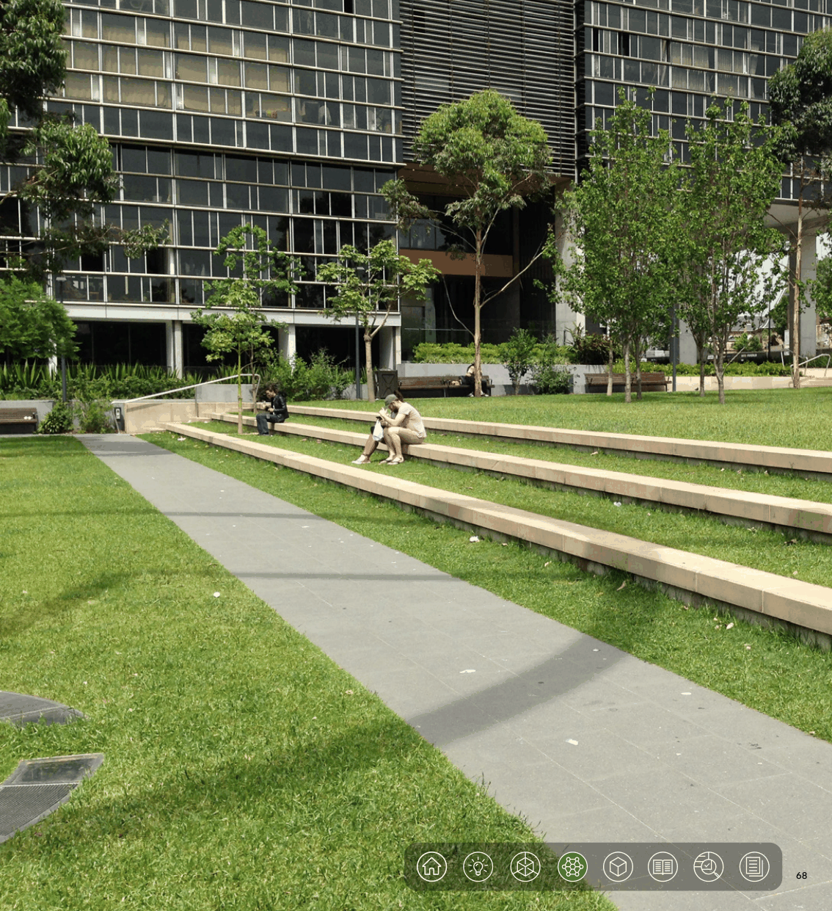

> [Picture on page 68: a picture, saved as a picture (images/ch-06-02-bankstown-city-centre-page-68-25.gif, 150 dpi).]

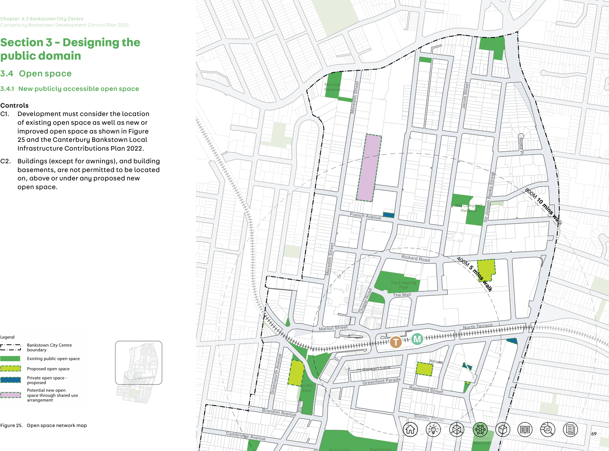

> [Picture on page 69: a map, saved as a picture (images/ch-06-02-bankstown-city-centre-page-69-1.gif, 150 dpi); the street names and other small labels are on the picture.]
> Words printed on the picture (title and legend, copied from the PDF):
> Bankstown City Centre
> Existing public open space
> Proposed open space
> Private open space -
> Potential new open
> space through shared use
> Sir Joseph Banks Street

Figure 25.	 Open space network map

### public domain

### 3.4   Open space

#### 3.4.1   New publicly accessible open space Controls

C1. 	 Development must consider the location of existing open space as well as new or improved open space as shown in Figure 25 and the Canterbury Bankstown Local Infrastructure Contributions Plan 2022. C2. 	 Buildings (except for awnings), and building basements, are not permitted to be located on, above or under any proposed new open space.

ad

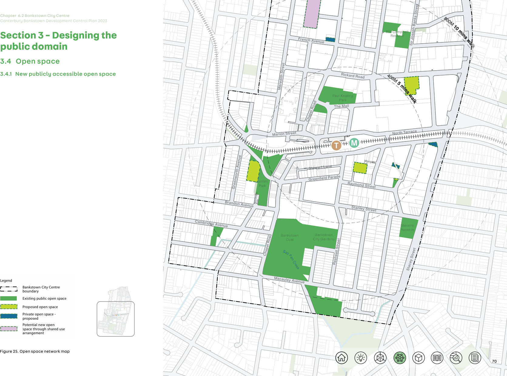

> [Picture on page 70: a map, saved as a picture (images/ch-06-02-bankstown-city-centre-page-70-1.gif, 150 dpi); the street names and other small labels are on the picture.]
> Words printed on the picture (title and legend, copied from the PDF):
> Bankstown City Centre
> Existing public open space
> Proposed open space
> Private open space -
> Potential new open
> space through shared use
> Chapel Road P
> Sir Joseph Banks Street

Figure 25. Open space network map

### public domain

### 3.4   Open space

#### 3.4.1   New publicly accessible open space

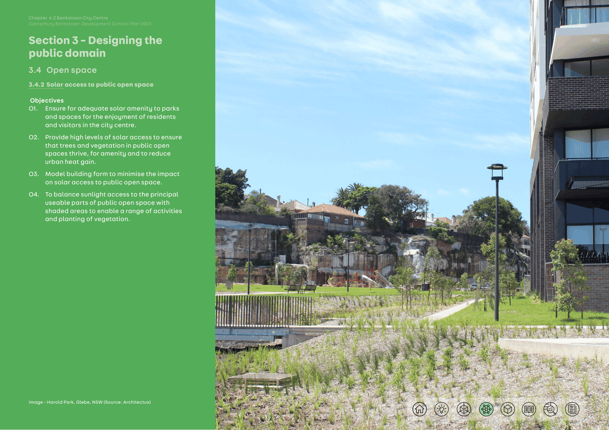

> [Picture on page 71: a picture, saved as a picture (images/ch-06-02-bankstown-city-centre-page-71-1.gif, 150 dpi).]
> Words printed on the picture (title and legend, copied from the PDF):
> Image - Harold Park, Glebe, NSW (Source: Architectus)

### public domain

### 3.4   Open space

#### 3.4.2	 Solar access to public open space Objectives

O1. 	 Ensure for adequate solar amenity to parks and spaces for the enjoyment of residents and visitors in the city centre. O2. 	 Provide high levels of solar access to ensure that trees and vegetation in public open spaces thrive, for amenity and to reduce urban heat gain. O3. 	 Model building form to minimise the impact on solar access to public open space. O4. 	 To balance sunlight access to the principal useable parts of public open space with shaded areas to enable a range of activities and planting of vegetation.

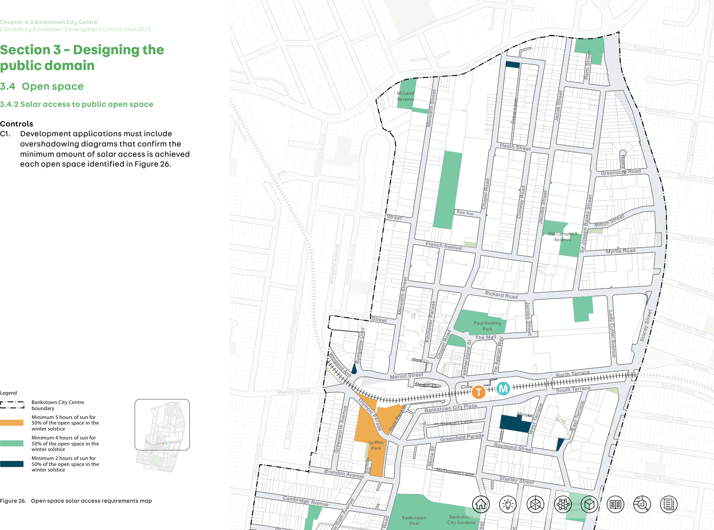

> [Picture on page 72: a map, saved as a picture (images/ch-06-02-bankstown-city-centre-page-72-1.gif, 150 dpi); the street names and other small labels are on the picture.]
> Words printed on the picture (title and legend, copied from the PDF):
> Bankstown City Centre
> Minimum 5 hours of sun for
> 50% of the open space in the
> Minimum 4 hours of sun for
> 50% of the open space in the
> Minimum 2 hours of sun for
> 50% of the open space in the
> way (Hume Highway
> Old Kent Road
> Sir Joseph Banks Street Myrtle Road
> Weigand Avenue Reynolds Avenue
> Prairie Vale Road
> Lady Cutler Avenue
> The Appian Way
> Bankstown City Plaza
> e Dale Parade
> Greenfield Parade Lopez Ln

Figure 26.	 Open space solar access requirements map

### public domain

### 3.4   Open space

#### 3.4.2 Solar access to public open space Controls

C1. 	 Development applications must include overshadowing diagrams that confirm the minimum amount of solar access is achieved each open space identified in Figure 26.

Chelmsf

V

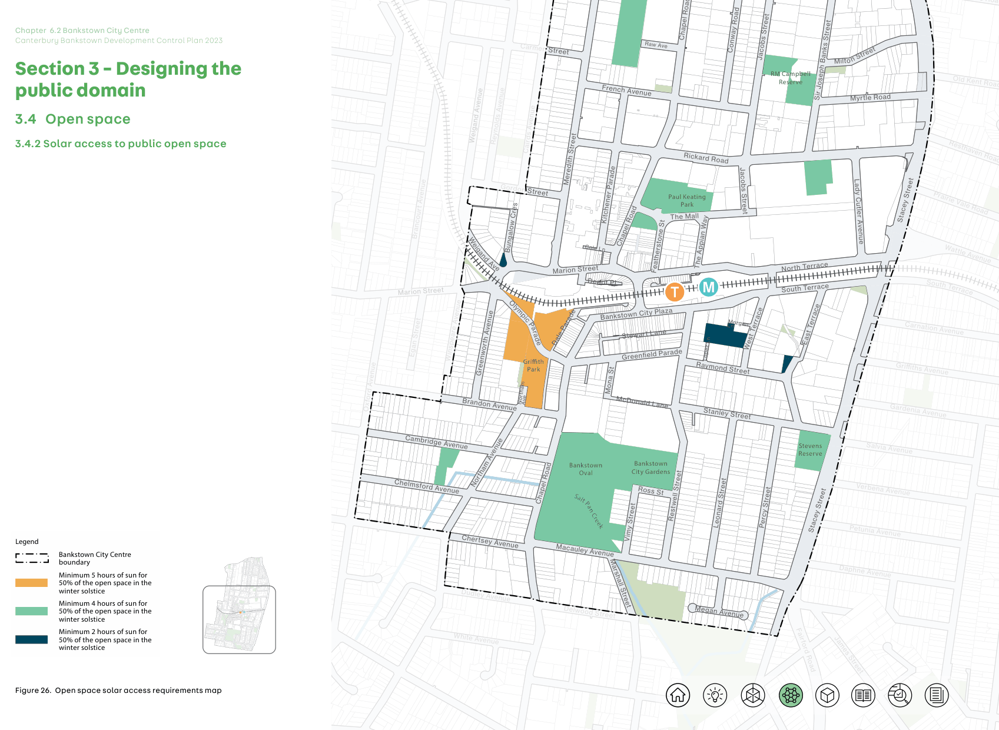

> [Picture on page 73: a map, saved as a picture (images/ch-06-02-bankstown-city-centre-page-73-1.gif, 150 dpi); the street names and other small labels are on the picture.]
> Words printed on the picture (title and legend, copied from the PDF):
> Bankstown City Centre
> Minimum 5 hours of sun for
> 50% of the open space in the
> Minimum 4 hours of sun for
> 50% of the open space in the
> Minimum 2 hours of sun for
> 50% of the open space in the
> Old Kent Road
> Sir Joseph Banks Street Myrtle Road
> Weigand Avenue Reynolds Avenue
> Prairie Vale Road
> Lady Cutler Avenue
> The Appian Way
> Bankstown City Plaza
> e Dale Parade
> Greenfield Parade Lopez Ln
> Chapel Road P
> Leonard Street Percy Street
> Road James Street

Figure 26.  Open space solar access requirements map

### public domain

### 3.4   Open space

#### 3.4.2 Solar access to public open space

nacre Road

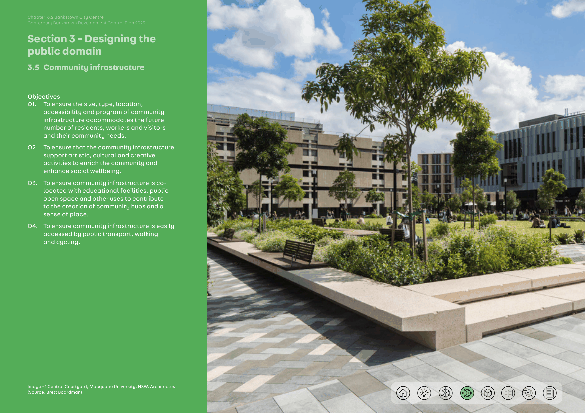

> [Picture on page 74: a picture, saved as a picture (images/ch-06-02-bankstown-city-centre-page-74-1.gif, 150 dpi).]
> Words printed on the picture (title and legend, copied from the PDF):
> Image - 1 Central Courtyard, Macquarie University, NSW, Architectus
> (Source: Brett Boardman)

### public domain

### 3.5	 Community infrastructure

#### Objectives

O1. 	 To ensure the size, type, location, accessibility and program of community infrastructure accommodates the future number of residents, workers and visitors and their community needs. O2. 	 To ensure that the community infrastructure support artistic, cultural and creative activities to enrich the community and enhance social wellbeing. O3. 	 To ensure community infrastructure is co-located with educational facilities, public open space and other uses to contribute to the creation of community hubs and a sense of place. O4. 	 To ensure community infrastructure is easily accessed by public transport, walking and cycling.

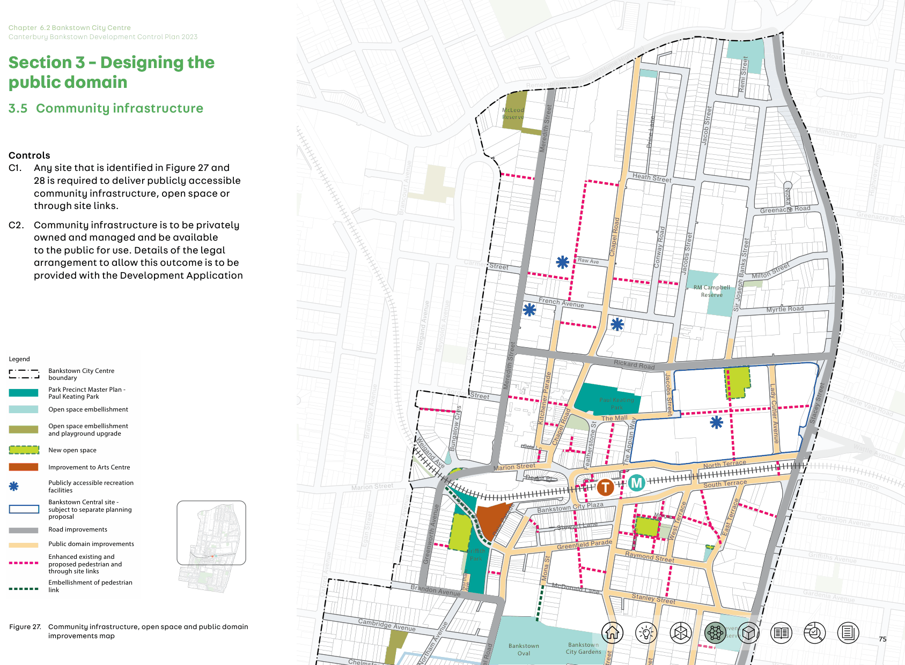

> [Picture on page 75: a map, saved as a picture (images/ch-06-02-bankstown-city-centre-page-75-1.gif, 150 dpi); the street names and other small labels are on the picture.]
> Words printed on the picture (title and legend, copied from the PDF):
> Bankstown City Centre
> Park Precinct Master Plan -
> Paul Keating Park
> Open space embellishment
> Open space embellishment
> and playground upgrade
> New open space
> Improvement to Arts Centre
> Publicly accessible recreation
> Bankstown Central site -
> subject to separate planning
> Public domain improvements
> Enhanced existing and
> proposed pedestrian and
> through site links
> Embellishment of pedestrian
> way (Hume Highway
> Old Kent Road
> Sir Joseph Banks Street Myrtle Road
> Weigand Avenue Reynolds Avenue
> Prairie Vale Road
> Lady Cutler Avenue
> The Appian Way
> Bankstown City Plaza
> e Dale Parade
> Greenfield Parade Lopez Ln

Figure 27.	 Community infrastructure, open space and public domain

### public domain

### 3.5   Community infrastructure

#### Controls

C1. 	 Any site that is identified in Figure 27 and 28 is required to deliver publicly accessible community infrastructure, open space or through site links.

C2. 	 Community infrastructure is to be privately owned and managed and be available to the public for use. Details of the legal arrangement to allow this outcome is to be provided with the Development Application

R

Verbena

Chelmsford Ave

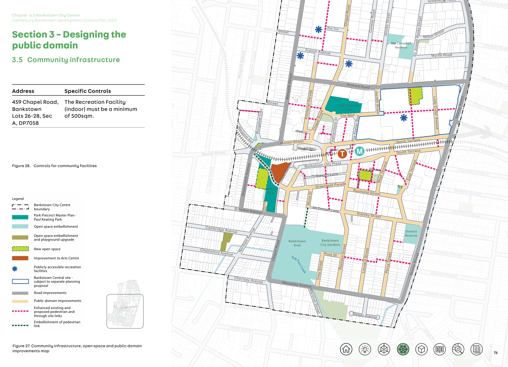

> [Picture on page 76: a map, saved as a picture (images/ch-06-02-bankstown-city-centre-page-76-1.gif, 150 dpi); the street names and other small labels are on the picture.]
> Words printed on the picture (title and legend, copied from the PDF):
> Bankstown City Centre
> Park Precinct Master Plan -
> Paul Keating Park
> Open space embellishment
> Open space embellishment
> and playground upgrade
> New open space
> Improvement to Arts Centre
> Publicly accessible recreation
> Bankstown Central site -
> subject to separate planning
> Public domain improvements
> Enhanced existing and
> proposed pedestrian and
> through site links
> Embellishment of pedestrian
> Old Kent Road
> Sir Joseph Banks Street Myrtle Road
> Weigand Avenue Reynolds Avenue
> Prairie Vale Road
> Lady Cutler Avenue
> The Appian Way
> Bankstown City Plaza
> e Dale Parade
> Greenfield Parade Lopez Ln
> Chapel Road P
> Leonard Street Percy Street
> Road James Street

Figure 28.	 Controls for community facilities

Figure 27. Community infrastructure, open space and public domain

### public domain

### 3.5   Community infrastructure

| Address | Specific Controls |
|---|---|
| 459 Chapel Road, | The Recreation Facility |
| Bankstown | (indoor) must be a minimum |
| Lots 26-28, Sec | of 500sqm. |
| A, DP7058 |  |

Greenacre Road

### BUILT FORM
