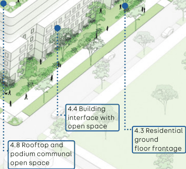
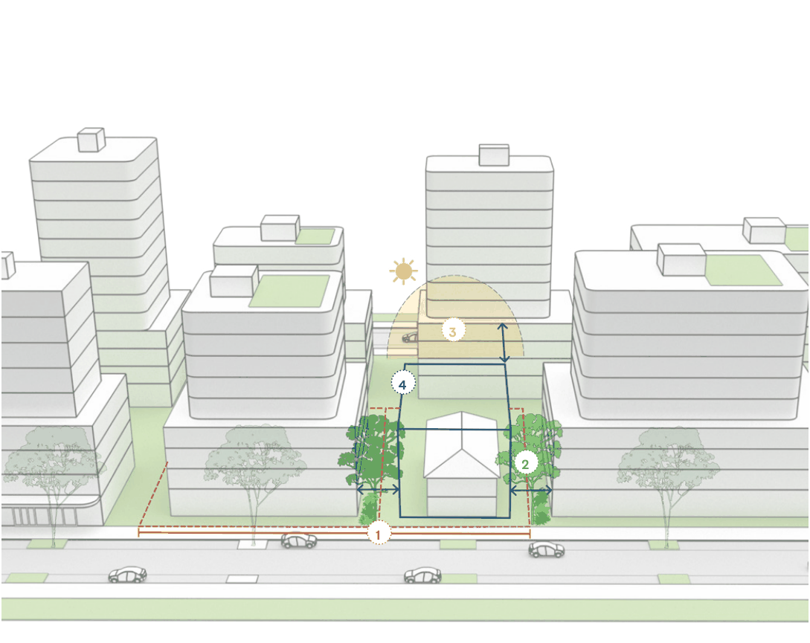

## Section 4 - Built form

Overview This section focuses on the design of built form and associated elements including open space and landscaping. The design of a building begins with consideration of the local context, including the characteristics of a character area, proximity to any heritage items, and the interface with the public domain.

Using the macro and site analysis, the design should also consider opportunities for public domain improvements and achieving excellent design outcomes for Bankstown. This section applies to all development unless there is conflict with Key Site provisions. In such instances, the Key Site section prevails to the extent of that conflict.

Figure 29. Overview of built form controls in Bankstown

City Centre

#### 4.2.7 Building

floorplates

### 4.5 Building

interface and

active frontages

4.6 Visual diversity, articulation and

fine grain buildings

### 4.1 Minimum

lot size, frontages and isolated sites

### 4.7 Materials

and finishes

4.2.3

Street wall

#### 4.2.4 Ground

setbacks

#### 4.2.6 Building

separation

distance 4.2.1 Building heights

#### 4.2.2 Floor-to-floor heights

#### 4.2.5 Upper storey

setbacks

> [Picture on page 78: a picture, saved as a picture (images/ch-06-02-bankstown-city-centre-page-78-44.gif, 150 dpi).]
> Words printed on the picture (title and legend, copied from the PDF):
> 4.4 Building
> interface with
> open space
> 4.3 Residential
> ground
> floor frontage
> 4.8 Rooftop and
> podium communal
> open space

### 4.1	 Minimum lot sizes, frontages

#### and isolated sites

#### Overview

The CBLEP 2023 sets out requirements for minimum lot size and frontage for buildings in certain zones. This is to ensure that scale of new development suits the size of the land to be developed and that new buildings in the city centre contribute to the overall desired future vision for the Centre.

#### 4.1.1	 Isolated sites Objectives

O1. 	 Development should not result in the isolation of sites and is required to clearly demonstrate that all avenues to amalgamate with the site has been undertaken by the applicant. O2. 	 To ensure that sites can be developed in a manner that aligns with the desired future character for the precinct. O3. 	 To ensure for the orderly development of land in instances where site amalgamation cannot be achieved.

> [Picture on page 79: a picture, saved as a picture (images/ch-06-02-bankstown-city-centre-page-79-24.gif, 150 dpi).]
> Words printed on the picture (title and legend, copied from the PDF):
> 3
> 4
> 2
> 1
