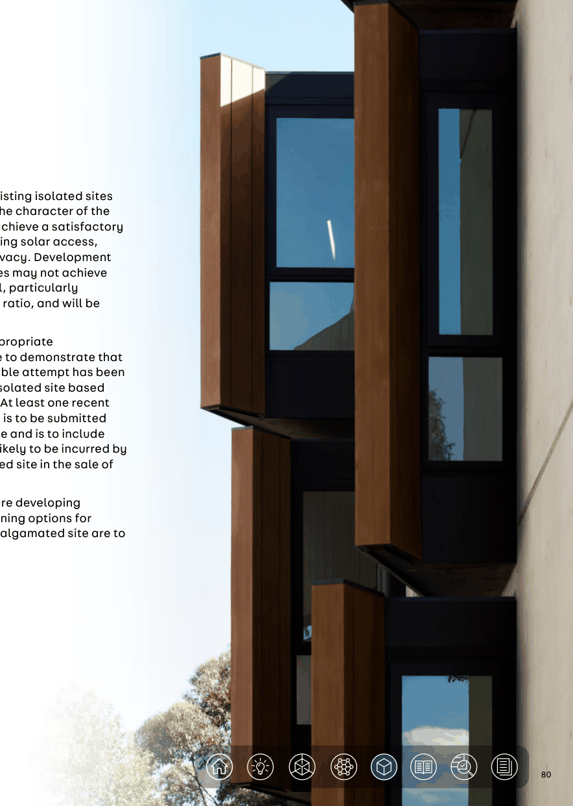
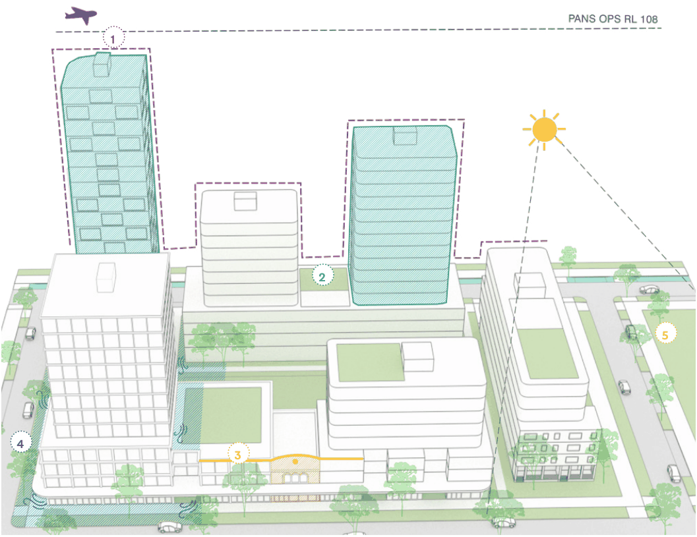
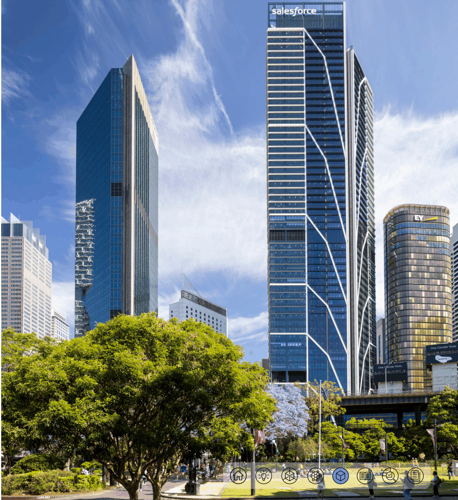
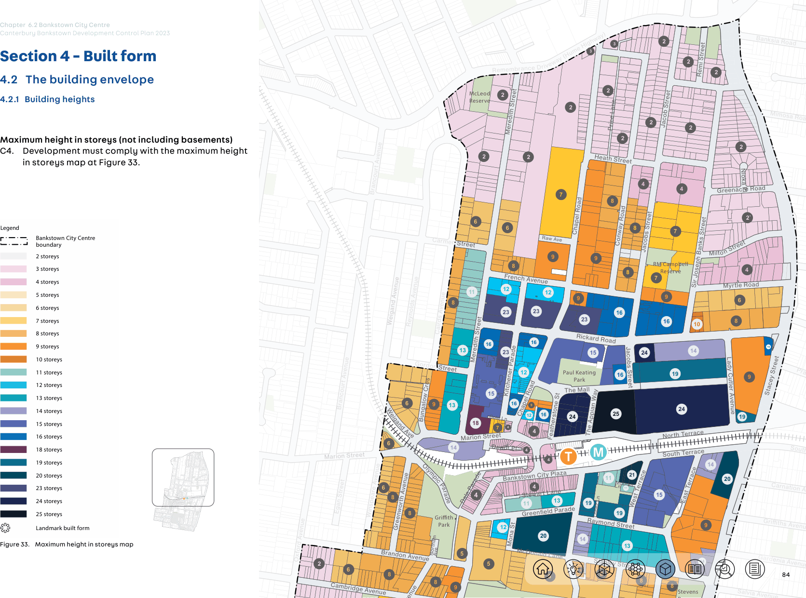
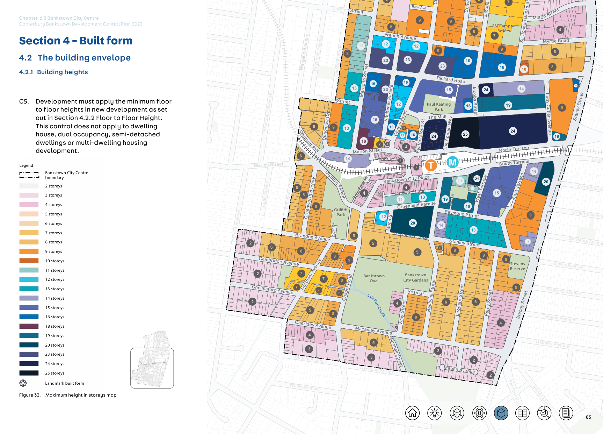
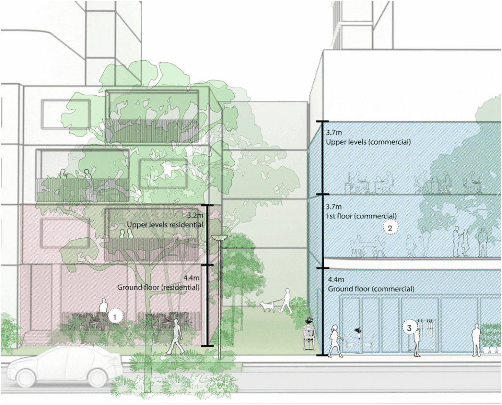
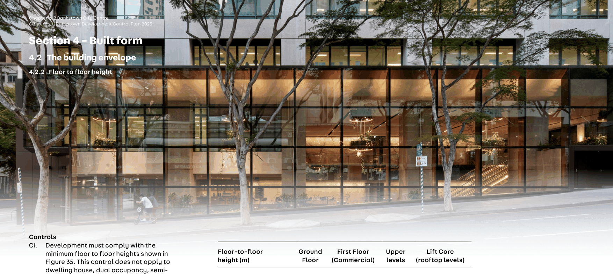
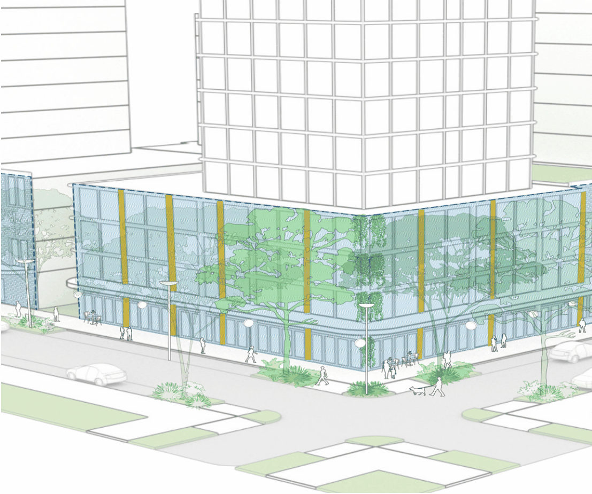

#### 4 Indicative envelope

of how isolated site

could redevelop

### 4.1   Minimum lot sizes, frontages and

#### isolated sites

#### 4.1.1   Isolated sites

#### Controls

C1. 	 Development must not result in the creation of an isolated site that could not be reasonably developed in compliance with the relevant planning controls, including the CBLEP2023 and this DCP.

C2. 	 Where amalgamation of isolated sites adjacent to the development site cannot be achieved, applicants will be required to demonstrate the following:

a) 	 That an orderly and economic development of the isolated site can be achieved

b) 	 How the isolated site it could be reasonably developed to its maximum potential within the applicable planning framework by providing an envelope for the isolated site, indicating height, setbacks, resultant site coverage (building and basement), sufficient to understand the relationship between the development site and the isolated site. A proposed site plan, floor plans and elevation drawings of sufficient detail are to be submitted.

Image - Shoutridge, Lindfield NSW, Architectus (Source: Brett Boardman)

> [Picture on page 80: a picture, saved as a picture (images/ch-06-02-bankstown-city-centre-page-80-31.gif, 150 dpi).]

C3. 	 The development of existing isolated sites

is not to detract from the character of the

streetscape and is to achieve a satisfactory

level of amenity including solar access,

visual and acoustic privacy. Development

of existing isolated sites may not achieve

the maximum potential, particularly

height and floor space ratio, and will be

assessed on merit.

C4. 	 Council will require appropriate

documentary evidence to demonstrate that

a genuine and reasonable attempt has been

made to purchase an isolated site based

on a fair market value. At least one recent

independent valuation is to be submitted

as part of that evidence and is to include

reasonable expenses likely to be incurred by

the owner of the isolated site in the sale of

the property.

C5. 	 Where adjacent sites are developing

concurrently, site planning options for

development as an amalgamated site are to

be explored.

### 4.2	 The building envelope

#### 4.2.1	Building heights

#### Objectives

O1. 	 To create a distinctive and legible urban core to define the centre of Bankstown. O2. 	 To maintain a diverse and interesting skyline through varying heights. O3. 	 To ensure adequate provision of sunlight to street level to protect the amenity of pedestrians and to ensure that street trees grow.

O4. 	 To design slender, elegant towers that can be seen ‘in the round’ (i.e. how the building is perceived from all sides). O5. 	 To ensure that buildings are designed in consideration of wind impacts on the public domain.

O6. 	 Ensure the height and scale of new development are site specific and developed in response to key features of the site and setting.

> [Picture on page 81: a picture, saved as a picture (images/ch-06-02-bankstown-city-centre-page-81-22.gif, 150 dpi).]
> Words printed on the picture (title and legend, copied from the PDF):
> 2
> 5
> 4
> 3

#### Diverse skyline of varying

heights within aeronautical limit

#### 1

#### Slender, elegant

#### towers well separated

#### 2

#### 4

Solar access for

amenity and plantings

#### 5

#### Height and scale

#### responds to character

and context

#### 3

#### Minimise wind

#### impacts for pedestrians

in public domain

Figure 31.	 Key design guidance for building heights to ensure visual interest, amenity and respond to context

### 4.2   The building envelope

#### 4.2.1   Building heights

#### Principles

P1. To ensure tall buildings express a strong architectural response defined by a clearly identified concept or idea to create a sense of place. P2. 	 Use gateway buildings to highlight the Urban Core and important street intersections. P3. 	 Concentrate tall buildings around the Metro/train station. P4. 	 To ensure that towers over 50m are setback above a podium to mitigate bulk and dominance to the street. P5. 	 Where more than two buildings are proposed on the same site, there should be a height variation between them that should be visually discernible from the surrounding street level. P6. 	 Buildings should be designed to reduce wind velocity at footpaths and public outdoor spaces. P7. Ensure wind conditions promote outdoor planting, including green roofs and other landscaping elements.

Salesforce Tower, Sydney CBD, Architectus (Source: Architectus)

> [Picture on page 82: a picture, saved as a picture (images/ch-06-02-bankstown-city-centre-page-82-28.gif, 150 dpi).]

### The building envelope

### 4.2   The building envelope

#### 4.2.1   Building heights

#### Controls

C1. 	 Buildings are to provide podiums that comply with the street wall height control in Figure 37. C2. 	 A wind impact assessment report, (also known as a Pedestrian Wind Environment Study), is required to be submitted to Council in support of a Development Application for buildings over 50m in height. The report is to consider the issues in Figure 32 and possible solutions to minimise wind impacts in the proposed building design. C3. 	 Despite the above, buildings without a podium are permitted on corner sites. In cases where a podium is not proposed, the building is to:

a)	 Be designed to mitigate down drafts to the public domain;

b)	 Be designed ‘in the round’ (i.e. consideration of the design quality in relation to how the building is viewed from within the centre, from the street level, from within other buildings and from a distance);

c)	 Provide a high quality and amenity ground plane for pedestrians at street level.

> [Picture text on page 83 is stored in the PDF without readable letters (no character map), so it could not be copied; see the original PDF.]

Figure 32.	 Tall Buidlings Design Guidelines, City of Toronto (2013) PP.65

> [Picture on page 84: a map, saved as a picture (images/ch-06-02-bankstown-city-centre-page-84-1.gif, 150 dpi); the street names and other small labels are on the picture.]
> Words printed on the picture (title and legend, copied from the PDF):
> Bankstown City Centre
> Landmark built form
> way (Hume Highway
> Sir Joseph Banks Street Myrtle Road
> Weigand Avenue Reynolds Avenue
> Lady Cutler Avenue
> The Appian Way
> t Pl 4
> Bankstown City Plaza
> e Dale Parade
> Greenfield Parade Lopez Ln

Figure 33.	 Maximum height in storeys map

### 4.2   The building envelope

#### 4.2.1   Building heights

#### Maximum height in storeys (not including basements)

C4. 	 Development must comply with the maximum height in storeys map at Figure 33.

W

h

Reserve

> [Picture on page 85: a map, saved as a picture (images/ch-06-02-bankstown-city-centre-page-85-1.gif, 150 dpi); the street names and other small labels are on the picture.]
> Words printed on the picture (title and legend, copied from the PDF):
> Bankstown City Centre
> Landmark built form
> Sir Joseph Banks Str Myrtle Road
> Weigand Avenue Reynolds Avenue
> Lady Cutler Avenue
> The Appian Way
> t Pl 4
> Bankstown City Plaza
> e Dale Parade
> Chapel Road P
> Leonard Street Percy Street
> Road James Street

Figure 33.	 Maximum height in storeys map

### 4.2   The building envelope

#### 4.2.1   Building heights

C5. 	 Development must apply the minimum floor to floor heights in new development as set out in Section 4.2.2 Floor to Floor Height. This control does not apply to dwelling house, dual occupancy, semi-detached dwellings or multi-dwelling housing development.

W

h

### 4.2   The building envelope

#### 4.2.2	 Floor to floor height

#### Objectives

O1. 	 Ensure that floor to floor heights provide adequate amenity for building occupants, support a different range of uses and allow for flexibility of uses over time. O2. 	 Ensure that above ground level parking has adequate ceiling heights to enable it to be converted to other uses over time.

> [Picture on page 86: a picture, saved as a picture (images/ch-06-02-bankstown-city-centre-page-86-11.gif, 150 dpi).]
> Words printed on the picture (title and legend, copied from the PDF):
> 1
> 2
> 3

#### Provide amenity

for building occupants

#### 1

Enable adaptivity and

#### flexibility for changing uses

#### 2

#### Consistent ground floor

#### height along active frontages

#### 3

Figure 34.	 Key design guidance for floor to floor heights to ensure amenity, flexibility and a consistent street wall.

> [Picture on page 87: a picture, saved as a picture (images/ch-06-02-bankstown-city-centre-page-87-1.gif, 150 dpi).]

Figure 35. This control does not apply to

### 4.2   The building envelope

#### 4.2.2   Floor to floor height

#### Controls

C1. 	 Development must comply with the minimum floor to floor heights shown in

dwelling house, dual occupancy, semi-detached dwellings or multi-dwelling housing development. C2. 	 It is preferred that the entire ground floor level is at one floor to floor height on active street frontage site to ensure for a consistent and attractive frontage.

| Floor-to-floor | Ground | First Floor | Upper | Lift Core |
|---|---|---|---|---|
| height (m) | Floor | (Commercial) | levels | (rooftop levels) |
| Residential | 4.4m | NA | 3.2m | 3m |
| Commercial | 4.4m | 3.7m | 3.7m | 3m |

For waste truck access – Heavy Rigid Vehicle (HRV) * 4.5m clearance for HRV *This includes ground level and podium level car parking. If a development has basement waste collection facilities, minimum clearance must comply with the controls established in Section 5.8 Waste management in Bankstown City Centre.

Figure 35.	 Minimum floor-to-floor heights

Image - No.1 Anzac Square, Brisbane, QLD, Architectus (Source: Christopher Frederick Jones)

### 4.2   The building envelope

#### 4.2.3	 Street wall

Together with the public domain, the street wall with active ground floor frontage, is the built element that shapes the way most of the city is experience.

#### Objectives

O1. 	 Define the space of the street and public spaces and articulate edges. O2. 	 Design the street wall to provides appropriate scale, material quality and detail.

O3. 	 To ensure that the visual relationship between the street and public spaces are reinforced.

O4. 	 Design the street wall to achieve fine grain modulation to create visual interest and variety while ensuring for consistency in streetscape character.

O5. 	 To create a vertical rhythm and visual interest to reduce the scale of building mass.

O6. 	 Encourage walkability by locating active uses in streets.

O7. 	 Minimise large expanses of inactive frontage.

> [Picture on page 88: a picture, saved as a picture (images/ch-06-02-bankstown-city-centre-page-88-27.gif, 150 dpi).]

#### Define the space

and articulate edges

#### 1

#### Fine grain modulation

and a vertical rhythm

#### 2
