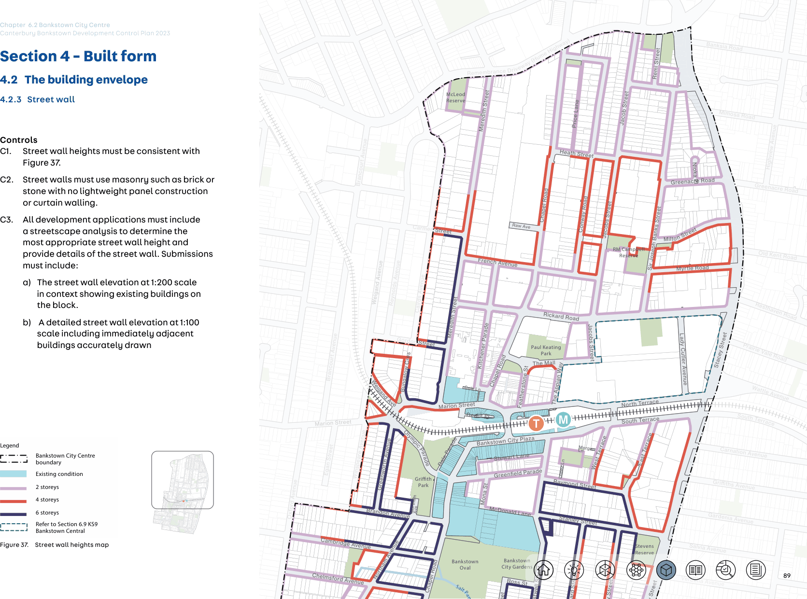
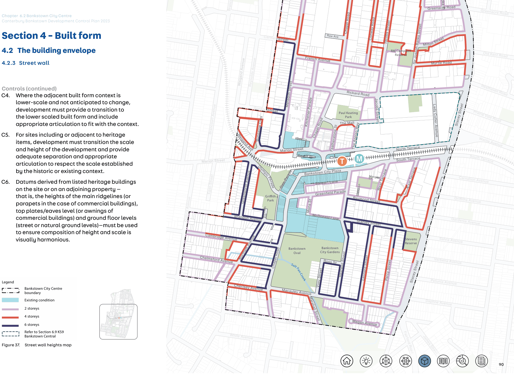
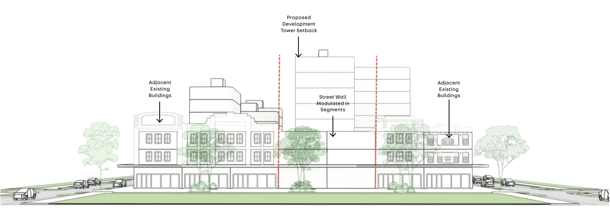
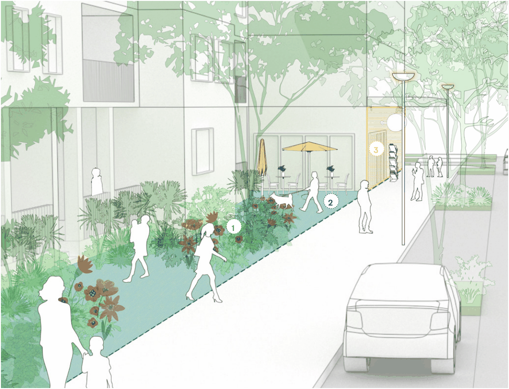
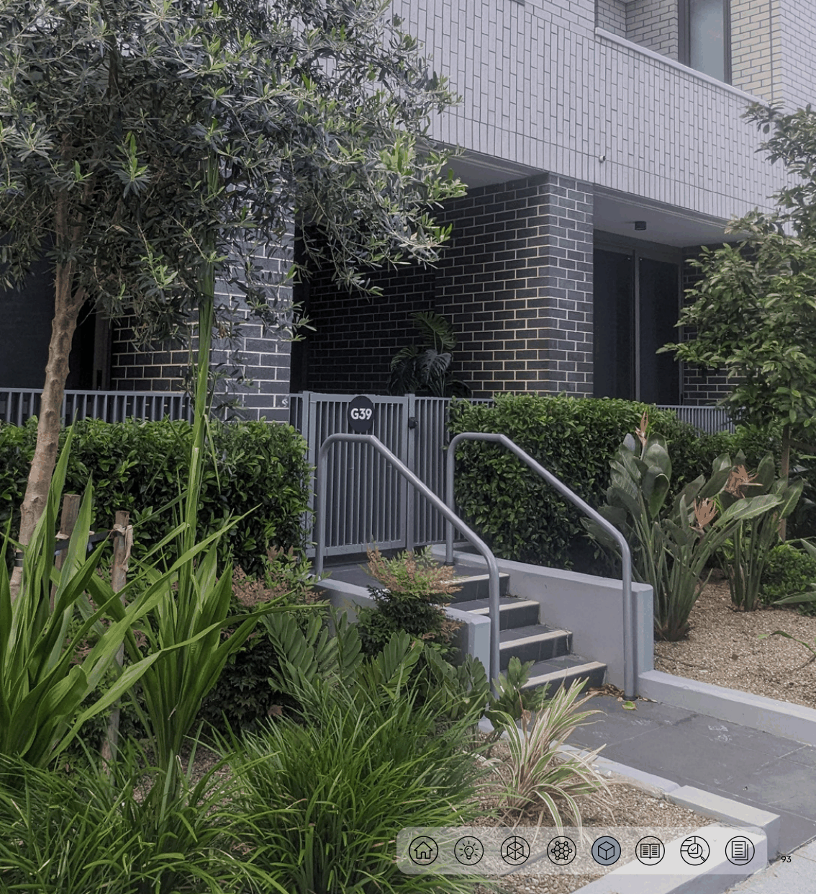
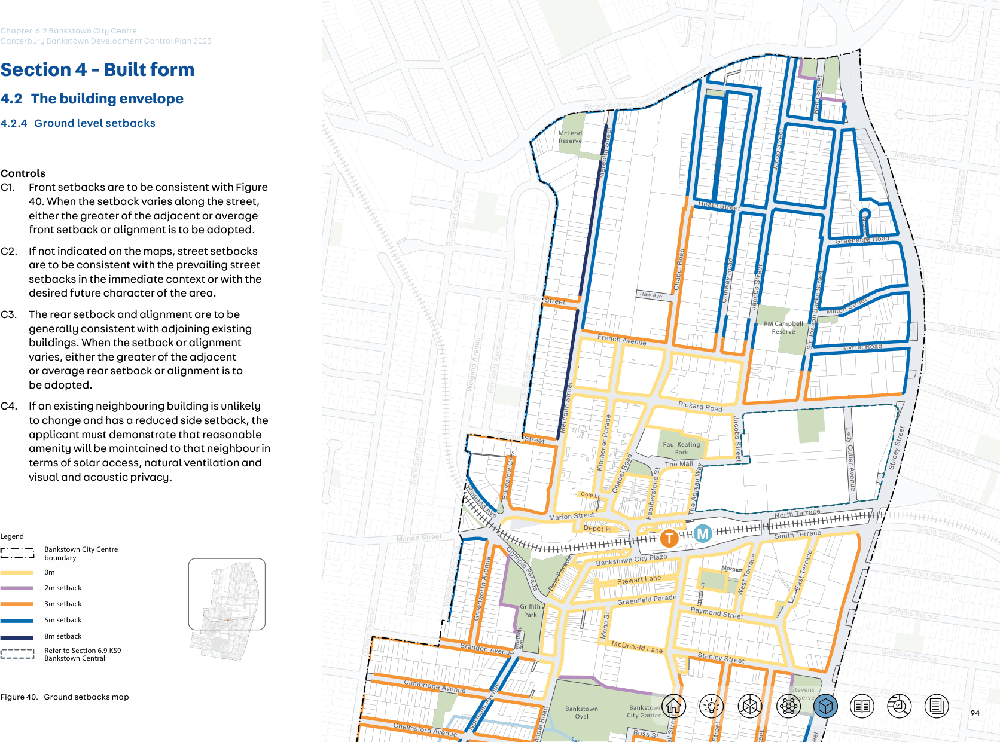
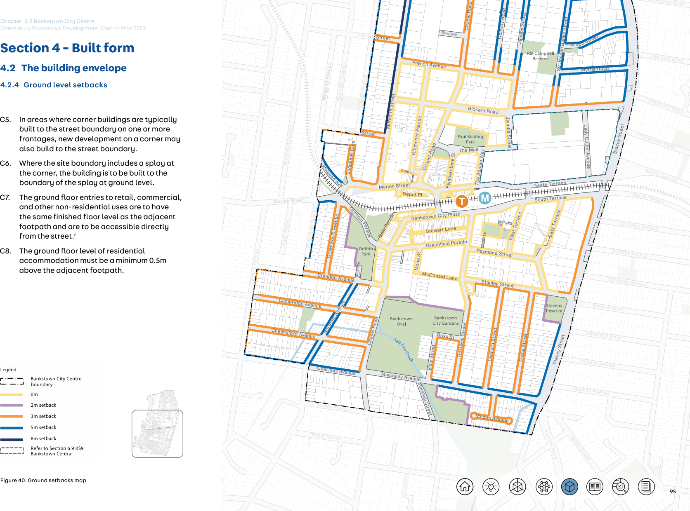
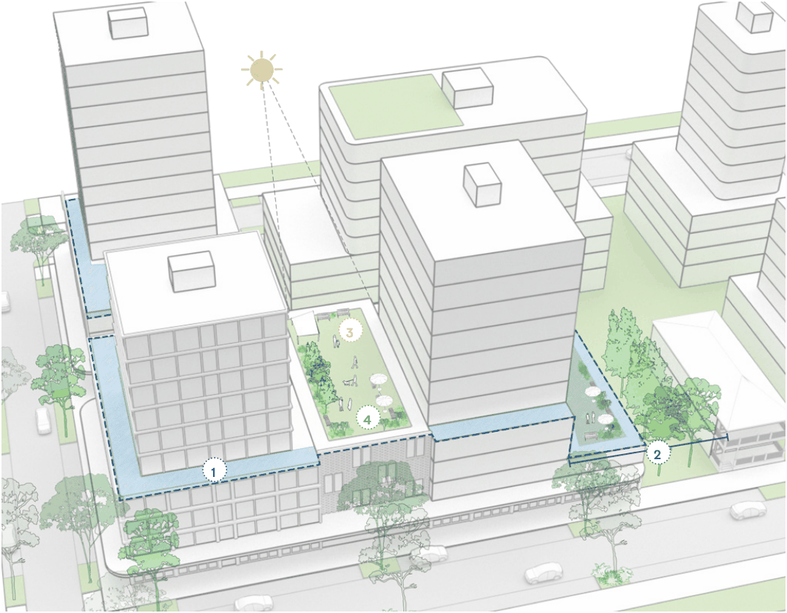

#### 3 Appropriate scale,

#### detail and character

that responds to its context

Figure 36.	 Key design guidance for street walls to ensure appropriate scale, definition, articulation and fine grain

> [Picture on page 89: a map, saved as a picture (images/ch-06-02-bankstown-city-centre-page-89-1.gif, 150 dpi); the street names and other small labels are on the picture.]
> Words printed on the picture (title and legend, copied from the PDF):
> scale including immediately adjacent
> buildings accurately drawn
> Bankstown City Centre
> Refer to Section 6.9 KS9
> way (Hume Highway
> Old Kent Road
> Sir Joseph Banks Street Myrtle Road
> Weigand Avenue Reynolds Avenue
> Prairie Vale Road
> Lady Cutler Avenue
> The Appian Way
> Bankstown City Plaza
> e Dale Parade
> Greenfield Parade Lopez Ln
> Chapel Road P

Figure 37.

Figure 37.	 Street wall heights map

### 4.2   The building envelope

#### 4.2.3   Street wall

#### Controls

C1. Street wall heights must be consistent with

C2. 	 Street walls must use masonry such as brick or stone with no lightweight panel construction or curtain walling.

C3. 	 All development applications must include a streetscape analysis to determine the most appropriate street wall height and provide details of the street wall. Submissions must include:

a) 	 The street wall elevation at 1:200 scale in context showing existing buildings on the block.

b) 	 A detailed street wall elevation at 1:100

n

### 4.2   The building envelope

#### 4.2.3   Street wall

#### Controls (continued)

C4. 	 Where the adjacent built form context is lower-scale and not anticipated to change, development must provide a transition to the lower scaled built form and include appropriate articulation to fit with the context. C5. 	 For sites including or adjacent to heritage items, development must transition the scale and height of the development and provide adequate separation and appropriate articulation to respect the scale established by the historic or existing context. C6. 	 Datums derived from listed heritage buildings on the site or on an adjoining property — that is, the heights of the main ridgelines (or parapets in the case of commercial buildings), top plates/eaves level (or awnings of commercial buildings) and ground floor levels (street or natural ground levels)—must be used to ensure composition of height and scale is visually harmonious.

H

> [Picture on page 90: a map, saved as a picture (images/ch-06-02-bankstown-city-centre-page-90-25.gif, 150 dpi); the street names and other small labels are on the picture.]
> Words printed on the picture (title and legend, copied from the PDF):
> Bankstown City Centre
> Refer to Section 6.9 KS9
> Old Kent Road
> Sir Joseph Banks Street Myrtle Road
> Weigand Avenue Reynolds Avenue
> Prairie Vale Road
> Lady Cutler Avenue
> The Appian Way
> Bankstown City Plaza
> e Dale Parade
> Greenfield Parade Lopez Ln
> Chapel Road P
> Leonard Street Percy Street
> Road James Street

Figure 37. 	 Street wall heights map

### 4.2   The building envelope

#### 4.2.3   Street wall

> [Picture on page 91: a map, saved as a picture (images/ch-06-02-bankstown-city-centre-page-91-3.gif, 150 dpi); the street names and other small labels are on the picture.]

Figure 38.	 A street wall elevation is to be prepared to demonstrate how the proposed development fits with the existing neighbouring buildings in the block.

### 4.2   The building envelope

#### 4.2.4 Ground level setbacks

#### Objectives

O1. 	 To reinforce the clear spatial definition of streets and public spaces. O2. 	 To maximise the impact of active frontage in the city centre.

O3. 	 To create a clear delineation between public and private space.

O4. 	 To allow some flexibility in proposed setbacks in response to context and where impacts on surrounding properties and the public domain are minimised. O5. 	 To reinforce significant elements of the centre including public spaces, monuments and landscape elements. O6. 	 To provide setbacks in residential areas for deep soil landscape and tree canopy that contributes to the public domain and provides privacy to residents. O7. 	 To ensure setbacks maintain the setting of heritage items.

O8. 	 To encourage new building setbacks where appropriate to reinforce a desired character area.

> [Picture on page 92: a picture, saved as a picture (images/ch-06-02-bankstown-city-centre-page-92-26.gif, 150 dpi).]
> Words printed on the picture (title and legend, copied from the PDF):
> 1
> 3
> 2

#### Landscape setbacks

for plantings and visual

privacy in residential areas

#### 1

#### 2

#### Setbacks reflect

#### context  and delineate

privacy and public space

Urban street edge with

active frontages in core

#### 3

Figure 39.	 Key design guidance for ground level setbacks to provide amenity, contribute to deep soil and planting, provide activation and respond to context.

### 4.2   The building envelope

#### 4.2.4   Ground level setbacks

#### Principles

P1. Reinforce the urban core of Bankstown by creating a defined urban street edge. P2. 	 Existing and proposed street canopy should be contained within setbacks where possible, especially outside of the urban core. P3. 	 Ensure setbacks enable built form to frame and define open spaces. P4. 	 Ensure appropriate amenity and sunlight to streets and adjoining properties is maintained. P5. 	 To allow flexibility in response to context only where amenity and environmental impacts are minimal.

Image - Fuse Street, Zetland, NSW (Source: Architectus)

> [Picture on page 93: a picture, saved as a picture (images/ch-06-02-bankstown-city-centre-page-93-19.gif, 150 dpi).]

> [Picture on page 94: a map, saved as a picture (images/ch-06-02-bankstown-city-centre-page-94-1.gif, 150 dpi); the street names and other small labels are on the picture.]
> Words printed on the picture (title and legend, copied from the PDF):
> Bankstown City Centre
> Refer to Section 6.9 KS9
> way (Hume Highway
> Old Kent Road
> Sir Joseph Banks Street Myrtle Road
> Weigand Avenue Reynolds Avenue
> Prairie Vale Road
> Lady Cutler Avenue
> The Appian Way
> Bankstown City Plaza
> e Dale Parade
> Greenfield Parade Lopez Ln
> ell Street Street

Figure 40.	 Ground setbacks map

### 4.2   The building envelope

#### 4.2.4   Ground level setbacks

#### Controls

C1. Front setbacks are to be consistent with Figure

40\. When the setback varies along the street, either the greater of the adjacent or average front setback or alignment is to be adopted. C2. 	 If not indicated on the maps, street setbacks are to be consistent with the prevailing street setbacks in the immediate context or with the desired future character of the area. C3. 	 The rear setback and alignment are to be generally consistent with adjoining existing buildings. When the setback or alignment varies, either the greater of the adjacent or average rear setback or alignment is to be adopted.

C4. 	 If an existing neighbouring building is unlikely to change and has a reduced side setback, the applicant must demonstrate that reasonable amenity will be maintained to that neighbour in terms of solar access, natural ventilation and visual and acoustic privacy.

lt

### 4.2   The building envelope

#### 4.2.4   Ground level setbacks

C5. 	 In areas where corner buildings are typically built to the street boundary on one or more frontages, new development on a corner may also build to the street boundary. C6. 	 Where the site boundary includes a splay at the corner, the building is to be built to the boundary of the splay at ground level. C7. The ground floor entries to retail, commercial, and other non-residential uses are to have the same finished floor level as the adjacent footpath and are to be accessible directly from the street.’

C8. 	 The ground floor level of residential accommodation must be a minimum 0.5m above the adjacent footpath.

B

> [Picture on page 95: a map, saved as a picture (images/ch-06-02-bankstown-city-centre-page-95-19.gif, 150 dpi); the street names and other small labels are on the picture.]
> Words printed on the picture (title and legend, copied from the PDF):
> Bankstown City Centre
> Refer to Section 6.9 KS9
> Old Kent Road
> Sir Joseph Banks Street Myrtle Road
> Weigand Avenue Reynolds Avenue
> Prairie Vale Road
> Lady Cutler Avenue
> The Appian Way
> Bankstown City Plaza
> e Dale Parade
> Chapel Road P
> Leonard Street Percy Street
> Road James Street

Figure 40. Ground setbacks map

### 4.2   The building envelope

#### 4.2.4	 Upper storey setbacks

#### Objectives

O1. 	 Ensure towers are setback above street walls to reinforce the scale of streets and mitigate down drafts to pedestrians.

O2. 	 Provide upper storey setbacks to ensure tall towers do not dominate the public domain. O3. 	 Ensure that setbacks allow for the enjoyment of sun and daylight within city spaces and provide for views of the sky.

O4. 	 Provide for appropriate transition and sympathetic response to lower-scaled buildings and significant elements within the local context.

O5. 	 Create opportunities for tree canopy, planting and outdoor open space on podiums.

> [Picture on page 96: a picture, saved as a picture (images/ch-06-02-bankstown-city-centre-page-96-18.gif, 150 dpi).]
> Words printed on the picture (title and legend, copied from the PDF):
> 3
> 4
> 1
> 2

#### Towers setback

above podiums

provide human scale

#### 1

#### 2

#### Maximise sun light

and views to the sky

#### 3

#### Provide

transitions to

respect context

Figure 41.	 Key design guidance for setbacks above street walls to provide a human scale, appropriate height transitions, ensure amenity and allow for podium outdoor activation.
