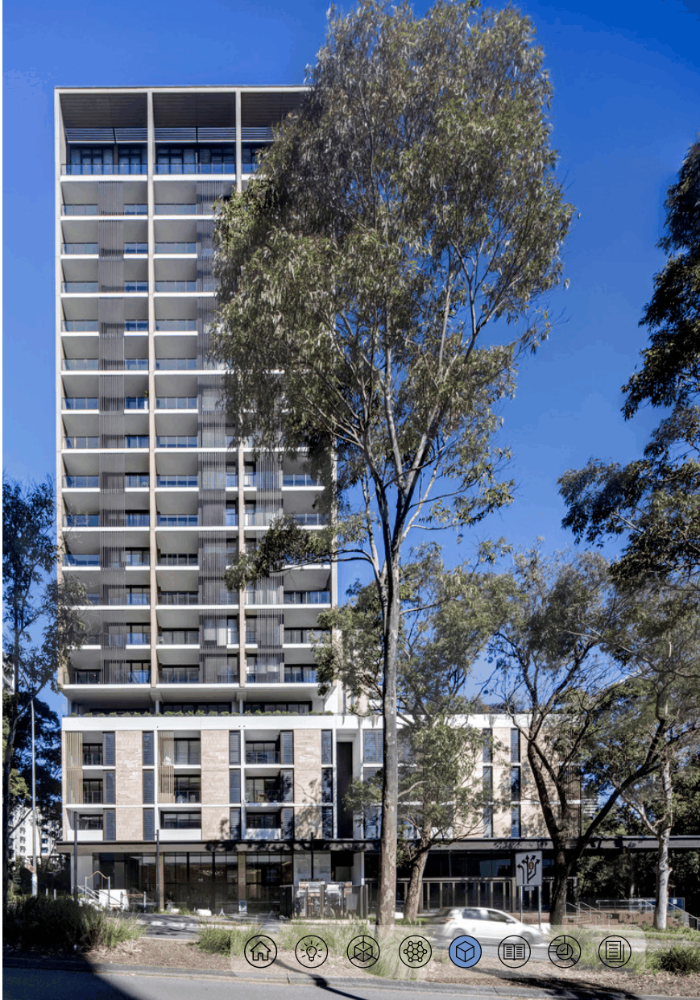
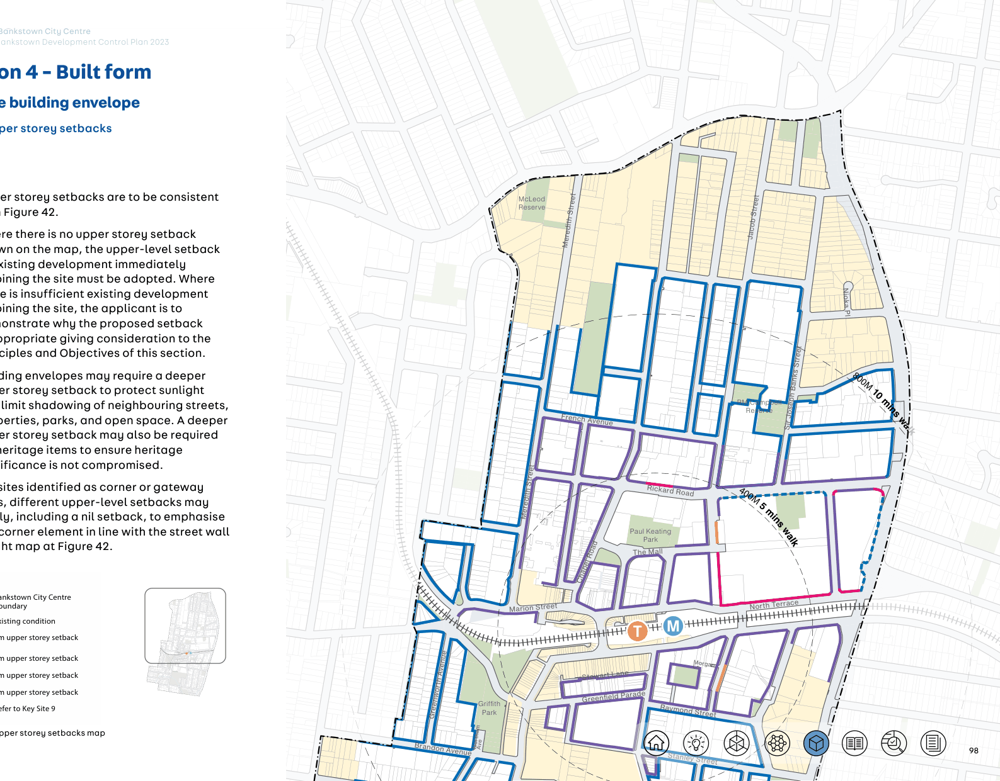
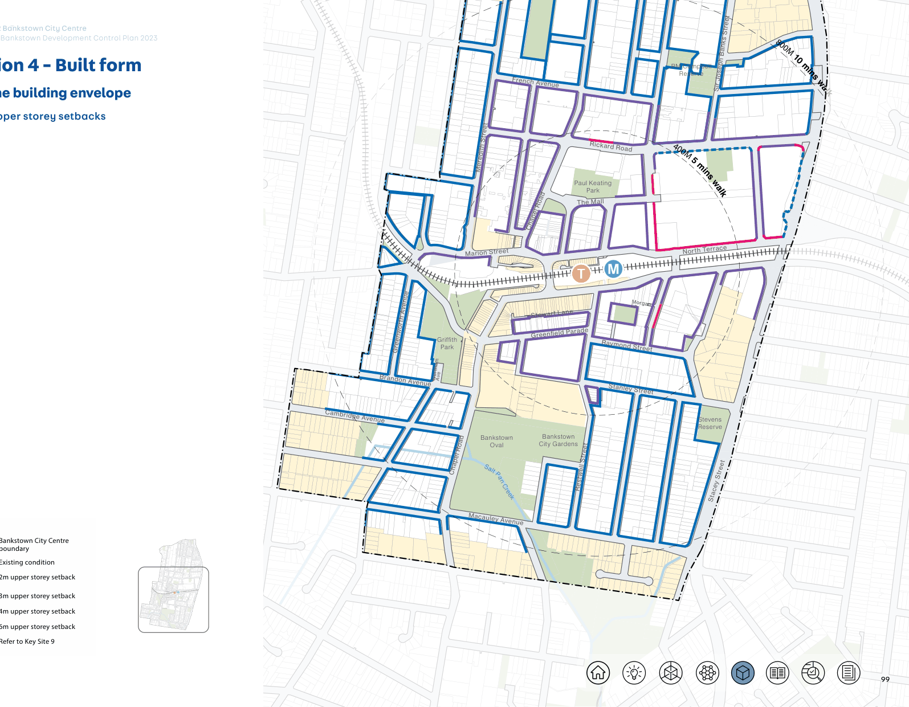
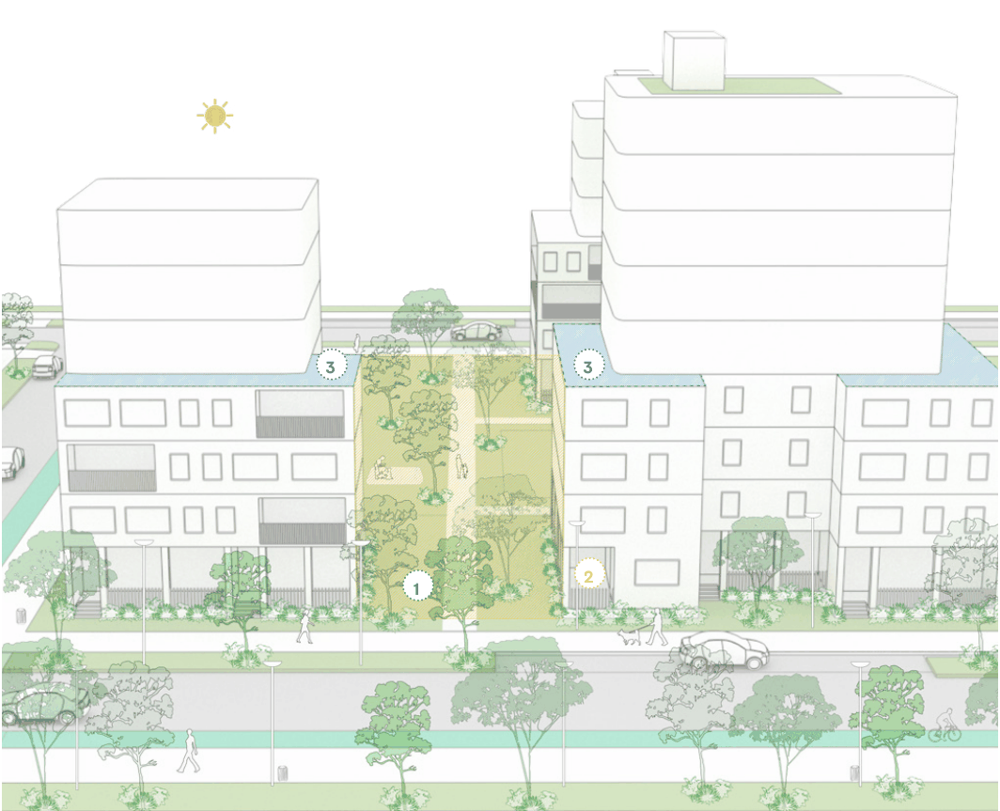

#### 4 Activate podiums

for outdoor open space and plantings

### 4.2   The building envelope

#### 4.2.4   Upper storey setbacks

#### Principles

P1. Clearly delineate street wall height to create a visual break to taller building elements. P2. 	 Minimise wind down drafts and corner effects that accelerate and intensify wind speed at ground level public spaces and ensure the Lawson Pedestrian Wind Criteria for safety and comfort are met. P3. 	 Encourage green cover and useable spaces on podiums and rooftops. P4. 	 Promote generous commercial, communal and residential balconies on upper storey setbacks. P5. 	 Buildings above the podium are setback from the street in a way that is sympathetic to surrounding development and does not detract from the human scale of the streetscape.

Image - Natura, Macquarie Park, NSW, Architectus (Source: Brett Boardman)

> [Picture on page 97: a picture, saved as a picture (images/ch-06-02-bankstown-city-centre-page-97-20.gif, 150 dpi).]

> [Picture on page 98: a map, saved as a picture (images/ch-06-02-bankstown-city-centre-page-98-1.gif, 150 dpi); the street names and other small labels are on the picture.]
> Words printed on the picture (title and legend, copied from the PDF):
> with Figure 42.
> Bankstown City Centre
> 2m upper storey setback
> 3m upper storey setback
> 4m upper storey setback
> 6m upper storey setback
> Refer to Key Site 9
> Sir Joseph Banks Street

Figure 42.	 Upper storey setbacks map

### Built form

### 4.2   The building envelope

#### 4.2.4   Upper storey setbacks

#### Controls

C1. 	 Upper storey setbacks are to be consistent

C2. 	 Where there is no upper storey setback shown on the map, the upper-level setback of existing development immediately adjoining the site must be adopted. Where there is insufficient existing development adjoining the site, the applicant is to demonstrate why the proposed setback is appropriate giving consideration to the Principles and Objectives of this section. C3. 	 Building envelopes may require a deeper upper storey setback to protect sunlight and limit shadowing of neighbouring streets, properties, parks, and open space. A deeper upper storey setback may also be required for heritage items to ensure heritage significance is not compromised. C4. 	 For sites identified as corner or gateway sites, different upper-level setbacks may apply, including a nil setback, to emphasise the corner element in line with the street wall height map at Figure 42.

Legend

Ca

> [Picture on page 99: a map, saved as a picture (images/ch-06-02-bankstown-city-centre-page-99-1.gif, 150 dpi); the street names and other small labels are on the picture.]
> Words printed on the picture (title and legend, copied from the PDF):
> Bankstown City Centre
> 2m upper storey setback
> 3m upper storey setback
> 4m upper storey setback
> 6m upper storey setback
> Refer to Key Site 9
> Chapel Road P
> Sir Joseph Banks Street

### Built form

### 4.2   The building envelope

#### 4.2.4   Upper storey setbacks

Legend

### 4.2   The building envelope

#### 4.2.5	 Building separation distance

#### Objectives

O1. 	 Protect the amenity of streets and public places by providing a healthy environment for street trees and allowing adequate daylight and views to the sky. O2. 	 Ensure the separation distance adequately respond to the setting of adjoining sites, in particular, narrow sites.

O3. 	 Provide adequate privacy, access to light, air and outlook for the occupants of buildings, neighbouring properties and future buildings.

O4. 	 To ensure sunlight penetrates through to street level to protect the amenity of pedestrians and to ensure that street trees grow.

O5. 	 Ensure development does not unfairly limit the re-development potential of adjoining sites in the future.

O6. 	 Maintain adequate separation distances between buildings on the same site to protect access to sunlight and sky views and improve air circulation between buildings

> [Picture on page 100: a picture, saved as a picture (images/ch-06-02-bankstown-city-centre-page-100-26.gif, 150 dpi).]
> Words printed on the picture (title and legend, copied from the PDF):
> 3
> 3
> 2
> 1

Ensure sunlight for

amenity and plantings

#### 1
