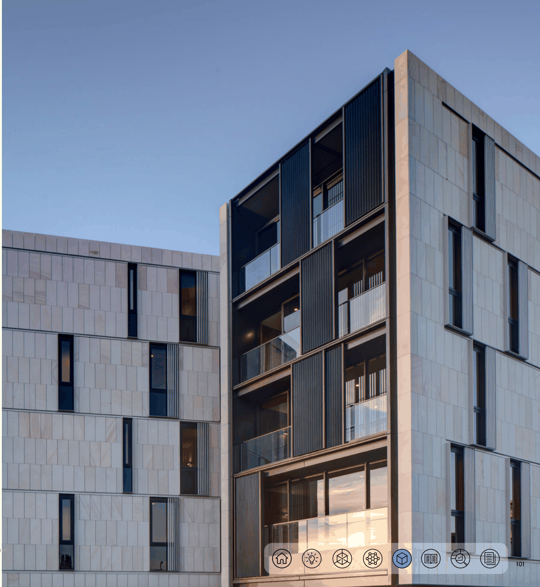
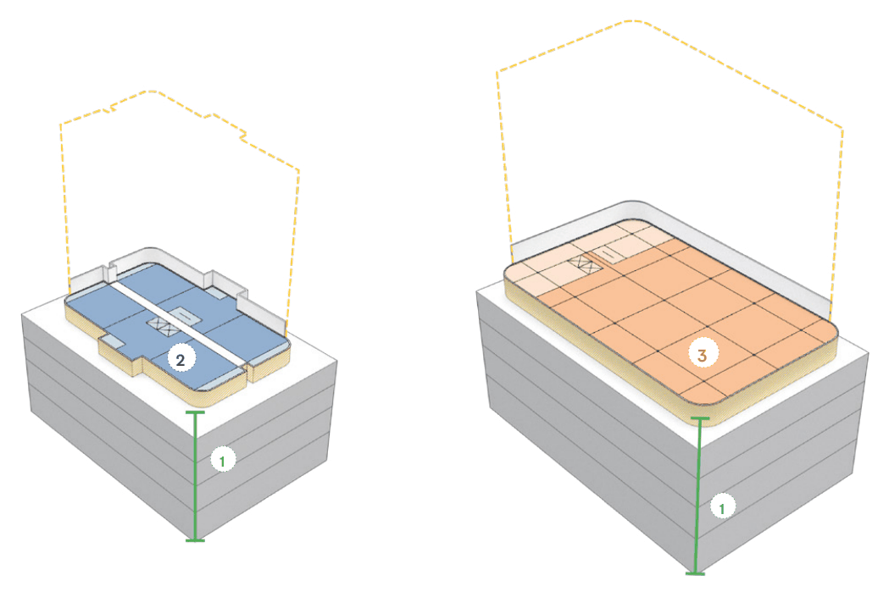

#### 3 Appropriate upper

#### setbacks to provide

desired building separations

Figure 43.	 Key design guidance for building separation to ensure amenity, visual privacy, views, air circulation and sunlight

### 4.2   The building envelope

#### 4.2.5   Building separation distance

#### Controls

C1. 	 Minimum building separation distances for non-residential uses are outlined in Figure 44. C2. 	 Minimum building separation distances for residential uses are outlined in Figure 45. C3. 	 For non-residential uses at the ground level that are not required that are not shown in the Active Frontages map in Figure 64, an analysis of existing and likely future context must be submitted by the applicant to determine the most appropriate separation distances between buildings. Separation Distances will be determined on site-by-site basis in accordance with the following matters:

a) 	 Site condition

b) 	 Lot size and frontage width

c) 	 The immediate surrounding context

d) 	 Building Envelope

e) 	 Proposed Use

f) 	 Access and servicing requirements C4. 	 Blank side walls are not supported. Side walls must be articulated using quality street art reflecting local identity, corbelling of brickwork or a change in building material.

Image - Harbord Diggers Redevelopment, Freshwater, NSW(Source: Brett Boardman)

> [Picture on page 101: a picture, saved as a picture (images/ch-06-02-bankstown-city-centre-page-101-33.gif, 150 dpi).]

### 4.2   The building envelope

#### 4.2.5   Building separation distance

#### Controls (continued)

C5. 	 Separation is to be measured to the outside face of buildings, including balconies, vertical and horizontal circulation and external walls

C6. 	 Separation distances must be apportioned equally between adjacent sites to determine side and rear boundary setbacks. C7. 	 In the case where a development results in an isolated site, the development may need to provide greater separation to ensure the isolated site can be reasonably developed. C8. 	 Only one step in the built form is permissible. If a building is > 8 storeys, then it is required to provide the 9+ storey building separation distance for that use from 5 storeys. C9. 	 Separation is to be measured to the outside face of buildings, including balconies, vertical and horizontal circulation and external walls

C10. 	 Separation distances must be apportioned equally between adjacent sites to determine side and rear boundary setbacks. C11. 	 In the case where a development results in an isolated site, the development may need to provide greater separation to ensure the isolated site can be reasonably developed. C12. 	 Only one step in the built form is permissible. If a building is > 8 storeys, then it is required to provide the 9+ storey building separation distance for that use from 5 storeys.

| Storeys | Up to 4 storeys | 5-8 storeys | 9+ storeys |
|---|---|---|---|
| Non-residential uses | 3m | 6m | 9m (or 12m for tall buildings of 50m or more) |
| Commercial developments | 6m | 9m | 12m |
| adjoining single purpose |  |  |  |
| residential uses* |  |  |  |
| Service plant areas adjoining | 3m | 4.5m | 6m |
| residential uses |  |  |  |

\*Commercial developments include business premises, childcare centres, educational establishments and places of worship. Single purpose residential uses include residential flat buildings, boarding houses, multi-dwelling housing and single dwelling houses.

Figure 44.	 Minimum building separation for non-residential uses

| Storeys | Up to 4 storeys | 5-8 storeys | 9+ storeys |
|---|---|---|---|
| Residential (between | 12m | 18m* | 24m |
| habitable rooms) |  |  |  |
| Residential (between habitable | 9m | 12m | 18m |
| and non-habitable rooms) |  |  |  |

\*Where the proposed development is above 4 storeys, the 18m separation between neighbouring buildings may be reduced if it can be demonstrated there is negligible impacts to an existing adjoining properties privacy and sunlight. If it is a new proposal within an area that will change, the proposal must demonstrate that the ADG privacy guidelines are met.

Figure 45.	 Minimum building separation for residential uses

### 4.2   The building envelope

#### 4.2.6	   Building floorplates

#### Objectives

O1. 	 To allow for views to the sky from streets and lanes.

O2. 	 To protect the amenity of streets and public places by ensuring appropriate levels of daylight and sunlight in streets, lanes, public places and for street trees. O3. 	 To ensure floor plates are limited to a certain area and configuration in accordance with use.

O4. 	 To ensure that towers are of slender proportions to achieve an elegant built form. O5. 	 To mitigate the potential adverse effects that bulky buildings may have on the public domain including overshadowing and urban heat.

O6. 	 To achieve living and working environments with good internal amenity and minimise the need for artificial cooling and heating. O7. 	 Commercial premises tall buildings must prioritise daylight access and minimise solar heat load.

O8. 	 Shallow floorplates and glazing to south facade is favourable for providing excellent natural daylight.

> [Picture on page 103: a picture, saved as a picture (images/ch-06-02-bankstown-city-centre-page-103-28.gif, 150 dpi).]
> Words printed on the picture (title and legend, copied from the PDF):
> 2
> 1
> 1
