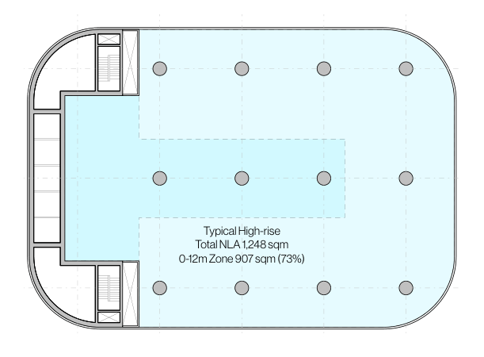
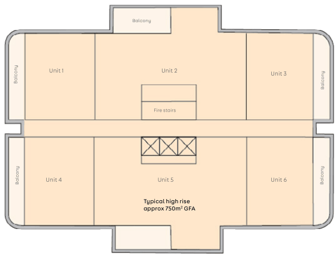
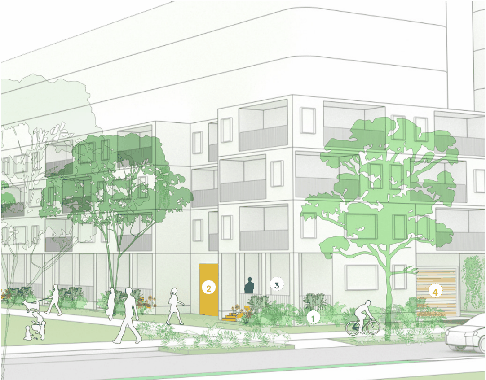

#### 3 A-grade towers for

commercial buildings with a maximum of 1.500m2 of GFA.

Figure 46.	 Floorplate controls for towers seek to ensure good functionality, circulation, amenity, solar access and maximise views to the sky

### 4.2   The building envelope

#### 4.2.6   Building floorplates

> [Picture on page 104: a picture, saved as a picture (images/ch-06-02-bankstown-city-centre-page-104-3.gif, 150 dpi).]
> Words printed on the picture (title and legend, copied from the PDF):
> Typical High-rise
> Total NLA 1,248 sqm
> 0-12m Zone 907 sqm (73%)

Figure 47.	 Example of floorplate for an A grade commercial building

#### Controls

C1. 	 The maximum floor plate area for any levels above 25m above ground level must be:

a) 	 800m2 GFA for residential flat buildings, residential accommodation within shop top housing, serviced apartments and self contained hotels.

b) 	 1,500m2 GFA for commercial.

> [Picture on page 104: a map, saved as a picture (images/ch-06-02-bankstown-city-centre-page-104-13.gif, 150 dpi); the street names and other small labels are on the picture.]
> Words printed on the picture (title and legend, copied from the PDF):
> Typical high rise
> approx 750m2 GFA

Figure 48.	 Example of a floorplate for a residential tower

C2. 	 Larger floor plates that exceed the above

may be considered by Council where the

proposal demonstrates consistency with the

Objectives and exhibits Design Excellence,

in accordance with Clause 6.15 of the CB LEP

2023, where applicable.

### 4.3	 Residential ground floor frontage

#### Objectives

O1. 	 Establish new canopy trees within setbacks that contribute to the character of the street and provide residents privacy. O2. 	 Appropriately define and design the street edge and setback area to achieve amenity and privacy for residents as well as engagement with and passive surveillance of the street for safety.

Principles

P1. 	 Residential buildings must be set back from the street boundary to provide amenity for ground floor residents, a landscaped setting for buildings and a landscaped character for the street.

P2. 	The area between the facade and the street boundary must receive attention in the design of the facade and in its material quality.

> [Picture on page 105: a picture, saved as a picture (images/ch-06-02-bankstown-city-centre-page-105-21.gif, 150 dpi).]
> Words printed on the picture (title and legend, copied from the PDF):
> 2
> 3
> 1
