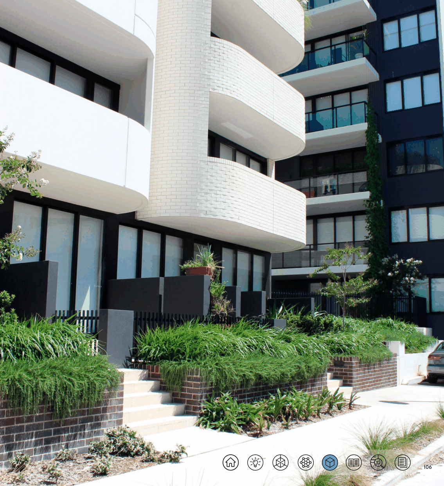
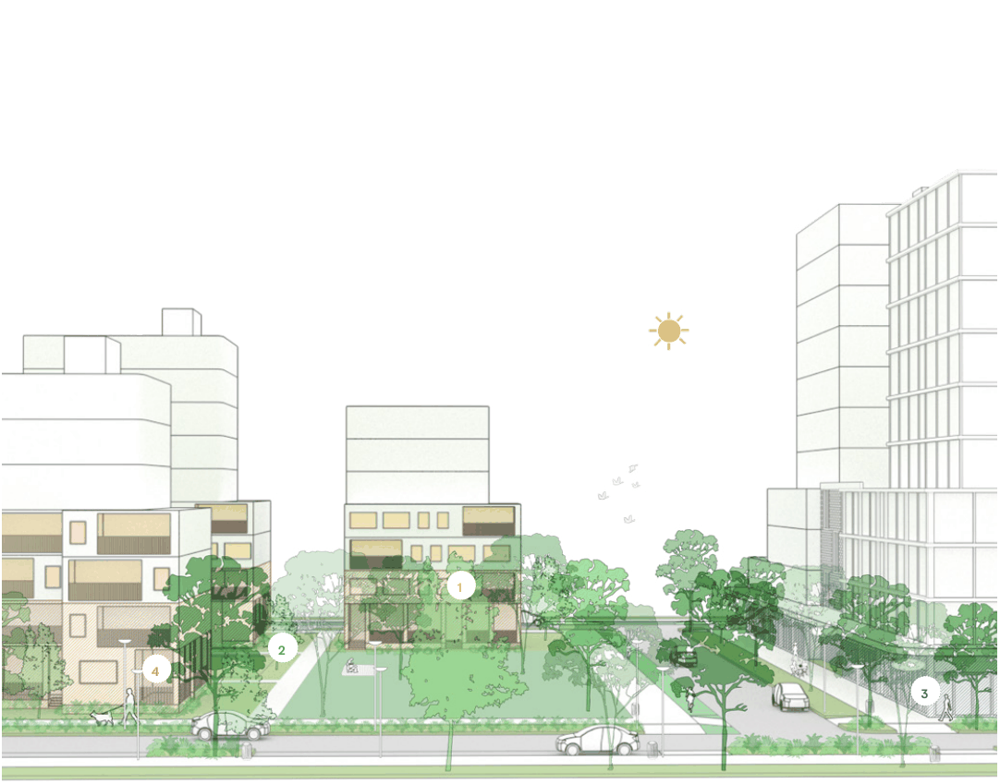

#### 4 Servicing and

basement access

screened and inset

behind setbacks

Figure 49.	 Key design guidance for the residential ground floor frontage to provide amenity, landscaping, visual privacy, passive surveillance and access.

### 4.3   Residential ground floor frontage

#### Controls

C1. 	 Ground setbacks are to comply with the minimum building setbacks in Figure 40. C2. 	 A 1 metre articulation zone is permitted within the minimum ground floor setback, in which building facade elements may occupy a maximum of one third of the area of the area of the facade frontage. Services or lift shafts are not permitted in the articulation zone. C3. 	 In locations where a nil setback is not required basements must be setback 3 metres from the street boundary to allow for deep soil areas and planting of canopy trees. C4. 	 All services must be integrated into the design of the building. C5. 	 Services must not be located within landscaped areas and must be appropriately screened. Refer to Section 4.6 Visual diversity, articulation and fine grain of this DCP, for examples of high quality screening.

Image - Eve Street, Erskineville (Source: Architectus)

> [Picture on page 106: a picture, saved as a picture (images/ch-06-02-bankstown-city-centre-page-106-26.gif, 150 dpi).]

### 4.4	 Building interface with open space

#### Objectives:

O1. 	 To maximise pedestrian connections at the lower levels of buildings to public parks and open spaces.

O2. 	 To reinforce connections with adjoining public open space.

O3. 	 To encourage active recreation in proximity to density.

O4. 	 To build on existing amenity and maximise accessibility and usability of existing spaces and infrastructure.

O5. 	 To ensure that park facilities and grounds are safe for all ages, genders and different groups.

O6. 	 To enhance vegetation and deep soil throughout parks and provide new publicly and privately accessible open space as heat sinks for the centre.

> [Picture on page 107: a picture, saved as a picture (images/ch-06-02-bankstown-city-centre-page-107-20.gif, 150 dpi).]
> Words printed on the picture (title and legend, copied from the PDF):
> 4
> 1
> 2
> 3
