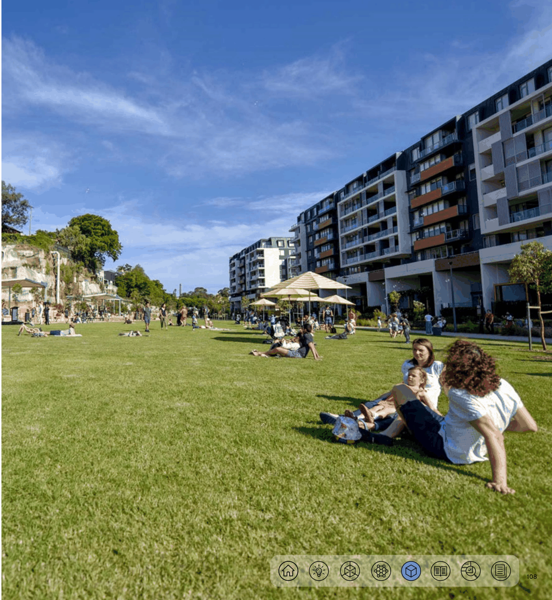
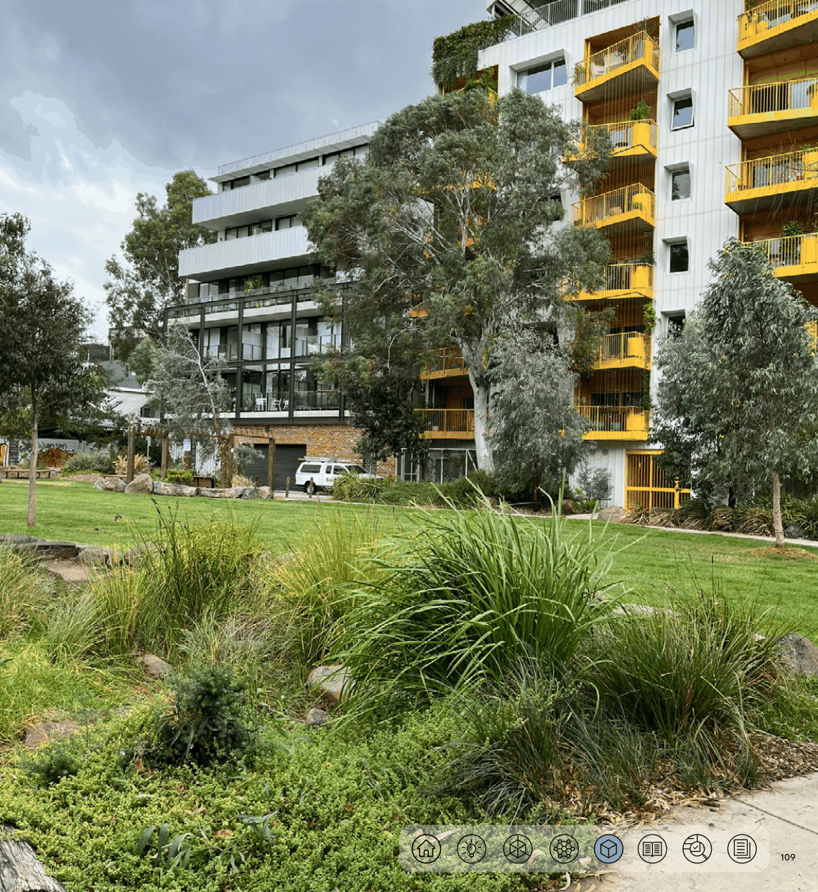
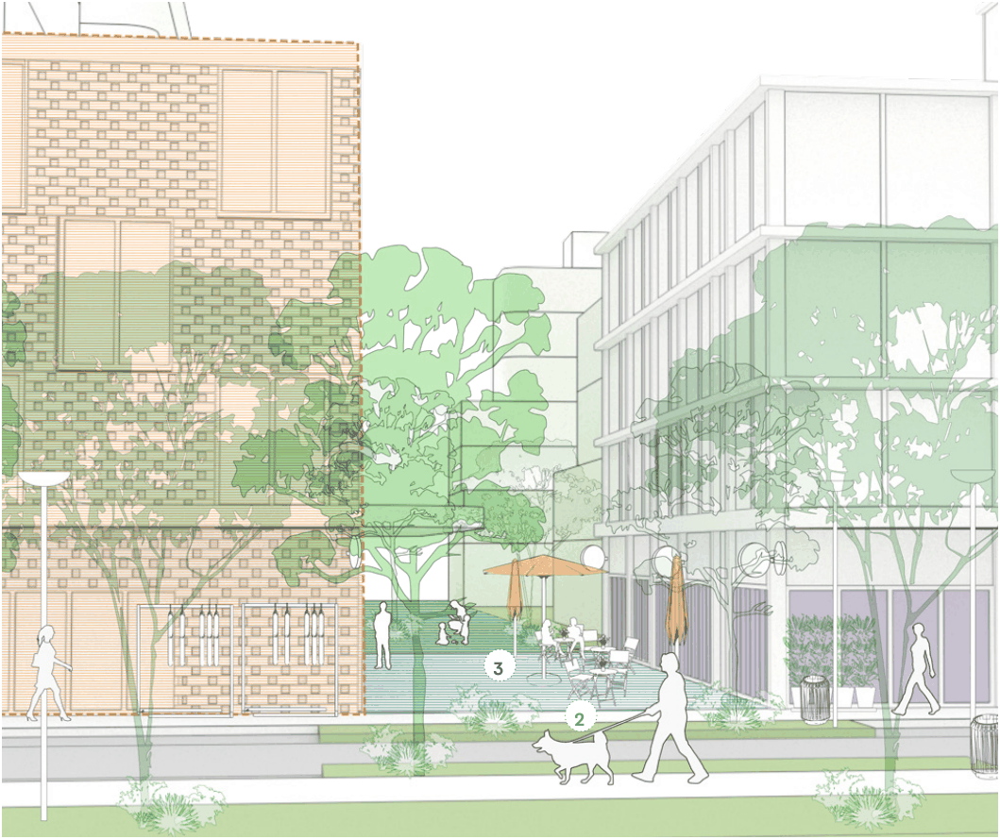

#### 4 Maisonette

#### apartments

provide passive surveillance to street and park

Figure 50.	 Design guidance for developments providing a high quality interface with a park ensuring good passive surveillance, access, landscaping and activation

### 4.4   Building interface with open space

#### Principles

P1. Views to existing and future open space must be identified early in the design process. P2. 	 Deliver high quality well resolved architecture viewed from open space. P3. 	 Ensure for higher density residential living for all groups in proximity to open space and the public realm.

Image - Harold Park, Glebe, NSW

> [Picture on page 108: a picture, saved as a picture (images/ch-06-02-bankstown-city-centre-page-108-12.gif, 150 dpi).]

### 4.4   Building interface with open space

#### Controls

C1. 	 Where buildings address public open space, the design is to maximise direct access for all occupants from the ground floor. C2. 	 Buildings must be designed so that balconies and windows are facing public spaces. C3. 	 For sites surrounding public open spaces, views to open space from balconies must be maximised. C4. 	 Where a building has a direct frontage to public open space, the design of the building is to minimise visual impact on the open space and provide a positive contribution.

Image - Nightingale, Melbourne, NSW (Source: Architectus)

> [Picture on page 109: a picture, saved as a picture (images/ch-06-02-bankstown-city-centre-page-109-17.gif, 150 dpi).]

### 4.5	 Building interface and active frontages

#### Overview

The active ground floor is the part of a building that interfaces directly with the street or public domain.

The ground level, where the city is experienced close up by the pedestrian, is where the individual walking experience is of enjoyment or where it suffers from a lack of engagement.

#### 4.5.1	 Development interface with the public domain Objectives

O1. 	 To ensure the interface with the public domain at the ground plane is designed at a human scale and provides a sensory experience through materials and finishes choice, landscape and fine-grained active frontages. O2. 	 To create opportunities to enjoy the positive aspects of climate and shield people from the negative; such as wind, rain and heat. O3. 	 To retain, improve and complete connections to ensure for reduced walking distances and an enhanced and permeable pedestrian network. O4. 	 To ensure active transport networks are well designed, safe, well lit, highly accessible and promote public use.

O5. 	 To ensure pedestrian connections are direct, well-lit, attractive, have active frontages where appropriate and provide a line of sight from one end to the other.

O6. 	 To ensure retail and hospitality uses address public spaces and streets to maximise opportunities for activation.

O7. 	 To ensure shared zones and service lanes are designed to be safe for pedestrians.

> [Picture on page 110: a picture, saved as a picture (images/ch-06-02-bankstown-city-centre-page-110-34.gif, 150 dpi).]
> Words printed on the picture (title and legend, copied from the PDF):
> 3
> 2
