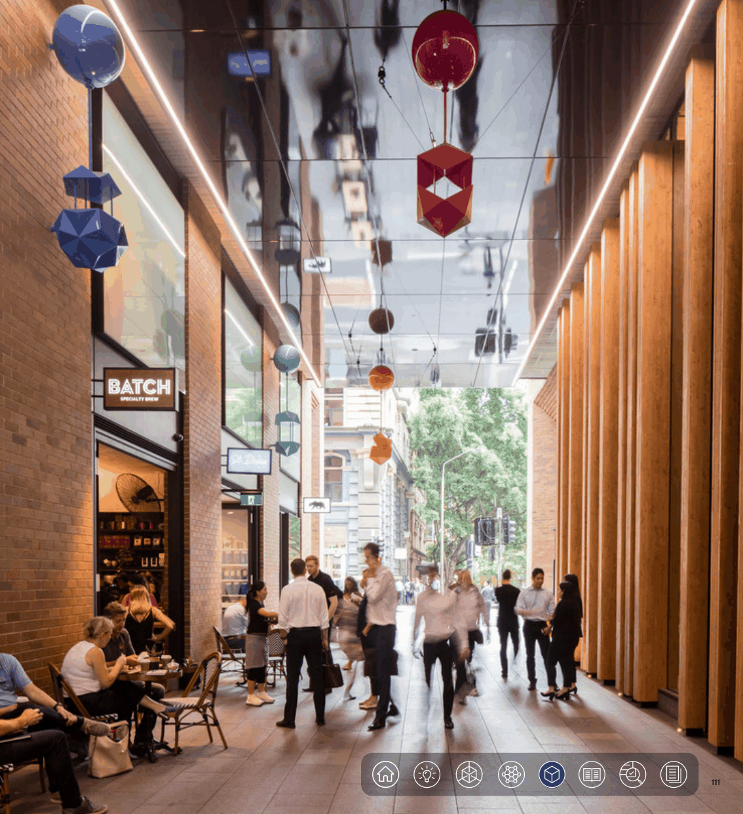
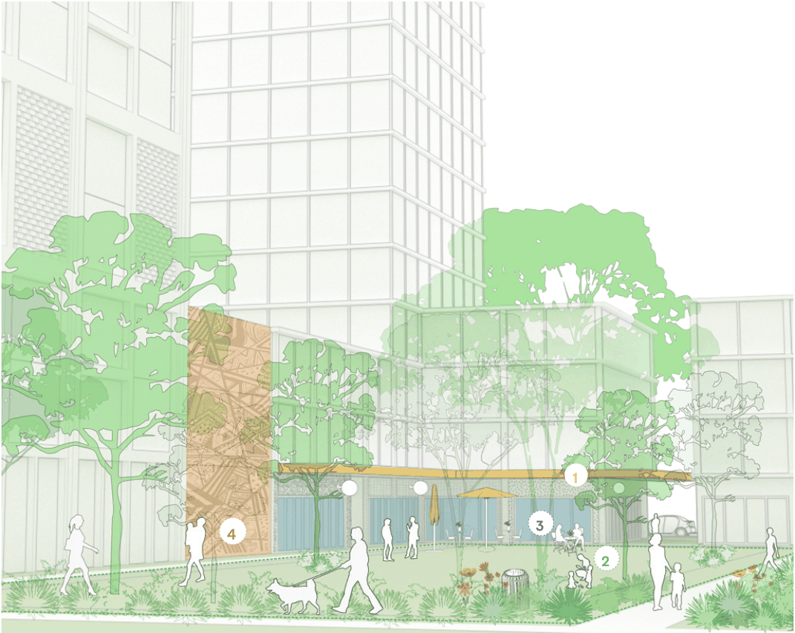

#### 1 Sensory

#### experiences

through materials and finishes

#### Enhance

landscape for

amenity and plantings

#### 2

#### Through site

#### links with activation

provide amenity, community and safety

#### 3

Active uses  and

building edges through retail and commerical shop fronts

#### 4

Design guidance for development interfacing streets and public spaces, ensuring amenity, visual interest, landscaping, connections and activation.

Figure 51.

### 4.5 Building interface and active frontages

#### 4.5.1 Development interface with the public domain

#### Controls

C1. 	 Ensure that the elements of new development that have a direct interface with the public domain are designed and constructed to be easily maintained and do not impede the  maintenance of the adjoining public domain either by Council or the relevant public authority. C2. 	 Enhance the public domain by ensuring adequate solar access to publicly accessible places and protect significant views to and from public spaces. C3. 	 Ensure that robust quality materials such as stone and face brick are used at the lower levels of buildings where pedestrians are using city footpaths. C4. 	 Active uses at the ground floor must not have roller shutters. Security measures must be built in behind the glass line. C5. 	 Active uses at the ground floor must be interesting and engaging when viewed from the adjacent streets and be illuminated for interest at night.

Image - Barrack Place, Architectus (Source: Brett Boardman)

> [Picture on page 111: a picture, saved as a picture (images/ch-06-02-bankstown-city-centre-page-111-27.gif, 150 dpi).]

### 4.5 Building interface and active frontages

#### 4.5.2	Building awnings and interface with

streets, plazas and squares

#### Objectives

O1. 	 To enhance the public domain by ensuring buildings use high quality, robust materials and finishes.

O2. 	 To provide an interface to public space that provides a sensory experience and is engaging for pedestrians.

O3. 	 To ensure that buildings address public space and do not have unarticulated blank walls.

O4. 	 To ensure that shelter is provided for pedestrians where active uses are located. O5. 	 To ensure for amenity in areas of high pedestrian volume by providing continuous protection from rain, sun and wind down draft.

> [Picture on page 112: a picture, saved as a picture (images/ch-06-02-bankstown-city-centre-page-112-20.gif, 150 dpi).]
> Words printed on the picture (title and legend, copied from the PDF):
> 3
> 1
> 2

#### 1

#### 2

#### Continuous

awnings for

shelter and protection

#### 4

#### Generous

#### forecourts of open

space and plazas with through site links
