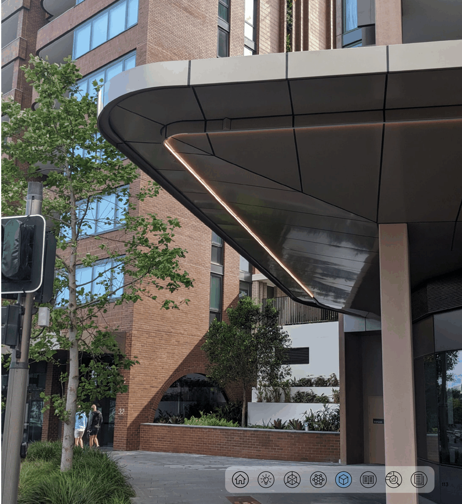
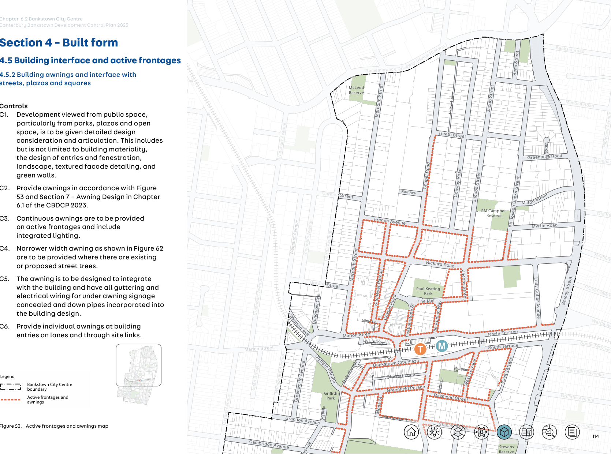
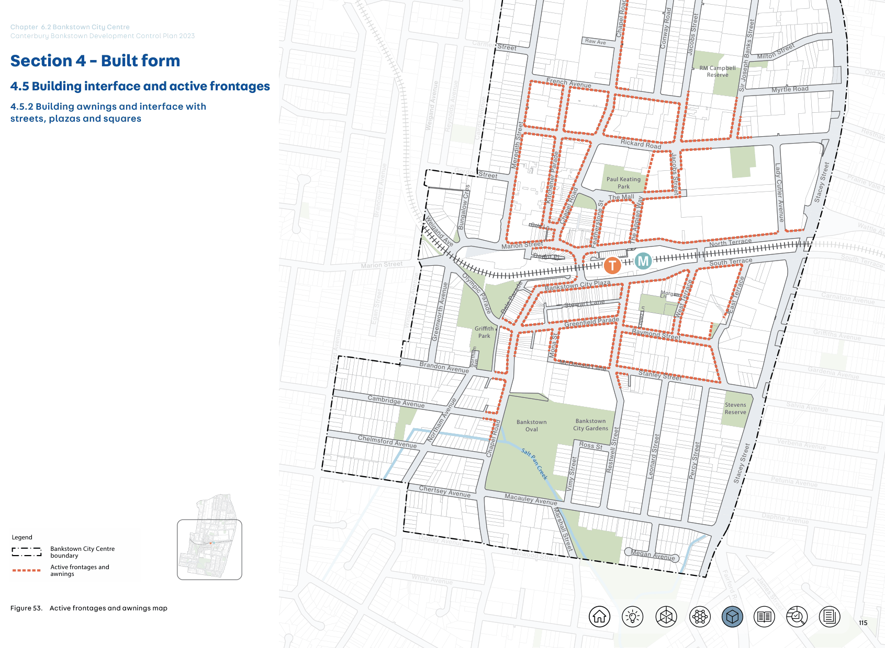
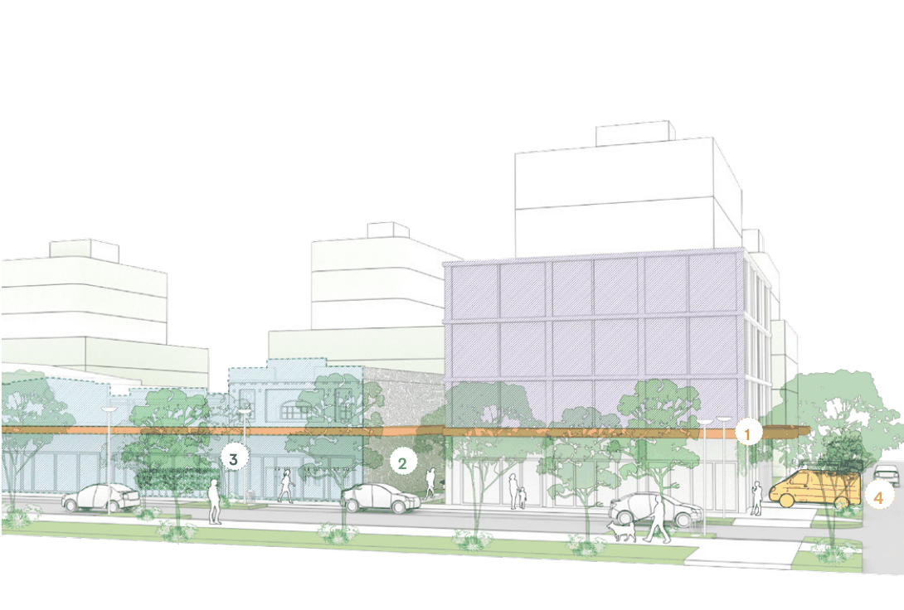

#### 3 Well defined

ground floor frontages

Articulation  and

murals to create visual interest on blank walls.

#### 4

Figure 52.	 Design guidance for building awnings and interfaces to public spaces that are inviting, active, safe and vibrant.

### 4.5 Building interface and active frontages

#### 4.5.2 Building awnings and interface with

streets, plazas and squares

#### Principles

P1. Integrate forecourts, squares and courtyards with through site links where appropriate. P2. 	 Provide ‘edges’ to frontage spaces and stairs for people to use to sit and stay. P3. 	 Ensure buildings provide good external lighting on street frontages and have well defined entries. P4. 	 Emphasise the street as a distinct spatial entity and design the street wall frontage with an appropriate human scale. P5. 	 To maintain complementary architectural detail of awning design. P6. 	 To ensure for amenity and safety of the public domain.

Image - Paul St, Zetland, NSW (Source: Architectus)

> [Picture on page 113: a picture, saved as a picture (images/ch-06-02-bankstown-city-centre-page-113-21.gif, 150 dpi).]

> [Picture on page 114: a map, saved as a picture (images/ch-06-02-bankstown-city-centre-page-114-1.gif, 150 dpi); the street names and other small labels are on the picture.]
> Words printed on the picture (title and legend, copied from the PDF):
> Bankstown City Centre
> Active frontages and
> way (Hume Highway
> Sir Joseph Banks Street Myrtle Road
> Weigand Avenue Reynolds Avenue
> Prairie Vale R
> Lady Cutler Avenue
> The Appian Way
> Bankstown City Plaza
> e Dale Parade
> Greenfield Parade Lopez Ln

Figure 53.	 Active frontages and awnings map

### 4.5 Building interface and active frontages

#### 4.5.2 Building awnings and interface with

streets, plazas and squares

#### Controls

C1. 	 Development viewed from public space, particularly from parks, plazas and open space, is to be given detailed design consideration and articulation. This includes but is not limited to building materiality, the design of entries and fenestration, landscape, textured facade detailing, and green walls.

C2. 	 Provide awnings in accordance with Figure 53 and Section 7 – Awning Design in Chapter

6.1 of the CBDCP 2023.

C3. 	 Continuous awnings are to be provided on active frontages and include integrated lighting.

C4. 	 Narrower width awning as shown in Figure 62 are to be provided where there are existing or proposed street trees.

C5. 	 The awning is to be designed to integrate with the building and have all guttering and electrical wiring for under awning signage concealed and down pipes incorporated into the building design.

C6. 	 Provide individual awnings at building entries on lanes and through site links.

> [Picture on page 115: a map, saved as a picture (images/ch-06-02-bankstown-city-centre-page-115-1.gif, 150 dpi); the street names and other small labels are on the picture.]
> Words printed on the picture (title and legend, copied from the PDF):
> Bankstown City Centre
> Active frontages and
> Sir Joseph Banks Street Myrtle Road
> Weigand Avenue Reynolds Avenue
> Prairie Vale R
> Lady Cutler Avenue
> The Appian Way
> Bankstown City Plaza
> e Dale Parade
> Chapel Road P
> Leonard Street Percy Street
> Road James Street

Figure 53.	 Active frontages and awnings map

### 4.5 Building interface and active frontages

#### 4.5.2 Building awnings and interface with

streets, plazas and squares

eenac

### 4.5 Building interface and active frontages

#### 4.5.3	Active frontage design

#### Objectives

O1. 	 Encourage in new development finer grained narrow frontages to create varied experiences that provide views into and out of shops.

O2. 	 Ensure for articulation of buildings into vertical bays and the integration of landscape where the use is not retail. O3. 	 Within a wide frontage, limit the length of a podium or frontage to a building to provide relief, modulation and a finer grain. O4. 	 Ensure vehicle entries are located away from key pedestrian areas.

O5. 	 Ensure that building services do not dominate the pedestrian experience and are designed as an integrated part of the building form.

O6. 	 Provide upper level tower podiums to buildings to diversify the building envelop, provide for deep soil planting and amenity for workers.

O7. 	 Ensure ground floor frontages are pedestrian oriented and of high design quality to add vitality to streets.

> [Picture on page 116: a picture, saved as a picture (images/ch-06-02-bankstown-city-centre-page-116-27.gif, 150 dpi).]
> Words printed on the picture (title and legend, copied from the PDF):
> 3
> 2
> 1
