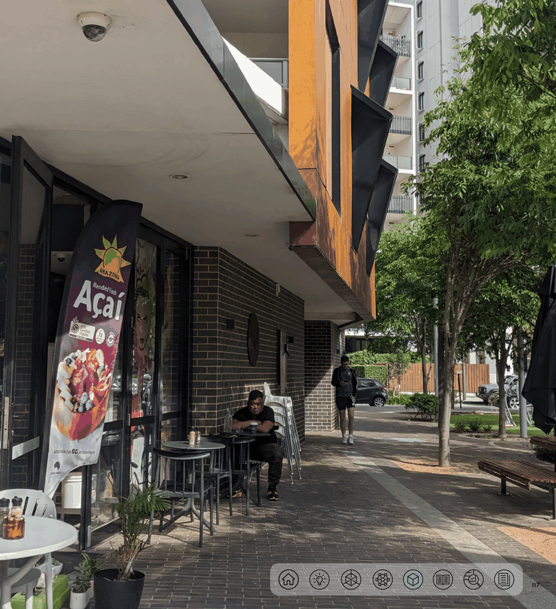
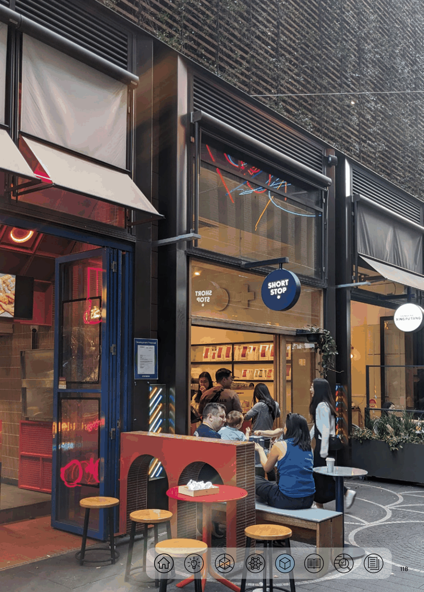
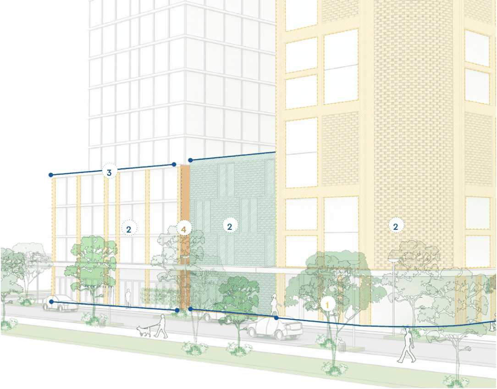

#### 4 Vehicle entries

located away from key pedestrian areas.

### 4.5 Building interface and active frontages

#### 4.5.3 Active frontage design

#### Controls

C1. New development that has a ground level street frontage that exceeds 45m is to provide active frontages at the ground floor level in accordance with Figure 64 Active Street Frontages Map and the following requirements in Figure 66. C2. 	 Where there is a single large site, ensure for a common language between buildings using natural materials and finishes such as stone and face brick. C3. 	 Shop fronts must be at-grade with the external footpath and not sunken below footpath level. C4. 	 Any security measure such as roller shutters, grills or other security mechanisms, must allow for views into the premises, and be setback from the front building line. C5. 	 The design of shop fronts is to provide high quality finishes and coordinated use of materials that integrates with the design and appearance of the whole building. C6. 	 Any required substations or utilities shall be integrated into the building form or located in the basement level. If integrated into the design of the building, they shall be designed to minimise the impact on the streetscape. Substations within the street or setback will not be accepted. C7. For building maintenance and to future proof residential buildings to enable infrastructure upgrades, heating and cooling infrastructure is to be consolidated into a centralised basement location and near the street frontage where possible.

Image - Matron Ruby Grant Park, Zetland, NSW (Source: Architectus)

> [Picture on page 117: a picture, saved as a picture (images/ch-06-02-bankstown-city-centre-page-117-38.gif, 150 dpi).]

### 4.5 Building interface and active frontages

#### 4.5.3 Active frontage design

#### Active street frontage design guidance

5m or 70% of each public domain frontage (whichever is the greater)

Minimum active frontage required for each frontage facing the public domain

| Active uses facing the | Entries or display windows to shops and/ |
|---|---|
| public domain | or food and drink premises or other uses, customer service areas and activities which provide pedestrian interest and interaction. |
| Minimum ‘grain’ of shop | 10 tenancy entries per 100m. |
| front tenancies | Where a single or larger tenancy is proposed with a single entrance, the facade must give the appearance of being visually broken up into finer grain tenancies and allow for separate tenancy entrances in the future |
| Provision of awnings | Awnings to be provided in accordance with Figure 53. |
| Through site links | Through site links to be provided in accordance with Figure 22 Pedestrian and cycle connections in Section 3.1.2 of this DCP. |

Figure 55.	 Active street frontage design guidance

Image - Darling Square, Haymarket, NSW (Source: Architectus)

> [Picture on page 118: a picture, saved as a picture (images/ch-06-02-bankstown-city-centre-page-118-12.gif, 150 dpi).]

### 4.6	 Visual diversity, articulation and fine

#### grain buildings

#### Objectives

O1. 	 Ensure that podiums are not overbearing in length and are designed with smaller parts to create a fine grained and varied experience at street level.

O2. 	 Ensure street blocks present as a group of buildings not a single building. O3. 	 Maintain a diverse and interesting skyline on large sites that propose two or more buildings through a mix of varying heights, roof form and tower design. O4. 	 Encourage variety in architectural design and character across large developments to provide a fine grain which enriches and enlivens the City’s public realm. O5. 	 Ensure that building services are integrated into the building design and hidden from public view to provide a quality street interface.

O6. 	 Reduce the scale of building mass through vertical or horizontal articulation using depth in façades

> [Picture on page 119: a picture, saved as a picture (images/ch-06-02-bankstown-city-centre-page-119-25.gif, 150 dpi).]
> Words printed on the picture (title and legend, copied from the PDF):
> 3
> 4
> 2
> 2
> 1
> 2
