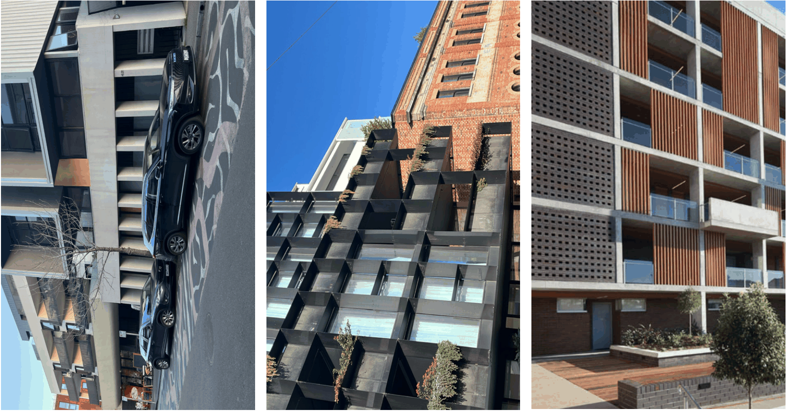
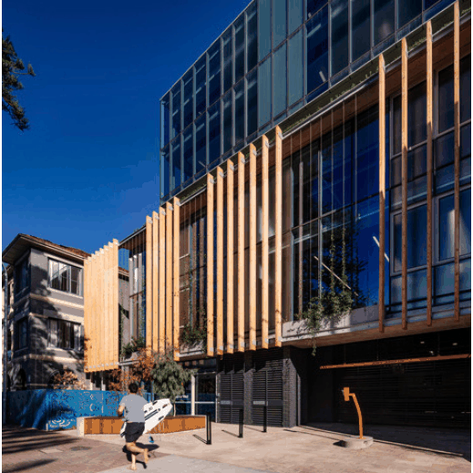
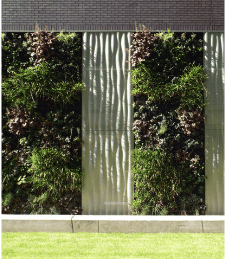
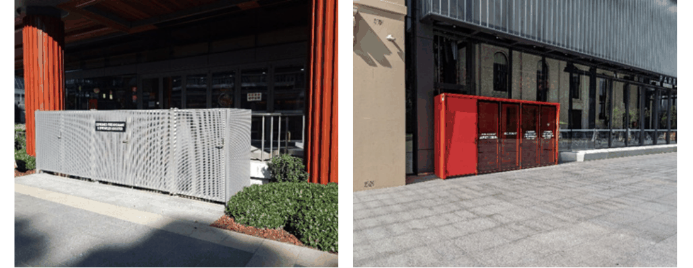
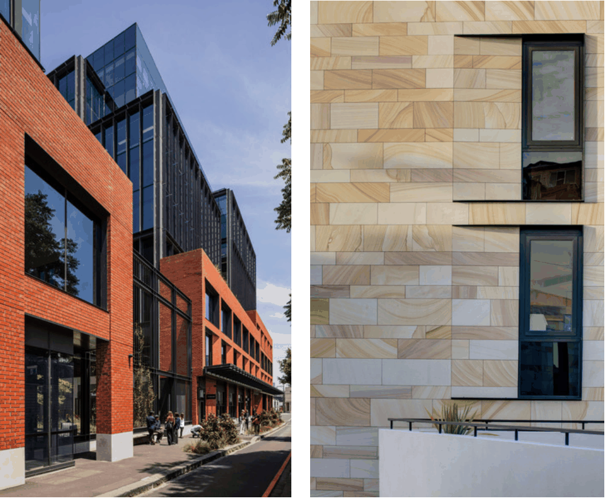
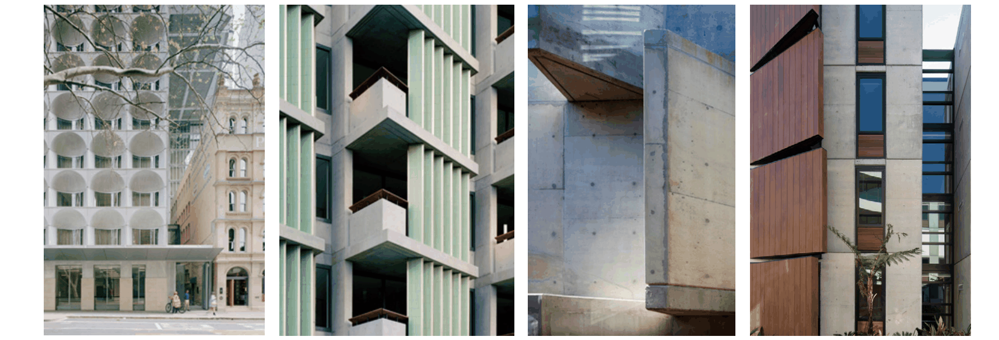
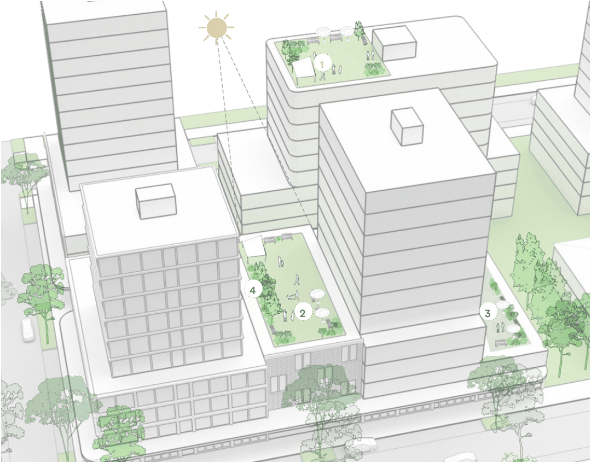

#### 4 Articulation

#### zone to provide depth

for design of building façades

### 4.6 Visual diversity, articulation and fine

#### grain buildings

> [Picture on page 120: a picture, saved as a picture (images/ch-06-02-bankstown-city-centre-page-120-3.gif, 150 dpi).]

Examples of articulated façades creating depth, fine grain and variety

Images: 1-2- Rose Street, Melbourne, VIC (Source: Architectus) 3 - Platform Apartments, North Eveleigh, NSW, Architectus (Source: Brett Boardman)

### 4.6 Visual diversity, articulation and fine

#### grain buildings

C4. 	 Ensure for a common language between

C6. 	 Be articulated with depth, relief and shadow

#### Controls

C1. 	 Where a building podium exceeds 45m

buildings using predominantly masonry and natural building materials, but not including glazed shop fronts.

on the street facade. A minimum relief of 150mm between the masonry finish and glazing face must be achieved.

> [Picture on page 121: a picture, saved as a picture (images/ch-06-02-bankstown-city-centre-page-121-13.gif, 150 dpi).]

C5. 	 The junction between old and new buildings must be articulated by an appropriate architectural treatment such as recesses, colour, materials, form, moulding, setback, height etc.

> [Picture on page 121: a picture, saved as a picture (images/ch-06-02-bankstown-city-centre-page-121-19.gif, 150 dpi).]

in length, it is to appear visually broken into two or more buildings using facade variation or physical separation. This outcome could be achieved through the following articulation design considerations or through other alternative design considerations to the reasonable satisfaction of Council:

a) 	 Podiums measuring 45-70m in length are divided into two or more vertical sections.

b) 	 Vertical sections must be separated by indentations and use a varied architectural expression and materiality.

c) 	 In cases where there is a range in street wall height, prioritise the lower range along laneways, pedestrian links, and areas with high pedestrian activity.

C2. 	 Where there is a nil boundary setback required at street walls, podiums must include a 1.5m articulation zone to allow architectural form to develop and to provide depth in the facade. This can occur above ground level on all public facing sides of a podium. This space can allow for an outdoor space for office workers and retail users but must not comprise Gross Floor Area. The articulation zone is to be located entirely within the property boundary. C3. 	 Building entries are to face and open to

Green and panelled wall interfacing open space

Wooden articulation and greening above carpark entry

the street.

Images: 1- Green wall (Source: Creative Commons) 2- Royal Far West Centre for Excellence, Manly, NSW, Architectus (Source: Trevor Mein)

### 4.6 Visual diversity, articulation and fine

#### grain buildings

Building services design C7. 	 Services such as electricity substations/ kiosks, fire pumps and hydrants and fire escapes must be addressed early in the design process to ensure they are integrated into building design. Substations must be integrated within the design of the building footprint where these facilities can meet Ausgrid standards and to the extent possible due to authority constraints and design requirements. C8. 	 Integrate fire booster pumps and associated pipes and equipment into the building design and use metal or tinted glass to visually screen such services on public facing street frontages. If a site has two frontages, locate the services on the secondary frontage if possible.

> [Picture on page 122: a picture, saved as a picture (images/ch-06-02-bankstown-city-centre-page-122-21.gif, 150 dpi).]

High quality screening used to minimise the visual impact of services on the streetscape and provide an uncluttered and orderly appearance to buildings

C9. 	 Where there are blank walls that interface with public open space due to service requirements, metal screens, landscaping and/or public art treatments are to be considered, including green walls where conditions allow plants to flourish.

### 4.7	 Materials and finishes

#### Objectives

O1. 	 Use quality materials and finishes at the street level interface to elevate the pedestrian experience. O2. 	 Ensure materials are robust and have longevity and contribute to beautiful buildings.

> [Picture on page 123: a picture, saved as a picture (images/ch-06-02-bankstown-city-centre-page-123-9.gif, 150 dpi).]

Examples of durable materials - brick and sandstone

Images: 1 - Industry Lanes, Melbourne, VIC, Architectus (Source: Trevor Mein 2023) 2 - Harbord Diggers, Freshwater, NSW, Architectus (Source: Brett Boardman)

### 4.7 Materials and finishes

> [Picture on page 124: a picture, saved as a picture (images/ch-06-02-bankstown-city-centre-page-124-2.gif, 150 dpi).]

#### Controls

C1. 	 Buildings must include durable single material finishes such as masonry and/or off form concrete. Painted cement render or similar painted finishes and Aluminium Composite Panel Cladding (e.g. Alucobond) must not be used within the podium levels of buildings and must not comprise more than 25% of each facade above podium level.

Image 6 - Shout Ridge, Lindfield, NSW (Source: Brett Boardman )

C2. 	 Elevate the pedestrian experience of the pedestrian at street eye level through fine grained detailing and quality material and finishes selection.

C3. 	 Development Applications proposing a tall building must include a reflectivity assessment to ensure external building materials do not cause unacceptable glare. C4. 	 Select materials and finishes that are low maintenance.

C5. 	 Create simplicity through the selection a common language of materials and finishes, rather than selecting many and creating visually complexity.

C6. 	 Where adjacent development is unlikely to occur in the short term, blank side walls must include public art or murals.

### 4.8	 Rooftop and podium

#### communal open space

#### Objectives

O1. 	 Ensure that rooftops achieve good amenity standards for residents.

O2. 	 Encourage the use of rooftops for passive recreation and communal uses for building occupants

O3. 	 Design rooftops to minimise urban heat island impacts through the use of landscaping and shade structures. O4. 	 Ensure rooftop open spaces are designed to promote the use of water and energy collected on site.

O5. 	 Ensure rooftop open space use landscape species are suitable for windy and dry conditions.

O6. 	 Ensure balustrades around rooftop communal spaces are integrated into the design of the space and contributes to the overall appearance of the space. O7. 	 Ensure harness anchor points are considered and integrated into the design where required for maintenance works.

> [Picture on page 125: a picture, saved as a picture (images/ch-06-02-bankstown-city-centre-page-125-25.gif, 150 dpi).]
> Words printed on the picture (title and legend, copied from the PDF):
> 4
> 1
> 2
> 3
