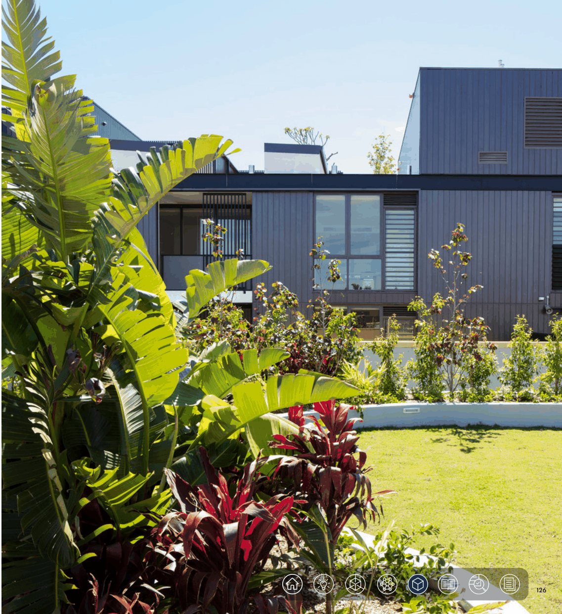
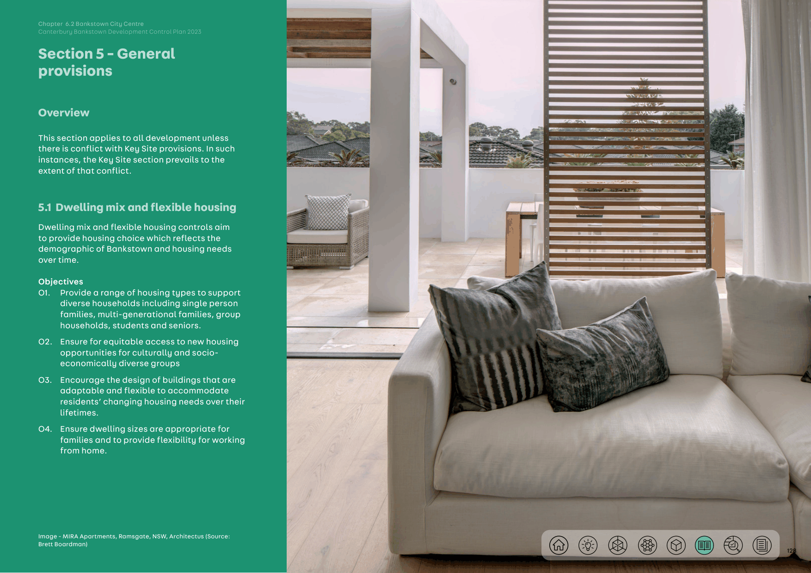

#### 3 Activate rooftops

for hospitality uses

#### Urban greening

and tree canopy

#### 4

Figure 57.	 Design guidance for activation, utilisation and greening of podiums and rooftops

### 4.8 Rooftop and podium

#### communal open space

#### Controls

C1. 	 Building rooftops including podiums that are designated communal open space areas must be designed to include:

a) 	 Seating

b) 	 Structures for rain protection and sun shading

c) 	 A BBQ/food preparation area with a sink, universal access

d) 	 Watering systems for proposed landscaping, and

e) 	 Stormwater management and disposal. C2. 	 Any rooftop structures are to be included in the maximum height of building permitted for the site within CBLEP 2023. The height is to be shown in the Development Application drawings. C3. 	 Any proposed communal open space located on the building podium and/or rooftop is to:

a) 	 Be consolidated into a useable area with a minimum width of 6m and a minimum area of 36m1.

b) 	 Be located so that solar access is provided for users of the open space.

c) 	 Be designed to a high quality and allow for landscaping and seating.

d) 	 Roof tops are be structurally sound and have the capacity of supporting planting and adequately draining growing medium.

Image - NewLife, Darling Harbour, NSW, Architectus (Source: Architectus)

> [Picture on page 126: a picture, saved as a picture (images/ch-06-02-bankstown-city-centre-page-126-35.gif, 150 dpi).]

### PART

### GENERAL

### PROVISIONS

> [Picture on page 128: a picture, saved as a picture (images/ch-06-02-bankstown-city-centre-page-128-1.gif, 150 dpi).]
> Words printed on the picture (title and legend, copied from the PDF):
> Image - MIRA Apartments, Ramsgate, NSW, Architectus (Source:
> Brett Boardman)
