## Section 5 - General provisions

#### Overview

This section applies to all development unless there is conflict with Key Site provisions. In such instances, the Key Site section prevails to the extent of that conflict.

### 5.1	 Dwelling mix and flexible housing

Dwelling mix and flexible housing controls aim to provide housing choice which reflects the demographic of Bankstown and housing needs over time.

#### Objectives

O1. 	 Provide a range of housing types to support diverse households including single person families, multi-generational families, group households, students and seniors. O2. 	 Ensure for equitable access to new housing opportunities for culturally and socio-economically diverse groups O3. 	 Encourage the design of buildings that are adaptable and flexible to accommodate residents’ changing housing needs over their lifetimes. O4. 	 Ensure dwelling sizes are appropriate for families and to provide flexibility for working from home.

### 5.1   Dwelling mix and flexible housing

#### Controls

C1. 	 The following dwelling mix is required for residential flat buildings and shop top housing developments containing 20 or more dwellings:

a) 	 Studio: between 5-10%

b) 	 1 bedroom: between 10-30%

c) 	 2 bedroom: between 40-75%

d) 	 3 or more bedroom: minimum 10% C2. 	 The dwelling mix requirements may be altered only if the development serves the purpose of public housing or if the applicant represents a community housing or non-profit organisation. C3. 	 Within residential flat buildings, at least 1 bedroom and 3 bedroom (or 3 or more) dwellings must be located at the same level as proposed communal open space to provide accessibility to that space for disabled, elderly people and families with children. C4. 	 Within residential flat buildings, the majority of 3 or more bedroom dwellings must be provided on the first two floors to support family living in higher density areas. C5. 	 Parking for non-residential uses, and non-staff related parking can be considered collectively and be shared if parking is accessible to the public and the hours of use have different peak demand times.

Image - Markham Avenue, Ashburton, VIC, Architectus (Source: Architectus)

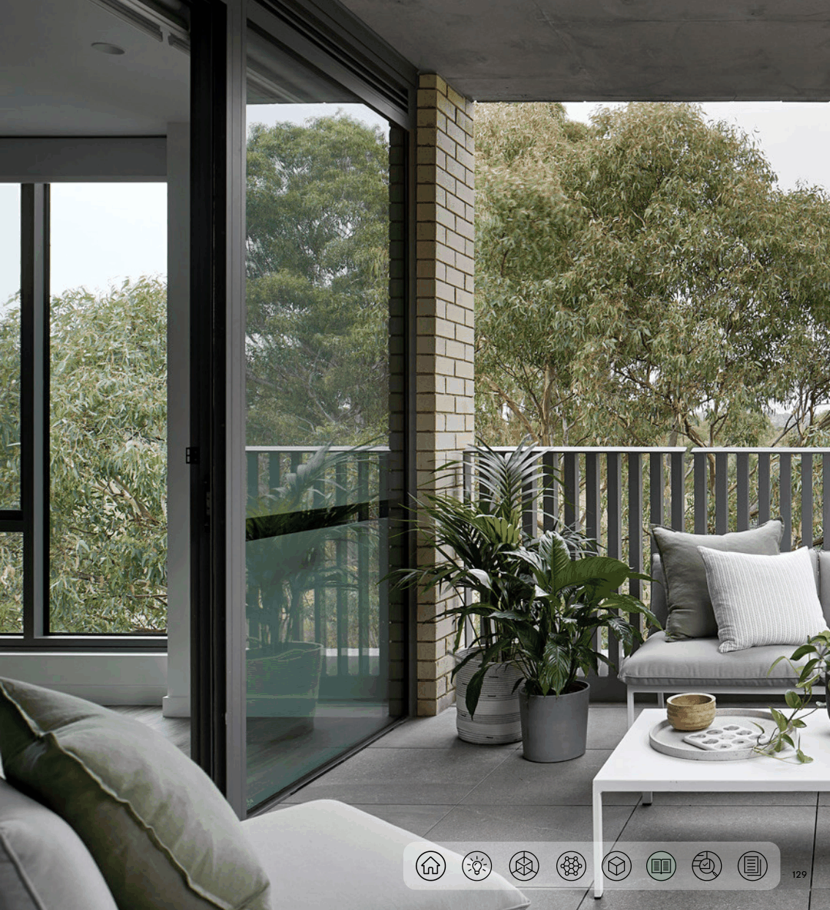

> [Picture on page 129: a picture, saved as a picture (images/ch-06-02-bankstown-city-centre-page-129-34.gif, 150 dpi).]

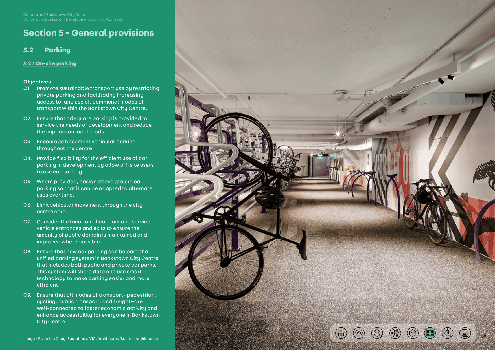

> [Picture on page 130: a picture, saved as a picture (images/ch-06-02-bankstown-city-centre-page-130-1.gif, 150 dpi).]
> Words printed on the picture (title and legend, copied from the PDF):
> throughout the centre.
> centre core.
> Image - Riverside Quay, Southbank, VIC, Architectus (Source: Architectus)

### 5.2 Parking

#### 5.2.1 On-site parking

#### Objectives

O1. 	 Promote sustainable transport use by restricting private parking and facilitating increasing access to, and use of, communal modes of transport within the Bankstown City Centre. O2. 	 Ensure that adequate parking is provided to service the needs of development and reduce the impacts on local roads. O3. 	 Encourage basement vehicular parking

O4. 	 Provide flexibility for the efficient use of car parking in development by allow off-site users to use car parking. O5. 	 Where provided, design above ground car parking so that it can be adapted to alternate uses over time. O6. 	 Limit vehicular movement through the city

O7. 	 Consider the location of car park and service vehicle entrances and exits to ensure the amenity of public domain is maintained and improved where possible. O8. 	 Ensure that new car parking can be part of a unified parking system in Bankstown City Centre that includes both public and private car parks. This system will share data and use smart technology to make parking easier and more efficient. O9. 	 Ensure that all modes of transport—pedestrian, cycling, public transport, and freight—are well-connected to foster economic activity and enhance accessibility for everyone in Bankstown City Centre.

### 5.2   Parking

#### 5.2.1   On-site parking

#### Controls

C1. 	 Development Applications must demonstrate how the layout and floor to ceiling height of above ground car parking can be adapted in the future for alternative uses.

C2. 	 It is preferred that car parking is located within basements, however if above ground it must be ‘sleeved’ by active frontage to conceal it from the public domain. C3. 	 To facilitate adaptation of car parking to other uses in the long term, above ground car parking is to remain as part of the common property and not part of, or attached to, individual strata units. C4. 	 All car parking within the Bankstown City Centre must be provided in accordance with the rates as specified in Figure 58. If a land use is not included in Figure 58 the car parking rates in Section 2 Chapter 3.2 of the CB DCP 2023 will apply.

C5. 	 Parking for non-residential uses, and non-staff related parking can be considered collectively and be shared if parking is accessible to the public and the hours of use have different peak demand times.

| Land Use | Size / Description | Inside Bankstown City Centre |  | Outside of Bankstown Core city |
|---|---|---|---|---|
|  |  | Minimum | Maximum car | Minimum car Maximum car parking rate |
|  |  | car | parking rate | parking rate |
|  |  | parking rate |  |  |
| Detached | N/A | 1 space | N/A | 1 space per dwelling N/A |
| dwelling |  | per dwelling |  |  |
| Residential | Studio | 0 | 0.5 space per dwelling | 0 space per dwelling 0.75 space per dwelling |
| flat buildings |  |  |  |  |
| / Shop top housing | 1 Bedroom 2 Bedrooms 3 Bedrooms Visitor | 0 0 0 0 | 0.5 space per dwelling 1 space per dwelling 1.5 space per dwelling 1 space per 10 dwellings | 0.2 space per dwelling 0.75 space per dwelling 0.5 space per dwelling 1.5 spaces per dwelling 1 space per dwelling 2 spaces per dwelling 0 1 space per 5 dwellings |
| Office premises | N/A | 0 | 1.25 space per 100m2 | 1 space per 100 m2 2 spaces per 100m2 |
| Retail premises | Shops | 0 | 1.25 spaces per 100m2 | 1 space per 100 m2 2 spaces per 100m2 |
| Education | Schools, | 0 | 1.25 spaces | 1 space per 100 m2 2 spaces |
| establishments | Universities, TAFE |  | per 100m2 | per 100m2 |

Figure 58.	 Car parking requirements for the Bankstown City Centre ‘core’ and outside of ‘core’ areas (Excludes the Bankstown Central site)

The TfNSW Guide to Transport Impact Assessment may provide additional guidance on parking rates for larger developments.

### 5.2   Parking

#### 5.2.1   On-site parking

#### Controls (continued)

Unbundled car parking

Unbundled parking refers to the separation of parking spaces from a development, whereby the parking spaces are held as common property, and are not part of the title of  individual dwellings or commercial units and as such are able to be leased or allocated to dwellings as required. This is to be managed and coordinated by the relevant body corporate or strata body.

C6. 	 Parking in the Bankstown City Centre for any development may opt into unbundled parking. C7. Where a development proposes to utilise unbundled car parking, details of the proposed unbundled car parking spaces is to be marked and the proposed contractual arrangements to use unbundled car parking is to be provided in the Development Application for the subdivision of that site. C8. 	 The proposed provision of car parking within the maximum car parking rate does not prevent the reallocation of car parking through unbundling.

C9. 	 For residential development, visitor car parking spaces are to be nominated as common property in a strata subdivision and cannot be leased or allocated to individual units.

Figure 59.	 Car parking location map showing core and outside of core areas in Bankstown City Centre

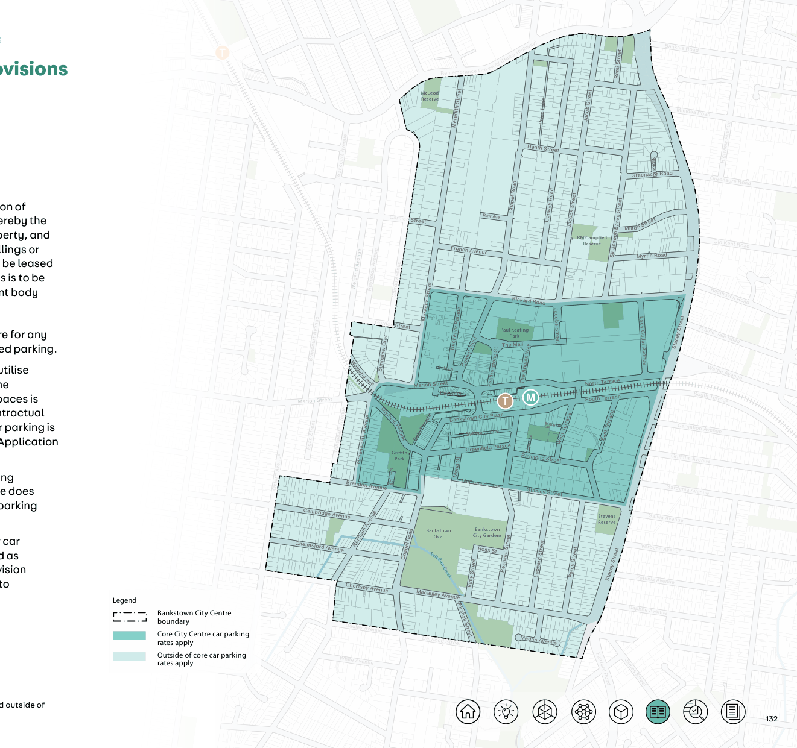

> [Picture on page 132: a map, saved as a picture (images/ch-06-02-bankstown-city-centre-page-132-33.gif, 150 dpi); the street names and other small labels are on the picture.]
> Words printed on the picture (title and legend, copied from the PDF):
> way (Hume Highway
> Old Kent Road
> Sir Joseph Banks Street Myrtle Road
> Weigand Avenue Reynolds Avenue
> Prairie Vale Road
> Lady Cutler Avenue
> The Appian Way
> Bankstown City Plaza
> e Dale Parade
> Winspeare Avenue Griffith
> Chapel Road P
> Leonard Street Percy Street
> Bankstown City Centre
> Core City Centre car parking
> Outside of core car parking
> Road James Street

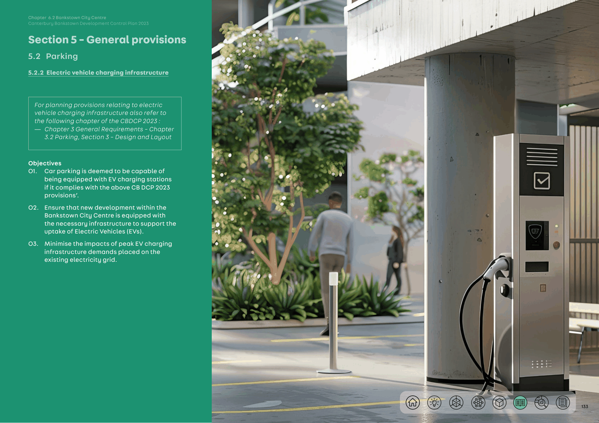

> [Picture on page 133: a picture, saved as a picture (images/ch-06-02-bankstown-city-centre-page-133-1.gif, 150 dpi).]
> Words printed on the picture (title and legend, copied from the PDF):
> For planning provisions relating to electric
> vehicle charging infrastructure also refer to
> the following chapter of the CBDCP 2023 :
> — Chapter 3 General Requirements – Chapter
> 3.2 Parking, Section 3 – Design and Layout

### 5.2   Parking

#### 5.2.2  Electric vehicle charging infrastructure

#### Objectives

O1. 	 Car parking is deemed to be capable of being equipped with EV charging stations if it complies with the above CB DCP 2023 provisions’. O2. 	 Ensure that new development within the Bankstown City Centre is equipped with the necessary infrastructure to support the uptake of Electric Vehicles (EVs). O3. 	 Minimise the impacts of peak EV charging infrastructure demands placed on the existing electricity grid.

### 5.2   Parking

#### 5.2.2   Electric vehicle charging infrastructure

#### Controls

C1. 	 All residential accommodation car parking must provide the following:

a) 	 One car parking space or at least 5 percent of all car parking spaces, whichever is the greater that is delivered within each development must be equipped or capable of being equipped with EV charging stations (Note: this requirement relates to the provision of Level 1 or 2 EV charging stations as conditional to all new residential development. The provision of level 3 chargers is within the discretion of the applicant).

b) 	 EV charging adapters for any EV parking provided must be of an open standard (non-proprietary) and must be designed to be used with a wide range of EV makes and models

C2. 	 All commercial premises development car parking must provide the following:

a) 	 One car parking space or at least 5 percent of all parking spaces, whichever is the greater that is delivered within each development must be equipped or capable of being equipped with EV charging stations.

b) 	 All car share spaces provided must have a Shared EV Connection.

C3. 	 All electric vehicle charging infrastructure and associated electricity supply installed on private property shall be the sole responsibility of the owner for maintenance, except in cases where the land is owned by the Council

Image - Belgrave Commuter Carpark, Belgrave, VIC, Architectus (Source: Trevor Mein)

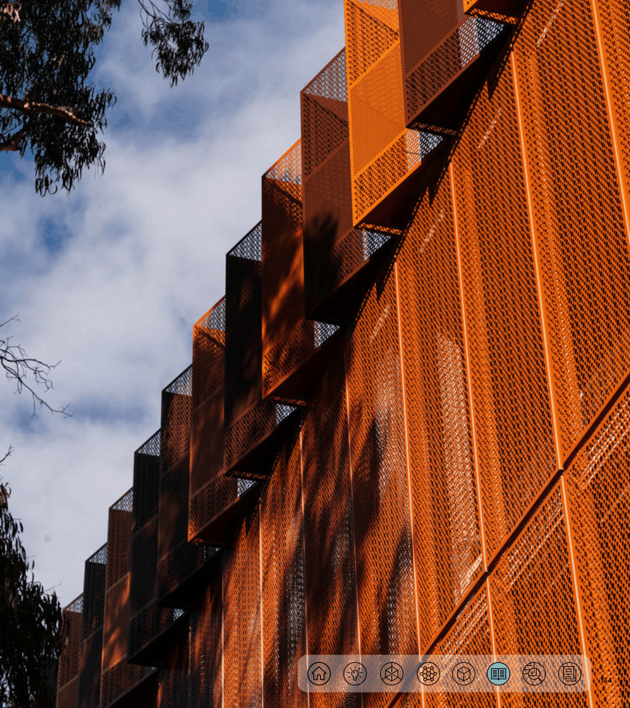

> [Picture on page 134: a picture, saved as a picture (images/ch-06-02-bankstown-city-centre-page-134-36.gif, 150 dpi).]

### 5.2   Parking

#### 5.2.3  Bicycle parking and end of trip facilities

#### Controls

C1. All development is to provide on-site bike parking designed in accordance with AS

2890.3 – Bicycle Parking Facilities. The location of bicycle parking must be:

a) 	 Easily accessible from the public domain

b) 	 Well-lit with adequate levels of natural surveillance, and

c) 	 Capable of being made secure to protect personal belongings.

C2. 	 Bicycle spaces for new developments are to be provided in accordance with rates set out in Figure 62, except where:

a) 	 Council is satisfied that a residential unit has been provided with sufficient storage within the basement garage for a bicycle and the required maximum number of vehicles and a safe path for cyclists to enter/exit the garage has been demonstrated, and;

b) 	 For proposed uses not listed within Figure 75, the applicant is required to demonstrate the number of bicycle spaces and end of trip facilities provided aligns with Council’s mode share targets as described in the Canterbury Bankstown Active Transport Action Plan 2021-2031

c) 	 If a land use is not included in Figure 60 the bicycle parking rates in Section 2 Chapter

3.2 of the CB DCP 2023 will apply.

Note: The minimum number of bicycle parking spaces is to be rounded up to the nearest whole number if it is not a whole number.

Image - Riverside Quay, Southbank, VIC, Architectus (Source: Architectus)

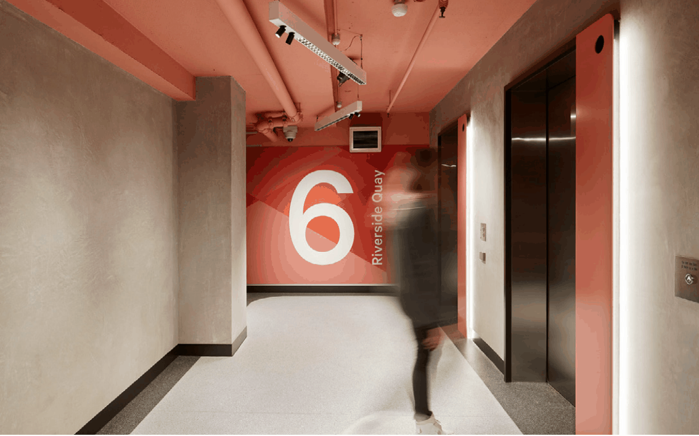

> [Picture on page 135: a picture, saved as a picture (images/ch-06-02-bankstown-city-centre-page-135-37.gif, 150 dpi).]

C3. 	 Secure bicycle parking facilities must be provided at a minimum in accordance with AS 2890.3– Bicycle Parking Facilities, including:

a) 	 Class 1 bicycle lockers for occupants of residential buildings

b) 	 Class 2 bicycle facilities for staff/ employees of any land use, and

c) 	 Class 3 bicycle rails for visitors of any land use.

C4. 	 Where bicycle parking is being provided in a basement, it is to be located:

a) 	 Close to entry/exit points

b) 	 Within clear sight and access of the entry/exit, and

c) 	 On the uppermost level of the basement.

C5. 	 Access to bicycle parking must be:

a) 	 A minimum of 1.8m wide (as per Council’s Standards)

b) 	 Clearly defined with line marking

c) 	 Accessible via a ramp

d) 	 Clearly identified through wayfinding and signage, and

e) 	 Accessible via appropriate

security systems.

C6. 	 Bicycle parking in the public domain must be provided at a location as close as possible to the main entrance of a building at grade.

### 5.2   Parking

#### 5.2.3   Bicycle parking and end of trip facilities

| Land Use | Size / Description | Bicycle Parking Rates | End-of-trip Facility Rates |
|---|---|---|---|
| Detached | N/A |  |  |
| dwelling |  |  |  |
| Residential flat | Studio | 1 secure space per 3 dwellings |  |
| buildings / Shop |  |  |  |
| top housing | 1 Bedroom 2 Bedrooms 3 Bedrooms Visitor | 1 secure space per 3 dwellings 1 secure space per 3 dwellings 1 secure space per 3 dwellings 1 visitor bicycle space per 10 dwellings |  |
| Office premises | N/A | 1 secure bicycle space per 200m2 GFA | 1 staff shower and change room for every 10 secure bicycle parking spaces required by the DCP |
| Retail premises | Shops | 1 secure bicycle space per 300m2 GFA 1 visitor bicycle space per 200m2 GFA | 1 staff shower and change room for every 10 secure bicycle parking spaces required by the DCP |
| Education | Primary | 1 bicycle rail per 20 students 1 secure | 1 staff shower and change room for |
| establishments | Schools Secondary Schools Tertiary Institutions | bicycle space per 10 staff 1 bicycle rail per 10 students 1 secure bicycle space per 10 staff 1 bicycle rail per 10 students 1 secure bicycle space per 10 full-time staff | every 10 secure bicycle parking spaces required by the DCP |

Figure 60.	 Bicycle parking/end of trip facility rates

Image - Riverside Quay, Southbank, NSW, Architectus (Source: Architectus)

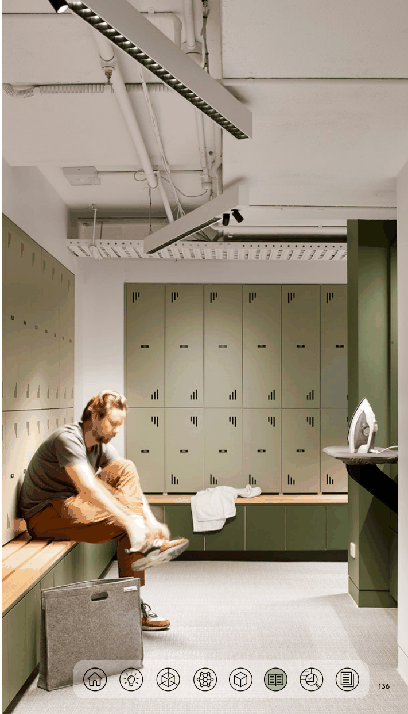

> [Picture on page 136: a picture, saved as a picture (images/ch-06-02-bankstown-city-centre-page-136-6.gif, 150 dpi).]

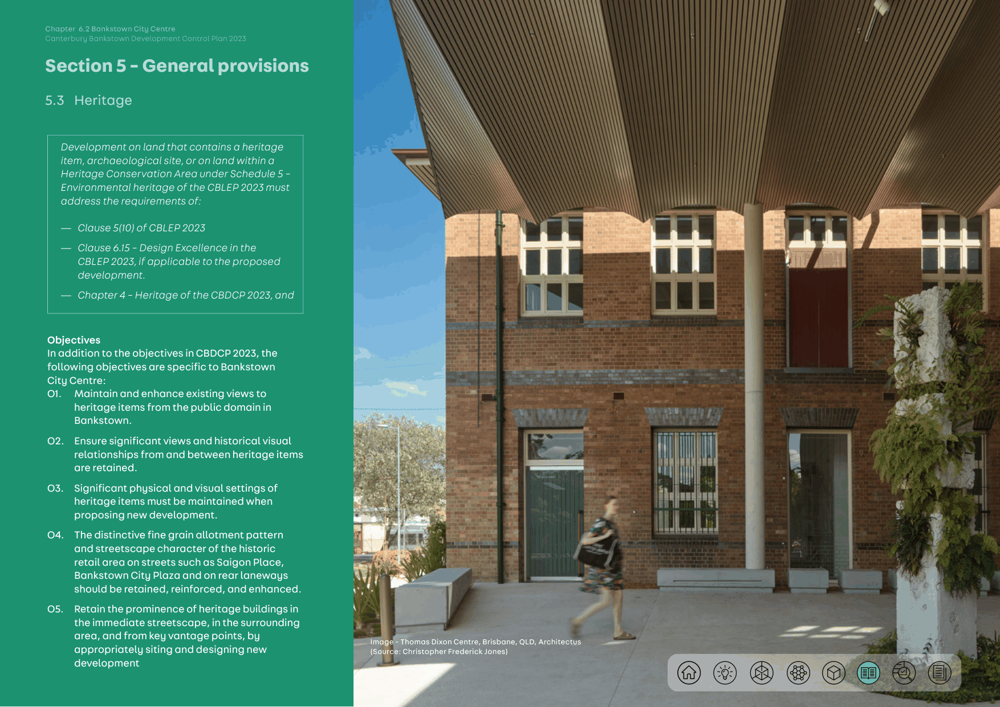

> [Picture on page 137: a picture, saved as a picture (images/ch-06-02-bankstown-city-centre-page-137-1.gif, 150 dpi).]
> Words printed on the picture (title and legend, copied from the PDF):
> Development on land that contains a heritage
> item, archaeological site, or on land within a
> Heritage Conservation Area under Schedule 5 –
> Environmental heritage of the CBLEP 2023 must
> address the requirements of:
> — Clause 5(10) of CBLEP 2023
> — Clause 6.15 – Design Excellence in the
> CBLEP 2023, if applicable to the proposed
> development.
> — Chapter 4 – Heritage of the CBDCP 2023, and
> Image - Thomas Dixon Centre, Brisbane, QLD, Architectus
> (Source: Christopher Frederick Jones)

### 5.3	   Heritage

#### Objectives

In addition to the objectives in CBDCP 2023, the following objectives are specific to Bankstown City Centre: O1. Maintain and enhance existing views to heritage items from the public domain in Bankstown. O2. 	 Ensure significant views and historical visual relationships from and between heritage items are retained. O3. 	 Significant physical and visual settings of heritage items must be maintained when proposing new development. O4. 	 The distinctive fine grain allotment pattern and streetscape character of the historic retail area on streets such as Saigon Place, Bankstown City Plaza and on rear laneways should be retained, reinforced, and enhanced. O5. 	 Retain the prominence of heritage buildings in the immediate streetscape, in the surrounding area, and from key vantage points, by appropriately siting and designing new development

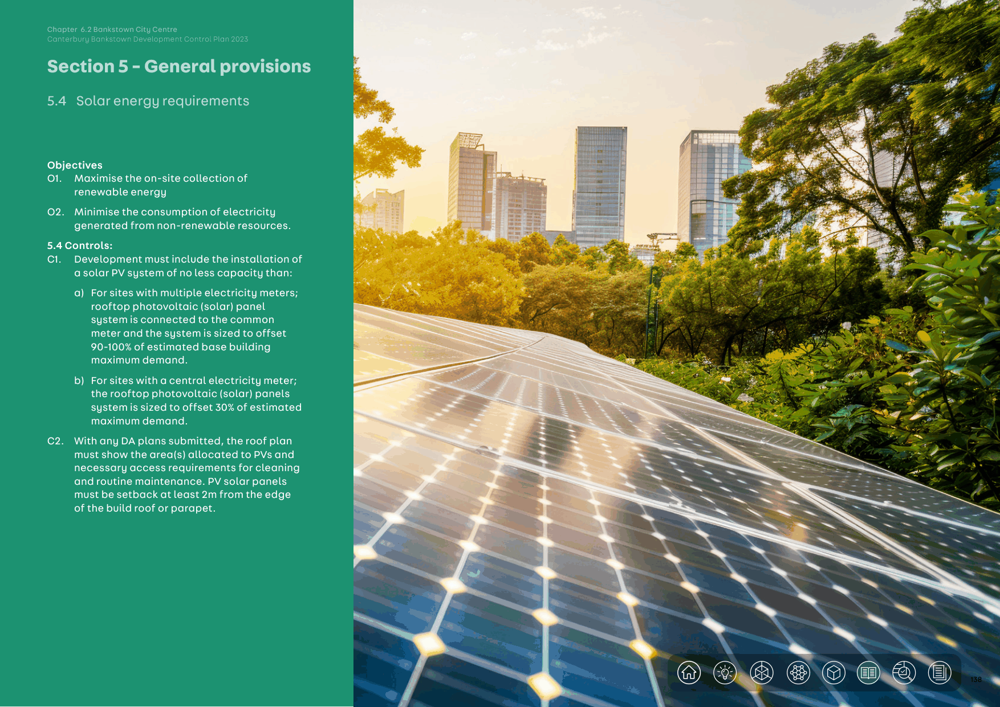

> [Picture on page 138: a picture, saved as a picture (images/ch-06-02-bankstown-city-centre-page-138-1.gif, 150 dpi).]
> Words printed on the picture (title and legend, copied from the PDF):
> renewable energy
> generated from non-renewable resources.

### 5.4	   Solar energy requirements

#### Objectives

O1. 	 Maximise the on-site collection of

O2. 	 Minimise the consumption of electricity

### 5.4 Controls:

C1. 	 Development must include the installation of a solar PV system of no less capacity than:

a) 	 For sites with multiple electricity meters; rooftop photovoltaic (solar) panel system is connected to the common meter and the system is sized to offset 90-100% of estimated base building maximum demand.

b) 	 For sites with a central electricity meter; the rooftop photovoltaic (solar) panels system is sized to offset 30% of estimated maximum demand.

C2. 	 With any DA plans submitted, the roof plan must show the area(s) allocated to PVs and necessary access requirements for cleaning and routine maintenance. PV solar panels must be setback at least 2m from the edge of the build roof or parapet.

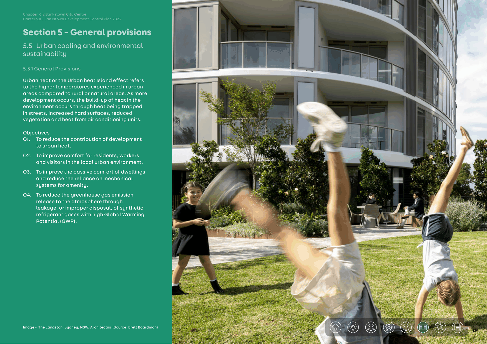

> [Picture on page 139: a picture, saved as a picture (images/ch-06-02-bankstown-city-centre-page-139-1.gif, 150 dpi).]
> Words printed on the picture (title and legend, copied from the PDF):
> 5.5.1 General Provisions
> to urban heat.
> Image -  The Langston, Sydney, NSW, Architectus  (Source: Brett Boardman)

### 5.5	 Urban cooling and environmental

#### sustainability

Urban heat or the Urban heat Island effect refers to the higher temperatures experienced in urban areas compared to rural or natural areas. As more development occurs, the build-up of heat in the environment occurs through heat being trapped in streets, increased hard surfaces, reduced vegetation and heat from air conditioning units.

Objectives O1. 	 To reduce the contribution of development

O2. 	 To improve comfort for residents, workers and visitors in the local urban environment. O3. 	 To improve the passive comfort of dwellings and reduce the reliance on mechanical systems for amenity. O4. 	 To reduce the greenhouse gas emission release to the atmosphere through leakage, or improper disposal, of synthetic refrigerant gases with high Global Warming Potential (GWP).

### 5.5	 Urban cooling and environmental

#### sustainability

#### 5.5.1 General Provisions

#### Controls

C1. 	 Glazing in the external facade of an enclosed balcony or wintergarden must have a solar absorption of less than 10%. C2. 	 Solar absorption of glazing must be marked on plans, and verified through inclusion of window specifications with DA. C3. 	 All new air conditioning and refrigeration equipment are to use refrigerants with a GWP of less than 10 if the equipment can be supplied on similar terms to conventional systems. Confirmation prior to the release of the construction certificate is required. C4. 	 Solid fuel heating and cooking systems are not permitted in any development. C5. 	 Gas cooktops, gas ovens or gas internal space heating systems are not permitted in any residential development. Instead, electric systems must be installed and clearly marked on development application plans. C6. 	 Basement carparks must be contained within building footprints and allow for deep soil beneath forecourts and courtyards for large canopy tree planting.

The compliance of a Development Application with the controls in 5.5.1 is to be shown on the drawings and plans submitted with the Development Application and included in the Statement of Environmental Effects.

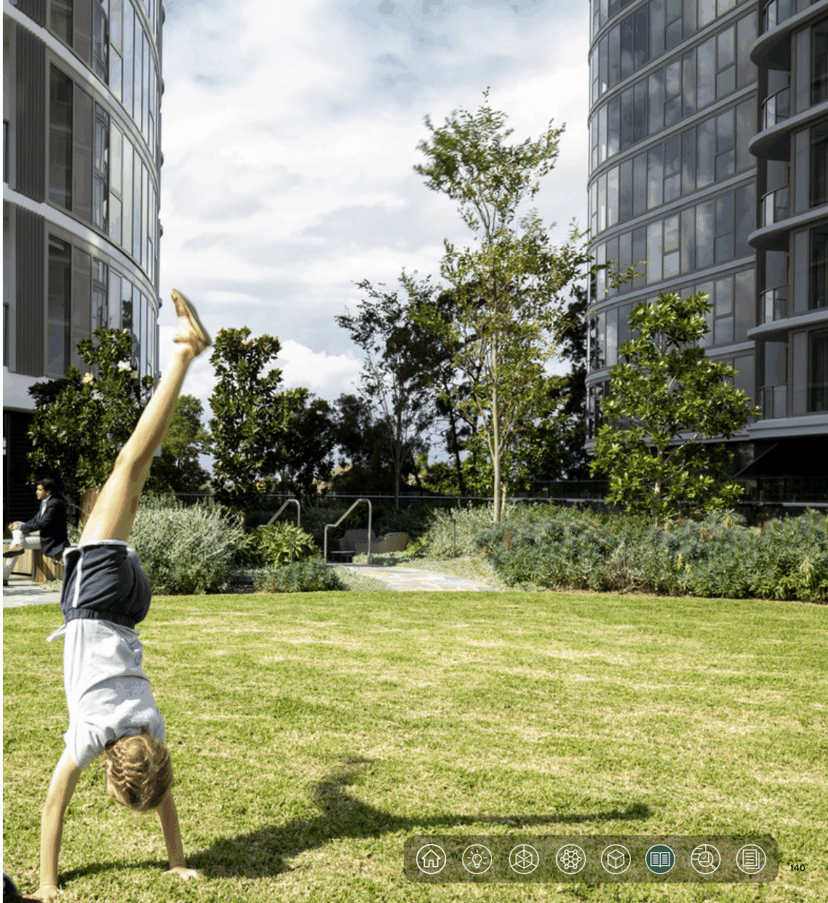

> [Picture on page 140: a picture, saved as a picture (images/ch-06-02-bankstown-city-centre-page-140-34.gif, 150 dpi).]

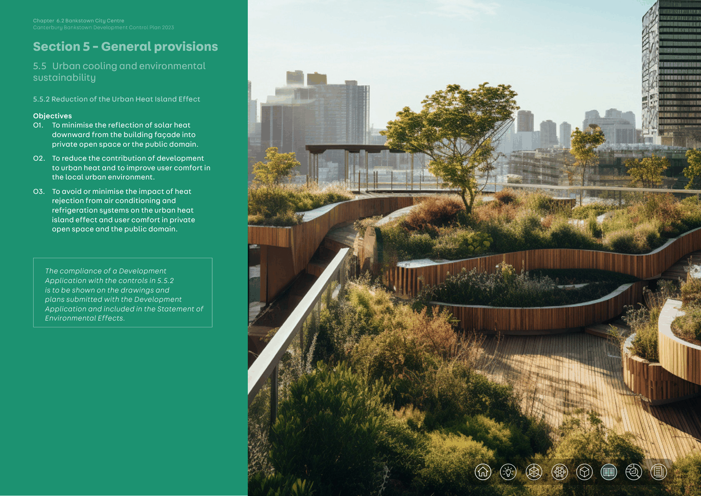

> [Picture on page 141: a picture, saved as a picture (images/ch-06-02-bankstown-city-centre-page-141-1.gif, 150 dpi).]
> Words printed on the picture (title and legend, copied from the PDF):
> The compliance of a Development
> Application with the controls in 5.5.2
> is to be shown on the drawings and
> plans submitted with the Development
> Application and included in the Statement of
> Environmental Effects.

### 5.5	 Urban cooling and environmental

#### sustainability

#### 5.5.2 Reduction of the Urban Heat Island Effect

#### Objectives

O1. 	 To minimise the reflection of solar heat downward from the building façade into private open space or the public domain. O2. 	 To reduce the contribution of development to urban heat and to improve user comfort in the local urban environment. O3. 	 To avoid or minimise the impact of heat rejection from air conditioning and refrigeration systems on the urban heat island effect and user comfort in private open space and the public domain.

### 5.5	 Urban cooling and environmental

#### sustainability

#### 5.5.2 Reduction of the Urban Heat Island Effect Controls

C1. 	 The extent of the vertical façade of street walls (or if no street wall, as measured from the first 12 metres from the ground plane) that comprise Reflective Surfaces must demonstrate a minimum percentage of shading as defined in Figure 61 Part A as calculated at the relevant time of year in Figure 63 and Figure 64.

C2. 	 The extent of the vertical façade of the tower (above the street wall or if no street wall, as measured above the first 12 metres from the ground plane) that comprise Reflective Surfaces must demonstrate a minimum percentage of shading as defined in Figure 61 Part B as calculated at the relevant time of year in Figure 63 and Figure 64.

C3. 	 Compliance with C1 and C2 above is demonstrated on 21 December on the east-facing façade at 10 AM, northeast and southeast facing façade at 11.30 AM, north-facing façade at 1 PM, northwest and southwest facing façade at 2.30 PM and the west-facing façade at 4 PM as shown in Figure 63.

C4. 	 Compliance with C1 and C2 above is demonstrated on 21 July on the northeast-facing façade at 10 AM, north northeast facing façade at 11.30 AM and 1 PM, and northwest facing façade at 2.30 PM and 4 PM as shown in Figure 64.

C5. 	 Shading may be provided by:

a)	 External feature shading with non-reflective surfaces;

b)	 Intrinsic features of the building form such as reveals and returns; and

c)	 Shading from vegetation such as green walls, where requirements for upkeep is covered by a positive covenant

C6. 	 Where it is demonstrated that shading cannot be achieved in accordance with C1- C4, development must provide:

a)	 A maximum external solar reflectance as defined in Table 12 is required for all Reflective surfaces; and

b)	 Applicants must provide elevations illustrating facade surface areas, indicating the location of any shading devices and external finishes, and the solar reflectance value of the cladding; and

c)	 Applicants must submit technical information that verifies the solar reflectance value of the cladding; and

d)	 Additional deep soil requirements to offset and reduce urban heat. The additional requirements will be determined by Council on a case by case basis.

C7. 	 Shadow diagrams must be submitted with the development application quantifying the extent of shading at 10 AM, 11.30 AM, 1 PM, 2.30 PM and 4 PM on 21 December and 21 June for each relevant façade. Shadows from existing buildings, structures and vegetation are not considered in the calculations. These shadow diagrams are required in addition to, and not instead of, the requisite shadow diagrams to assess solar amenity and compliance with ADG requirements. Note: Refer to Figure 113 and Figure 114 for sun angles corresponding to shading reference times. Calculation of RSR for each relevant façade must also be submitted with the Development Application.

C8. 	 Where surfaces on rooftops or podiums are used for communal open space or other active purposes, the development must demonstrate at least 50% of the accessible roof area complies with one or a combination of the following:

a)	 Be shaded by a shade structure, or/and;

b)	 Be shaded by a solar panel or/and;

c)	 Be covered by vegetation consistent with the controls on Green Roofs or Walls or/and;

d)	 Provide shading through canopy tree planting, to be measured on the extent of the canopy cover 2 years after planting.

### 5.5	 Urban cooling and environmental

#### sustainability

#### 5.5.2 Reduction of the Urban Heat Island Effect

#### Controls (continued)

| Part A - Street Wall |  |  |  |
|---|---|---|---|
| Reflective Surface | <30% | 30-70% | ≥70% |
| Ration (RSR) |  |  |  |
| Minimum Shading (%) | 0 | 1.5*RSR-45 | 75 |
| Part B - Tower |  |  |  |
| Reflective Surface | <30% | 30-70% | ≥70% |
| Ration (RSR) |  |  |  |
| Minimum Shading (%) | 0 | 0.8*RSR-24 | 75 |

Figure 61.	 Shading Requirements

| Reflective | <30% | 30-70% | ≥70% |
|---|---|---|---|
| Surface |  |  |  |
| Ration (RSR) |  |  |  |
| Maximum | No | 62.5- | 10 |
| External Solar | Maximum | 0.75*RSR |  |
| Reflectance (%) |  |  |  |

Figure 62.	 Maximum External Surface Reflection

| Facade Orientation | Sun Angles - 21 December (Summer Solstice) | Facade Orientation Northeast ± 300 | Sun Angles - 21 July (Winter Solstice) 10 am AEDT |
|---|---|---|---|
| East ± 22.50 | 10 am AEDT Sun Elevation: 510 Azimuth: 660 |  | Sun Elevation: 280 Azimuth: 320 |
|  |  | North northeast ± 22.50 | 11:30 am AEDT |
| Northeast / | 11:30 am AEDT |  | Sun Elevation: 350 |
| Southeast ± 22.50 | Sun Elevation: 690 Azimuth: 660 |  | Azimuth: 90 |
|  |  | North northwest ± 22.50 | 1 pm AEDT |
| North ± 22.50 | 1 pm AEDT Sun Elevation: 800 Azimuth: 3520 |  | Sun Elevation: 300 Azimuth: 3430 |
|  |  | Northwest ± 22.50 | 2:30 pm AEDT |
| Northeast / | 2:30 pm AEDT |  | Sun Elevation: 250 |
| Southeast ± 22.50 | Sun Elevation: 670 Azimuth: 2900 |  | Azimuth: 3210 |
|  |  | Northwest ± 22.50 | 4 pm AEDT |
| West ± 22.50 | 4 pm AEDT Sun Elevation: 480 Azimuth: 2720 |  | Sun Elevation: 120 Azimuth: 3040 |

Figure 63.	 Sun Angles during Summer Solstice

Figure 64.	 Sun Angles during Winter Solstice

### 5.5	 Urban cooling and environmental

#### sustainability

#### 5.5.2 Reduction of the Urban Heat Island Effect

#### Controls (continued)

C9. 	 Where surfaces on rooftops or podiums are not used for private or public open space, for solar panels or heat rejection plant, the development must demonstrate the following:

a)	 Materials used have a minimum solar reflectivity index (SRI) of 82 if a horizontal surface or a minimum SRI of 39 for sloped surface greater than 15 degrees; or

b)	 75% of the total roof or podium surface be covered by vegetation; or

c)	 A combination of (a) and (b) for the total roof surface

d)	 Applicants must provide a plan illustrating all roof surface areas, indicating the location of any green roofs, flat mounted PV panels, and the SRI value of the roofing.

e)	 Applicants must submit technical information that verifies the SRI performance of roofing.

C10. 	 Residential apartments within a mixed-use development or residential flat building must incorporate efficient heating, ventilation and cooling systems which reject heat from a centralised source on the upper-most roof. C11. 	 Heat rejection units must not be located on the street wall frontage on the primary street or immediately adjacent to rooftop landscaped and/or communal areas unless separated by a solid wall.

Image - Flinders University Health and Medical Research Building, Bedford Park, SA, Architectus (Source: Trevor Mein)

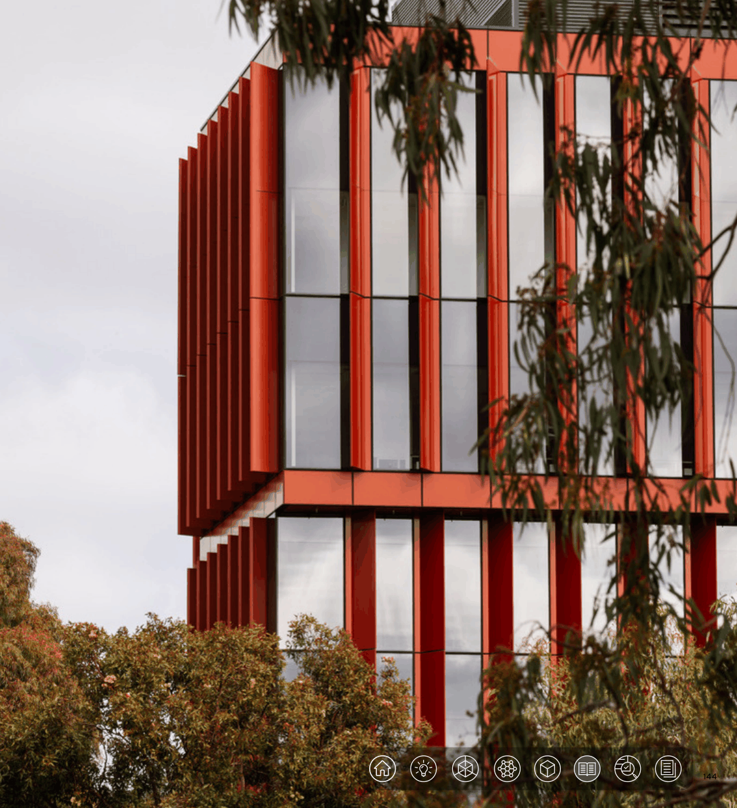

> [Picture on page 144: a picture, saved as a picture (images/ch-06-02-bankstown-city-centre-page-144-38.gif, 150 dpi).]

### 5.6	 Energy and Water Management

#### 5.6.1 Energy efficiency (BASIX affected buildings)

#### Objectives

O1. 	 Promote sustainable development which uses energy efficiently and minimises non-renewable energy usage during the construction and use of buildings. O2. 	 Ensure all new developments to actively contribute to the collective effort of reducing energy consumption throughout the Bankstown City Centre. O3. 	 Decrease dependency on the main grid energy supply within Bankstown City Centre by implementing alternative energy sources and strategies.

#### Controls

C1. 	 For developments not covered by BASIX,

compliance with the energy efficiency

provisions of the Building Code of Australia

(Section J) is mandatory. A Section J report,

along with annotated plans demonstrating

compliance with fabric and service

requirements, must be submitted.

C2. 	 All development not subject to BASIX

must issue documentation from a suitably

qualified consultant is to be submitted with

Development Applications demonstrating

the measures that will be used to achieve

the relevant energy efficiency scheme

rating. Evidence of a formal commitment

agreement or registration with the

relevant scheme administrator is required

to be submitted prior to the issuing of a

construction certificate.

C3. 	 All new developments must future proof

the integration of smart technologies for

the purposes of monitoring energy usage

(e.g. Lighting, heat, ventilation and air

conditioning).

C4. 	 Verification of energy target achievement

requires the submission of a signed

Commitment Agreement from the National

Australian Built Environment Rating

System (NABERS).

C5. 	 Targets for mixed-use developments

must be tailored to the specific mix and

proportion of land uses, determined on a

site-specific basis and at the discretion of

the Council.

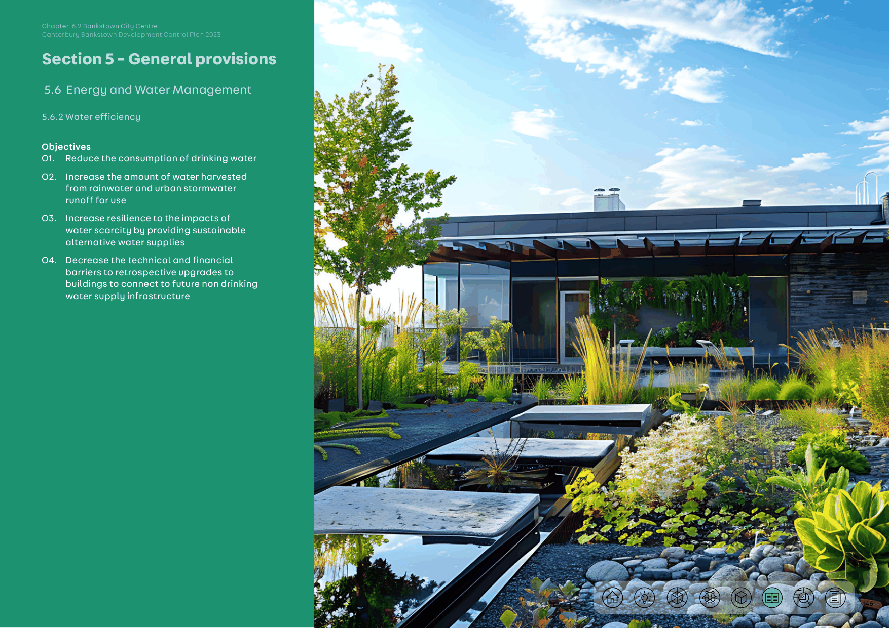

> [Picture on page 146: a picture, saved as a picture (images/ch-06-02-bankstown-city-centre-page-146-1.gif, 150 dpi).]
> Words printed on the picture (title and legend, copied from the PDF):
> 5.6.2 Water efficiency

### 5.6	 Energy and Water Management

#### Objectives

O1. 	 Reduce the consumption of drinking water O2. 	 Increase the amount of water harvested from rainwater and urban stormwater runoff for use O3. 	 Increase resilience to the impacts of water scarcity by providing sustainable alternative water supplies O4. 	 Decrease the technical and financial barriers to retrospective upgrades to buildings to connect to future non drinking water supply infrastructure

### 5.6	 Energy and Water Management

#### 5.6.2 Water efficiency

#### Controls

C1. 	 All new developments must include submetering and future proof for smart technologies to minimise water consumption.

C2. 	 Cooling towers must be designed in accordance with best practice guidelines to reduce water consumption. C3. 	 All development not subject to BASIX will need to incorporate the following water-saving measures:

a) 	 Plumbing fixtures are to meet minimum Water Efficiency Labelling and Standards (WELS) Scheme Standards including 4 star rated showerheads, 4 star rated toilet cisterns, 5 star rated urinals and 6 star rated water tap outlets.

b) 	 Appliances (dishwashers, clothes washers etc) are to be 5 stars (WELS Scheme) or better rated for water use efficiency.

C4. 	 All development not subject to BASIX must issue documentation from a suitably qualified consultant is to be submitted with development Applications demonstrating the measures that will be used to achieve the relevant water efficiency scheme rating. Evidence of a formal commitment agreement or registration with the relevant scheme administrator is required to be submitted prior to the issuing of a construction certificate.

C5. 	 Verification of energy target achievement

requires the submission of a signed

Commitment Agreement from the National

Australian Built Environment Rating

System (NABERS).

C6. 	 Targets for mixed-use developments must be

tailored to the specific mix and proportion

of land uses, determined on a site-specific

basis and at the discretion of the Council.

> [Picture on page 148: a picture, saved as a picture (images/ch-06-02-bankstown-city-centre-page-148-1.gif, 150 dpi).]
> Words printed on the picture (title and legend, copied from the PDF):
> 5.6.3 Electric Buildings
> combustion.

### 5.6	 Energy and Water Management

#### Objectives

O1. 	 To minimise the reliance on the consumption of fossil fuels in new development. O2. 	 To prevent indoor pollutants associated with

#### Controls

C1. 	 All new mixed-use development, residential development, commercial premises, tourist and visitor accommodation, health services facilities and educational establishments are to use only electricity for all energy requirements associated with normal operations. C2. 	 The use of fossil fuels for any purpose is not to exceed 1% of the projected annual energy demand for the building. ** — * Note: BASIX certification for residential developments at a DA stage must not rely on gas for heating or hot water to comply with Control C1 — ** Note: This control excludes emergency services and emergency infrastructure such as pumps and generators utilised in the case of emergencies (flood, fire, etc). 1% of projected annual energy demand for fossil fuels allows for the use of diesel for standby generation

### 5.7	 Signage and lighting

#### 5.7.3	 All proposed signage (including business

identification)

#### Controls

C1. 	 For all new development that proposes non-residential accommodation floor space and has more than two or more tenancies is to include a Preliminary Signage Strategy. The Preliminary Signage Strategy is to include, where applicable:

a) 	 A plan showing the location of all signage

b) 	 Indicative locations for all building identification signage

c) 	 Under awning signage zones

d) 	 Wayfinding signage zones

e) 	 Details of illumination of signage

f) 	 Dynamic Signage, and

g) 	 Tenancy shopfront signage zones.

#### 5.7.4	 Illuminated signage, including light

projection signage

In addition to the general requirements for signage in Chapter 3.6 – Signs of the CBDCP 2023, the following requirements apply to illuminated signage in Bankstown City Centre.

Controls

C1. 	 Externally illuminated signs must have a downward facing light source focused on the display area. Upward facing lights are not permitted.

C2. 	 Implementation of LED light fixtures is recommended, due to the significant reduction in energy consumption LED lights have in comparison to other light fixtures. C3. 	 Signs or lights with flashing, chasing, pulsating or flickering lights are not permitted unless part of an approved public artwork.

C4. 	 Existing signs on heritage items and existing buildings are to be retained where they have heritage value.

5.7.1	 Building identification signs - top of building signs

#### Controls

C1. Building identification signs located at the top of buildings must comply with the following:

a) 	 No more than two top of building signs are displayed on any one building, where each sign is of a similar size and appearance

b) 	 The top of building sign is allocated only to a significant tenant or the building’s owner

c) 	 The top of building design integrates with the building’s architecture, materiality, and finishes

d) 	 The signage has a maximum vertical height less than one typical floor of the building

e) 	 Signage is not on the building’s roof or positioned with the intention of being visible from the air

f) 	 The top of building sign is not used, sold or leased for third party business or advertisement.

### 5.7   Signage and lighting

#### 5.7.2	 Dynamic content sign

#### Controls

C1. Dynamic content signs that are visible from residential premises must:

a) 	 Only operate between 7am-11pm; and

b) 	 Involve static images that change and not be animated or include moving images/ videos; and

c) 	 Have an image dwell time ≥ 10 seconds, and a transition time of 0.1 seconds.

C2. 	 Illuminated or dynamic content signs are only permitted in shop windows subject to consent.

> [Picture on page 150: a picture, saved as a picture (images/ch-06-02-bankstown-city-centre-page-150-14.gif, 150 dpi).]

> [Picture on page 151: a picture, saved as a picture (images/ch-06-02-bankstown-city-centre-page-151-1.gif, 150 dpi).]
> Words printed on the picture (title and legend, copied from the PDF):
> All objectives and controls included in
> this part apply in addition to the following
> chapters of the CBDCP 2023:
> — Chapter 3 General Requirements - 3.3
> Waste Management
> — Applicable Waste Design for New
> Developments Guide.

### 5.8	   Waste management

Objectives O1. 	 Ensure that development in Bankstown City Centre enables convenient collection of waste and efficient and optimal waste management strategies across all development types within the area. O2. 	 Optimise waste collection logistics and to minimise truck movements to reduce traffic congestion, noise pollution, poor amenity, and environmental impact within the community. O3. 	 Safeguard the visual amenity, safety, and functional integrity of servicing areas of the site. O4. 	 Enable Food Waste and Garden Organic (FOGO) waste collection servicing and align with Council’s commitment to fostering a circular economy.

### 5.8 Waste management

#### Controls:

C1. 	 For large developments, or developments where Council determines collect and return is unsuitable,  ensure that waste collection activities exclusively occur on-site via an HRV per the Australian Standards 2890.2 preventing disruptions to shared laneways and maintaining the visual and functional quality of these spaces. C2. 	 Implement a range of measures that effectively minimise waste collection truck movements and reduce carbon emissions. C3. 	 Mandatory separation of food and garden organic waste at its source is required to meet the NSW Environment Protection Authority FOGO mandate and align with council’s commitment to fostering a circular economy. C4. 	 Additional recommendations regarding Waste Management strategies for developments with at least 1,000 residential dwellings are included in 5.8.3 Additional Waste Management Systems of this DCP. Note: The length of a vehicular ramp and turning reservation of an HRV requires approximately 55-60m to descend 5.0m into a basement

> [Picture on page 152: a picture, saved as a picture (images/ch-06-02-bankstown-city-centre-page-152-29.gif, 150 dpi).]

### 5.8 Waste management

#### 5.8.1  Waste management design for new

subdivisions

#### Controls

C1. 	 Subdivision design and road layout is to ensure that a HRV as per Australian Standard 2890.2 Parking Facilities: Off Street Commercial Vehicle Facilities can enter and exit the development (the subdivision) in a forward direction without the need to reverse.

C2. 	 For developments incorporating cul-de-sacs, plans illustrating turning paths for a HRV are to be provided to demonstrate that the vehicle can safely manoeuvre with no reverse vehicle movements. C3. 	 Temporary turning facilities and access roads for a HRV are to be provided for staged subdivision development where the entire road network will not be completed as part of Stage 1. This will ensure waste collection vehicles are able to enter and exit the development in a forward direction and can continue to service existing buildings.

#### 5.8.2  Waste management design for laneways

#### Controls

C1. 	 Laneways are of sufficient width to

accommodate a HRV (as per AS2890.2)

collection vehicle movements entering and

exiting and required manoeuvring to service

future dwellings.

C2. 	 Laneways are to be sufficiently wide for a

vehicle to pass a stationary waste truck.

C3. 	 Length of laneways need to be considered

to ensure collection staff can maintain

appropriate and safe sight distances to view

any obstructions.

C4. 	 Waste collection vehicles have sufficient

overhead clearance. Collection points need

to be located away from any overhead

wires, street tree canopies, building awning

and overhangs and other structures that can

impede waste collection access.

### 5.8 Waste management

#### 5.8.3 Additional waste management systems Innovative waste collection systems

High-density developments (of 1,000+ individual dwellings or units) provide a good opportunity to install advanced waste collection arrangements, such as underground bins, compaction units or automated waste collection systems (AWCS). These systems allow waste, recycling and organics to be collected below ground instead of having heavy collection vehicles driving through residential areas.

Refer to Page 69 https://www.epa.nsw.gov.au/-/media/epa/ corporate-site/resources/warrlocal/19p1559-resource-recovery-in-residential-developments.pdf

#### Automated Waste Collection Systems

Automated waste collection systems (AWCS) also known as ‘pneumatic’ or ‘vacuum’ systems are a technology that exists in many cities overseas. These systems consist of networks of underground pipes that use negative air pressure to transport waste and recycling along a pipe network to a centralised collection point. This can be up to 2.5km away from the building. From here a waste collection vehicle hauls the waste away for final treatment. The system is fully sealed, quiet and helps eliminate the need for bins and manual handling of waste. It also helps reduce the number of waste collection movements and can be aesthetically pleasing.

Refer to Page 87 https://www.epa.nsw.gov.au/-/media/epa/ corporate-site/resources/warrlocal/19p1559-resource-recovery-in-residential-developments.pdf

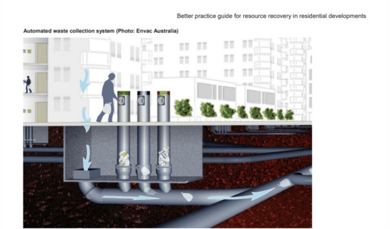

> [Picture on page 154: a picture, saved as a picture (images/ch-06-02-bankstown-city-centre-page-154-34.gif, 150 dpi).]

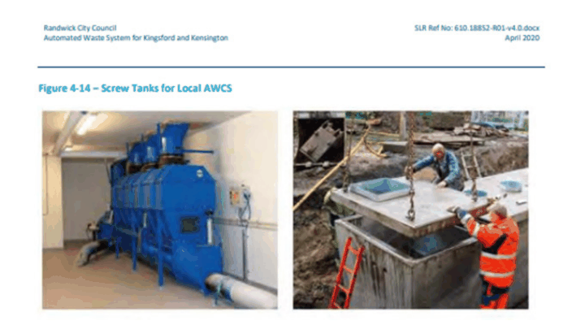

> [Picture on page 154: a picture, saved as a picture (images/ch-06-02-bankstown-city-centre-page-154-35.gif, 150 dpi).]

### 5.8 Waste management

#### 5.8.3 Additional waste management systems Static compactor with hook lift collection

In large developments of more than 400 apartments, larger capacity static compactors may be considered with council approval. Generally known as ‘hook-lift’ compactors, these systems come in a range of sizes with up to 40m3 capacity which, when combined with a 3:1 compaction ratio, can hold up to 90m3 of waste. This means that the frequency of collection can be significantly reduced, depending on the quantities. They are more suitable for commercial or larger residential developments. Static compactors require 6m clearance for Waste Servicing.

Hook-lift compactors require waste collection vehicles to reverse directly onto them, so the building will require enough turning and manoeuvring space for heavy rigid class collection vehicles. Access for these kinds of vehicles should be modelled using turning circle software during the design stage. Hook-lift compactors are normally provided by a waste contractor as part of a service package and come in two types: static and transportable

Refer to Page 108 https://www.epa.nsw.gov.au/-/media/epa/ corporate-site/resources/warrlocal/19p1559-resource-recovery-in-residential-developments.pdf

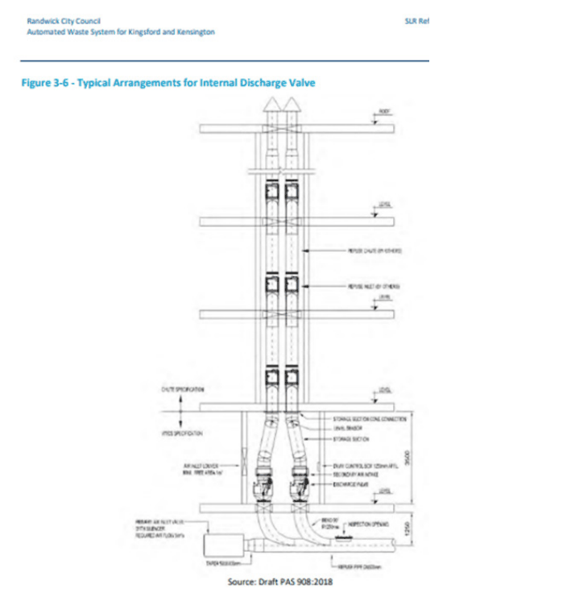

> [Picture on page 155: a picture, saved as a picture (images/ch-06-02-bankstown-city-centre-page-155-30.gif, 150 dpi).]

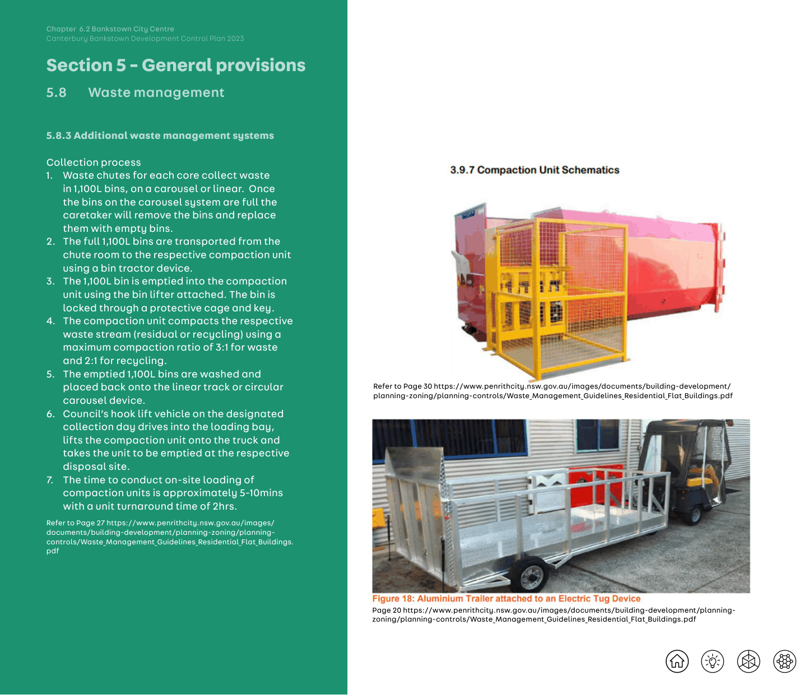

> [Picture on page 156: a picture, saved as a picture (images/ch-06-02-bankstown-city-centre-page-156-1.gif, 150 dpi).]
> Words printed on the picture (title and legend, copied from the PDF):
> Refer to Page 27 https://www.penrithcity.nsw.gov.au/images/
> documents/building-development/planning-zoning/planning-
> controls/Waste_Management_Guidelines_Residential_Flat_Buildings.
> pdf
> Refer to Page 30 https://www.penrithcity.nsw.gov.au/images/documents/building-development/
> planning-zoning/planning-controls/Waste_Management_Guidelines_Residential_Flat_Buildings.pdf
> Page 20 https://www.penrithcity.nsw.gov.au/images/documents/building-development/planning-
> zoning/planning-controls/Waste_Management_Guidelines_Residential_Flat_Buildings.pdf

### 5.8 Waste management

#### 5.8.3 Additional waste management systems

Collection process

1\.	 Waste chutes for each core collect waste in 1,100L bins, on a carousel or linear.  Once the bins on the carousel system are full the caretaker will remove the bins and replace them with empty bins.

2\.	 The full 1,100L bins are transported from the chute room to the respective compaction unit using a bin tractor device.

3\.	 The 1,100L bin is emptied into the compaction unit using the bin lifter attached. The bin is locked through a protective cage and key.

4\.	 The compaction unit compacts the respective waste stream (residual or recycling) using a maximum compaction ratio of 3:1 for waste and 2:1 for recycling.

5\.	 The emptied 1,100L bins are washed and placed back onto the linear track or circular carousel device.

6\.	 Council’s hook lift vehicle on the designated collection day drives into the loading bay, lifts the compaction unit onto the truck and takes the unit to be emptied at the respective disposal site.

7\.	 The time to conduct on-site loading of compaction units is approximately 5-10mins with a unit turnaround time of 2hrs.

### 5.8 Waste management

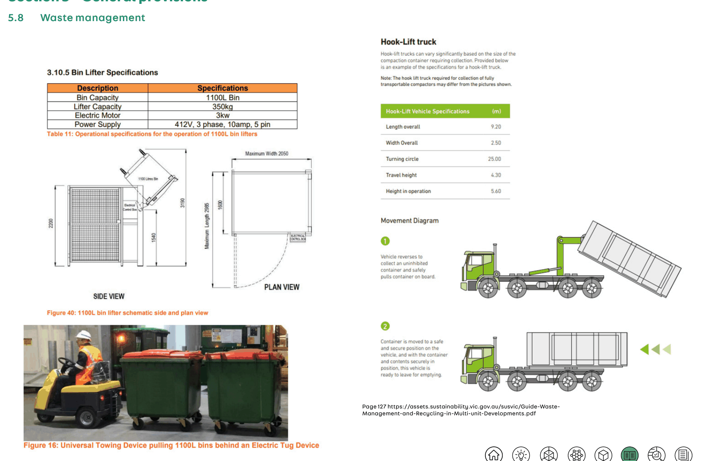

> [Picture on page 157: a picture, saved as a picture (images/ch-06-02-bankstown-city-centre-page-157-2.gif, 150 dpi).]

> Words printed on the picture (title and legend, copied from the PDF):
> Page 127 https://assets.sustainability.vic.gov.au/susvic/Guide-Waste-

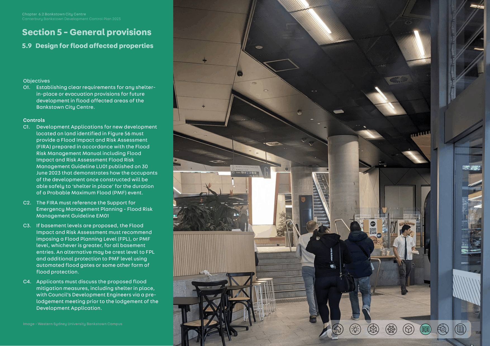

> [Picture on page 158: a picture, saved as a picture (images/ch-06-02-bankstown-city-centre-page-158-1.gif, 150 dpi).]
> Words printed on the picture (title and legend, copied from the PDF):
> Image - Western Sydney University Bankstown Campus

### 5.9	 Design for flood affected properties

Objectives O1. 	 Establishing clear requirements for any shelter-in-place or evacuation provisions for future development in flood affected areas of the Bankstown City Centre.

#### Controls

C1. 	 Development Applications for new development located on land identified in Figure 56 must provide a Flood Impact and Risk Assessment (FIRA) prepared in accordance with the Flood Risk Management Manual including Flood Impact and Risk Assessment Flood Risk Management Guideline LU01 published on 30 June 2023 that demonstrates how the occupants of the development once constructed will be able safely to ‘shelter in place’ for the duration of a Probable Maximum Flood (PMF) event. C2. 	 The FIRA must reference the Support for Emergency Management Planning - Flood Risk Management Guideline EM01 C3. 	 If basement levels are proposed, the Flood Impact and Risk Assessment must recommend imposing a Flood Planning Level (FPL), or PMF level, whichever is greater, for all basement entries. An alternative may be crest level to FPL and additional protection to PMF level using automated flood gates or some other form of flood protection. C4. 	 Applicants must discuss the proposed flood mitigation measures, including shelter in place, with Council’s Development Engineers via a pre-lodgement meeting prior to the lodgement of the Development Application.

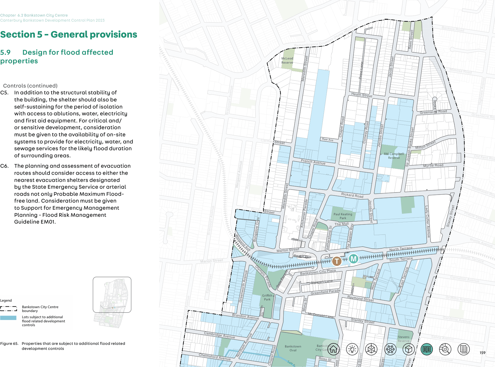

> [Picture on page 159: a map, saved as a picture (images/ch-06-02-bankstown-city-centre-page-159-1.gif, 150 dpi); the street names and other small labels are on the picture.]
> Words printed on the picture (title and legend, copied from the PDF):
> Bankstown City Centre
> Lots subject to additional
> flood related development
> way (Hume Highway
> Old Kent Roa
> Sir Joseph Banks Street Myrtle Road
> Weigand Avenue Reynolds Avenue
> Prairie Vale Road
> Lady Cutler Avenue
> The Appian Way
> Bankstown City Plaza
> e Dale Parade
> Greenfield Parade Lopez Ln
> Chapel Road P
> rd Street Street

Figure 65.	 Properties that are subject to additional flood related

### 5.9 Design for flood affected

#### properties

C5. 	 In addition to the structural stability of the building, the shelter should also be self-sustaining for the period of isolation with access to ablutions, water, electricity and first aid equipment. For critical and/ or sensitive development, consideration must be given to the availability of on-site systems to provide for electricity, water, and sewage services for the likely flood duration of surrounding areas.

C6. 	 The planning and assessment of evacuation routes should consider access to either the nearest evacuation shelters designated by the State Emergency Service or arterial roads not only Probable Maximum Flood-free land. Consideration must be given to Support for Emergency Management Planning - Flood Risk Management Guideline EM01.

a et

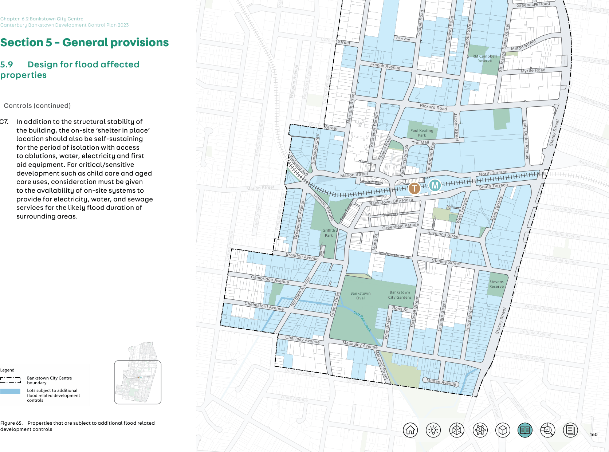

> [Picture on page 160: a map, saved as a picture (images/ch-06-02-bankstown-city-centre-page-160-1.gif, 150 dpi); the street names and other small labels are on the picture.]
> Words printed on the picture (title and legend, copied from the PDF):
> Bankstown City Centre
> Lots subject to additional
> flood related development
> Old Kent Roa
> Sir Joseph Banks Street Myrtle Road
> Weigand Avenue Reynolds Avenue
> Prairie Vale Road
> Lady Cutler Avenue
> The Appian Way
> Bankstown City Plaza
> e Dale Parade
> Chapel Road P
> Leonard Street Percy Street
> Road James Street

Figure 65.	 Properties that are subject to additional flood related

### 5.9 Design for flood affected

#### properties

C7. 	 In addition to the structural stability of the building, the on-site ‘shelter in place’ location should also be self-sustaining for the period of isolation with access to ablutions, water, electricity and first aid equipment. For critical/sensitive development such as child care and aged care uses, consideration must be given to the availability of on-site systems to provide for electricity, water, and sewage services for the likely flood duration of surrounding areas.

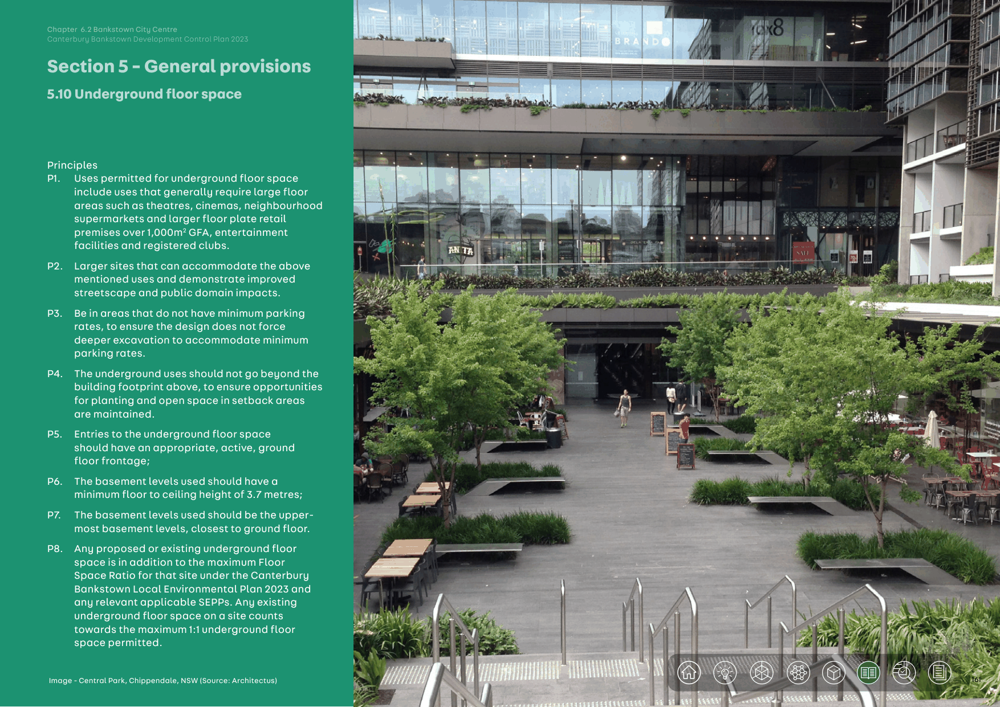

> [Picture on page 161: a picture, saved as a picture (images/ch-06-02-bankstown-city-centre-page-161-1.gif, 150 dpi).]
> Words printed on the picture (title and legend, copied from the PDF):
> Image - Central Park, Chippendale, NSW (Source: Architectus)

### 5.10	Underground floor space

Principles P1. Uses permitted for underground floor space include uses that generally require large floor areas such as theatres, cinemas, neighbourhood supermarkets and larger floor plate retail premises over 1,000m2 GFA, entertainment facilities and registered clubs. P2. 	 Larger sites that can accommodate the above mentioned uses and demonstrate improved streetscape and public domain impacts. P3. 	 Be in areas that do not have minimum parking rates, to ensure the design does not force deeper excavation to accommodate minimum parking rates. P4. 	 The underground uses should not go beyond the building footprint above, to ensure opportunities for planting and open space in setback areas are maintained. P5. 	 Entries to the underground floor space should have an appropriate, active, ground floor frontage; P6. 	 The basement levels used should have a minimum floor to ceiling height of 3.7 metres; P7. The basement levels used should be the upper-most basement levels, closest to ground floor. P8. 	 Any proposed or existing underground floor space is in addition to the maximum Floor Space Ratio for that site under the Canterbury Bankstown Local Environmental Plan 2023 and any relevant applicable SEPPs. Any existing underground floor space on a site counts towards the maximum 1:1 underground floor space permitted.

### 5.11	 Development near late night trading

#### uses and noisy areas

Controls C1. 	 Residential development is to include acoustic measures to reduce the impact of noise from existing or planned external sources (for example busy roads, adjoining industries or commercial activities, late night trading premises, live music venues and public parks and plazas in which people may congregate or host live music or events). C2. 	Development is to incorporate measures that reduce the entry of noise from external sources into dwellings. Such measures can include one or more of the following:

a) 	 a limit on window size and number where oriented towards an intrusive noise source.

b) 	 seals at entry doors to reduce noise transmission from common corridors or outside the building.

c) 	 storage, circulation areas, and non-habitable rooms to buffer noise from external sources.

d) 	 double or acoustic glazing.

e) 	 operable acoustic screens to balconies.

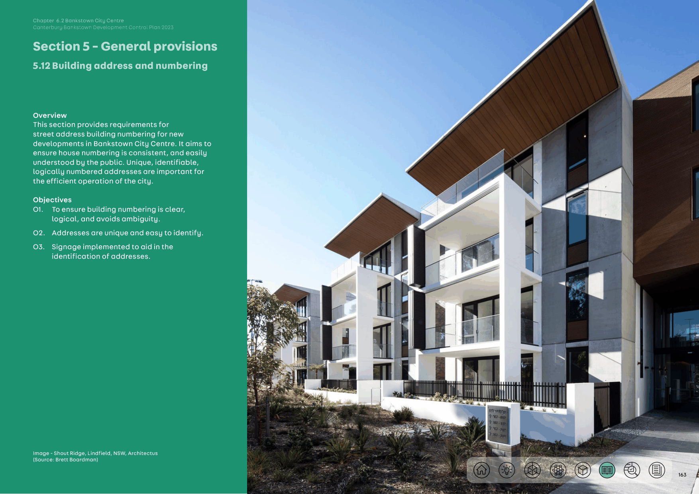

> [Picture on page 163: a picture, saved as a picture (images/ch-06-02-bankstown-city-centre-page-163-1.gif, 150 dpi).]
> Words printed on the picture (title and legend, copied from the PDF):
> logical, and avoids ambiguity.
> identification of addresses.
> Image - Shout Ridge, Lindfield, NSW, Architectus
> (Source: Brett Boardman)

### 5.12	Building address and numbering

#### Overview

This section provides requirements for street address building numbering for new developments in Bankstown City Centre. It aims to ensure house numbering is consistent, and easily understood by the public. Unique, identifiable, logically numbered addresses are important for the efficient operation of the city.

#### Objectives

O1. 	 To ensure building numbering is clear,

O2. 	 Addresses are unique and easy to identify. O3. 	 Signage implemented to aid in the

### 5.12   Building address and numbering

#### Controls

C1. 	 Main entranceways to residential buildings must have access to the primary street frontage, in correspondence with the residential address.

C2. 	 Single houses on land that has not been subdivided must be allocated a single number (e.g. 1 Rickard Road) sequentially with odd and even numbers on opposite sides of the street.

C3. 	 If land is subdivided or in scenarios where new developments are proposed where additional numbers are required, suffixes (e.g. 1, 1A and 1B Rickard Road) can be used. C4. 	 Suffixed numbers must:

a) 	 Start at A; and

b) 	 Be ordered sequentially, in the direction of the numbering on the street.

C5. 	 Strata units must:

a) 	 Be numbered from 1 sequentially, and;

b) 	 Use floor numbers as a prefix (e.g. 101, 201,

301\) in medium to high density buildings.

C6. 	 House numbers must be placed at the

front of the house near the door, and on

a post box.

C7. 	 Apartment numbers must be on the front

door, with individual post boxes for each

apartment also numbered and accessible

to delivery services. The street number of

the apartment block must be placed near

the front door, with additional signage on

the primary frontage that is legible form

the street.

C8. 	 In accordance with Section 2.3 Connecting

with Country, building names are to consider

the use of Aboriginal words and names as

part of a holistic Connecting with Country

strategy for development on the site.

### 5.13	General requirements for certain new

#### development

#### Controls

C1. 	 Retail development that proposes to provide shopping trolleys for customers must either provide coin-operated locks or a self-wheel locking mechanism that is activated when shopping trolleys travel beyond the site C2. 	 Commercial premises that provide shopping trolleys for customers are to submit a shopping trolley containment strategy with their Development Application. The trolley containment strategy must address the following conditions:

(h) Commercial premises that provide trolleys must have a trolley restriction system in place to stop any trolley leaving the property boundaries;

(i) Recognition of laws under the Public Spaces (Unattended Property) Act 2021, which include harsher penalties for owners of shopping trolleys, unregistered cars and trailers;

(j) Trolleys must be branded & include contact details; and

(k) Operators with more than 25 shopping trolleys have 3 hours to collect unattended trolleys (outside the hours 11pm-7am).

Image - Industry Lanes, Richmond, VIC, Architectus (Source: Trevor Mein)

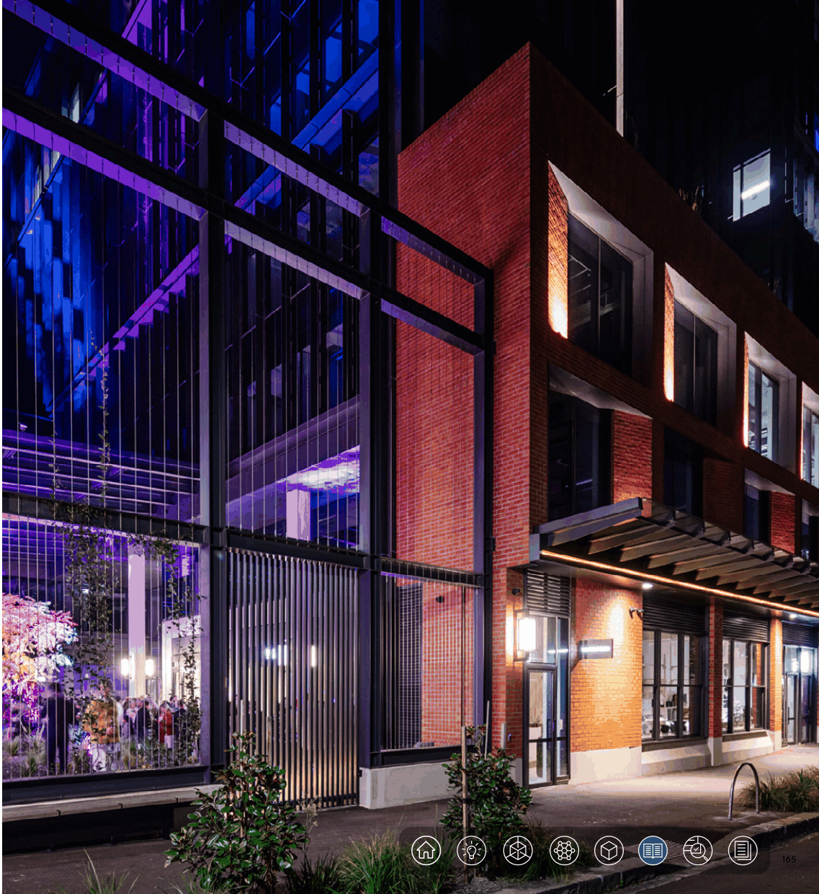

> [Picture on page 165: a picture, saved as a picture (images/ch-06-02-bankstown-city-centre-page-165-32.gif, 150 dpi).]

### KEY SITES
