## Section 6 - Key sites

#### Overview of key sites

#### Overview

The following sites have been identified as playing a key role in the realisation of the vision and objectives of Bankstown City Centre, due to their site area being 5,000sqm or more, the site having a single ownership, the potential uses for the site and the site’s location. To ensure for an optimal outcome for the city, early engagement between the applicant and Council is essential. All site maps and figures are indicative and subject to the lodgement of a detailed Development Application.

KS1

New Bankstown Hospital, TAFE and LaSalle Catholic College site

KS2

ALDI store site - Chapel Road and Richard Road

KS3 67-70 Rickard Road, Bankstown

KS4 Compass Centre

KS5 Bankstown Sports Club

KS6

South Terrace and future public park and plaza

KS7 8-14 West Terrace

KS8 212 South Terrace

KS9 Bankstown Central

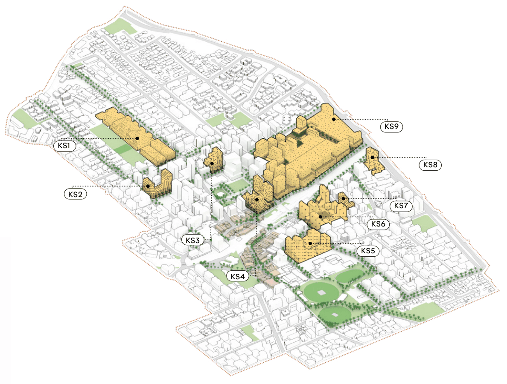

> [Picture on page 167: a picture, saved as a picture (images/ch-06-02-bankstown-city-centre-page-167-30.gif, 150 dpi).]
> Words printed on the picture (title and legend, copied from the PDF):
> KS9
> KS1
> KS8
> KS2
> KS7
> KS6
> KS3
> KS5
> KS4

Figure 66.	 Axonometric view of key sites in Bankstown City Centre with indicative massing of potential future development

#### Overview of key sites

All sites within the site boundary should undergo a Design Excellence Process.

Legend Bankstown City Centre boundary

Key sites

KS1

New Bankstown Hospital, TAFE and LaSalle Catholic College site

KS2

ALDI store site - Chapel Road and Richard Road

KS3

67-70 Rickard Road, Bankstown

KS4 Compass Centre

KS5 Bankstown Sports Club

KS6

South Terrace and future public park and plaza

KS7 8-14 West Terrace

KS8 212 South Terrace

KS9 Bankstown Central

Figure 67.	 Key sites map

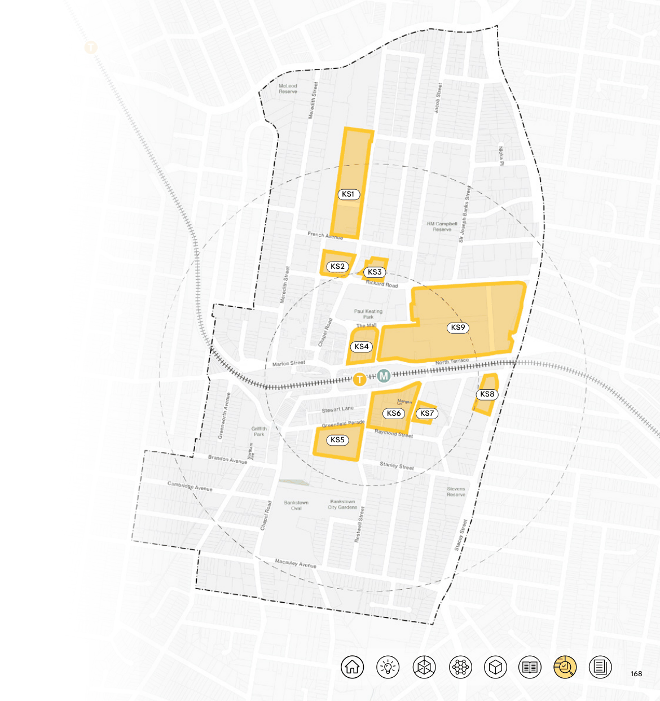

> [Picture on page 168: a picture, saved as a picture (images/ch-06-02-bankstown-city-centre-page-168-27.gif, 150 dpi).]
> Words printed on the picture (title and legend, copied from the PDF):
> KS1
> KS2
> KS3
> KS9
> KS4
> KS8
> KS6 KS7
> KS5

#### Overview of key sites

#### Objectives

O1. 	 To ensure that development is unique to the character, climate and demographic of Bankstown City Centre. O2. 	 To achieve Design Excellence, create inspirational key sites with high quality innovative architecture, that are sustainably built, offer community benefit, provide new publicly accessible and private spaces that contribute positively to Bankstown’s sense of place and its skyline. O3. 	 To ensure that the principles of Connecting to Country are enshrined and represented in these sites. O4. 	 To ensure development does not compromise or reduce solar access to parks. O5. 	 To integrate through site links, to expand the public domain and improve pedestrian and cyclist permeability and connect to existing and new open space. O6. 	 To provide for a range of heights on key sites to create an interesting and diverse skyline. O7. 	 To ensure that the interface of sites activate the public domain and invite the public into new publicly accessible spaces. O8. 	 To ensure that podiums are articulated to appear as smaller parts to create a positive fine grained and varied experience at street level. O9. 	 To ensure that building services are integrated into the building design and hidden from public view to provide a quality street interface.

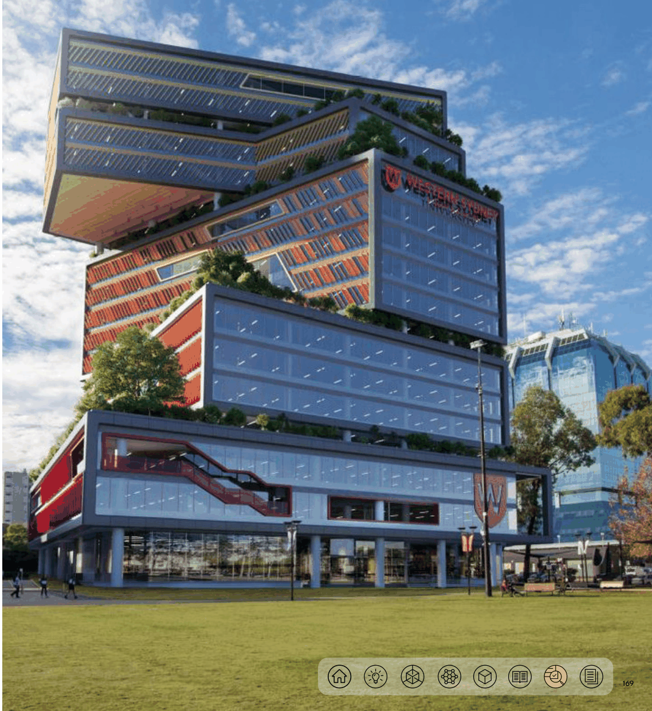

> [Picture on page 169: a picture, saved as a picture (images/ch-06-02-bankstown-city-centre-page-169-35.gif, 150 dpi).]

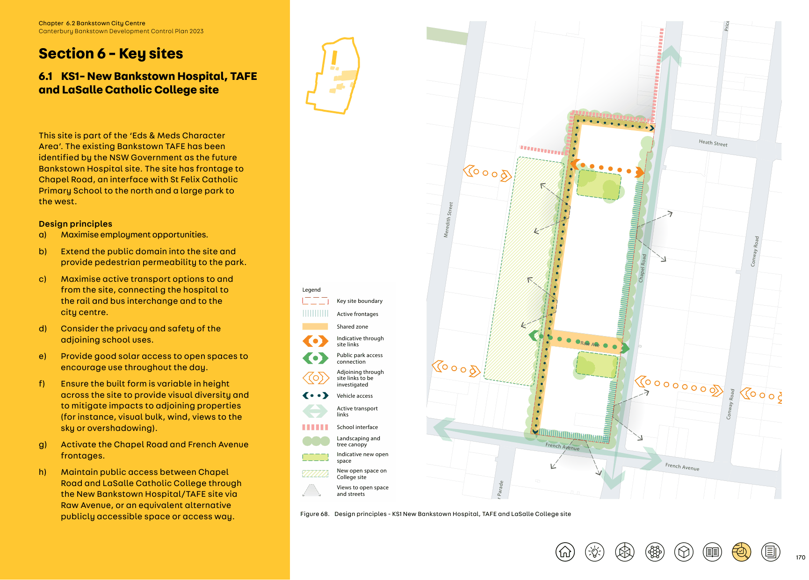

> [Picture on page 170: a map, saved as a picture (images/ch-06-02-bankstown-city-centre-page-170-1.gif, 150 dpi); the street names and other small labels are on the picture.]
> Words printed on the picture (title and legend, copied from the PDF):
> adjoining school uses.

### 6.1	 KS1- New Bankstown Hospital, TAFE

#### and LaSalle Catholic College site

This site is part of the ‘Eds & Meds Character Area’. The existing Bankstown TAFE has been identified by the NSW Government as the future Bankstown Hospital site. The site has frontage to Chapel Road, an interface with St Felix Catholic Primary School to the north and a large park to the west.

#### Design principles

a) Maximise employment opportunities.

b) Extend the public domain into the site and provide pedestrian permeability to the park.

c) Maximise active transport options to and from the site, connecting the hospital to the rail and bus interchange and to the city centre.

d) Consider the privacy and safety of the

e) Provide good solar access to open spaces to encourage use throughout the day.

f) Ensure the built form is variable in height across the site to provide visual diversity and to mitigate impacts to adjoining properties (for instance, visual bulk, wind, views to the sky or overshadowing).

g) Activate the Chapel Road and French Avenue

h) Maintain public access between Chapel Road and LaSalle Catholic College through the New Bankstown Hospital/TAFE site via Raw Avenue, or an equivalent alternative publicly accessible space or access way.

Key site boundary

Active frontages

Indicative through

Public park access

Adjoining through site links to be

Active transport

School interface Landscaping and

Indicative new open

New open space on

Views to open space

Jacobs Street

Figure 68.	 Design principles - KS1 New Bankstown Hospital, TAFE and LaSalle College site

Rickard Road

Rick

### 6.1   KS1- New Bankstown Hospital, TAFE

#### and LaSalle Catholic College site

#### Design principles (continued)

i) Provide at least 3,000-4,000m2 of publicly accessible open space associated with any development of the existing southern playing fields of LaSalle Catholic College, with clear public access from Raw Avenue or an alternate public access way to Chapel Road.

j) Ensure development of the new Bankstown Hospital and TAFE site provides overlooking of playing fields, Chapel Road and French Avenue.

k) Pedestrian arrival points of any health or education building should include a public forecourt, with landscaping and weather protection.

l) Development of the future hospital site and TAFE site should include a wayfinding and signage strategy.

m) Provide design excellence across the site that are visually striking and interesting buildings that are unique and contribute to the identity of Bankstown as a place for beautiful architecture.

n) Provide a public art strategy with the State Significant Development Application that shows how public art will be integrated across the site’

o) Use green landscaping throughout the site at ground level and on buildings to help provide amenity and habitat and help create a welcoming place for patients workers and visitors to the site.

Image

2 -  Victorian Heart Hospital, Clayton, VIC, Architectus (Source: Peter Bennetts

p) The new building at the corner of French Avenue

and Chapel Road to act as a landmark building that

serves as the ‘front door’ for the site for pedestrians

accessing the hospital and TAFE from the Sydney

Metro and railway station and Bankstown CBD.

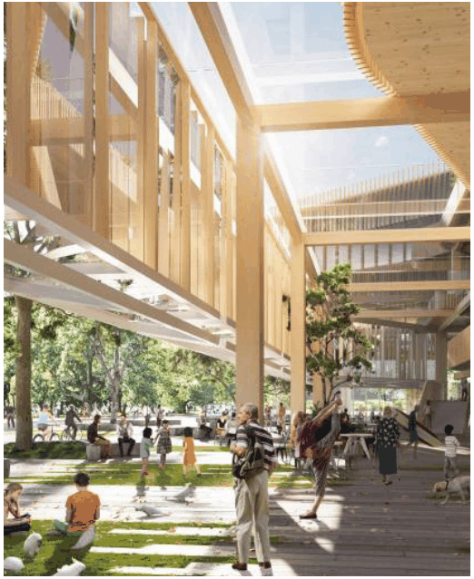

> [Picture on page 171: a picture, saved as a picture (images/ch-06-02-bankstown-city-centre-page-171-43.gif, 150 dpi).]

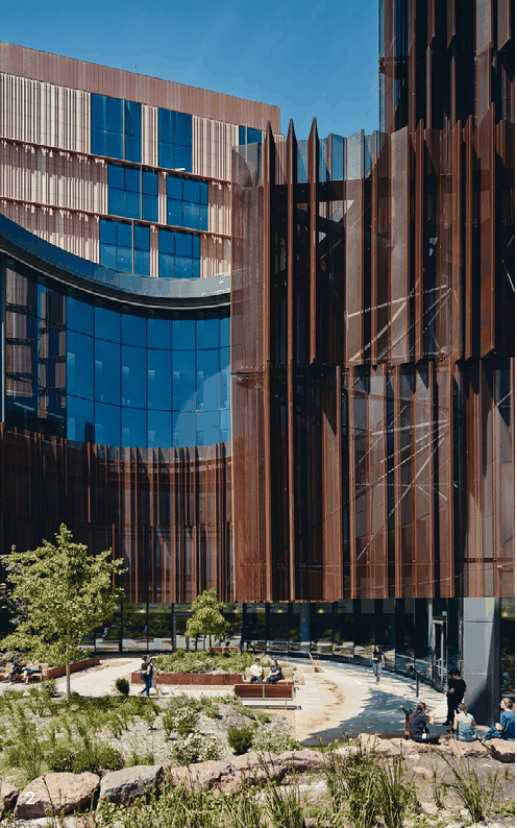

> [Picture on page 171: a picture, saved as a picture (images/ch-06-02-bankstown-city-centre-page-171-44.gif, 150 dpi).]
> Words printed on the picture (title and legend, copied from the PDF):
> 2

### 6.2	 KS2 - ALDI Store site - Chapel Road

#### and Rickard Road

This site has three street frontages, Chapel and Rickard Road and Kitchener Parade and is located within the Eds & Meds Character Area. There is an interface to the north with Little Saigon Plaza. This key site provides potential for pedestrian permeability from the northern and western parts of the city centre.

#### Design principles

a) Ensure the development maximises engagement with street frontages and draws people into the site from the northern and western part of the centre.

b) Provide for a mix of uses that will activate the site and the street.

c) Provide separation with the existing building to the north with a green buffer.

d) Enhance and maximise active transport options to and from the site, connecting Bankstown Hospital to Bankstown Train Station and city centre.

e) Prioritise loading and unloading and vehicular access from Kitchener Parade.

Images:

1 - Barrack Place, Architectus (Source: Brett Boardman) 2 - Hoddle Street, Architectus (Source: Tim Shaw)

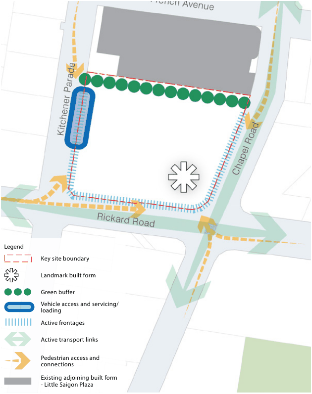

> [Picture on page 172: a map, saved as a picture (images/ch-06-02-bankstown-city-centre-page-172-28.gif, 150 dpi); the street names and other small labels are on the picture.]
> Words printed on the picture (title and legend, copied from the PDF):
> Key site boundary
> Landmark built form
> Vehicle access and servicing/
> Active transport links
> Pedestrian access and
> Existing adjoining built form
> - Little Saigon Plaza

Figure 69.	 Design principles - KS2. ALDI Store site - Chapel Road and Rickard Road

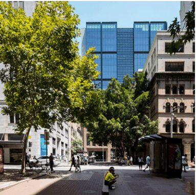

> [Picture on page 172: a picture, saved as a picture (images/ch-06-02-bankstown-city-centre-page-172-30.gif, 150 dpi).]

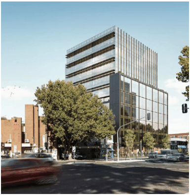

> [Picture on page 172: a picture, saved as a picture (images/ch-06-02-bankstown-city-centre-page-172-31.gif, 150 dpi).]

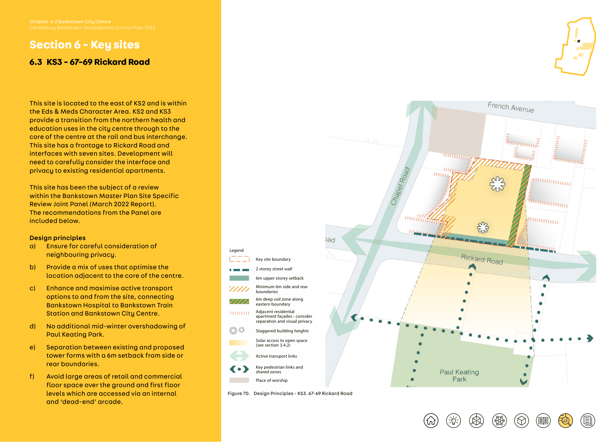

> [Picture on page 173: a picture, saved as a picture (images/ch-06-02-bankstown-city-centre-page-173-1.gif, 150 dpi).]
> Words printed on the picture (title and legend, copied from the PDF):
> neighbouring privacy.
> Paul Keating Park.
> Legend

### 6.3	 KS3 - 67-69 Rickard Road

This site is located to the east of KS2 and is within the Eds & Meds Character Area. KS2 and KS3 provide a transition from the northern health and education uses in the city centre through to the core of the centre at the rail and bus interchange. This site has a frontage to Rickard Road and interfaces with seven sites. Development will need to carefully consider the interface and privacy to existing residential apartments.

This site has been the subject of a review within the Bankstown Master Plan Site Specific Review Joint Panel (March 2022 Report). The recommendations from the Panel are included below.

#### Design principles

a) Ensure for careful consideration of

b) Provide a mix of uses that optimise the location adjacent to the core of the centre.

c) Enhance and maximise active transport options to and from the site, connecting Bankstown Hospital to Bankstown Train Station and Bankstown City Centre.

d) No additional mid-winter overshadowing of

e) Separation between existing and proposed tower forms with a 6m setback from side or rear boundaries.

f) Avoid large areas of retail and commercial floor space over the ground and first floor levels which are accessed via an internal and ‘dead-end’ arcade.

Key site boundary

2 storey street wall

6m upper storey setback

Minimum 6m side and rear

boundaries

6m deep soil zone along

eastern boundary

Adjacent residential

apartment façades - consider

separation and visual privacy

Staggered building heights

Solar access to open space

(see section 3.4.2)

Active transport links

Key pedestrian links and

shared zones

Place of worship

Figure 70.	 Design Principles - KS3. 67-69 Rickard Road

### 6.3   KS3 - 67-69 Rickard Road

#### Design principles (continued)

g) Design approach should be a focus during design development to ensure, among other things, greater amenity from light and air in the proposed lower-level spaces and reduced walking distance from the street frontage to each tenancy.

h) A 2 storey street wall to establish continuity with the street wall of the existing building to the west.

i) Provide a minimum 6m upper storey setback above the 2 storey street wall.

j) Provide two distinctly separate towers with a minimum separation of 12m to resolve amenity issues, modulate the massing and reduce building bulk.

k) Provide a minimum 6m setback from the western side boundary to the mid-level tower fronting Rickard Road to provide separation from the existing building to the west and to reduce the continuous length of this secondary street wall.

l) Address the excessive building length to Rickard Road with well defined articulation.

m) Provide 6m wide deep soil planting zone to the eastern boundary to meet or exceed ADG requirements.

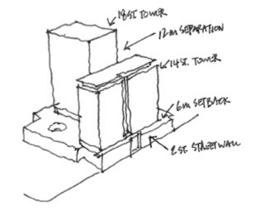

> [Picture on page 174: a picture, saved as a picture (images/ch-06-02-bankstown-city-centre-page-174-29.gif, 150 dpi).]

Figure 71.	 Staggered tower heights (Source: Joint Panel Report Bankstown Master Plan Site Specific Review, March 2022)

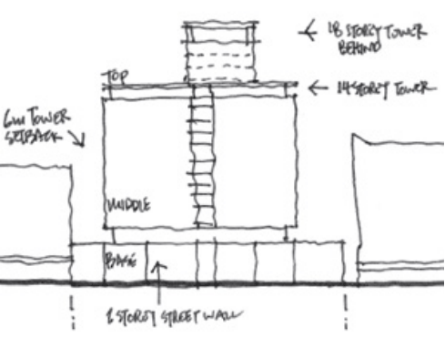

> [Picture on page 174: a picture, saved as a picture (images/ch-06-02-bankstown-city-centre-page-174-33.gif, 150 dpi).]

Figure 72.	 Built form should be vertically articulated to minimise visual bulk and scale impacts (Source: Joint Panel Report Bankstown Master Plan Site Specific Review, March 2022)

### 6.3   KS3 - 67-69 Rickard Road

#### Design principles (continued)

n) A 14 storey tower fronting Rickard Road is required as part of the redevelopment of the site as this would: — Be more compatible with adjacent existing towers along Rickard Road — Serve as an appropriate height transition toward Paul Keating Park, and — Achieve a 4 storey staggered height to the rear tower to help modulate building bulk.

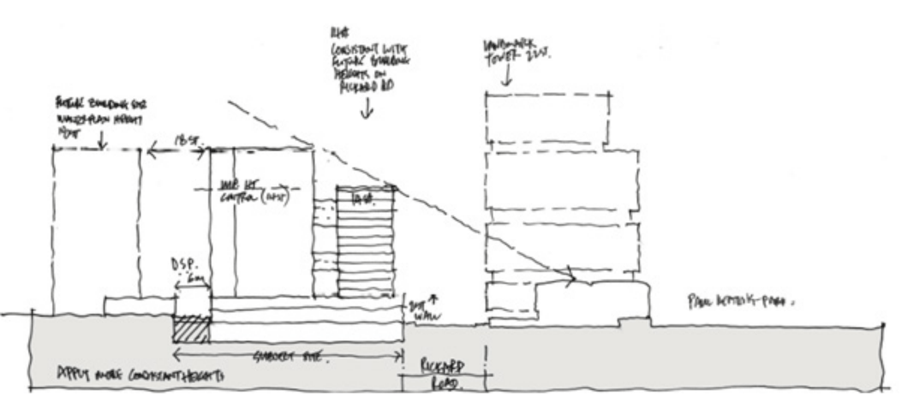

> [Picture on page 175: a picture, saved as a picture (images/ch-06-02-bankstown-city-centre-page-175-13.gif, 150 dpi).]

Figure 73.	 Staggered tower heights and transition in height to Paul Keating Park (Source: Joint Panel Report Bankstown Master Plan Site Specific Review, March 2022)

### 6.4	 KS4 - Compass Centre

This site is part of the City Centre Character Area. The site occupies the entire block and the Town Centre Precinct as part of the Bankstown Centre site, is to the immediate east. This is the core area of the centre of Bankstown and present many opportunities directly adjacent to the railway station and new Sydney Metro.

This area has the potential to accommodate a high density, 24-hour city centre with pre-eminent retail and entertainment destinations, actives streets and new public open space. There is potential for additional activation of the site resulting from the delivery of a pedestrian oriented boulevard connecting Bankstown Sports Club and Western Sydney University.

Legend

Key site boundary

Nil street setback, 2-3 storey

street wall

Fine grain built form

Landmark built form

Landmark corners activating

public domain

Above podium open space

Pedestrian through site link

Servicing and loading

Key surrounding pedestrian

links

Future development on

former Council Library site

Future shared zone

Existing built form

Metro plaza

Existing surrounding open

space

Figure 74.	 Design Principles - KS4. Compass Centre

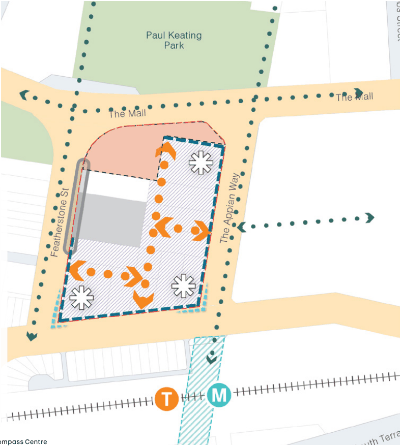

> [Picture on page 176: a picture, saved as a picture (images/ch-06-02-bankstown-city-centre-page-176-38.gif, 150 dpi).]

### 6.4   KS4 - Compass Centre

#### Design principles

a) Provide a high quality architectural designed development that acts as the key northern ‘entrance’ to the Bankstown City Centre for people using the Bankstown Railway Station and Metro Station.

b) Maintain or increase the employment capacity of the existing site.

c) Explore opportunities to increase publicly accessible open space.

d) Retain or improve daylight access to open spaces.

e) Enhance and maximise active transport options to and from the site, connecting the site to Bankstown Train Station and city centre.

f) Activate and invigorate street frontages, expanding fine-grain development and employment floor space within Bankstown City Centre.

g) Consider the block’s redevelopment holistically and how the redevelopment will respect the adjoining redevelopment of the Bankstown Central shopping centre site at ground level and podium level.

Image - Sol Square, Christchurch, NZ

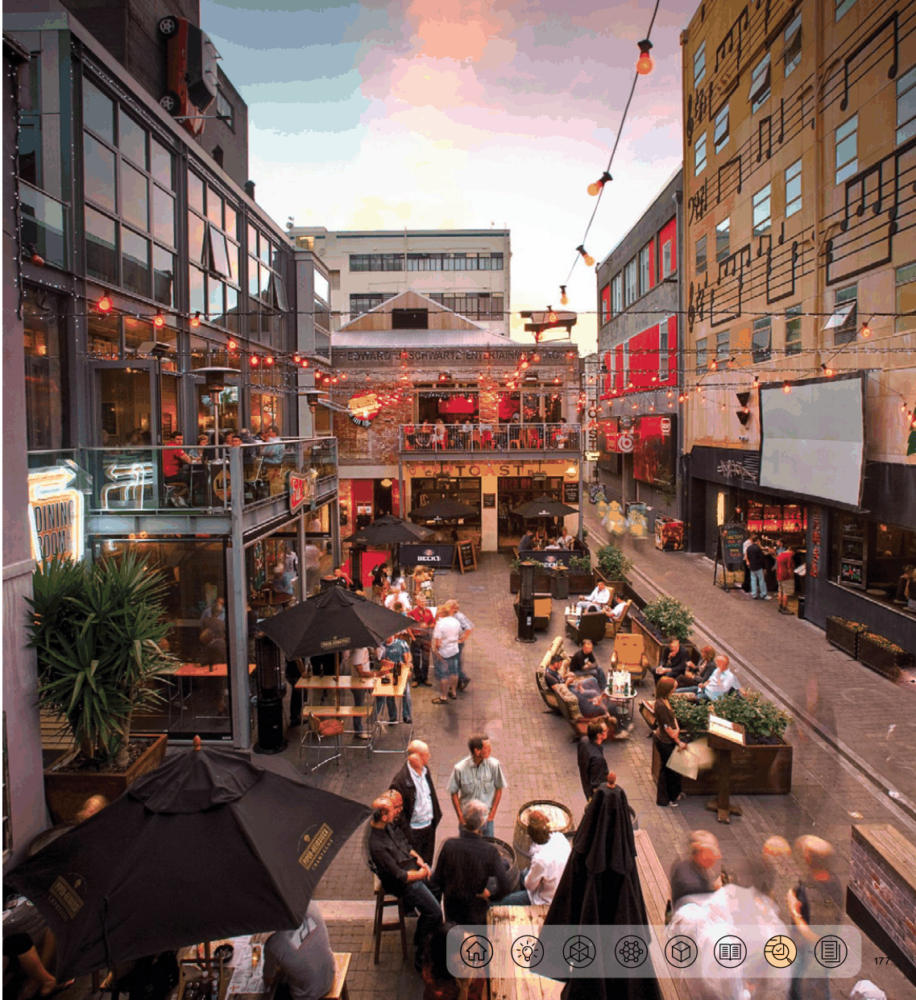

> [Picture on page 177: a picture, saved as a picture (images/ch-06-02-bankstown-city-centre-page-177-28.gif, 150 dpi).]

### 6.5	 KS5 - Bankstown Sports Club

Southern extent of The Avenue proposed in Bankstown Master Plan, which aims to create a pedestrian oriented shared boulevard that connects Bankstown Sports to Western Sydney University.

#### Design principles

a) Maintain or increase the employment capacity of the existing site.

b) Retain or improve daylight access to open spaces.

c) Achieve Design Excellence.

d) Enhance and maximise active transport options to and from the site, connecting the site to Bankstown Train Station and city centre.

e) Activate and invigorate street frontages, expanding fine-grain development and employment floor space within Bankstown City Centre.

f) Explore opportunities to include through site links to connect the site to Bankstown City Centre.

g) Any servicing and loading must not negatively impact upon the safety and amenity of school aged children at the adjoining primary school as they go to and from school via McDonald Lane.

Legend

Key site boundary

Fine grain frontages

Active frontages

Landmark built form

Solar access to open space

(see section 3.4.2)

Pedestrian through site link

Enhanced existing through

site link

Proposed through site link to

park precinct

Key bus route, active

transport and pedestrian

connection

Servicing and loading

Schools

Open space

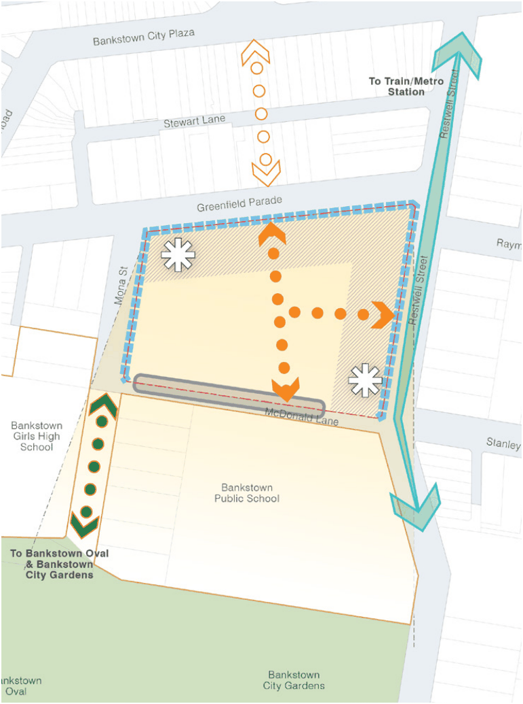

> [Picture on page 178: a picture, saved as a picture (images/ch-06-02-bankstown-city-centre-page-178-47.gif, 150 dpi).]

Figure 75.	 Design Principles - KS5. Bankstown Sports Club

### 6.6	 KS6 - South Terrace and future public

#### park and plaza

Bankstown City Centre Area identified in the Master Plan as a key site for a potential new plaza, due to its proximity to the train and metro stations, and central location.

#### Design principles

a) Explore opportunities to increase publicly accessible open space.

b) Retain or improve daylight access to open spaces.

c) Achieve Design Excellence.

d) Enhance and maximise active transport options to and from the site, connecting the site to Bankstown Train Station and city centre.

e) Activate and invigorate street frontages, expanding fine-grain development and employment floor space within Bankstown City Centre.

Legend

Key site boundary

Fine grain frontages

Active frontages

Landmark built form

Potential new public plaza (location subject to detailed master planning and further testing)

Solar access to potential new public plaza

Pedestrian through site link

Shared zone Key bus route, active transport and pedestrian connection to station and CBD

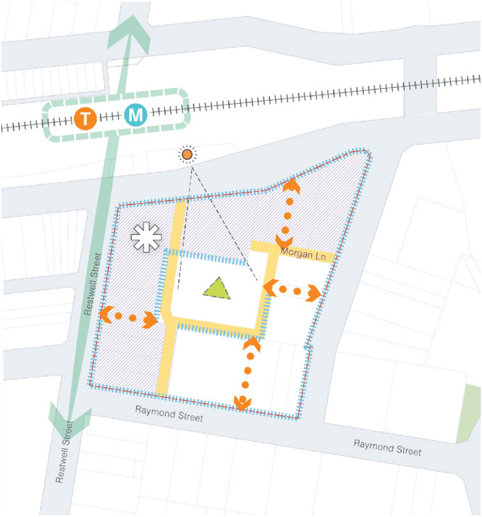

> [Picture on page 179: a picture, saved as a picture (images/ch-06-02-bankstown-city-centre-page-179-38.gif, 150 dpi).]

Figure 76.	 Design principles - KS6. South Terrace and future public plaza - subject to detailed master planning and further testing

### 6.7	 KS7 - 8-14 West Terrace

This site is east of the CBD Core, within the Cite Centre Area near Bankstown Sports Club and plaza suggested in Bankstown Master Plan. The site is an important transitional location between the City Centre and identified areas for High Density Living.

This site has been the subject of a review within the Bankstown Master Plan Site Specific Review Joint Panel (March 2022 Report). The recommendations from the Panel are included below.

#### Design principles

a) Explore opportunities to increase publicly accessible open space.

b) Retain or improve daylight access to open spaces.

c) Enhance and maximise active transport options to and from the site, connecting the site to Bankstown metro and train stations and city centre.

d) Provide a through-site link wholly on the subject site, and avoid a ‘central block’ park.

e) Improve streetscape presentation and active frontage by minimising the size of vehicle openings and, where possible, consolidating private vehicle and service vehicle access and incorporating these into the building architecture.

Queen Elizabeth II Courts of Law, Architectus (Source: Architectus)

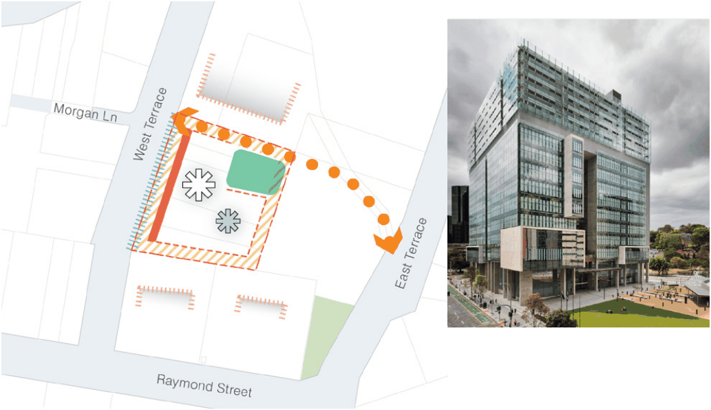

> [Picture on page 180: a picture, saved as a picture (images/ch-06-02-bankstown-city-centre-page-180-32.gif, 150 dpi).]

Legend

Key site boundary

Active frontages

4 storey street wall with 4m upper storey setback

6m front, side and rear setbacks

Publicly accessible open space

Figure 77.	 Design Principles - KS7. 8-14 West Terrace

Through site link

Staggered building heights

Built form transition - 4

storeys

Adjacent residential

apartment façades - consider

separation and visual privacy

Public open space

### 6.7   KS7 - 8-14 West Terrace

#### Design principles (continued)

f) Provide a 4m upper-level setback resulting in the main tower being 9m from the boundary.

g) Simplification of the tower into a single slab or bar building (refer to Figure 79) to resolve amenity issues associated with unit interface and configuration.

h) Introduce a lower height for the east wing to articulate the built form, reduce bulk and potential overshadowing of adjacent building and pocket park to south east. Refer to Figure 79.

i) Deep soil planting must achieve a minimum 7% of the site and will require some of the currently excavated site to be filled.

j) Combined residential and commercial foyers should be separated for improved safety and amenity.

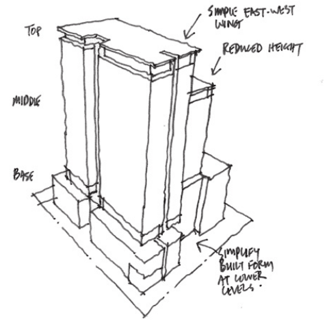

> [Picture on page 181: a picture, saved as a picture (images/ch-06-02-bankstown-city-centre-page-181-20.gif, 150 dpi).]

Figure 79.	 Axonometric view of built form to express base, middle and top (Source: Joint Panel Report Bankstown Master Plan Site Specific Review, March 2022)

> [Picture text on page 181 is stored in the PDF without readable letters (no character map), so it could not be copied; see the original PDF.]

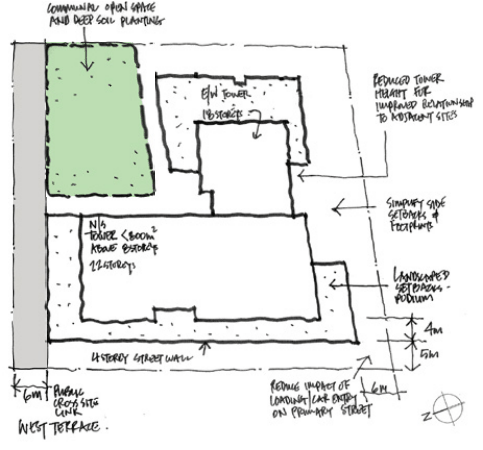

> [Picture on page 181: a picture, saved as a picture (images/ch-06-02-bankstown-city-centre-page-181-25.gif, 150 dpi).]
> [Picture text on page 181 is stored in the PDF without readable letters (no character map), so it could not be copied; see the original PDF.]

> [Picture on page 181: a picture, saved as a picture (images/ch-06-02-bankstown-city-centre-page-181-26.gif, 150 dpi).]
> [Picture text on page 181 is stored in the PDF without readable letters (no character map), so it could not be copied; see the original PDF.]
> Words printed on the picture (title and legend, copied from the PDF):
> Bankstown Master Plan Site Specific Review, March 2022)

Figure 78.	 Plan view of simplified building forms (Source: Joint Panel Report

### 6.8	 KS8- 212 South Terrace

The 212 South Terrace key site is situated at the eastern edge of the City Centre, at the corner of South Terrace and Stacey Street. Due to the site’s prominent location at the eastern approach into Bankstown, particularly by rail, new development on the site can contribute to defining the eastern gateway into Bankstown.

#### Design principles

a) Provide a new publicly accessible open space of approximately 1,000sqm fronting Stacey Street.

b) Provide a minimum 3m setback and landscape buffer to Stacey Street.

c) Provide a 2 storey street wall height and a 4 storey street wall height at the South Terrace and Stacey Street frontages, respectively.

d) Locate height at the corner of South Terrace and Stacey Street.

e) Consider the interfaces with the St Euphemia Greek Orthodox Church and College including setbacks and transition in built form height and scale.

f) Provide a through site link that enables pedestrian access from East Terrace, subject to amalgamation of 2 East Terrace with properties to the north, along South Terrace.

g) Locate vehicle access, servicing and loading from the existing slip lane on Stacey Street.

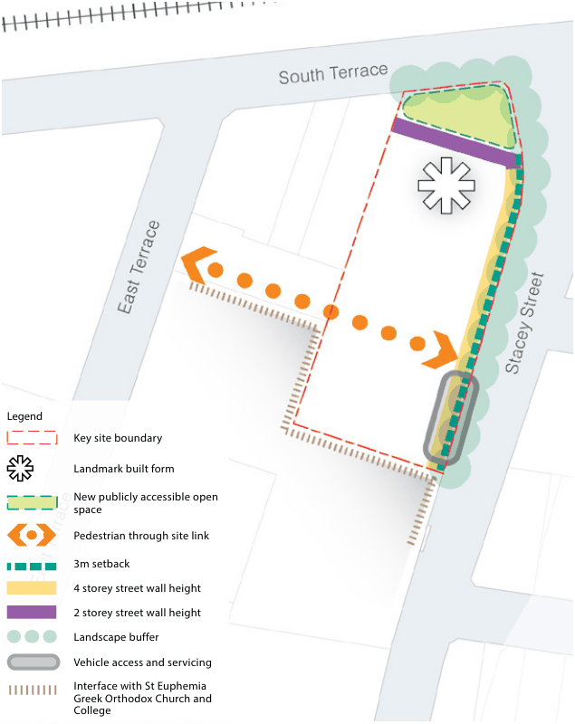

> [Picture on page 182: a map, saved as a picture (images/ch-06-02-bankstown-city-centre-page-182-31.gif, 150 dpi); the street names and other small labels are on the picture.]
> Words printed on the picture (title and legend, copied from the PDF):
> Key site boundary
> Landmark built form
> New publicly accessible open
> Pedestrian through site link
> 4 storey street wall height
> 2 storey street wall height
> Vehicle access and servicing
> Interface with St Euphemia
> Greek Orthodox Church and

Figure 80.	 Design principles - KS8. 212 South Terrace

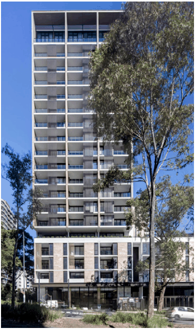

> [Picture on page 182: a picture, saved as a picture (images/ch-06-02-bankstown-city-centre-page-182-33.gif, 150 dpi).]

Example of slender marker tower with a defined street wall (Natura Apartments, Waterloo. Source: Architectus) Image - Natura, Architectus (Source: Brett Boardman)

### 6.9	 KS9 - Bankstown Central

The provisions of this section of the DCP will apply to development of the Bankstown Central as shown in Figure 81 and will prevail where there are any inconsistencies with other parts of the CBDCP

2023\. The site figures and maps are indicative and subject to the lodgement of a Development Application.

#### Development Contributions and Planning Agreements

Development Applications submitted on the site must refer to, and incorporate where relevant, specific items detailed in any Planning Agreement that applies to the site such as delivery of certain public infrastructure, works and/or monetary contributions by the land owner during the staged delivery of the Site’s redevelopment.

#### General objectives

O1. 	 To deliver the growth and evolution of Bankstown as a Strategic Centre and a Health, Academic, Research and Training Precinct, as identified in The Greater Sydney Region Plan – A Metropolis of Three Cities (March 2018), The South District Plan (March 2018), the Greater Cities Commission Bankstown CBD and Bankstown Airport Place Strategy, Council’s Local Strategic Planning Statement – Connective City 2036, and the Bankstown City Centre Master Plan.

Image - Visualisation of Bankstown Central (Source: Vicinity)

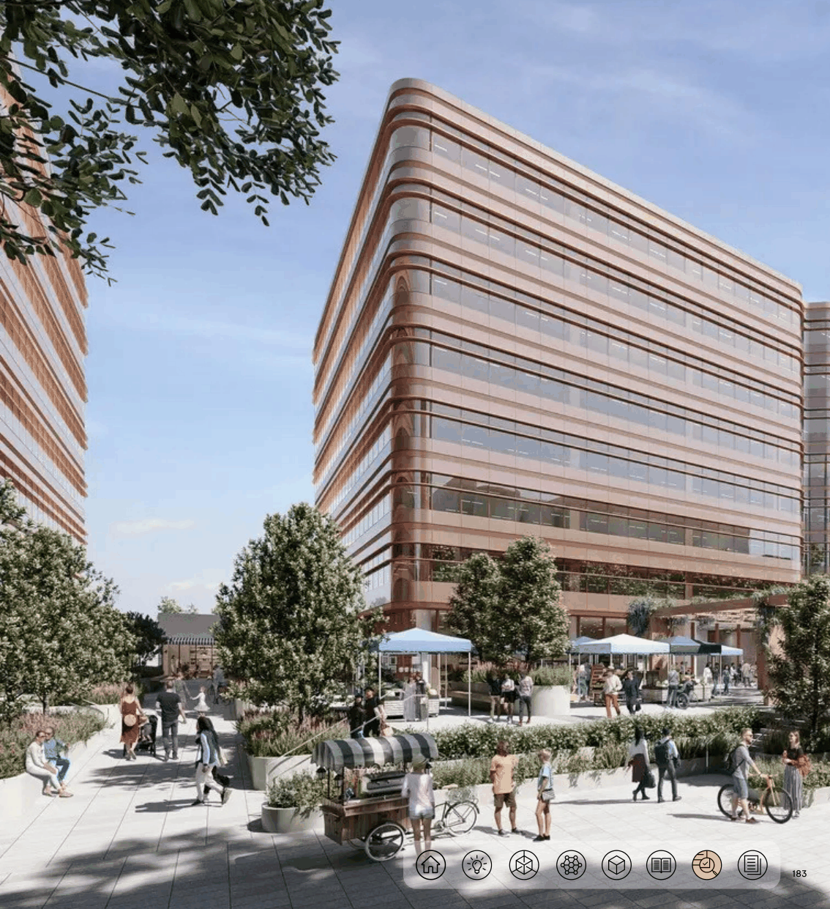

> [Picture on page 183: a picture, saved as a picture (images/ch-06-02-bankstown-city-centre-page-183-31.gif, 150 dpi).]

### 6.9   KS9 - Bankstown Central

O2. 	 To expand the role of Bankstown Central into a truly mixed-use centre, supporting employment growth and increased commercial office floor space as well as a greater diversity of uses, with potential to include residential accommodation, student housing, serviced apartments, hotels, medical and child-care uses, whilst continuing its function as a regional shopping centre. O3. 	 To ensure that future development responds to the characteristics of the Site and surrounding context to facilitate high quality urban design of new parks, spaces, streets and laneways for people to enjoy and achieve the desired future character and key principles for the Site and Precincts. O4. 	 To ensure for high quality publicly accessible open spaces, streets and laneways within the site and ensure for shading and shelter, landscaping and solar access. O5. 	 To allow enough flexibility for the provision of future uses to respond to changing market requirements over time and to allow the Site to be developed as individual precincts that also respond to the intent of the Indicative Structure Plan at Figure 81 of this DCP. O6. 	 To take advantage of the proximity of existing and future public transport access to the site including the future Sydney Metro, as well as the emerging health and education uses being developed in proximity to the site.

Image - Visualisation of Bankstown Central (Source: Vicinity)

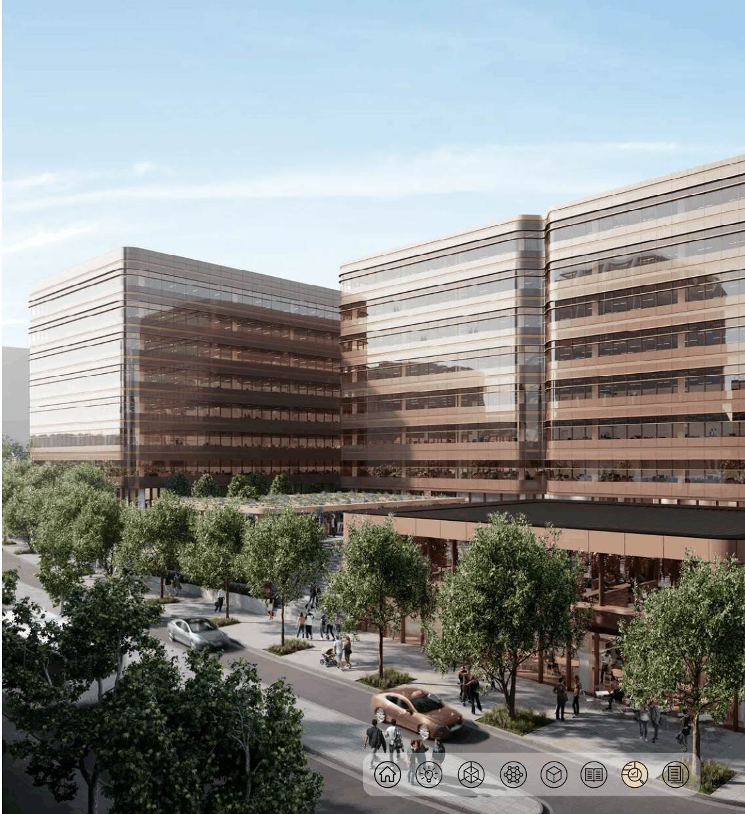

> [Picture on page 184: a picture, saved as a picture (images/ch-06-02-bankstown-city-centre-page-184-36.gif, 150 dpi).]

### 6.9   KS9 - Bankstown Central

O7. 	 To provide new open spaces and green connections for the current and future residents, workers and visitor community, along with enhanced integration from the Site with the public domain of the Bankstown City Centre. O8. 	 Enable delivery of the Jacobs Street extension as a new bus interchange in accordance with TfNSW bus operational requirements and Council’s public domain requirements.

Image - Visualisation of Bankstown Central (Source: Vicinity)

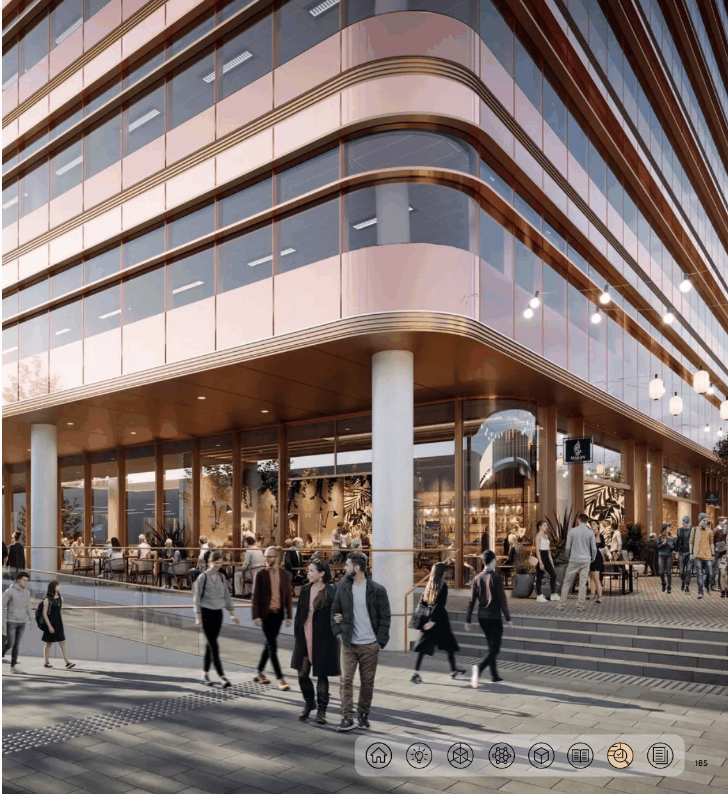

> [Picture on page 185: a picture, saved as a picture (images/ch-06-02-bankstown-city-centre-page-185-14.gif, 150 dpi).]

### 6.9   KS9 - Bankstown Central

#### 6.9.1   Precinct plans

#### Development involving the retained shopping centre building Controls

C1. 	 The dark shaded area identified in Figure

81 indicates the retained shopping centre

building. The centre is not proposed to be

redeveloped and was not envisaged to be

redeveloped as part of the amendment

to the LEP.

C2. 	 Any future development of the retained

shopping centre building should give

regard to the long term structure plan set

by this section of the DCP particularly

in terms of the indicative through site

links, the interface with new or proposed

development, activation and car park

upgrades.

C3. 	 Any future redevelopment of the retained

shopping centre, not related to the

ongoing operation of the shopping centre

and located within the shopping centre

footprint, requires preparation of new

development objectives and controls

through an amendment of this section of

the DCP and/or lodgement of a Concept

Development Application.

C4. 	 Development interfacing with the retained

shopping centre will need to have regard

to the operational requirements of the

shopping centre so to ensure its ongoing

function.

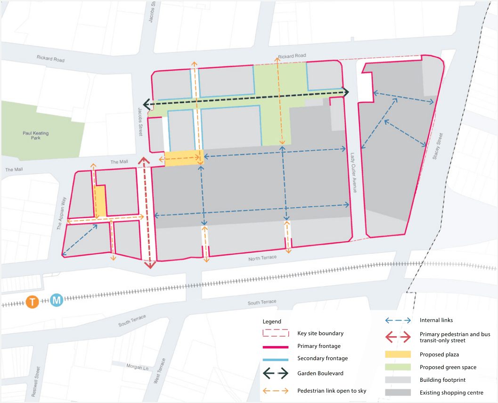

> [Picture on page 186: a map, saved as a picture (images/ch-06-02-bankstown-city-centre-page-186-34.gif, 150 dpi); the street names and other small labels are on the picture.]
> Words printed on the picture (title and legend, copied from the PDF):
> Key site boundary
> Pedestrian link open to sky
> Primary pedestrian and bus
> Proposed green space
> Existing shopping centre

Figure 81.	 Bankstown Central - structure plan

Carmen Street

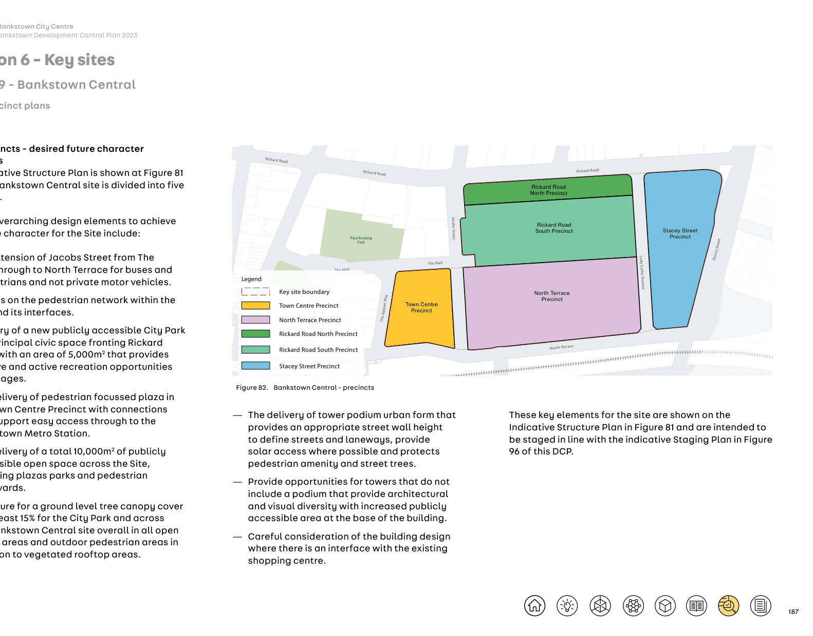

> [Picture on page 187: a map, saved as a picture (images/ch-06-02-bankstown-city-centre-page-187-2.gif, 150 dpi); the street names and other small labels are on the picture.]
> Words printed on the picture (title and legend, copied from the PDF):
> Site and its interfaces.
> Key site boundary
> Town Centre Precinct
> The Appian Way
> North Terrace Precinct
> Rickard Road North Precinct
> Rickard Road South Precinct
> Stacey Street Precinct
> Bankstown City Plaza
> Sir Joseph Banks Street
> Lady Cutler Avenue

Figure 82.	 Bankstown Central - precincts

### 6.9   KS9 - Bankstown Central

#### 6.9.1    Precinct plans

#### Site Precincts - desired future character principles

The Indicative Structure Plan is shown at Figure 81 and the Bankstown Central site is divided into five Precincts.

The key overarching design elements to achieve the future character for the Site include:

— The extension of Jacobs Street from The Mall through to North Terrace for buses and pedestrians and not private motor vehicles. — A focus on the pedestrian network within the

— Delivery of a new publicly accessible City Park and principal civic space fronting Rickard Road with an area of 5,000m2 that provides passive and active recreation opportunities for all ages.

— The delivery of pedestrian focussed plaza in the Town Centre Precinct with connections that support easy access through to the Bankstown Metro Station.

— The delivery of a total 10,000m2 of publicly accessible open space across the Site, including plazas parks and pedestrian boulevards.

— To ensure for a ground level tree canopy cover of at least 15% for the City Park and across the Bankstown Central site overall in all open space areas and outdoor pedestrian areas in addition to vegetated rooftop areas.

— The delivery of tower podium urban form that provides an appropriate street wall height to define streets and laneways, provide solar access where possible and protects pedestrian amenity and street trees. — Provide opportunities for towers that do not include a podium that provide architectural and visual diversity with increased publicly accessible area at the base of the building. — Careful consideration of the building design where there is an interface with the existing shopping centre.

ac

These key elements for the site are shown on the Indicative Structure Plan in Figure 81 and are intended to be staged in line with the indicative Staging Plan in Figure 96 of this DCP.

### 6.9   KS9 - Bankstown Central

#### 6.9.1    Precinct plans Town Centre Precinct

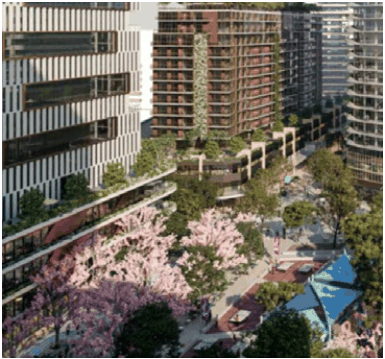

> [Picture on page 188: a picture, saved as a picture (images/ch-06-02-bankstown-city-centre-page-188-4.gif, 150 dpi).]

#### Desired Future Character Principles

a) Development is of a scale that is reflective of the location of this Precinct in the City Centre ‘core’ area and being adjacent to rail infrastructure.

b) Provides the ‘primary entry’ to the Bankstown City Centre and Bankstown Central site for residents, workers and visitors to Bankstown that arrive via the Sydney Metro, train station and buses.

c) The design of the precinct recognises the LEP requirement for minimum employment generating floor space.

d) Tall buildings with central precinct plaza with active uses at ground level, where possible.

e) Building separation and appropriate floor plate areas for each use, that minimise excessive visual building bulk to streets.

f) Carefully crafted and activated laneways, which can incorporate shelter and provision for seating and lighting. The interface for users with buildings is formed by quality materials and shopfronts that provide for various uses including but not limited to commercial, retail, restaurants and cafés.

g) Residential accommodation in the Precinct supports the long-term vision for Bankstown of providing accommodation for students and key workers, short-stay accommodation and hotels.

h) Enable delivery of the Jacobs Street extension as a new bus interchange in accordance with TfNSW bus operational requirements and Council’s public domain requirements. No vehicle access or loading entry driveways to the Town Centre Precinct are to be provided from Jacobs Street Extension which will be a bus-only link.

#### North Terrace Precinct

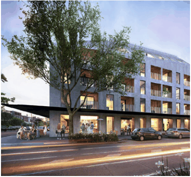

> [Picture on page 188: a picture, saved as a picture (images/ch-06-02-bankstown-city-centre-page-188-54.gif, 150 dpi).]

#### Desired Future Character Principles

a) Tall mixed use tower podium buildings with nil setback to streets and public spaces. Provide opportunities for towers that connect to the ground without a podium.

b) The existing shopping centre building is retained within the northern portion of the precinct and no development is proposed, other than that required to support the ongoing function and operation of the shopping centre and associated uses.

c) Towers that are spaced apart, and offset, if possible, that provide good access to an outlook, natural daylight and sunlight.

d) Building separation and appropriate floor plate areas for each use that minimise excessive visual building bulk to streets and controls down drafts to streets and ensures for solar access to building façades.

e) Allowance for north-south links as indicatively shown on the Indicative Structure Plan as the precinct is developed. Active edges are to be provided at ground level at the North Terrace entry points to these links.

f) Vehicular and loading entries, servicing and fire egress may be located on active edges where there are existing entries or where it is demonstrated their location will not negatively impede upon pedestrian movement and safety and will continue to prioritise good building design and streetscape outcomes.

g) Provide building design and materials that attenuate noise from the adjacent railway line.

h) Ensure that the design of buildings considers the interface with the existing shopping centre and the future for the precinct and buildings are designed ‘in the round’ (with designs giving regard to how the building is perceived from all sides).

i) No vehicle access or loading entry driveways to the Town Centre Precinct are to be provided from Jacobs Street extension – which will be a bus-only link.

### 6.9   KS9 - Bankstown Central

#### 6.9.1    Precinct plans Rickard Road North and Rickard Road

#### South Precincts

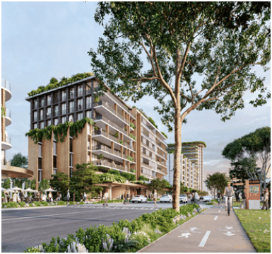

> [Picture on page 189: a picture, saved as a picture (images/ch-06-02-bankstown-city-centre-page-189-5.gif, 150 dpi).]

#### Desired Future Character Principles

a) Rickard Road North Precinct supports the transition of Rickard Road to be the key boulevard for the City Centre.

b) A new City Park of 5,000m2 addressing Rickard Road and shared by both precincts, which serves as the principal civic space for passive and active recreation for all ages for the site and for the city generally.

c) A new east-west Garden Boulevard that provides connectivity between Jacobs Street and Lady Cutler Avenue that is predominately open to the sky and has quality landscape design including mature trees, dense planting and uses low maintenance materials such as but not limited to, stone and face brickwork.

d) The Garden Boulevard provides a mix of passive recreation features such as seating, pods and ground level activity including potential for covered areas for food and beverage outdoor dining, stages and amphitheatres and the like to provide areas for social interaction and gathering.

e) Multiple pedestrian access points along Rickard Road that includes the consideration of the future shared pedestrian cycleway.

f) Residential focus to Rickard Road that considers the rear interface to the City Park and Garden Boulevard. Rickard Road South will have development that provides an edge to the boulevard and to the City Park.

g) A small urban plaza which is an extension to The Mall forms an entry point and link into the existing shopping centre from Jacobs Street in the Rickard Road South Precinct.

#### Stacey Street Precinct

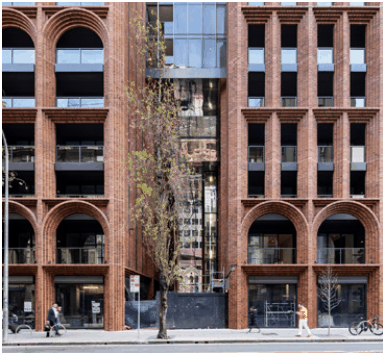

> [Picture on page 189: a picture, saved as a picture (images/ch-06-02-bankstown-city-centre-page-189-52.gif, 150 dpi).]

#### Desired Future Character Principles

a) Careful consideration of the interface with the existing shopping centre and the future development of the precinct.

b) New development will focus on enhancing the character of Lady Cutler Avenue to being more pedestrian friendly and activated with components of retail frontages, seating, shading and landscaping.

c) New development on Stacey Street will concentrate on attenuating noise, screening the street and providing landscaping.

d) Two new towers, one to be located on the north-eastern corner and another on the southern boundary of the Precinct, of high quality design, that act as key landmarks for the City Centre.

e) Provide quality low maintenance materials such as but not limited to granite, stone and face brick work, in all new development particularly at street level that will be appropriate to the precinct’s location along a major arterial road.

f) Provide building design and building materials that attenuate noise from the adjacent railway line and street traffic.

g) The Stacey Street Precinct must consider any future alterations to Stacey Street, including widening works and shared paths, because it is a State Road and any works require approval by Transport for NSW. Any new development in the Stacey Street Precinct should have no vehicular access to the Wattle Street and Stacey Street intersection.

### 6.9   KS9 - Bankstown Central

6\. 9.2  Publicly accessible space and public domain interface

Public space includes streets, squares, plazas, parks, through site links and laneways. These civic elements are key to developing a place that is enlivened, exciting and unique. Public spaces are the enduring elements of a city which people share as a social and cultural space.

Through site links for the Bankstown Central Key Site can include pedestrian links that are internal to a building. These links are lined with fine grain shops to activate edges, where feasible.

My

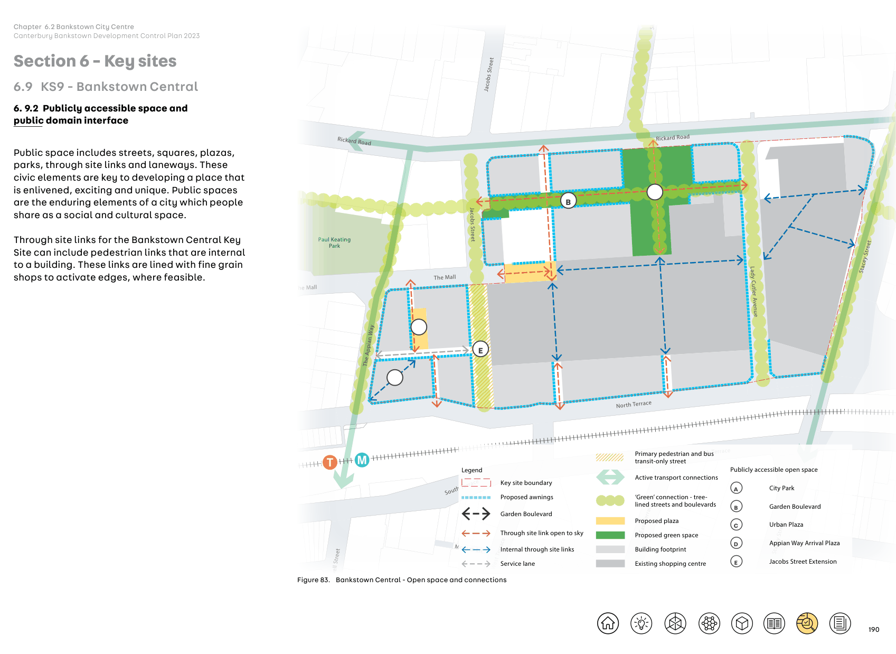

> [Picture on page 190: a map, saved as a picture (images/ch-06-02-bankstown-city-centre-page-190-15.gif, 150 dpi); the street names and other small labels are on the picture.]
> Words printed on the picture (title and legend, copied from the PDF):
> Bankstown City Plaza
> The Appian Way
> Key site boundary
> Through site link open to sky
> Internal through site links
> Sir Joseph B
> Lady Cutler Avenue
> Primary pedestrian and bus
> Publicly accessible open space
> Active transport connections
> A City Park
> ‘Green’ connection - tree-
> lined streets and boulevards
> B Garden Boulevard
> C Urban Plaza
> Proposed green space
> D Appian Way Arrival Plaza
> E Jacobs Street Extension
> Existing shopping centre

Figure 83.	 Bankstown Central - Open space and connections

### 6.9   KS9 - Bankstown Central

#### 6.9.2    Publicly accessible space and public

domain interface

#### Public domain and publicly accessible space

principles

#### Objectives

O1. 	 	Ensure pedestrian permeability within the site improves connectivity between the metro/train station and bus interchange. O2. 	 Ensure solar access to publicly accessible space is considered to ensure for amenity for occupants and the successful growth and survival of landscaping on the site and on adjoining land.

O3. 	 Ensure that public spaces are designed as equitable and safe with quality pedestrian amenity including lighting and, where appropriate, 24 hour accessibility. O4. 	 Ensure fine grained, pedestrian scaled lanes and links are provided throughout the site and seamlessly integrate with the public domain around the site.

O5. 	 Ensure any future Development Applications seek to accommodate modes of movement including such as electric vehicles, point-to-point vehicle services and car share services where feasible.

#### Controls

C1. 	 The future streets and pedestrian network are to be

consistent with Figure 83.

C2. 	 Publicly accessible spaces, including Jacobs Street

and the Jacobs Street extension site must integrate

the road reserve width agreed in the Bankstown Bus

Interchange Reference Design.

C3. 	 Provide a hierarchy of streets, pedestrian lanes,

through site links, share ways and service lanes

within the site as detailed in Figure 83.

C4. 	 Provide landscaping species appropriate to local

climate to ensure for visual amenity and mitigation

of urban heat island effect. Larger trees are to be

provided in deep soil of a minimum depth of 1.2

metres, in continuous tree trenches. Awnings and

similar are provided for shading, sun protection and

inclement weather as shown at Figure 83.

C5. 	 Vehicular movements, including servicing traffic

should be minimised by integrating service access

to precincts, where possible. Refer to Section 3

of this DCP.

C6. 	 Vehicular driveways and access points should be

minimised adjacent to key pedestrian entrances

to the site and along proposed shared streets

and/or zones.

C7. 	 Two trees should be planted for every one tree

removed from the site or from the surrounding

public domain. New trees should be a minimum 100

litre pot size and minimum 3 metres high.

### 6.9   KS9 - Bankstown Central

#### 6.9.2    Publicly accessible space and public

domain interface

#### Pedestrian links, through site links, shared lanes

and service lanes

#### Objectives

O1. 	 	Ensure pedestrians are encouraged to use all publicly accessible spaces through the placement of active frontages, awnings, trees, seating, lighting and the quality of materials to pavements, where appropriate. O2. 	 Design lanes that provide an intimate space to linger within a fine grain spatial network. O3. 	 Provide easy wayfinding to primary nodal points within the Bankstown City Centre including the Bankstown railway and Metro stations, the Civic Precinct including key locations in close proximity to Bankstown Central.

O4. 	 Encourage active frontages along lanes, shared lanes and service lanes, where appropriate, without compromising safety. O5. 	 New laneways should enhance the relationship between built form, open space, active street frontages, pedestrian paths and bicycle networks.

#### Controls

C1. 	 New lanes will be provided as indicatively shown in Figure 83 and reinforce pedestrian ‘desire lines’ to major destinations in the Site and the City Centre.

C2. 	 Any deviations from the indicative pedestrian connectivity layout in Figure 83 should demonstrate an equivalent or enhanced pedestrian connections and ensure good urban design outcomes in respect to pedestrian access, connectivity and convenience.

C3. 	 Lanes and connections within the Town Centre Precinct, North Terrace Precinct, The Garden Boulevard and Lady Cutler Avenue should, where possible, incorporate fine grained shop fronts typically 5-15m in width with active uses as shown on Figure 83 to engage pedestrians and promote diversity in public space.

C4. 	 Public space and laneways open to sky are to provide where appropriate 3m wide awnings as shown on Figure 83 relating to the frontage of the development being undertaken. Despite Figure 80, proposed awnings to Rickard Road and Lady Cutler Avenue are only required to the parts of buildings where:

a) 	 Shared or communal building entrances occur such as entrances to residential lobbies;

b) 	 Areas where outdoor dining is proposed linked with food and beverage premises; and

c) 	 Public pedestrian entrances to the existing shopping centre building.

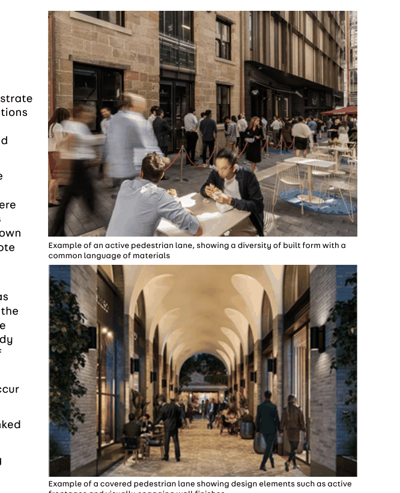

> [Picture on page 192: a picture, saved as a picture (images/ch-06-02-bankstown-city-centre-page-192-58.gif, 150 dpi).]
> Words printed on the picture (title and legend, copied from the PDF):
> Example of an active pedestrian lane, showing a diversity of built form with a
> common language of materials
> Example of a covered pedestrian lane showing design elements such as active

frontages and visually engaging wall finishes

### 6.9   KS9 - Bankstown Central

#### 6.9.2    Publicly accessible space and public

domain interface

#### Controls (continued)

C5. 	 As the North Terrace Precinct is developed, provision shall be made for north-south pedestrian lanes through to the entrance of the existing shopping centre as noted on the Indicative Structure Plan in Figure 81. This will form part of any future development application. These links will be:

a) 	 A minimum of 8m wide.

b) 	 Open to the sky from the North Terrace boundary to the existing shopping centre building.

c) 	 Allow for bridge links for pedestrians and/or vehicles to be constructed between the podiums subject to being:

i) 	 A minimum setback of 8m north of the North Terrace boundary for the eastern entrance, and

ii) 	 For the western entrance to have a minimum setback to North Terrace boundary which is to maintain the same setback alignment as the eastern entrance reflecting the angled boundary line along North Terrace. Refer to the dashed line marked A in Figure 84.

iii) 	Bridge link structures are to be a maximum 6.6m wide excluding structure.

C6. 	 Outdoor laneways, links and connections within the Town Centre Precinct and the Garden Boulevard will be open 24 hours a day, well-lit and adhere to the Crime Prevention Through Environmental Design (CPTED) principles.

C7. 	 New streets and lanes will integrate utilities and services underground, to facilitate tree planting.

C8. 	 Through site links not open to the sky are to generally adopt the principles outlined in following:

a) 	 Inclusion of fine grain shopfronts

b) 	 Warmth of finishes

c) 	 Consistent signage and internal lighting design, and

d) 	 Visibility to the end of laneways, where practical.

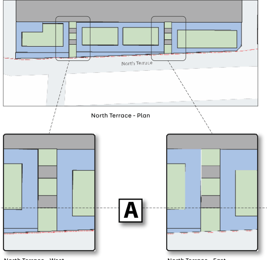

> [Picture on page 193: a picture, saved as a picture (images/ch-06-02-bankstown-city-centre-page-193-51.gif, 150 dpi).]
> Words printed on the picture (title and legend, copied from the PDF):
> North Terrace - Plan

### A

North Terrace - East

North Terrace - West

Figure 84.	 North Terrace pedestrian lane access points and vehicle/pedestrian bridge locations. Dashed line marked ‘A’ indicates the minimum setback for the southern edge of the vehicle/pedestrian bridges nearest to the North Terrace boundary which is set back the 8m setback of the eastern bridge

### 6.9   KS9 - Bankstown Central

#### 6.9.2    Publicly accessible space and public

domain interface

#### City Park, Garden Boulevard, Town Centre Urban

#### Plaza, open space and links Objectives

O1. 	 Ensure that the City Park, Garden Boulevard and Town Centre Precinct Urban Plaza are easily accessed by a network of pedestrian lanes and thoroughfares. O2. 	 Consider the needs for solar access and areas for shade to maximise amenity to public space during periods of the day they are most used for recreation. O3. 	 Provide tree planting appropriate to the local climate along the Garden Boulevard and within the City Park and open space areas.

O4. 	 Provide for recreational equipment, seating, landscaping, absorptive ground treatments and an integrated consistent materials palette for hard landscape. O5. 	 New landscaped elements will form a green grid between open spaces, providing tree canopy, reducing the heat island effect, and increasing pedestrian amenity as shown in Figure 82.

#### Controls

C1. 	 Consistent with Figure 83, new open space and pedestrian focussed elements will include the following:

a) 	 A total 10,000m2 of publicly accessible open space across the Site including plazas, parks and pedestrian boulevards, including:

i) 	 City Park of 5,000m2

ii) 	 Garden Boulevard

iii) 	Town Centre Urban Plaza

iv) 	The Appian Way Arrival Plaza, and

v) 	 Jacobs Street Extension.

C2. 	 Built form on the Bankstown Central site must provide that the City Park receives a minimum of 4 hours of direct sunlight to at least 50% of its area on the Winter Solstice (21 June) between 8am and 4pm. This is applicable to the entire City Park once completed. In calculating the area of direct sunlight, any shadows cast by development outside of the Bankstown Central site shall not reduce the area of direct sunlight cast on the City park, with only shadows cast by development within the Bankstown Central site to be considered in the calculation.

C3. 	 The City Park is to include a playground and other equipment and facilities for the use and enjoyment of all age groups. It is to be a predominantly green open space with areas of adequate soil depth and soil volume for medium size (8 – 12 metres high, 8 metres spread) trees.

C4. 	 Any proposed basement or underground structures under the City Park must make an allowance of minimum 1.0 metre depth and 35m3 volume to support the growth of medium (8 – 12metres high, 8 metres spread) trees. The surface level of the deep soil areas is to be generally the average ground level of the City Park. Soil volumes are to be confirmed by a qualified arborist based on the tree species and continuous tree trench at maturity.

C5. 	 Provide a minimum tree canopy cover of 15% at ground level for the City Park and communal and publicly accessible landscaped open space areas across the site.

C6. 	 The City Park is to provide a range of spaces that can sustain different scales of community gatherings and events for diverse ages and groups.

### 6.9   KS9 - Bankstown Central

#### 6.9.2    Publicly accessible space and public

domain interface

#### City Park, Garden Boulevard, Town Centre Urban

#### Plaza, open space and links Controls (continued)

C7. 	 The Garden Boulevard will have a minimum width of 15 metres and be located a minimum 35 metres from Rickard Road once all stages completed. C8. 	 The overhang of future adjacent buildings over The Garden Boulevard (other than awnings, signage, lighting, façade articulation and similar ancillary building features) is to be minimised. C9. 	 The Town Centre Urban Plaza must have a minimum area of 800m2 and minimum dimensions of 16 metres. C10. 	 The Town Centre Urban Plaza must provide a minimum of 1.5 hours direct sunlight to at least 160 m2 of its area on 21 June (Winter Solstice).  In calculating the area of direct sunlight, any shadows cast by development outside of the Bankstown Central site shall not reduce the area of direct sunlight cast on the Town Centre Urban Plaza, with only shadows cast by development within the Bankstown Central site to be considered in the calculation.

### 6.9   KS9 - Bankstown Central

#### 6.9.3   Building layout, form and design Visual diversity, articulation and fine grain

of buildings

#### Objectives

O1. 	 	Ensure tall buildings within the Town Centre and North Terrace precincts express a strong architectural response defined by a clearly identified concept or idea to create a sense of place.

O2. 	 Provide upper storey tower podiums to buildings to diversify the building envelope and amenity for workers.

O3. 	 Ensure that podiums are not overbearing in length and are articulated to appear as smaller parts to create a positive fine grained and varied experience at street level.

O4. 	 Ensure street blocks present as a group of buildings not a single building and the street is fine grained.

O5. 	 Maintain a diverse and interesting skyline through varying heights and/or roof form and/or tower design.

O6. 	 Ensure that building services are integrated into the building design and hidden from public view to provide a quality street interface.

#### Controls

C1. 	 Within long street blocks, such as along Rickard Road and the North Terrace, the street frontage is to be limited in length to 45m. Where a building podium exceeds this maximum length, it is to appear visually broken into two or more buildings using facade variation or physical separation. Refer to Figure 86. This outcome could be achieved through the following articulation design considerations (as shown in Figure 86) or through other alternative design considerations to the reasonable satisfaction of Council:

a) 	 Podiums measuring 45-70m in length are divided into two or more vertical sections.

b) 	 Podiums exceeding 70m in length are divided into at least three vertical sections.

c) 	 Vertical sections must be separated by indentations and emphasized by a noticeable change in both architectural expression and materiality. Additionally, there must be a variation in height by one or more storeys.

d) 	 The indentations between sections must be at least 10% of the total podium length and have a depth of 1.5m.

e) 	 In cases where there is a range in street wall height, prioritise the lower range along laneways, pedestrian links, and areas with high pedestrian activity.

C2. 	 Podiums can include an articulation zone, above ground level and on all sides of the podium structure that have an elevation directly to a public road or a publicly accessible lane or outdoor open space

area. The articulation zone is to be located entirely within the property and not encroach or overhang footpaths and other public owned land.

C3. 	 In accordance with the Active Street Frontages Map in Figure 91, glazed shopfronts of approximately 5m - 15m m should be provided to at least 30% of the internalised laneways within the Town Centre Precinct, the north south links in the North Terrace Precinct and the Garden Boulevard.

C4. 	 A shopfront tenancy that has the ability for two frontages must locate back of house activities away from these frontages. C5. 	 Vary the visual appearance of buildings in a precinct as a response to use, context, environmental conditions, solar access and amenity. Ensure for a common language between buildings using predominantly natural building materials (excluding shopfront glazing) and finishes such as but not limited to stone and face brick albeit this requirement does not preclude elements of metal finishes and other cladding systems.

### 6.9   KS9 - Bankstown Central

#### 6.9.3   Building layout, form and design Visual diversity, articulation and fine grain

of buildings

#### Controls (continued)

C6. 	 Services must be addressed early in the design process to ensure they are integrated into building design or where necessary integrated into streetscapes. Substations should be underground or integrated within the design of the building footprint where these facilities can meet Ausgrid standards and to the extent possible due to authority constraints and design requirements. C7. 	 Where there are blank walls that interface with public open space and do not meet the active frontage requirements, landscaping and/or public art treatments are to be considered including green walls where conditions allow plants to flourish. C8. 	 The reinforced corners identified in Figure 90, if utilised, can either provide higher street walls or a tower with no setback to ground level.

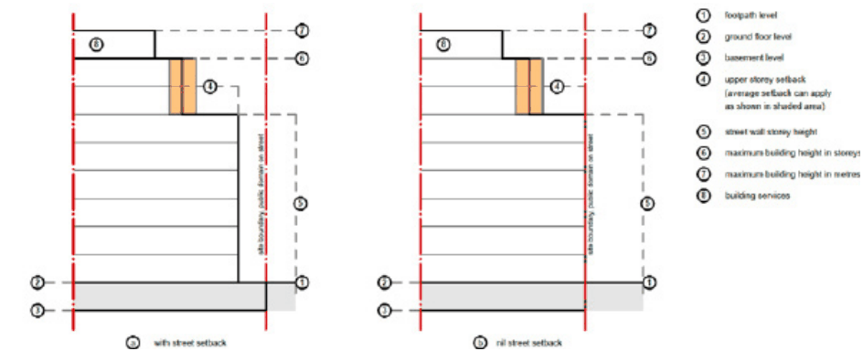

> [Picture on page 197: a picture, saved as a picture (images/ch-06-02-bankstown-city-centre-page-197-25.gif, 150 dpi).]

Figure 85.	 Built form controls – street wall and upper storey setback

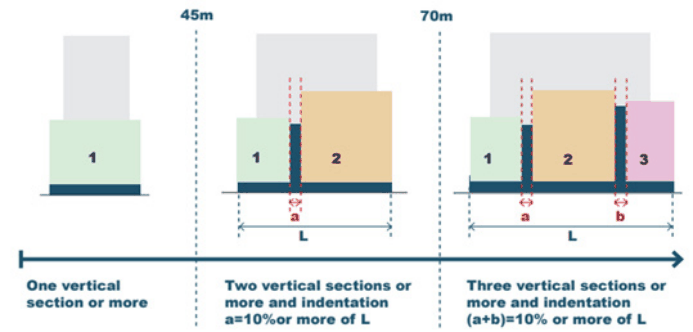

> [Picture on page 197: a picture, saved as a picture (images/ch-06-02-bankstown-city-centre-page-197-27.gif, 150 dpi).]

Figure 86.	 Potential  podium articulation design treatments to minimise overbearing visual impact created by long podiums

### 6.9   KS9 - Bankstown Central

#### 6.9.3    Building layout, form and design

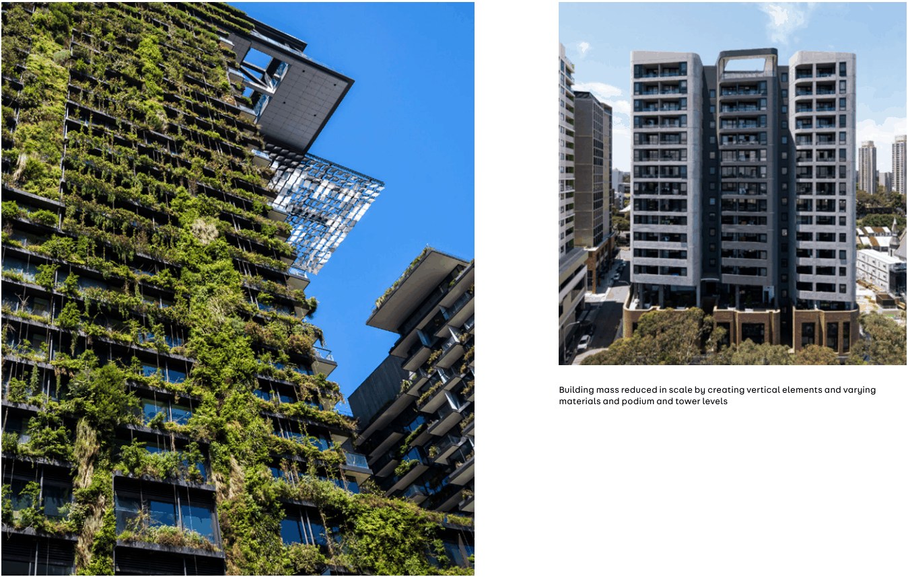

> [Picture on page 198: a picture, saved as a picture (images/ch-06-02-bankstown-city-centre-page-198-3.gif, 150 dpi).]

Example of green walls

Images

1- Central Park, Sydney, NSW (Source: Open Source)

Building mass reduced in scale by creating vertical elements and varying

materials and podium and tower levels

### 6.9   KS9 - Bankstown Central

#### 6.9.3    Building layout, form and design Street and upper storey setbacks Objectives

O1. 	 To ensure that each tall building is designed to be seen as a unified composition from all sides.

O2. 	 Ensure for appropriate upper storey setback to allow for the enjoyment of sun and daylight within internal streets and lanes. O3. 	 Provide an upper storey setback to ensure tall towers do not dominate the public domain and publicly accessible spaces. O4. 	 Ensure the Rickard Road North street setbacks provide for deep soil for large trees in tree trenches and planting. Where it is demonstrated within an arborist report there is not adequate space for the growth of large trees, street setbacks must provide deep soil for medium trees (8-12 metres high, 8 metre spread) and planting. O5. 	 Reinforce the spatial definition of lanes and publicly accessible spaces. O6. 	 Ensure for consistent street frontage along the street alignment.

O7. 	 Ensure towers are setback above street walls to reinforce the scale of streets, mitigate wind impacts on pedestrians, enable views to the sky and protect amenity in streets and public spaces. O8. 	 Avoid the appearance of a continuous wall of towers on North Terrace where a group of tall buildings appear as one mass.

#### Controls

C1. 	 	Buildings are to comply with the minimum setback requirements in Figure 87 and 89. C2. 	 The design of towers that interface directly with the Urban Plaza within the Town Centre Precinct is to:

a) 	 Allow for variable internal setbacks to respond to the building uses.

C3. 	 If no upper storey setbacks are proposed, the Development Application is to:

a) 	 Demonstrate how the design of the plaza provides good amenity at the ground level in terms of solar access, wind, and views of the sky,

b) 	 Include the use of awnings and building design elements such as colonnades or building recesses

c) 	 The lower levels of buildings facing the plaza are appropriately defined using building articulation that reflects the prevailing street wall height of surrounding buildings.

| Street frontage | Street setback | Upper storey setback |
|---|---|---|
| The | Nil | 3m |
| Appian Way |  |  |
| Rickard Road | 3m | 6m (non-residential) 3m (residential) |
| North Terrace | Nil | 3m (between The Appian Way and Jacobs Street extension) 6m |
| Jacobs Street | Nil | 4m (between The Mall and Rickard Road) 6m east (between The Mall and North Terrace) 3m west (between The Mall and North Terrace |
| The Mall | Nil | 3m |
| Lady | Nil | 3m |
| Cutler Avenue |  |  |

Figure 87.	 Street and upper storey setbacks

### 6.9   KS9 - Bankstown Central

#### 6.9.3    Building layout, form and design Street wall heights Objectives

O1. 	 To ensure that the visual relationship between the street and public spaces is reinforced

O2. 	 To ensure the design of street walls provide appropriate scale.

O3. 	 Adopt an appropriate variety of street wall heights throughout precincts to reinforce the fine grain of new laneways, through site links and internal spaces.

O4. 	 Create a vertical rhythm and visual interest to reduce the scale of building mass. O5. 	 Establish street walls that are appropriate to each precinct and to the context that surrounds them.

O6. 	 Ensure street planting and overshadowing is considered when using street walls. O7. 	 Allow tall buildings that do not include a podium and are built to the ground.

#### Controls

C1. 	 The street wall storey height of new development is to be consistent with Figure 88 and Figure 90.

C2. 	 Tall buildings are permitted to be built to the ground without a podium. Such towers are to provide visual and architectural variety, provide a physical break in a street block from the podium and tower typology and include an increased area of publicly accessible area at ground level at the base of the tower.

C3. 	 Any building services required on the roof that are visible at ground level from the opposite side of the street from each building elevation, must be appropriately screened with high quality treatments or setback from the building or parapet edge to minimise overshadowing and visibility.

| Street frontage | Street Wall Storey Height (min – max where applicable) |
|---|---|
| The Appian Way | 3-6 storeys |
| Rickard Road | 4-6 storeys |
| North Terrace | 3-6 storeys |
| Jacobs Street | 3-8 storeys (between The Mall and Rickard Road) 3-8 storeys (between The Mall and North Terrace) |
| The Mall | 3-6 storeys |
| Lady Cutler Avenue | 3-6 storeys |

Figure 88.	 Street wall heights

### 6.9   KS9 - Bankstown Central

#### 6.9.3    Building layout, form and design

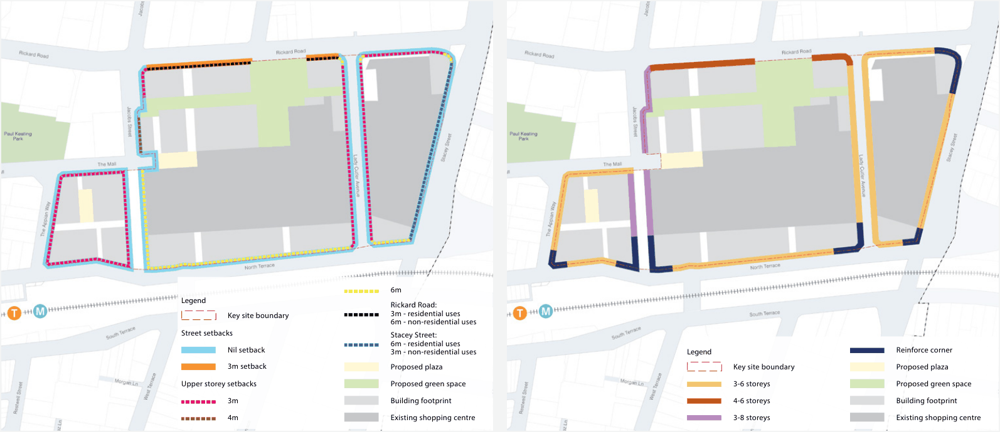

> [Picture on page 201: a map, saved as a picture (images/ch-06-02-bankstown-city-centre-page-201-3.gif, 150 dpi); the street names and other small labels are on the picture.]
> Words printed on the picture (title and legend, copied from the PDF):
> Key site boundary
> Upper storey setbacks
> 3m - residential uses
> 6m - non-residential uses
> 6m - residential uses
> 3m - non-residential uses
> Proposed green space
> Existing shopping centre

Figure 89.	 Bankstown Central - Street setbacks and upper storey setbacks

> Words printed on the picture (title and legend, copied from the PDF):
> Key site boundary
> Proposed green space
> Existing shopping centre

Figure 90.	 Bankstown Central - Street wall heights

### 6.9   KS9 - Bankstown Central

#### 6.9.3    Building layout, form and design Active street frontages Objectives

O1. 	 Ensure ground floor frontages are pedestrian oriented and of high quality to add vitality to streets.

O2. 	 Provide ground floor shop frontages along streets and lanes, where possible O3. 	 Provide a mix of shopfront sizes that provide views into and out of the shop. O4. 	 Ensure vehicular access and servicing entrances are minimised and integrated within precincts, where possible. O5. 	 Ensure vehicle entries are located away from key pedestrian areas, where possible. O6. 	 Ensure that building services do not dominate the pedestrian experience and are designed as an integrated part of the building design, to the extent possible due to authority constraints and authority design requirements.

#### Controls

C1. 	 Active frontages are to be provided in accordance with the Active Street Frontage Map (refer to Figure 91). Note, ‘Active frontages’ has the same meaning as in Chapter 7 Section 2 of the CBDCP 2023 (page 5).

C2. 	 At least 50% of active primary frontages of the building elevation at ground level, as defined in the Active Street Frontage Map at Figure 91, are to be activated by lobbies, entries, and retail/commercial uses with display windows or shopfronts where retail premises are proposed. This percentage includes shopfronts required under Control

C3 Section 4.1.

C3. 	 If a variation is sought to the Active Frontage Map, the first Development Application for each precinct must include an indicative plan illustrating how the precinct may be able to comply with the above control C2. C4. 	 In the event the major tenant (Kmart) that occupies the part of the existing shopping centre building that is located along the southern side of the garden boulevard vacates, relocates or substantially reduces its footprint, the northern and eastern sides of the external façade of the tenancy should be activated through shop fronts if practicable, outdoor dining, or visually treated through the use of public art, green walls or façade articulation. Refer to the ‘Possible active frontage’ in Figure 91. C5. 	 Minimise blank walls without doors or windows and integrate any services into the building form and architecture, to the extent possible due to authority constraints and authority design requirements

C6. 	 The external shopping centre walls above ground level that have a direct interface with the City Park must be treated with façade articulation or public art, or a combination of both, and include ground level activation such as shopfronts and outdoor dining, where possible.

C7. 	 Active frontages are to be designed at the same level as the footpath subject to flooding requirements and accessibility considerations.

C8. 	 Where elevated ground floor tenancies above public spaces are required, a design solution should be based on the individual flood risk and site constraints for that precinct. This approach must be integrated within all buildings interfacing with the public space to ensure for a coordinated ground floor level to provide for an active frontage.

C9. 	 Security grills may only be fitted internally behind the shopfront and are to be fully retractable.

C10. 	 Vehicle access is to be located away from key pedestrian areas and be from service lanes, where possible. In the event vehicle access is located within 5m of a pedestrian access point, the design of the vehicle and pedestrian access must ensure pedestrian safety is prioritised.

### 6.9   KS9 - Bankstown Central

#### 6.9.3    Building layout, form and design Active street frontages

#### Controls (continued)

C11. 	 Development that interfaces with Rickard Road, Lady Cutler Avenue and Stacey Street should assist in transforming these streets from being car dominated roads to attractive, pedestrian friendly, urban boulevards. C12. 	 Frontages within the site are to be activated by retail/commercial uses and provide views into tenancies from pedestrian footpaths and laneways and designed to minimise ‘back of house’ servicing areas and blank walls. C13. 	 Awnings are to be provided over the public and publicly accessible footways to active street frontages in accordance with Figure 52 that extend a minimum of 3m over the footway and be continuous with no gaps, to provide protection from the sun (at Summer Solstice), rain, and wind.

Legend Key site boundary

Proposed plaza

Active primary frontage

Proposed green space

Active internal frontage

Building footprint

Possible active frontage

Existing shopping centre

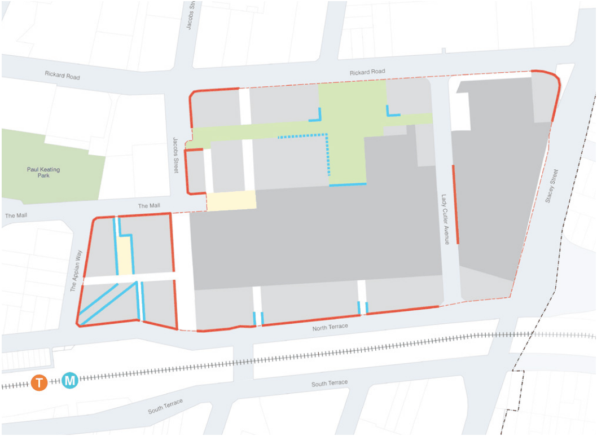

> [Picture on page 203: a picture, saved as a picture (images/ch-06-02-bankstown-city-centre-page-203-33.gif, 150 dpi).]

Figure 91.	 Bankstown Central - active street frontage

### 6.9   KS9 - Bankstown Central

#### 6.9.3    Building layout, form and design Residential and commercial public domain

interfaces – Rickard Road and new City Park

Residential interface – Rickard Road

#### Objectives

O1. 	 Ensure the privacy, safety and comfort of the occupants of ground floor units. O2. 	 Provide a positive contribution and activation to the public domain. O3. 	 Establish an adequate spatial and visual buffer along shared paths to enhance safety of cyclists and pedestrians. O4. 	 Consider flexibility for the potential future conversion of residential uses at lower floor levels into commercial spaces. O5. 	 Consider finer grain terrace house style dwellings at the lower ground levels of apartment buildings fronting to Rickard Road.

#### Controls

C1. 	 Apartments located on the ground floor must be designed to allow for walk-up maisonette style dwellings and must provide direct street access.

C2. 	 Ground flood apartments facing Rickard Road must locate the primary living space facing Rickard Road.

C3. 	 The ground floor level must be a minimum of 0.5m above the adjoining footpath level and have a ground floor ceiling height of at least 3.3m.

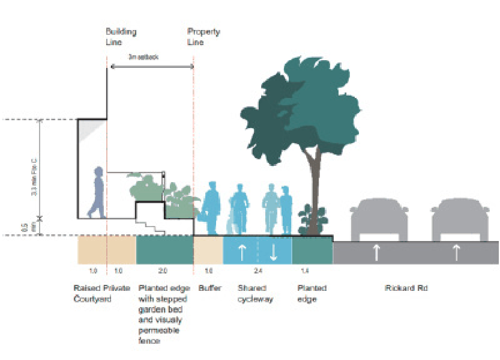

> [Picture on page 204: a picture, saved as a picture (images/ch-06-02-bankstown-city-centre-page-204-33.gif, 150 dpi).]

Figure 92.	 Indicative Ground floor level residential interface to Rickard Road

C4. 	 Entry stairs and/or fence doors must be

setback at least 1m away from the property

line to avoid conflict with pedestrians

and cyclists using the shared path along

Rickard Road.

C5. 	 Incorporate a 2m wide stepped planted

buffer within the 3m front setback (between

the building line and property line) from

Rickard Road. Refer to Figure 92.

### 6.9   KS9 - Bankstown Central

#### 6.9.3    Building layout, form and design

Residential and commercial interfaces – New City Park

#### Objectives

O1. 	 	Enhance amenity and encourage passive surveillance by optimising park views and require landscaping adjunct to ground floor dwellings within the new City Park. O2. 	 Encourage individual private residence access points along the length of the interface.

O3. 	 Foster activation of the public domain. O4. 	 Preserve the privacy and amenity of residential units.

O5. 	 Maximise activation and views from the ground level residential dwellings to the City Park.

O6. 	 Utilise landscaping to provide a green buffer within the new City Park along the interface with the future development.

#### Controls

C1. 	 	The ground floor level must be a minimum 0.5m above the adjoining City Park level and have a ground floor ceiling height of at least 3.3m.

C2. 	 A planted buffer of at least 3m wide located within the new City Park measured from the building line / City Park boundary must be provided where residential use interfaces with the City Park and which forms part of the minimum area of the City Park. Refer to

Figure 93 adjacent.

C3. 	 Where apartments have a direct frontage

to the new City Park, private access points

from the park to the ground floor dwellings

must be provided via pathways through the

landscaped planted buffer.

C4. 	 Commercial premises on the ground floor

and that have a frontage to the new City

Park must be readily accessed without use

of mechanical vertical transport for all users

from the adjoining open space or footpath.

C5. 	 Separation between residential and

commercial uses at the ground floor level

is to be provided to ensure good amenity,

acoustic and visual privacy for all occupants

of the building. The following must be

considered at the ground level at such

interfaces:

a) 	 Planter boxes and vegetation

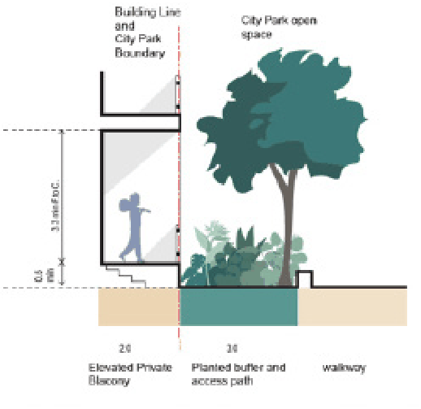

> [Picture on page 205: a picture, saved as a picture (images/ch-06-02-bankstown-city-centre-page-205-52.gif, 150 dpi).]

Figure 93.	 Indicative Ground floor level residential interface to new City Park

b) 	 Architectural features such as solid

screening and wall projections. The use

of retractable blinds or movable fabric or

similar screens must not be used.

c) 	 Physical separations such as foyers,

lobbies and other trafficable areas or

access points for residents to enter the

### 6.9   KS9 - Bankstown Central

#### 6.9.4  Transport and parking Car and bicycle parking Objectives

O1. Car parking provision across the site will adopt a maximum parking rate as opposed to a minimum car parking rate to reflect the ‘inner core CBD’ location with part of the Bankstown Central site being within 400m of Bankstown Railway Station and are consistent with the maximums in the Canterbury Bankstown DCP 2023.

O2. 	 Recognise the historical car parking provision has applied to the site and the existing car parking spaces can be retained as a ‘baseline’ provision. New development will be subject to the car parking rates in this section of the DCP, except where new development is replacing existing car parking required for the continued operation and viability of the shopping centre. O3. 	 New development on the site to consider a precinct-wide approach to carparking including where feasible, consolidated car parking facilities, shared car park entrances and consolidated/integrated basements, and car-share facilities.

O4. 	 Ensure car parking is designed to minimise adverse impacts on the public realm and to help create streets that are active, safe, comfortable and attractive. O5. 	 Consider the future adoption of above ground car parking for other uses over time.

#### Controls

C1. For all new developments, the car parking rates in Figure 94 will apply. C2. 	 Car parking provisions can be uncoupled from each specific use as long as overall provisions are within the allocations to provide for flexibility over time.

Note: Uncoupling car parking provisions may be implemented, for example, in the form of office car parking spaces converted to car parking spaces for retail uses outside of standard office business hours.

C3. 	 Above ground car parking to public facing streets, internal pedestrian links and publicly accessible open spaces must be sleeved with active uses, public art, green walls or screening.

C4. 	 The screening of the above ground parking that is not sleeved with active frontages must use high-quality facade treatments that allow natural ventilation but minimise visibility of cars from public spaces

C5. 	 Proposals must demonstrate how the layout and floor to ceiling height of above ground car parking can be adapted in the future for alternative uses.

C6. 	 To facilitate adaptation of car parking to other uses in the long term, above ground car parking is to remain as part of the common property and not part of, or attached to,

individual strata units.

C7. Bicycle parking is to be in accordance with the parking rates in Figure 95.

C8. 	 Bicycle parking must be located wholly within private land.

C9. 	 The first Development Application for redevelopment of each Precinct must include:

a) 	 A Car Park Access and Servicing Strategy that is informed by development staging and minimises/consolidates where possible, vehicle access points along Stacey Street, Jacobs Street, Lady Cutler Drive, The Mall and North Terrace as each

### 6.9   KS9 - Bankstown Central

#### 6.9.4  Transport and parking Car and bicycle parking Controls (continued)

location applies to the works associated with the Development Application, and

b) 	 An updated Travel Demand Management Plan (TDMP) that aligns with and builds upon the original TDMP lodged for the wider precinct. It must include  a range of development responses to proactively encourage walking, cycling and public transport use to minimise the traffic generating impact of the redevelopment of the site. The TDMP is to include details of how Development Applications on the site address the following:

i) 	 Improving pedestrian and active transport connections to the interim bus interchange, future permanent bus interchange, railway station and future metro station, and neighbouring land uses;

ii) 	 Measures to promote and accommodate increased bus patronage given the large number of additional trips forecast on the public transport system (noting the railway line will not serve all travel movements/ directions of travel); and

iii) 	 How loading/unloading and service

vehicles will access the site without significant safety and amenity impacts in areas of higher pedestrian/cyclist activity.

Note: A mechanism to review the TDMP at the Development Application stage of the next building in a Precinct is to identify whether the objectives

| Land Use | Size/ Description | Minimum parking provision | Maximum car parking provision |
|---|---|---|---|
| Residential | Studio | Zero | 0.5 Space per dwelling |
| Flat Building/ Build to Rent | 1 Bedroom 2 Bedrooms 3 Bedrooms Visitor | Zero Zero Zero Zero | 0.5 Space per dwelling 1 Space per dwelling 1.5 Spaces per dwelling 1 Space per 10 dwellings |
| Office Premises | Office | Zero | 1.25 spaces per 100m2 for new additional retail premises Gross Floor Area |
| Existing uses | Retail, commercial | N/A | It is noted that the parking rates stipulated in this table |
| Refer to Section |  |  | do not apply to any existing |
| 5.2.1 of this |  |  | or approved commercial/ |
| chapter for retail |  |  | retail uses. For such uses, |
| car parking rates |  |  | a maximum cap of 3,500 |
| that apply to |  |  | applies. Any further parking |
| this site. |  |  | for new floor space may be in addition to this cap. |
| Education | Education | Zero | 1.5 spaces per 100m2 |
| Premises |  |  |  |
| All Other | N/A | Zero | Not defined |
| Land Uses |  |  |  |
| Other Land Uses |  |  |  |
| Serviced | N/A | Zero | 1 space per room |
| Apartment |  |  |  |
| Hotel | N/A | Zero | 0.5 space per room |
| Student | N/A | Zero | 0.33 space per bed |
| Accommodation |  |  |  |

Figure 94.	 Car parking requirements

### 6.9   KS9 - Bankstown Central

#### 6.9.4   Transport and parking

| Land Use | Size/ Description | Maximum car parking provision |
|---|---|---|
| Residential Flat Building/ | Studio |  |
| Build to Rent | 1 Bedroom |  |
|  | 2 Bedrooms | 1 secure bicycle space per 3 dwellings |
|  | 3 Bedrooms |  |
|  | Visitor | 1 visitor bicycle space per 15 dwellings |
| Shop top Housing/mixed | Shop | Residential flat building and |
| use buildings | Top Housing | commercial office / retail / business rates will apply to the relevant component of the development |
| Office Premises | Office | 1 secure bicycle space per 200m2 GFA 1 visitor bicycle space per 500m2 over 1000m2 GFA |
| Retail Premises | Retail | 1 secure bicycle space per 300m2 GFA |
| End-of-trip Facility Rates |  |  |
| Office Premises | Office | 1 staff shower for every 10 secure |
| Retail Premises | Retail | bicycle parking spaces required by this section of the DCP and associated |
| Figure 95. Bicycle parking and End of trip facility rates |  | change rooms. |

### 6.9   KS9 - Bankstown Central

#### 6.9.4   Transport and parking Service  vehicle access and loading Objectives

O1. 	 To facilitate, where feasible, the orderly servicing of the commercial premises and residential accommodation on the site without impacting on positive pedestrian focussed streetscape, urban design and public domain outcomes in and around the site.

O2. 	 To maintain a consolidated or centralised loading dock that will service the majority of the site, or group of loading docks for each precinct, which provides better urban outcomes from a traffic management and streetscape perspective, whilst enabling an efficient use of space for site servicing.

#### Controls

C1. 	 The appearance of service vehicle entries and areas must:

a) 	 Provide safe (well lit and free of concealment opportunities) and 24-hour access between car parking areas and building entries.

b) 	 Not be visible from an adjacent public open space.

c) 	 Screening with architectural treatments/artwork/green walls must be incorporated into the design where adjacent to a public open space.

d) 	 Set back or recessed entries from the main façade line.

e) 	 Avoid ‘black holes’ in the façade by providing security doors to car park entries, where appropriate.

C2. 	 All service vehicle areas and loading docks must be designed in accordance with Australian Standards AS2890.1, AS2890.2 and AS2890.6.

C3. 	 Individual developments at the Site will not be required to provide their own separate loading docks, however this can be provided where it is demonstrated in the Development Application to result in a better traffic management and servicing outcome for the site and street network.

#### Jacobs Street Extension Bus Interchange

requirements

#### Objectives

O1. 	 Provide the extension of Jacobs Street between The Mall and North Terrace that incorporates a sensitive place-based bus interchange that fits within the ‘Complete Streets’ design philosophy. O2. 	 Deliver a ‘people first’ designed street within a tree lined streetscape with space for street furniture, landscaping, pedestrians and mobility impaired users. O3. 	 Ensure Jacobs Street Extension works as an integral part of the main bus corridor through the Bankstown City Centre in terms of its operational functionality and performance for buses.

#### Controls

C1. 	 Drawings are to be submitted to Council and Transport for NSW for review prior to lodgement of a Development Application on the site that coordinates with the construction of the Jacobs Street extension. C2. 	 The width of the road reserve for the Jacobs Street Extension is 24.8 metres or as otherwise agreed as part of the reference design developed by Transport for NSW, Vicinity and Council.

C3. 	 The constructed Jacobs Street Extension is to be dedicated to Council.

C4. 	 The design of the new Jacobs Street extension and public domain, as well as new buildings along the new street, must provide a 15 metre radius bus turn from North Terrace eastbound into the Jacobs Street extension northbound, that does not conflict with a bus doing the simultaneous opposite direction turn.

C5. 	 Ensure that the design of buildings on the corner of Lady Cutler Avenue and North Terrace allow for the movement of buses and delivery of a roundabout as part of the Bankstown Bus Interchange.

### 6.9   KS9 - Bankstown Central

#### 6.9.5   Waste management

#### Objectives

O1. 	 To optimise waste collection logistics and to minimise truck movements to reduce traffic congestion, noise pollution, poor amenity, and environmental impact within the community.

O2. 	 To safeguard the visual amenity, safety, and functional integrity of shared laneways and servicing areas of the site. O3. 	 To enable food waste and garden organic (FOGO) waste collection servicing and align with Council’s commitment to fostering a circular economy.

#### Controls

C1. 	 The first development application for each

Precinct must include a Master Waste

Management Plan (WMP) that is provided

for Council’s Waste Planning and Strategy

Team review and approval detailing:

a) 	 An orderly and efficient designed

system for the collection of residential

and commercial waste and recycling

services for the entire precinct.

b) 	 Measures that will minimise waste

collection truck movements and reduce

carbon emissions.

c) 	 Separation of food and garden organic

waste at its source as required to

meet the NSW Environment Protection

Authority (EPA) FOGO mandatory

legislative requirements.

C2. 	 Waste collection must be limited away

from shared laneways as much as possible

during the operating hours of retail

premises, food and drink premises and other

commercial uses.

C3. 	 All waste collection must occur on site

and designed in accordance with the

Australian Standards 2890.2:2018 Off-street

Commercial Vehicle Facilities.

C4. 	 All new development must comply with

the requirements of the applicable Waste

Design for New Developments Guide.

### 6.9   KS9 - Bankstown Central

#### 6.9.6   Signage strategy and public art

#### Objectives

O1. 	 To ensure that signage is integrated and consistent within precincts to contribute to composition of the finer grain at ground level in the open spaces and lanes network. O2. 	 To ensure that public art is delivered across the site in an integrated and cohesive way, that acknowledges the indigenous history of the place and reflects the contemporary character and community of Bankstown.

#### 6.9.7 Controls

C1. 	 To ensure all signage is coordinated across the site, the Development Application that proposes the detailed design and construction of each building in each Precinct (for the applicable buildings subject to the DA) is to include a Preliminary Signage Strategy. The Preliminary Signage Strategy is to include:

a) 	 A plan showing the location of all signage zones

b) 	 Indicative locations for all building identification signage

c) 	 Under awning signage zones

d) 	 Wayfinding signage zones

e) 	 Details of illumination of signage

f) 	 Dynamic Signage

g) 	 Tenancy shopfront signage zones C2. 	 Public art is to be provided on the site with reference to the ‘Public Art Principles’ and indicative ‘Artwork Opportunities’ in the Draft Public Art Strategy produced by UAP dated September 2022, which may be updated from time to time with agreement of the Authority.

C3. 	 An update to the public art plan for each stage is to be submitted with the relevant Development Application. The plan is to provide details on how high quality public art in publicly accessible locations will contribute to the identity and amenity of the place and include:

a) 	 Project context

b) 	 Visioning

c) 	 Artwork typologies

d) 	 Examples of artwork (for that stage), and

e) 	 Indicative implementation plan including process, timeline and procurement.

### 6.9   KS9 - Bankstown Central

#### 6.9.7   Staging and implementation

#### Objectives

O1. 	 An indicative staging strategy is key to Bankstown Central’s urban renewal. The strategy must consider the land holding, the operation and lease expiries of the retail centre, the proposed infrastructure upgrades, and the local market conditions. O2. 	 The redevelopment of the site delivered in a

Street

Conway Road

RM Campbell

Reserve

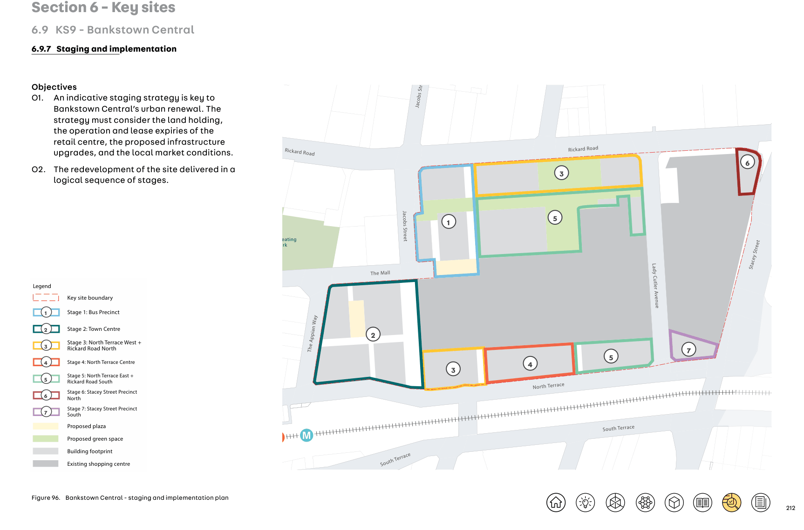

> [Picture on page 212: a map, saved as a picture (images/ch-06-02-bankstown-city-centre-page-212-16.gif, 150 dpi); the street names and other small labels are on the picture.]
> Words printed on the picture (title and legend, copied from the PDF):
> logical sequence of stages.
> Key site boundary
> 1 Stage 1: Bus Precinct
> 2 Stage 2: Town Centre
> Stage 3: North Terrace West +
> Rickard Road North
> The Appian Way
> 4 Stage 4: North Terrace Centre
> Stage 5: North Terrace East +
> Rickard Road South
> Stage 6: Stacey Street Precinct
> Stage 7: Stacey Street Precinct
> Proposed green space
> Existing shopping centre
> Bankstown City Plaza
> Sir Joseph Banks Street
> Lady Cutler Avenue

Figure 96.	 Bankstown Central - staging and implementation plan

Car

### 6.9   KS9 - Bankstown Central

#### 6.9.7   Staging and implementation

#### Controls

C1. 	 The indicative staging is indicated in Figure 96 and Figure 97, and `is subject to market forces and demand.

C2. 	 A staging plan is to be submitted with the first DA for new mixed-use development within the relevant Precinct. The staging plan is to include:

a) 	 Pedestrian movement

b) 	 Vehicle movement and car parking

c) 	 Publicly accessible open space (either permanent or temporary)

d) 	 Evidence of consultation with Transport for NSW regarding the design of Jacobs Street extension.

C3. 	 The delivery of public infrastructure and benefits in connection with any Planning Agreement that applies to the site is to be identified in the Staging Plan C4. 	 Prior to lodgement of a Development Application with Council (except for any Development Applications relating to the operation of the existing shopping centre) evidence of lodgement of a feasibility enquiry with Sydney Water via a Water Servicing Coordinator, including a Growth Forecast Form where relevant, should be provided to Council in connection to the proposed development site.

| Stage | Indicative timeframe |
|---|---|
| Stage 1: Bus Precinct | 2020-2026 |
| Stage 2: Town Centre | 2022-2029 |
| Stage 3: North Terrace West + Rickard | 2025-2031 |
| Road North |  |
| Stage 4: North Terrace Centre | 2030-2034 |
| Stage 5: North Terrace East + Rickard | 2032-2036 |
| Road South |  |
| Stage 6: Stacey Street Precinct North | 2034-2038 |
| Stage 7: Stacey Street Precinct South | 2036-2040 |

Figure 97.	 Indicative staging program for Bankstown Central (as of 2023)

### APPENDIX
