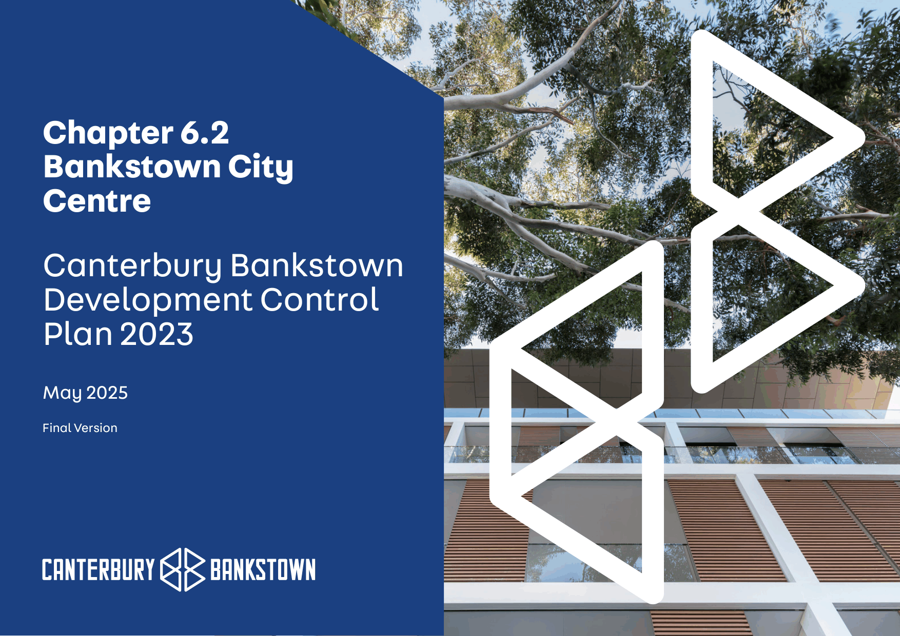
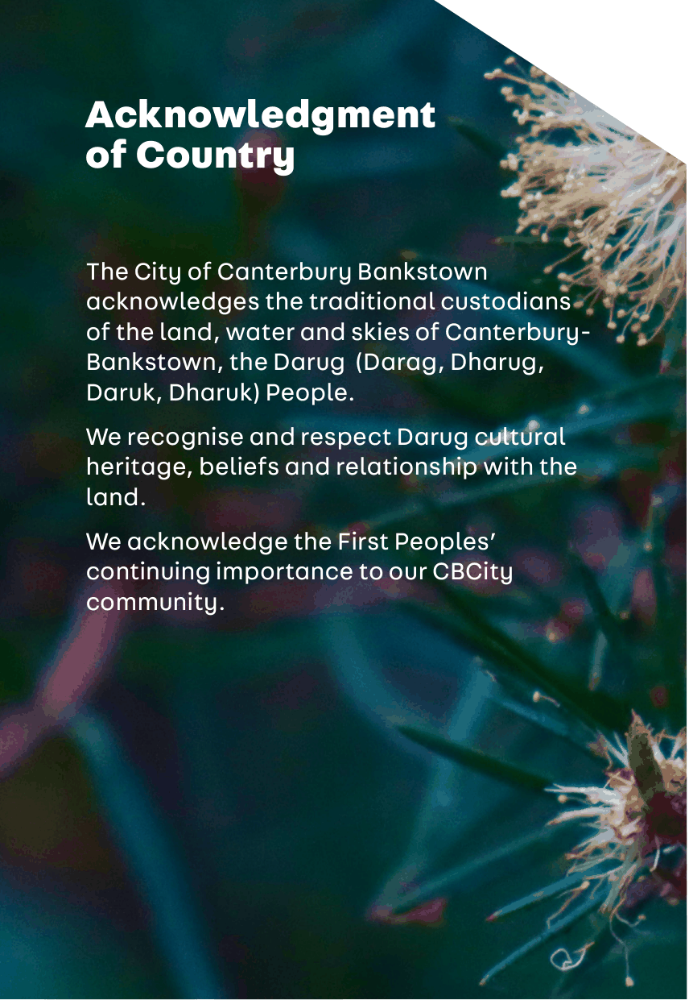
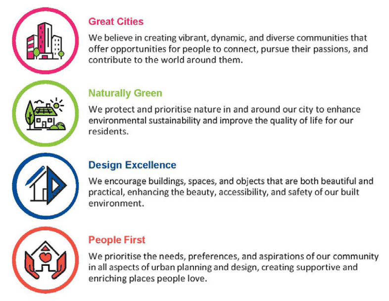
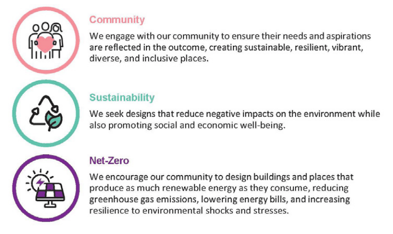
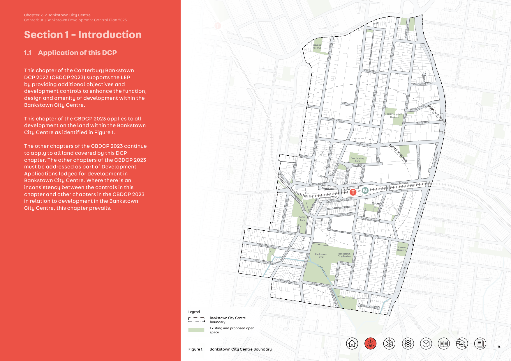

# Canterbury-Bankstown Development Control Plan 2023 - Chapter 6.2 Bankstown City Centre

> This chapter is split into 39 section file(s), one per numbered heading, in the order they appear in the PDF.

Source PDF: [2025.08.01 - DCP 2023 - AMENDMENT 8 - Chapter 6.2 - Bankstown City Centre.pdf](https://planfortomorrow.sharepoint.com/sites/Planfortomorrow/Shared%20Documents/00%20NSW-Planning-Resources/dcp/canterbury-bankstown-development-control-plan-2023/ch-06-02-bankstown-city-centre/2025.08.01%20-%20DCP%202023%20-%20AMENDMENT%208%20-%20Chapter%206.2%20-%20Bankstown%20City%20Centre.pdf)

> [Picture on page 1: a picture, saved as a picture (images/ch-06-02-bankstown-city-centre-page-1-1.gif, 150 dpi).]

### Chapter 6.2

### Bankstown City

### Centre

### Canterbury Bankstown

### Development Control

### Plan 2023

### May 2025

#### Final Version

> [Picture on page 2: a picture, saved as a picture (images/ch-06-02-bankstown-city-centre-page-2-1.gif, 150 dpi).]

### Acknowledgment

### of Country

### The City of Canterbury Bankstown

### acknowledges the traditional custodians

### of the land, water and skies of Canterbury-

Bankstown, the Darug  (Darag, Dharug,

### Daruk, Dharuk) People. We recognise and respect Darug cultural

heritage, beliefs and relationship with the

### land. We acknowledge the First Peoples’

### continuing importance to our CBCity

### community.

### We’re committed to creating

### a liveable and loveable City

#### Great Cities

We believe in creating vibrant, dynamic, and diverse communities that offer opportunities for people to connect, pursue their passions, and contribute to the world around them.

#### Naturally Green

We protect and prioritise nature in and around our city to enhance environmental sustainability and improve the quality of life for our residents.

#### Design Excellence

We encourage buildings, spaces, and objects that are both beautiful and practical, enhancing the beauty, accessibility, and safety of our built environment.

#### People First

We prioritise the needs, preferences, and aspirations of our community in all aspects of urban planning and design, creating supportive and enriching places people love.

#### Community

We engage with our community to ensure their needs and aspirations are reflected in the outcome, creating sustainable, resilient, vibrant, diverse, and inclusive places.

#### Sustainability

We seek designs that reduce negative impacts on the environment while also promoting social and economic well-being.

#### Net-Zero

We encourage our community to design buildings and places that produce as much renewable energy as they consume, reducing greenhouse gas emissions, lowering energy bills, and increasing resilience to environmental shocks and stresses.

Explore the design for

### Bankstown City Centre DCP:

### Bankstown City Centre, along with other significant centres

### in the Canterbury-Bankstown Local Government Area, have

### an area specific Development Control Plan (DCP). This DCP

### contains the following parts:

### Understanding

### Introduction

### Place

### General Provisions

### Key Sites

### Built Form

### Designing the Public

### Domain

### Definitions

> The PDF's contents list (page numbers of the printed document) is not repeated here - see Sections below.

### Welcome to the City of Canterbury Bankstown

> [Picture on page 5: a picture, saved as a picture (images/ch-06-02-bankstown-city-centre-page-5-2.gif, 150 dpi).]

> [Picture on page 5: a picture, saved as a picture (images/ch-06-02-bankstown-city-centre-page-5-3.gif, 150 dpi).]

### SECTION

### INTRODUCTION

Visualisation of Bankstown City Centre  (Source: SJB)

> [Picture on page 8: a map, saved as a picture (images/ch-06-02-bankstown-city-centre-page-8-1.gif, 150 dpi); the street names and other small labels are on the picture.]
> Words printed on the picture (title and legend, copied from the PDF):
> way (Hume Highway
> Old Kent Road
> Sir Joseph Banks Street Myrtle Road alk
> Weigand Avenue Reynolds Avenue
> Rickard Road 40
> Prairie Vale Road
> Lady Cutler Avenue
> The Appian Way
> Bankstown City Plaza
> e Dale Parade
> Greenfield Parade Lopez Ln
> Winspeare Avenue Griffith
> Chapel Road P
> Leonard Street Percy Street
> Bankstown City Centre
> Road James Street
> Existing and proposed open

Figure 1. Bankstown City Centre Boundary

<!-- sections -->
## Sections

1. [1 - Introduction](01-introduction.md)
2. [2 - Understanding Place](02-understanding-place.md)
3. [24 hour activation](03-24-hour-activation.md)
4. [3 Expansion and views](04-3-expansion-and-views.md)
5. [3 Gathering and play](05-3-gathering-and-play.md)
6. [3 - Designing the public domain](06-3-designing-the-public-domain.md)
7. [4 - Built form](07-4-built-form.md)
8. [1 Amalgamate to](08-1-amalgamate-to.md)
9. [2 Appropriate](09-2-appropriate.md)
10. [3 Ensure amenity](10-3-ensure-amenity.md)
11. [4 Indicative envelope](11-4-indicative-envelope.md)
12. [3 Appropriate scale,](12-3-appropriate-scale.md)
13. [4 Activate podiums](13-4-activate-podiums.md)
14. [2 Views and privacy](14-2-views-and-privacy.md)
15. [3 Appropriate upper](15-3-appropriate-upper.md)
16. [1 Above 25m](16-1-above-25m.md)
17. [2 Slender towers  for](17-2-slender-towers-for.md)
18. [3 A-grade towers for](18-3-a-grade-towers-for.md)
19. [1 Deep soil and](19-1-deep-soil-and.md)
20. [2 Ground entrances](20-2-ground-entrances.md)
21. [3 Maisonette](21-3-maisonette.md)
22. [4 Servicing and](22-4-servicing-and.md)
23. [1 Balconies](23-1-balconies.md)
24. [4 Maisonette](24-4-maisonette.md)
25. [1 Sensory](25-1-sensory.md)
26. [3 Well defined](26-3-well-defined.md)
27. [1 Continuous](27-1-continuous.md)
28. [3 Modular shop fronts](28-3-modular-shop-fronts.md)
29. [4 Vehicle entries](29-4-vehicle-entries.md)
30. [1 Fine grain](30-1-fine-grain.md)
31. [2 Variety in](31-2-variety-in.md)
32. [3 Long podiums](32-3-long-podiums.md)
33. [4 Articulation](33-4-articulation.md)
34. [1 Sun and wind](34-1-sun-and-wind.md)
35. [2 Communal uses](35-2-communal-uses.md)
36. [3 Activate rooftops](36-3-activate-rooftops.md)
37. [5 - General provisions](37-5-general-provisions.md)
38. [6 - Key sites](38-6-key-sites.md)
39. [Appendix 1 - Definitions](39-appendix-1-definitions.md)
