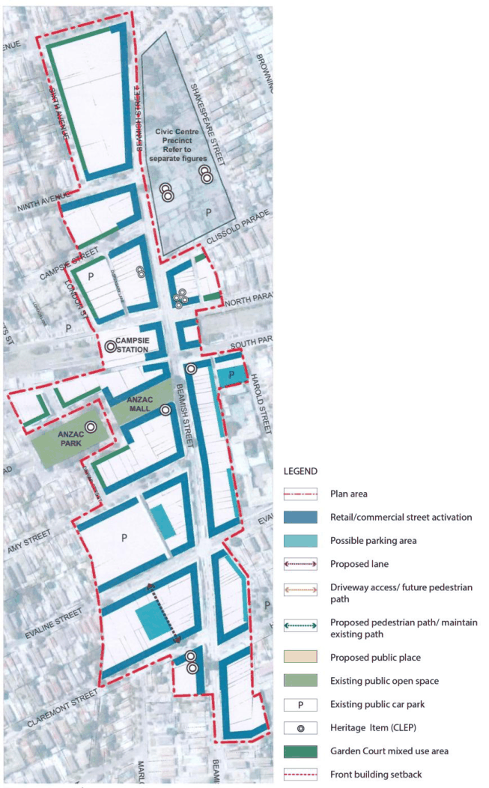
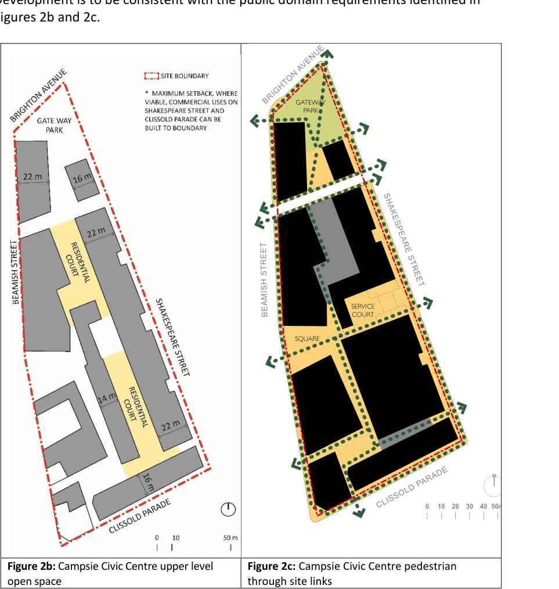

## SECTION 2–STRUCTURE PLAN

#### Objectives

O1 To improve the structure and function of the Campsie Town Centre.

#### Development controls

2.1 Development in the Campsie Town Centre is to be in accordance to the structure plan shown in Figure 2a. The structure plan contains controls in relation to parking, laneways, pedestrian pathways, retail/commercial activation locations and other matters.

> [Picture on page 5: a picture, saved as a picture (images/ch-06-03-campsie-town-centre-page-5-9.gif, 150 dpi).]

Figure 2a: Structure Plan

2.2 Development is to be consistent with the public domain requirements identified in

> [Picture on page 6: a picture, saved as a picture (images/ch-06-03-campsie-town-centre-page-6-2.gif, 150 dpi).]
> Words printed on the picture (title and legend, copied from the PDF):
> Figures 2b and 2c.
> open space
> through site links

Figure 2b: Campsie Civic Centre upper level

Figure 2c: Campsie Civic Centre pedestrian
